# 7 bước cycber kill chain

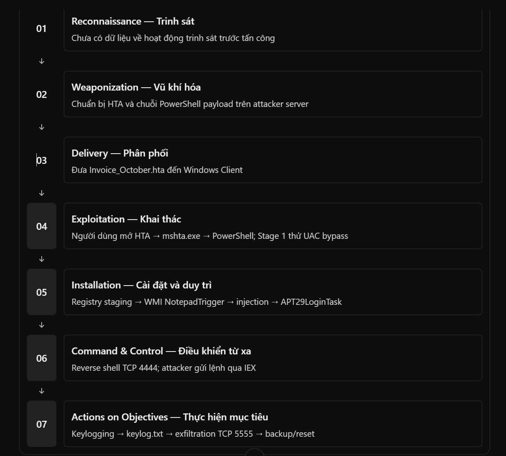

# thông tin máy ảo

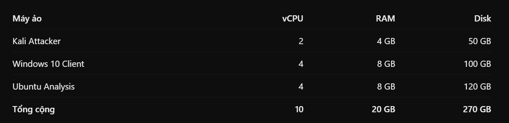

# các tool cần thiết

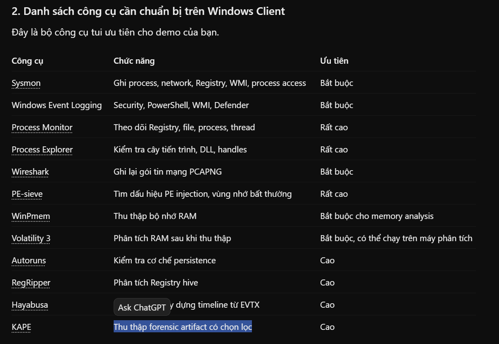

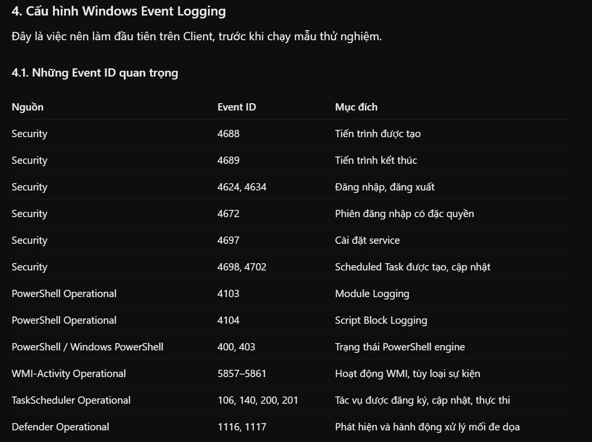

# CHUẨN BỊ CHO CLIENT

## 1. TẠO CẤU TRÚC THƯ MỤC DFIR

Mở `Windows PowerShell → Run as Administrator`.

```PS1
$dirs = @(
    "C:\DFIR",
    "C:\DFIR\Tools",
    "C:\DFIR\Config",
    "C:\DFIR\Scripts",
    "C:\DFIR\Evidence",
    "C:\DFIR\Evidence\EVTX",
    "C:\DFIR\Evidence\Registry",
    "C:\DFIR\Evidence\WMI",
    "C:\DFIR\Evidence\Tasks",
    "C:\DFIR\Evidence\Filesystem",
    "C:\DFIR\Evidence\Process",
    "C:\DFIR\Evidence\Memory",
    "C:\DFIR\Evidence\Network",
    "C:\DFIR\Evidence\Metadata"
)

foreach ($dir in $dirs) {
    New-Item -ItemType Directory -Path $dir -Force | Out-Null
}

Write-Host "DFIR directories created successfully." -ForegroundColor Green
```

<details>
<summary>Bấm vào đây để xem nội dung.</summary>

```PS1
# KIỂM TRA
Get-ChildItem C:\DFIR -Recurse -Directory |
    Select-Object FullName
# KIỂM TRA

PS C:\Windows\system32> Get-ChildItem C:\DFIR -Recurse -Directory |
>>     Select-Object FullName

FullName
--------
C:\DFIR\Config
C:\DFIR\Evidence
C:\DFIR\Scripts
C:\DFIR\Tools
C:\DFIR\Evidence\EVTX
C:\DFIR\Evidence\Filesystem
C:\DFIR\Evidence\Memory
C:\DFIR\Evidence\Metadata
C:\DFIR\Evidence\Network
C:\DFIR\Evidence\Process
C:\DFIR\Evidence\Registry
C:\DFIR\Evidence\Tasks
C:\DFIR\Evidence\WMI
```

</details>

## 2. CẤU HÌNH SYSMON

```PS1
New-Item -ItemType Directory -Path "C:\DFIR\Tools\Sysmon" -Force
```

GIẢI NÉN `1_Sysmon.zip` VÀ CHUYỂN TẤT CẢ FILE VÀO ĐƯỜNG DẪN TRÊN.

<details>
<summary>Bấm vào đây để xem nội dung.</summary>

```PS1
Get-ChildItem "C:\DFIR\Tools\Sysmon"

& "C:\DFIR\Tools\Sysmon\Sysmon64.exe" -?

Get-Service -Name Sysmon64,Sysmon -ErrorAction SilentlyContinue |
    Select-Object Name, Status, StartType
```

```PS1
PS C:\Windows\system32> Get-ChildItem "C:\DFIR\Tools\Sysmon"


    Directory: C:\DFIR\Tools\Sysmon


Mode                 LastWriteTime         Length Name
----                 -------------         ------ ----
-a----         9/10/2026   4:03 PM           7490 Eula.txt
-a----         9/10/2026   4:06 PM        6162240 Sysmon.exe
-a----         9/10/2026   4:06 PM        3203368 Sysmon64.exe
-a----         9/10/2026   4:06 PM        3138824 Sysmon64a.exe


PS C:\Windows\system32>
PS C:\Windows\system32> & "C:\DFIR\Tools\Sysmon\Sysmon64.exe" -?


System Monitor v15.22 - System activity monitor
By Mark Russinovich and Thomas Garnier
Copyright (C) 2014-2026 Microsoft Corporation
Using libxml2. libxml2 is Copyright (C) 1998-2012 Daniel Veillard. All Rights Reserved.
Sysinternals - www.sysinternals.com

Usage:
Install:                 Sysmon64.exe -i [<configfile>]
Update configuration:    Sysmon64.exe -c [<configfile>]
Install event manifest:  Sysmon64.exe -m
Print schema:            Sysmon64.exe -s
Uninstall:               Sysmon64.exe -u [force]
  -c   Update configuration of an installed Sysmon driver or dump the
       current configuration if no other argument is provided. Optionally
       take a configuration file.
  -i   Install service and driver. Optionally take a configuration file.
  -m   Install the event manifest (done on service install as well)).
  -s   Print configuration schema definition of the specified version.
       Specify 'all' to dump all schema versions (default is latest)).
  -u   Uninstall service and driver. Adding force causes uninstall to proceed
       even when some components are not installed.

The service logs events immediately and the driver installs as a boot-start driver to capture activity from early in
the boot that the service will write to the event log when it starts.

On Vista and higher, events are stored in "Applications and Services Logs/Microsoft/Windows/Sysmon/Operational". On
older systems, events are written to the System event log.

Use the '-? config' command for configuration file documentation. More examples are available on the Sysinternals
website.

Specify -accepteula to automatically accept the EULA on installation, otherwise you will be interactively prompted to
accept it.

Neither install nor uninstall requires a reboot.

PS C:\Windows\system32>
PS C:\Windows\system32> Get-Service -Name Sysmon64,Sysmon -ErrorAction SilentlyContinue |
>>     Select-Object Name, Status, StartType
PS C:\Windows\system32>
```

</details>

### 2.1. Kiểm tra Sysmon Configuration Schema:

```PS1
& "C:\DFIR\Tools\Sysmon\Sysmon64.exe" -s |
    Out-File "C:\DFIR\Config\sysmon-schema.txt" -Encoding UTF8

Get-Content "C:\DFIR\Config\sysmon-schema.txt" -TotalCount 20
```

```PS1
$schema = Get-Content "C:\DFIR\Config\sysmon-schema.txt" -Raw

$events = @(
    "ProcessCreate",
    "NetworkConnect",
    "ProcessTerminate",
    "ImageLoad",
    "CreateRemoteThread",
    "ProcessAccess",
    "FileCreate",
    "RegistryEvent",
    "WmiEvent",
    "FileDelete"
)

$results = foreach ($eventName in $events) {
    [PSCustomObject]@{
        EventType = $eventName
        Found     = $schema.Contains($eventName)
    }
}

$results | Format-Table -AutoSize
```

<details>
<summary>Bấm vào đây để xem nội dung</summary>

```PS1
PS C:\Windows\system32> & "C:\DFIR\Tools\Sysmon\Sysmon64.exe" -s |
>>     Out-File "C:\DFIR\Config\sysmon-schema.txt" -Encoding UTF8

PS C:\Windows\system32>
PS C:\Windows\system32> Get-Content "C:\DFIR\Config\sysmon-schema.txt" -TotalCount 20

System Monitor v15.22 - System activity monitor
By Mark Russinovich and Thomas Garnier
Copyright (C) 2014-2026 Microsoft Corporation
Using libxml2. libxml2 is Copyright (C) 1998-2012 Daniel Veillard. All Rights Reserved.
Sysinternals - www.sysinternals.com

<manifest schemaversion="4.91" binaryversion="18">
  <configuration>
    <options>
      <!-- Command-line only options -->
      <option switch="i" name="Install" argument="optional" noconfig="true" exclusive="true" />
      <option switch="c" name="Configuration" argument="optional" noconfig="true" exclusive="true" />
      <option switch="u" name="UnInstall" argument="optional" noconfig="true" exclusive="true" />
      <option switch="m" name="Manifest" argument="none" noconfig="true" exclusive="true" />
      <option switch="z" name="ClipboardInstance" argument="required" noconfig="true" exclusive="true" />
      <option switch="t" name="DebugMode" argument="optional" noconfig="true" />
      <option switch="btf" name="BTF" argument="optional" noconfig="true" />
      <option switch="service" name="Service" argument="none" noconfig="true" />
      <option switch="s" name="PrintSchema" argument="optional" noconfig="true" exclusive="true" />
PS C:\Windows\system32> $schema = Get-Content "C:\DFIR\Config\sysmon-schema.txt" -Raw
PS C:\Windows\system32>
PS C:\Windows\system32> $events = @(
>>     "ProcessCreate",
>>     "NetworkConnect",
>>     "ProcessTerminate",
>>     "ImageLoad",
>>     "CreateRemoteThread",
>>     "ProcessAccess",
>>     "FileCreate",
>>     "RegistryEvent",
>>     "WmiEvent",
>>     "FileDelete"
>> )
PS C:\Windows\system32>
PS C:\Windows\system32> $results = foreach ($eventName in $events) {
>>     [PSCustomObject]@{
>>         EventType = $eventName
>>         Found     = $schema.Contains($eventName)
>>     }
>> }
PS C:\Windows\system32>
PS C:\Windows\system32> $results | Format-Table -AutoSize

EventType          Found
---------          -----
ProcessCreate       True
NetworkConnect      True
ProcessTerminate    True
ImageLoad           True
CreateRemoteThread  True
ProcessAccess       True
FileCreate          True
RegistryEvent       True
WmiEvent            True
FileDelete          True
```

</details>

### 2.2 Tạo file cấu hình sysmon-dfir.xml

```PS1
$xml = @'
<Sysmon schemaversion="4.91">
  <HashAlgorithms>sha256</HashAlgorithms>
  <CheckRevocation>False</CheckRevocation>
  <DnsLookup>False</DnsLookup>

  <EventFiltering>

    <!-- Process execution: Event ID 1 -->
    <ProcessCreate onmatch="include" />

    <!-- Network connections: Event ID 3 -->
    <NetworkConnect onmatch="include" />

    <!-- Process termination: Event ID 5 -->
    <ProcessTerminate onmatch="include" />

    <!-- Selected image loads: Event ID 7 -->
    <ImageLoad onmatch="include">
      <Image condition="end with">\notepad.exe</Image>
      <Image condition="end with">\powershell.exe</Image>
      <Image condition="end with">\mshta.exe</Image>
    </ImageLoad>

    <!-- Remote thread creation: Event ID 8 -->
    <CreateRemoteThread onmatch="include" />

    <!-- Process access involving Notepad: Event ID 10 -->
    <ProcessAccess onmatch="include">
      <TargetImage condition="end with">\notepad.exe</TargetImage>
    </ProcessAccess>

    <!-- File creation: Event ID 11 -->
    <FileCreate onmatch="include" />

    <!-- Registry modifications: Event IDs 12, 13, 14 -->
    <RegistryEvent onmatch="include">
      <TargetObject condition="contains">APT29Stage1</TargetObject>
      <TargetObject condition="contains">ms-settings\shell\open\command</TargetObject>
      <TargetObject condition="contains">TaskCache</TargetObject>
    </RegistryEvent>

    <!-- WMI persistence: Event IDs 19, 20, 21 -->
    <WmiEvent onmatch="include" />

    <!-- DNS requests: Event ID 22 -->
    <DnsQuery onmatch="include" />

    <!-- File deletion without archive: Event ID 26 -->
    <FileDeleteDetected onmatch="include" />

  </EventFiltering>
</Sysmon>
'@

$path = "C:\DFIR\Config\sysmon-dfir.xml"

Set-Content -Path $path -Value $xml -Encoding UTF8

Write-Host "Created: $path" -ForegroundColor Green
```

```PS1
$path = "C:\DFIR\Config\sysmon-dfir.xml"

try {
    [xml]$config = Get-Content $path -Raw -ErrorAction Stop

    Write-Host "XML Syntax: VALID" -ForegroundColor Green
    Write-Host "Schema Version: $($config.Sysmon.schemaversion)"
    Write-Host "Event Filters: $($config.Sysmon.EventFiltering.ChildNodes.Count)"
}
catch {
    Write-Host "XML Syntax: INVALID" -ForegroundColor Red
    Write-Host $_.Exception.Message
}
```

```PS1
Get-Item "C:\DFIR\Config\sysmon-dfir.xml" |
    Select-Object FullName, Length, LastWriteTime

Get-FileHash "C:\DFIR\Config\sysmon-dfir.xml" -Algorithm SHA256
```

<details>
<summary>Bấm vào đây để xem nội dung</summary>

```PS1
PS C:\Windows\system32> $xml = @'
>> <Sysmon schemaversion="4.91">
>>   <HashAlgorithms>sha256</HashAlgorithms>
>>   <CheckRevocation>False</CheckRevocation>
>>   <DnsLookup>False</DnsLookup>
>>
>>   <EventFiltering>
>>
>>     <!-- Process execution: Event ID 1 -->
>>     <ProcessCreate onmatch="include" />
>>
>>     <!-- Network connections: Event ID 3 -->
>>     <NetworkConnect onmatch="include" />
>>
>>     <!-- Process termination: Event ID 5 -->
>>     <ProcessTerminate onmatch="include" />
>>
>>     <!-- Selected image loads: Event ID 7 -->
>>     <ImageLoad onmatch="include">
>>       <Image condition="end with">\notepad.exe</Image>
>>       <Image condition="end with">\powershell.exe</Image>
>>       <Image condition="end with">\mshta.exe</Image>
>>     </ImageLoad>
>>
>>     <!-- Remote thread creation: Event ID 8 -->
>>     <CreateRemoteThread onmatch="include" />
>>
>>     <!-- Process access involving Notepad: Event ID 10 -->
>>     <ProcessAccess onmatch="include">
>>       <TargetImage condition="end with">\notepad.exe</TargetImage>
>>     </ProcessAccess>
>>
>>     <!-- File creation: Event ID 11 -->
>>     <FileCreate onmatch="include" />
>>
>>     <!-- Registry modifications: Event IDs 12, 13, 14 -->
>>     <RegistryEvent onmatch="include">
>>       <TargetObject condition="contains">APT29Stage1</TargetObject>
>>       <TargetObject condition="contains">ms-settings\shell\open\command</TargetObject>
>>       <TargetObject condition="contains">TaskCache</TargetObject>
>>     </RegistryEvent>
>>
>>     <!-- WMI persistence: Event IDs 19, 20, 21 -->
>>     <WmiEvent onmatch="include" />
>>
>>     <!-- DNS requests: Event ID 22 -->
>>     <DnsQuery onmatch="include" />
>>
>>     <!-- File deletion without archive: Event ID 26 -->
>>     <FileDeleteDetected onmatch="include" />
>>
>>   </EventFiltering>
>> </Sysmon>
>> '@
PS C:\Windows\system32>
PS C:\Windows\system32> $path = "C:\DFIR\Config\sysmon-dfir.xml"
PS C:\Windows\system32>
PS C:\Windows\system32> Set-Content -Path $path -Value $xml -Encoding UTF8
PS C:\Windows\system32>
PS C:\Windows\system32> Write-Host "Created: $path" -ForegroundColor Green
Created: C:\DFIR\Config\sysmon-dfir.xml
PS C:\Windows\system32> $path = "C:\DFIR\Config\sysmon-dfir.xml"
PS C:\Windows\system32>
PS C:\Windows\system32> try {
>>     [xml]$config = Get-Content $path -Raw -ErrorAction Stop
>>
>>     Write-Host "XML Syntax: VALID" -ForegroundColor Green
>>     Write-Host "Schema Version: $($config.Sysmon.schemaversion)"
>>     Write-Host "Event Filters: $($config.Sysmon.EventFiltering.ChildNodes.Count)"
>> }
>> catch {
>>     Write-Host "XML Syntax: INVALID" -ForegroundColor Red
>>     Write-Host $_.Exception.Message
>> }
XML Syntax: VALID
Schema Version: 4.91
Event Filters: 22
PS C:\Windows\system32> Get-Item "C:\DFIR\Config\sysmon-dfir.xml" |
>>     Select-Object FullName, Length, LastWriteTime

FullName                       Length LastWriteTime
--------                       ------ -------------
C:\DFIR\Config\sysmon-dfir.xml   1686 10/19/2026 4:37:42 PM


PS C:\Windows\system32>
PS C:\Windows\system32> Get-FileHash "C:\DFIR\Config\sysmon-dfir.xml" -Algorithm SHA256

Algorithm       Hash                                                                   Path
---------       ----                                                                   ----
SHA256          9ED2505B1B0E0306270EC9ABF6A1D9AAE7398004F01CC3AE6DB4AA901BABE316       C:\DFIR\Config\sysmon-dfir.xml


PS C:\Windows\system32>
```

</details>

#### 2.2.1. FIX

```PS1
$path = "C:\DFIR\Config\sysmon-dfir.xml"

# Backup cấu hình cũ
Copy-Item $path "C:\DFIR\Config\sysmon-dfir-v1-backup.xml" -Force

# Đọc nội dung
$content = Get-Content $path -Raw

# Các nhóm cần thu toàn bộ sự kiện
$eventNames = @(
    "ProcessCreate",
    "NetworkConnect",
    "ProcessTerminate",
    "CreateRemoteThread",
    "FileCreate",
    "WmiEvent",
    "DnsQuery",
    "FileDeleteDetected"
)

foreach ($name in $eventNames) {
    $old = '<' + $name + ' onmatch="include" />'
    $new = '<' + $name + ' onmatch="exclude" />'

    if (-not $content.Contains($old)) {
        throw "Cannot find expected rule: $old"
    }

    $content = $content.Replace($old, $new)
}

# Ghi lại cấu hình
Set-Content -Path $path -Value $content -Encoding UTF8

Write-Host "Sysmon XML updated successfully." -ForegroundColor Green
```

```PS1
$path = "C:\DFIR\Config\sysmon-dfir.xml"

[xml]$config = Get-Content $path -Raw

$rules = $config.SelectNodes("/Sysmon/EventFiltering/*")

Write-Host "XML Syntax: VALID" -ForegroundColor Green
Write-Host "Schema Version: $($config.Sysmon.schemaversion)"
Write-Host "Event Filters: $($rules.Count)"

$rules |
    Select-Object LocalName,
        @{Name="OnMatch";Expression={$_.GetAttribute("onmatch")}} |
    Format-Table -AutoSize
```

```PS1
Get-FileHash "C:\DFIR\Config\sysmon-dfir.xml" -Algorithm SHA256
```

<details>
<summary>Bấm vào đây để xem nội dung</summary>

```PS1
PS C:\Windows\system32> $path = "C:\DFIR\Config\sysmon-dfir.xml"
PS C:\Windows\system32>
PS C:\Windows\system32> # Backup c?u hình cu
PS C:\Windows\system32> Copy-Item $path "C:\DFIR\Config\sysmon-dfir-v1-backup.xml" -Force
PS C:\Windows\system32>
PS C:\Windows\system32> # D?c n?i dung
PS C:\Windows\system32> $content = Get-Content $path -Raw
PS C:\Windows\system32>
PS C:\Windows\system32> # Các nhóm c?n thu toàn b? s? ki?n
PS C:\Windows\system32> $eventNames = @(
>>     "ProcessCreate",
>>     "NetworkConnect",
>>     "ProcessTerminate",
>>     "CreateRemoteThread",
>>     "FileCreate",
>>     "WmiEvent",
>>     "DnsQuery",
>>     "FileDeleteDetected"
>> )
PS C:\Windows\system32>
PS C:\Windows\system32> foreach ($name in $eventNames) {
>>     $old = '<' + $name + ' onmatch="include" />'
>>     $new = '<' + $name + ' onmatch="exclude" />'
>>
>>     if (-not $content.Contains($old)) {
>>         throw "Cannot find expected rule: $old"
>>     }
>>
>>     $content = $content.Replace($old, $new)
>> }
PS C:\Windows\system32>
PS C:\Windows\system32> # Ghi l?i c?u hình
PS C:\Windows\system32> Set-Content -Path $path -Value $content -Encoding UTF8
PS C:\Windows\system32>
PS C:\Windows\system32> Write-Host "Sysmon XML updated successfully." -ForegroundColor Green
Sysmon XML updated successfully.
PS C:\Windows\system32> $path = "C:\DFIR\Config\sysmon-dfir.xml"
PS C:\Windows\system32>
PS C:\Windows\system32> [xml]$config = Get-Content $path -Raw
PS C:\Windows\system32>
PS C:\Windows\system32> $rules = $config.SelectNodes("/Sysmon/EventFiltering/*")
PS C:\Windows\system32>
PS C:\Windows\system32> Write-Host "XML Syntax: VALID" -ForegroundColor Green
XML Syntax: VALID
PS C:\Windows\system32> Write-Host "Schema Version: $($config.Sysmon.schemaversion)"
Schema Version: 4.91
PS C:\Windows\system32> Write-Host "Event Filters: $($rules.Count)"
Event Filters: 11
PS C:\Windows\system32>
PS C:\Windows\system32> $rules |
>>     Select-Object LocalName,
>>         @{Name="OnMatch";Expression={$_.GetAttribute("onmatch")}} |
>>     Format-Table -AutoSize

LocalName          OnMatch
---------          -------
ProcessCreate      exclude
NetworkConnect     exclude
ProcessTerminate   exclude
ImageLoad          include
CreateRemoteThread exclude
ProcessAccess      include
FileCreate         exclude
RegistryEvent      include
WmiEvent           exclude
DnsQuery           exclude
FileDeleteDetected exclude


PS C:\Windows\system32> Get-FileHash "C:\DFIR\Config\sysmon-dfir.xml" -Algorithm SHA256

Algorithm       Hash                                                                   Path
---------       ----                                                                   ----
SHA256          9FCAE8A90A8FFF0915CC4641CB920B2B12FCCB6C8318B253E2E06E7B7E34A71F       C:\DFIR\Config\sysmon-dfir.xml


PS C:\Windows\system32>
```

</details>

### 2.3. Cài đặt Sysmon với file cấu hình đã chuẩn bị

```PS1
# Thao tác 1 — Cài Sysmon
& "C:\DFIR\Tools\Sysmon\Sysmon64.exe" -accepteula -i "C:\DFIR\Config\sysmon-dfir.xml"
```

```PS1
# Thao tác 2 — Kiểm tra dịch vụ
Get-Service -Name Sysmon64,Sysmon -ErrorAction SilentlyContinue |
    Select-Object Name, Status, StartType
```

```PS1
# Thao tác 3 — Kiểm tra Windows Event Log
Get-WinEvent -ListLog "Microsoft-Windows-Sysmon/Operational" |
    Select-Object LogName, IsEnabled, RecordCount, MaximumSizeInBytes
```

```PS1
# Tiếp theo, xem 5 event Sysmon mới nhất:
Get-WinEvent -LogName "Microsoft-Windows-Sysmon/Operational" -MaxEvents 5 |
    Select-Object TimeCreated, Id, ProviderName, Message |
    Format-List
```

<details>
<summary>Bấm vào đây để xem nội dung</summary>


```PS1
PS C:\Windows\system32> & "C:\DFIR\Tools\Sysmon\Sysmon64.exe" -accepteula -i "C:\DFIR\Config\sysmon-dfir.xml"


System Monitor v15.22 - System activity monitor
By Mark Russinovich and Thomas Garnier
Copyright (C) 2014-2026 Microsoft Corporation
Using libxml2. libxml2 is Copyright (C) 1998-2012 Daniel Veillard. All Rights Reserved.
Sysinternals - www.sysinternals.com

Loading configuration file with schema version 4.91
Configuration file validated.
Sysmon64 installed.
SysmonDrv installed.
Starting SysmonDrv.
SysmonDrv started.
Starting Sysmon64..
Sysmon64 started.
PS C:\Windows\system32> Get-Service -Name Sysmon64,Sysmon -ErrorAction SilentlyContinue |
>>     Select-Object Name, Status, StartType

Name      Status StartType
----      ------ ---------
Sysmon64 Running Automatic


PS C:\Windows\system32> Get-WinEvent -ListLog "Microsoft-Windows-Sysmon/Operational" |
>>     Select-Object LogName, IsEnabled, RecordCount, MaximumSizeInBytes

LogName                              IsEnabled RecordCount MaximumSizeInBytes
-------                              --------- ----------- ------------------
Microsoft-Windows-Sysmon/Operational      True          51           67108864


PS C:\Windows\system32> Get-WinEvent -LogName "Microsoft-Windows-Sysmon/Operational" -MaxEvents 5 |
>>     Select-Object TimeCreated, Id, ProviderName, Message |
>>     Format-List


TimeCreated  : 10/19/2026 4:44:42 PM
Id           : 7
ProviderName : Microsoft-Windows-Sysmon
Message      : Image loaded:
               RuleName: -
               UtcTime: 2026-10-19 09:44:42.918
               ProcessGuid: {70b8ae90-e0fd-6ad5-a000-000000000a00}
               ProcessId: 1844
               Image: C:\Windows\System32\WindowsPowerShell\v1.0\powershell.exe
               ImageLoaded: C:\Windows\System32\wevtapi.dll
               FileVersion: 10.0.19041.6280 (WinBuild.160101.0800)
               Description: Eventing Consumption and Configuration API
               Product: Microsoft® Windows® Operating System
               Company: Microsoft Corporation
               OriginalFileName: wevtapi.dll
               Hashes: SHA256=3EA8637A2709C2102280ECA38767A5313C039221240F28D6446EE7DA26A3A631
               Signed: true
               Signature: Microsoft Windows
               SignatureStatus: Valid
               User: DESKTOP-3H9MVK0\admin

TimeCreated  : 10/19/2026 4:44:42 PM
Id           : 7
ProviderName : Microsoft-Windows-Sysmon
Message      : Image loaded:
               RuleName: -
               UtcTime: 2026-10-19 09:44:42.746
               ProcessGuid: {70b8ae90-e0fd-6ad5-a000-000000000a00}
               ProcessId: 1844
               Image: C:\Windows\System32\WindowsPowerShell\v1.0\powershell.exe
               ImageLoaded: C:\Windows\System32\ntasn1.dll
               FileVersion: 10.0.19041.3636 (WinBuild.160101.0800)
               Description: Microsoft ASN.1 API
               Product: Microsoft® Windows® Operating System
               Company: Microsoft Corporation
               OriginalFileName: ntasn1.dll
               Hashes: SHA256=832BD371FD24ED57029F9E21BE5A42D063F357CA96F5FBD841552B134CE4AEC1
               Signed: true
               Signature: Microsoft Windows
               SignatureStatus: Valid
               User: DESKTOP-3H9MVK0\admin

TimeCreated  : 10/19/2026 4:44:42 PM
Id           : 7
ProviderName : Microsoft-Windows-Sysmon
Message      : Image loaded:
               RuleName: -
               UtcTime: 2026-10-19 09:44:42.746
               ProcessGuid: {70b8ae90-e0fd-6ad5-a000-000000000a00}
               ProcessId: 1844
               Image: C:\Windows\System32\WindowsPowerShell\v1.0\powershell.exe
               ImageLoaded: C:\Windows\System32\KdsCli.dll
               FileVersion: 10.0.19041.3996 (WinBuild.160101.0800)
               Description: Microsoft Key Distribution Service Provider
               Product: Microsoft® Windows® Operating System
               Company: Microsoft Corporation
               OriginalFileName: KdsCli.dll
               Hashes: SHA256=AF1AA0A99CE301976EB1E1FD4FBECB0ED6AFE54127B860C7D8F5DDD9C0D9C3AA
               Signed: true
               Signature: Microsoft Windows
               SignatureStatus: Valid
               User: DESKTOP-3H9MVK0\admin

TimeCreated  : 10/19/2026 4:44:42 PM
Id           : 7
ProviderName : Microsoft-Windows-Sysmon
Message      : Image loaded:
               RuleName: -
               UtcTime: 2026-10-19 09:44:42.746
               ProcessGuid: {70b8ae90-e0fd-6ad5-a000-000000000a00}
               ProcessId: 1844
               Image: C:\Windows\System32\WindowsPowerShell\v1.0\powershell.exe
               ImageLoaded: C:\Windows\System32\Wldap32.dll
               FileVersion: 10.0.19041.6157 (WinBuild.160101.0800)
               Description: Win32 LDAP API DLL
               Product: Microsoft® Windows® Operating System
               Company: Microsoft Corporation
               OriginalFileName: WLDAP32.DLL
               Hashes: SHA256=024405E869EEB7F49C6A2EC07E95F5CE939E673A88E0226C9B53D8F5E14DFF3B
               Signed: true
               Signature: Microsoft Windows
               SignatureStatus: Valid
               User: DESKTOP-3H9MVK0\admin

TimeCreated  : 10/19/2026 4:44:42 PM
Id           : 7
ProviderName : Microsoft-Windows-Sysmon
Message      : Image loaded:
               RuleName: -
               UtcTime: 2026-10-19 09:44:42.731
               ProcessGuid: {70b8ae90-e0fd-6ad5-a000-000000000a00}
               ProcessId: 1844
               Image: C:\Windows\System32\WindowsPowerShell\v1.0\powershell.exe
               ImageLoaded: C:\Windows\Microsoft.NET\assembly\GAC_64\Microsoft.KeyDistributionService.Cmdlets\v4.0_10.0
               .0.0__31bf3856ad364e35\Microsoft.KeyDistributionService.Cmdlets.dll
               FileVersion: 10.0.19041.3636 (WinBuild.160101.0800)
               Description: Windows Key Distribution Service Cmdlets
               Product: Microsoft® Windows® Operating System
               Company: Microsoft Corporation
               OriginalFileName: Microsoft.KeyDistributionService.Cmdlets.dll
               Hashes: SHA256=4C031C200602540FF5C5C5C02E8F3F82078359682F1C7E686DD20B39E676ED73
               Signed: true
               Signature: Microsoft Windows
               SignatureStatus: Valid
               User: DESKTOP-3H9MVK0\admin


PS C:\Windows\system32>
```

</details>

### 2.4. Kiểm thử Sysmon Event ID 1

```PS1
Start-Process notepad.exe -ArgumentList "C:\DFIR\test-sysmon.txt"

Start-Sleep -Seconds 3
```

```PS1
$events = Get-WinEvent `
    -FilterHashtable @{
        LogName = "Microsoft-Windows-Sysmon/Operational"
        Id = 1
        StartTime = (Get-Date).AddMinutes(-10)
    } -ErrorAction SilentlyContinue

$events |
    Where-Object { $_.Message -match "notepad\.exe" } |
    Select-Object -First 3 TimeCreated, Id, Message |
    Format-List
```

<details>
<summary>Bấm vào đây để xem nội dung</summary>

```PS1
PS C:\Windows\system32> Start-Process notepad.exe -ArgumentList "C:\DFIR\test-sysmon.txt"
PS C:\Windows\system32>
PS C:\Windows\system32> Start-Sleep -Seconds 3
PS C:\Windows\system32>
PS C:\Windows\system32>
PS C:\Windows\system32> $events = Get-WinEvent `
>>     -FilterHashtable @{
>>         LogName = "Microsoft-Windows-Sysmon/Operational"
>>         Id = 1
>>         StartTime = (Get-Date).AddMinutes(-10)
>>     } -ErrorAction SilentlyContinue
PS C:\Windows\system32>
PS C:\Windows\system32> $events |
>>     Where-Object { $_.Message -match "notepad\.exe" } |
>>     Select-Object -First 3 TimeCreated, Id, Message |
>>     Format-List


TimeCreated : 10/19/2026 4:49:00 PM
Id          : 1
Message     : Process Create:
              RuleName: -
              UtcTime: 2026-10-19 09:49:00.717
              ProcessGuid: {70b8ae90-e78c-6ad5-f700-000000000a00}
              ProcessId: 1304
              Image: C:\Windows\System32\notepad.exe
              FileVersion: 10.0.19041.5794 (WinBuild.160101.0800)
              Description: Notepad
              Product: Microsoft® Windows® Operating System
              Company: Microsoft Corporation
              OriginalFileName: NOTEPAD.EXE
              CommandLine: "C:\Windows\system32\notepad.exe" C:\DFIR\test-sysmon.txt
              CurrentDirectory: C:\Windows\system32\
              User: DESKTOP-3H9MVK0\admin
              LogonGuid: {70b8ae90-e085-6ad5-f0d7-020000000000}
              LogonId: 0x2D7F0
              TerminalSessionId: 1
              IntegrityLevel: High
              Hashes: SHA256=DA5807BB0997CC6B5132950EC87EDA2B33B1AC4533CF1F7A22A6F3B576ED7C5B
              ParentProcessGuid: {70b8ae90-e0fd-6ad5-a000-000000000a00}
              ParentProcessId: 1844
              ParentImage: C:\Windows\System32\WindowsPowerShell\v1.0\powershell.exe
              ParentCommandLine: "C:\Windows\System32\WindowsPowerShell\v1.0\powershell.exe"
              ParentUser: DESKTOP-3H9MVK0\admin
```

</details>

### 2.5. Tăng dung lượng Sysmon Event Log


```ps1
wevtutil sl "Microsoft-Windows-Sysmon/Operational" /ms:268435456
```

```ps1
Get-WinEvent -ListLog "Microsoft-Windows-Sysmon/Operational" |
    Select-Object LogName, IsEnabled, RecordCount,
        @{Name="MaxSizeMB";Expression={[math]::Round($_.MaximumSizeInBytes / 1MB, 2)}}
```

```ps1
wevtutil gl "Microsoft-Windows-Sysmon/Operational"
```

<details>
<summary>Bấm vào đây để xem nội dung</summary>

```ps1
PS C:\Windows\system32> wevtutil sl "Microsoft-Windows-Sysmon/Operational" /ms:268435456
PS C:\Windows\system32> Get-WinEvent -ListLog "Microsoft-Windows-Sysmon/Operational" |
>>     Select-Object LogName, IsEnabled, RecordCount,
>>         @{Name="MaxSizeMB";Expression={[math]::Round($_.MaximumSizeInBytes / 1MB, 2)}}

LogName                              IsEnabled RecordCount MaxSizeMB
-------                              --------- ----------- ---------
Microsoft-Windows-Sysmon/Operational      True         250       256


PS C:\Windows\system32> wevtutil gl "Microsoft-Windows-Sysmon/Operational"
name: Microsoft-Windows-Sysmon/Operational
enabled: true
type: Operational
owningPublisher: Microsoft-Windows-Sysmon
isolation: Custom
channelAccess: O:BAG:SYD:(A;;0xf0007;;;SY)(A;;0x7;;;BA)(A;;0x1;;;BO)(A;;0x1;;;SO)(A;;0x1;;;S-1-5-32-573)
logging:
  logFileName: %SystemRoot%\System32\Winevt\Logs\Microsoft-Windows-Sysmon%4Operational.evtx
  retention: false
  autoBackup: false
  maxSize: 268435456
publishing:
  fileMax: 1
PS C:\Windows\system32>
```

</details>

### 2.6. Kiểm thử Sysmon Event ID 3

```ps1
Test-NetConnection -ComputerName 192.168.56.100 -Port 22
```

```ps1
$events = Get-WinEvent -FilterHashtable @{
    LogName = "Microsoft-Windows-Sysmon/Operational"
    Id = 3
    StartTime = (Get-Date).AddMinutes(-10)
} -ErrorAction SilentlyContinue

$events |
    Where-Object {
        $_.Message -match "192\.168\.56\.100" -and
        $_.Message -match "DestinationPort: 22"
    } |
    Select-Object -First 5 TimeCreated, Id, Message |
    Format-List
```

<details>
<summary>Bấm vào đây để xem nội dung</summary>

```ps1
PS C:\Windows\system32> Test-NetConnection -ComputerName 192.168.56.100 -Port 22

                                                                                                                        ComputerName     : 192.168.56.100                                                                                       RemoteAddress    : 192.168.56.100                                                                                       RemotePort       : 22                                                                                                   InterfaceAlias   : Ethernet0                                                                                            SourceAddress    : 192.168.56.200                                                                                       TcpTestSucceeded : True


PS C:\Windows\system32> $events = Get-WinEvent -FilterHashtable @{
>>     LogName = "Microsoft-Windows-Sysmon/Operational"
>>     Id = 3
>>     StartTime = (Get-Date).AddMinutes(-10)
>> } -ErrorAction SilentlyContinue
PS C:\Windows\system32>
PS C:\Windows\system32> $events |
>>     Where-Object {
>>         $_.Message -match "192\.168\.56\.100" -and
>>         $_.Message -match "DestinationPort: 22"
>>     } |
>>     Select-Object -First 5 TimeCreated, Id, Message |
>>     Format-List


TimeCreated : 10/19/2026 4:56:36 PM
Id          : 3
Message     : Network connection detected:
              RuleName: -
              UtcTime: 2026-10-19 09:56:33.994
              ProcessGuid: {70b8ae90-e0fd-6ad5-a000-000000000a00}
              ProcessId: 1844
              Image: C:\Windows\System32\WindowsPowerShell\v1.0\powershell.exe
              User: DESKTOP-3H9MVK0\admin
              Protocol: tcp
              Initiated: true
              SourceIsIpv6: false
              SourceIp: 192.168.56.200
              SourceHostname: -
              SourcePort: 49674
              SourcePortName: -
              DestinationIsIpv6: false
              DestinationIp: 192.168.56.100
              DestinationHostname: -
              DestinationPort: 22
              DestinationPortName: -


PS C:\Windows\system32>
```

</details>

### 2.7. Kiểm thử Sysmon Event ID 11 (File Create)

```ps1
$testFile = "C:\DFIR\Evidence\Filesystem\sysmon-filetest.txt"

"DFIR Sysmon FileCreate Test - $(Get-Date -Format o)" |
    Set-Content -Path $testFile

Get-Item $testFile |
    Select-Object FullName, Length, CreationTime
```

```ps1
Get-WinEvent -FilterHashtable @{
    LogName   = "Microsoft-Windows-Sysmon/Operational"
    Id        = 11
    StartTime = (Get-Date).AddMinutes(-10)
} -ErrorAction SilentlyContinue |
    Where-Object {
        $_.Message -like "*sysmon-filetest.txt*"
    } |
    Select-Object -First 3 TimeCreated, Id, Message |
    Format-List
```


<details>
<summary>Bấm vào đây để xem nội dung</summary>

```ps1
PS C:\Windows\system32> $testFile = "C:\DFIR\Evidence\Filesystem\sysmon-filetest.txt"
PS C:\Windows\system32>
PS C:\Windows\system32> "DFIR Sysmon FileCreate Test - $(Get-Date -Format o)" |
>>     Set-Content -Path $testFile
PS C:\Windows\system32>
PS C:\Windows\system32> Get-Item $testFile |
>>     Select-Object FullName, Length, CreationTime

FullName                                        Length CreationTime
--------                                        ------ ------------
C:\DFIR\Evidence\Filesystem\sysmon-filetest.txt     65 10/19/2026 5:01:04 PM


PS C:\Windows\system32> Get-WinEvent -FilterHashtable @{
>>     LogName   = "Microsoft-Windows-Sysmon/Operational"
>>     Id        = 11
>>     StartTime = (Get-Date).AddMinutes(-10)
>> } -ErrorAction SilentlyContinue |
>>     Where-Object {
>>         $_.Message -like "*sysmon-filetest.txt*"
>>     } |
>>     Select-Object -First 3 TimeCreated, Id, Message |
>>     Format-List


TimeCreated : 10/19/2026 5:01:04 PM
Id          : 11
Message     : File created:
              RuleName: -
              UtcTime: 2026-10-19 10:01:04.763
              ProcessGuid: {70b8ae90-e0fd-6ad5-a000-000000000a00}
              ProcessId: 1844
              Image: C:\Windows\System32\WindowsPowerShell\v1.0\powershell.exe
              TargetFilename: C:\DFIR\Evidence\Filesystem\sysmon-filetest.txt
              CreationUtcTime: 2026-10-19 10:01:04.763
              User: DESKTOP-3H9MVK0\admin
```

</details>

### 2.8. Kiểm thử Sysmon Registry Events 12–14

```ps1
$testKey = "HKCU:\Software\Classes\APT29Stage1\DFIR_Test"

# Tao Registry key thu nghiem
New-Item -Path $testKey -Force | Out-Null

# Tao va ghi gia tri thu nghiem
New-ItemProperty `
    -Path $testKey `
    -Name "DFIR_TestValue" `
    -Value "SYS_MON_TEST_001" `
    -PropertyType String `
    -Force | Out-Null

# Kiem tra gia tri
Get-ItemProperty -Path $testKey -Name "DFIR_TestValue"
```

```ps1
Set-ItemProperty `
    -Path $testKey `
    -Name "DFIR_TestValue" `
    -Value "SYS_MON_TEST_002"
```

```ps1
Remove-Item -Path $testKey -Recurse -Force
```

```ps1
Get-WinEvent -FilterHashtable @{
    LogName   = "Microsoft-Windows-Sysmon/Operational"
    Id        = 12,13,14
    StartTime = (Get-Date).AddMinutes(-10)
} -ErrorAction SilentlyContinue |
    Where-Object {
        $_.Message -match "DFIR_Test"
    } |
    Select-Object TimeCreated, Id, Message |
    Format-List
```

<details>
<summary>Bấm vào đây để xem nội dung</summary>

```ps1
PS C:\Windows\system32> $testKey = "HKCU:\Software\Classes\APT29Stage1\DFIR_Test"
PS C:\Windows\system32>
PS C:\Windows\system32> # Tao Registry key thu nghiem
PS C:\Windows\system32> New-Item -Path $testKey -Force | Out-Null
PS C:\Windows\system32>
PS C:\Windows\system32> # Tao va ghi gia tri thu nghiem
PS C:\Windows\system32> New-ItemProperty `
>>     -Path $testKey `
>>     -Name "DFIR_TestValue" `
>>     -Value "SYS_MON_TEST_001" `
>>     -PropertyType String `
>>     -Force | Out-Null
PS C:\Windows\system32>
PS C:\Windows\system32> # Kiem tra gia tri
PS C:\Windows\system32> Get-ItemProperty -Path $testKey -Name "DFIR_TestValue"


DFIR_TestValue : SYS_MON_TEST_001
PSPath         : Microsoft.PowerShell.Core\Registry::HKEY_CURRENT_USER\Software\Classes\APT29Stage1\DFIR_Test
PSParentPath   : Microsoft.PowerShell.Core\Registry::HKEY_CURRENT_USER\Software\Classes\APT29Stage1
PSChildName    : DFIR_Test
PSDrive        : HKCU
PSProvider     : Microsoft.PowerShell.Core\Registry


PS C:\Windows\system32> Set-ItemProperty `
>>     -Path $testKey `
>>     -Name "DFIR_TestValue" `
>>     -Value "SYS_MON_TEST_002"
PS C:\Windows\system32> Remove-Item -Path $testKey -Recurse -Force
PS C:\Windows\system32> Get-WinEvent -FilterHashtable @{
>>     LogName   = "Microsoft-Windows-Sysmon/Operational"
>>     Id        = 12,13,14
>>     StartTime = (Get-Date).AddMinutes(-10)
>> } -ErrorAction SilentlyContinue |
>>     Where-Object {
>>         $_.Message -match "DFIR_Test"
>>     } |
>>     Select-Object TimeCreated, Id, Message |
>>     Format-List


TimeCreated : 10/19/2026 5:05:31 PM
Id          : 12
Message     : Registry object added or deleted:
              RuleName: -
              EventType: DeleteKey
              UtcTime: 2026-10-19 10:05:31.326
              ProcessGuid: {70b8ae90-e0fd-6ad5-a000-000000000a00}
              ProcessId: 1844
              Image: C:\Windows\System32\WindowsPowerShell\v1.0\powershell.exe
              TargetObject: HKU\S-1-5-21-195670024-3047601688-2024525099-1000_Classes\APT29Stage1\DFIR_Test
              User: DESKTOP-3H9MVK0\admin

TimeCreated : 10/19/2026 5:05:17 PM
Id          : 13
Message     : Registry value set:
              RuleName: -
              EventType: SetValue
              UtcTime: 2026-10-19 10:05:17.529
              ProcessGuid: {70b8ae90-e0fd-6ad5-a000-000000000a00}
              ProcessId: 1844
              Image: C:\Windows\System32\WindowsPowerShell\v1.0\powershell.exe
              TargetObject:
              HKU\S-1-5-21-195670024-3047601688-2024525099-1000_Classes\APT29Stage1\DFIR_Test\DFIR_TestValue
              Details: SYS_MON_TEST_002
              User: DESKTOP-3H9MVK0\admin

TimeCreated : 10/19/2026 5:05:05 PM
Id          : 13
Message     : Registry value set:
              RuleName: -
              EventType: SetValue
              UtcTime: 2026-10-19 10:05:05.920
              ProcessGuid: {70b8ae90-e0fd-6ad5-a000-000000000a00}
              ProcessId: 1844
              Image: C:\Windows\System32\WindowsPowerShell\v1.0\powershell.exe
              TargetObject:
              HKU\S-1-5-21-195670024-3047601688-2024525099-1000_Classes\APT29Stage1\DFIR_Test\DFIR_TestValue
              Details: SYS_MON_TEST_001
              User: DESKTOP-3H9MVK0\admin

TimeCreated : 10/19/2026 5:05:05 PM
Id          : 12
Message     : Registry object added or deleted:
              RuleName: -
              EventType: CreateKey
              UtcTime: 2026-10-19 10:05:05.794
              ProcessGuid: {70b8ae90-e0fd-6ad5-a000-000000000a00}
              ProcessId: 1844
              Image: C:\Windows\System32\WindowsPowerShell\v1.0\powershell.exe
              TargetObject: HKU\S-1-5-21-195670024-3047601688-2024525099-1000_Classes\APT29Stage1\DFIR_Test
              User: DESKTOP-3H9MVK0\admin


PS C:\Windows\system32>
```

</details>

### 2.9. Kiểm thử Sysmon Event ID 14 (Registry Rename)

```ps1
$parent = "HKCU:\Software\Classes\APT29Stage1"

New-Item -Path "$parent\DFIR_RenameBefore" -Force | Out-Null

Test-Path "$parent\DFIR_RenameBefore"
```

```ps1
Rename-Item `
    -Path "$parent\DFIR_RenameBefore" `
    -NewName "DFIR_RenameAfter"
```

```ps1
Test-Path "$parent\DFIR_RenameAfter"
```

```ps1
Get-WinEvent -FilterHashtable @{
    LogName   = "Microsoft-Windows-Sysmon/Operational"
    Id        = 14
    StartTime = (Get-Date).AddMinutes(-10)
} -ErrorAction SilentlyContinue |
    Where-Object {
        $_.Message -match "DFIR_Rename"
    } |
    Select-Object TimeCreated, Id, Message |
    Format-List
```

```ps1
Remove-Item `
    -Path "HKCU:\Software\Classes\APT29Stage1\DFIR_RenameAfter" `
    -Recurse -Force
```

<details>
<summary>Bấm vào đây để xem nội dung</summary>

```ps1
PS C:\Windows\system32> $parent = "HKCU:\Software\Classes\APT29Stage1"
PS C:\Windows\system32>
PS C:\Windows\system32> New-Item -Path "$parent\DFIR_RenameBefore" -Force | Out-Null
PS C:\Windows\system32>
PS C:\Windows\system32> Test-Path "$parent\DFIR_RenameBefore"
True
PS C:\Windows\system32> Rename-Item `
>>     -Path "$parent\DFIR_RenameBefore" `
>>     -NewName "DFIR_RenameAfter"
PS C:\Windows\system32>
PS C:\Windows\system32> Test-Path "$parent\DFIR_RenameAfter"
True
PS C:\Windows\system32>
PS C:\Windows\system32> Get-WinEvent -FilterHashtable @{
>>     LogName   = "Microsoft-Windows-Sysmon/Operational"
>>     Id        = 14
>>     StartTime = (Get-Date).AddMinutes(-10)
>> } -ErrorAction SilentlyContinue |
>>     Where-Object {
>>         $_.Message -match "DFIR_Rename"
>>     } |
>>     Select-Object TimeCreated, Id, Message |
>>     Format-List
PS C:\Windows\system32>
PS C:\Windows\system32> Remove-Item `
>>     -Path "HKCU:\Software\Classes\APT29Stage1\DFIR_RenameAfter" `
>>     -Recurse -Force
PS C:\Windows\system32>
PS C:\Windows\system32>
```

</details>

#### 2.9.1. FIX Kiểm tra vì sao Event ID 14 không xuất hiện

**Kiểm thử Event ID 14 bằng Windows API.**

```ps1
$parent = "HKCU:\Software\Classes\APT29Stage1"

New-Item -Path "$parent\DFIR_ApiBefore" -Force | Out-Null

Test-Path "$parent\DFIR_ApiBefore"
```

```ps1
$code = @'
using System;
using System.Runtime.InteropServices;
using Microsoft.Win32.SafeHandles;

public static class RegistryRenameTest
{
    [DllImport("advapi32.dll", CharSet = CharSet.Unicode)]
    public static extern int RegRenameKey(
        SafeRegistryHandle hKey,
        string lpSubKeyName,
        string lpNewKeyName
    );
}
'@

Add-Type -TypeDefinition $code

$parentKey = [Microsoft.Win32.Registry]::CurrentUser.OpenSubKey(
    "Software\Classes\APT29Stage1",
    $true
)

if ($null -eq $parentKey) {
    throw "Cannot open test Registry parent key."
}

try {
    $result = [RegistryRenameTest]::RegRenameKey(
        $parentKey.Handle,
        "DFIR_ApiBefore",
        "DFIR_ApiAfter"
    )

    Write-Host "RegRenameKey Return Code: $result"
}
finally {
    $parentKey.Close()
}
```

```ps1
[PSCustomObject]@{
    BeforeExists = Test-Path "$parent\DFIR_ApiBefore"
    AfterExists  = Test-Path "$parent\DFIR_ApiAfter"
}
```

```ps1
Get-WinEvent -FilterHashtable @{
    LogName   = "Microsoft-Windows-Sysmon/Operational"
    Id        = 14
    StartTime = (Get-Date).AddMinutes(-15)
} -ErrorAction SilentlyContinue |
    Select-Object TimeCreated, Id, Message |
    Format-List
```


<details>
<summary>Bấm vào đây để xem nội dung</summary>


```ps1
PS C:\Windows\system32> $parent = "HKCU:\Software\Classes\APT29Stage1"
PS C:\Windows\system32>
PS C:\Windows\system32> New-Item -Path "$parent\DFIR_ApiBefore" -Force | Out-Null
PS C:\Windows\system32>
PS C:\Windows\system32> Test-Path "$parent\DFIR_ApiBefore"
True
PS C:\Windows\system32> $code = @'
>> using System;
>> using System.Runtime.InteropServices;
>> using Microsoft.Win32.SafeHandles;
>>
>> public static class RegistryRenameTest
>> {
>>     [DllImport("advapi32.dll", CharSet = CharSet.Unicode)]
>>     public static extern int RegRenameKey(
>>         SafeRegistryHandle hKey,
>>         string lpSubKeyName,
>>         string lpNewKeyName
>>     );
>> }
>> '@
PS C:\Windows\system32>
PS C:\Windows\system32> Add-Type -TypeDefinition $code
PS C:\Windows\system32>
PS C:\Windows\system32> $parentKey = [Microsoft.Win32.Registry]::CurrentUser.OpenSubKey(
>>     "Software\Classes\APT29Stage1",
>>     $true
>> )
PS C:\Windows\system32>
PS C:\Windows\system32> if ($null -eq $parentKey) {
>>     throw "Cannot open test Registry parent key."
>> }
PS C:\Windows\system32>
PS C:\Windows\system32> try {
>>     $result = [RegistryRenameTest]::RegRenameKey(
>>         $parentKey.Handle,
>>         "DFIR_ApiBefore",
>>         "DFIR_ApiAfter"
>>     )
>>
>>     Write-Host "RegRenameKey Return Code: $result"
>> }
>> finally {
>>     $parentKey.Close()
>> }
RegRenameKey Return Code: 0
PS C:\Windows\system32> [PSCustomObject]@{
>>     BeforeExists = Test-Path "$parent\DFIR_ApiBefore"
>>     AfterExists  = Test-Path "$parent\DFIR_ApiAfter"
>> }

BeforeExists AfterExists
------------ -----------
       False        True


PS C:\Windows\system32> Get-WinEvent -FilterHashtable @{
>>     LogName   = "Microsoft-Windows-Sysmon/Operational"
>>     Id        = 14
>>     StartTime = (Get-Date).AddMinutes(-15)
>> } -ErrorAction SilentlyContinue |
>>     Select-Object TimeCreated, Id, Message |
>>     Format-List


TimeCreated : 10/20/2026 8:59:13 AM
Id          : 14
Message     : Registry object renamed:
              RuleName: -
              EventType: RenameKey
              UtcTime: 2026-10-20 01:59:13.602
              ProcessGuid: {70b8ae90-caae-6ad6-9c00-000000000b00}
              ProcessId: 8108
              Image: C:\Windows\System32\WindowsPowerShell\v1.0\powershell.exe
              TargetObject: HKU\S-1-5-21-195670024-3047601688-2024525099-1000_Classes\APT29Stage1\DFIR_ApiBefore
              NewName: HKU\S-1-5-21-195670024-3047601688-2024525099-1000_Classes\APT29Stage1\DFIR_ApiAfter
              User: DESKTOP-3H9MVK0\admin
```

</details>

**Dọn dẹp Registry key thử nghiệm.**

```ps1
$testKey = "HKCU:\Software\Classes\APT29Stage1\DFIR_ApiAfter"

if (Test-Path $testKey) {
    Remove-Item -Path $testKey -Recurse -Force
    Write-Host "DFIR test key removed successfully."
}

Test-Path $testKey
```

```ps1
Get-ChildItem "HKCU:\Software\Classes\APT29Stage1" `
    -ErrorAction SilentlyContinue |
    Where-Object { $_.PSChildName -like "DFIR_*" } |
    Select-Object PSChildName
```

<details>
<summary>Bấm vào đây để xem nội dung</summary>

```ps1
PS C:\Windows\system32> $testKey = "HKCU:\Software\Classes\APT29Stage1\DFIR_ApiAfter"
PS C:\Windows\system32>
PS C:\Windows\system32> if (Test-Path $testKey) {
>>     Remove-Item -Path $testKey -Recurse -Force
>>     Write-Host "DFIR test key removed successfully."
>> }
DFIR test key removed successfully.
PS C:\Windows\system32>
PS C:\Windows\system32> Test-Path $testKey
False
PS C:\Windows\system32> Get-ChildItem "HKCU:\Software\Classes\APT29Stage1" `
>>     -ErrorAction SilentlyContinue |
>>     Where-Object { $_.PSChildName -like "DFIR_*" } |
>>     Select-Object PSChildName
PS C:\Windows\system32>
```

</details>

### 2.10. Kiểm tra môi trường WMI trước khi thử Event ID 19–21

```ps1
Get-Service Winmgmt, Sysmon64 |
    Select-Object Name, Status, StartType
```

```ps1
$classes = @(
    "__EventFilter",
    "CommandLineEventConsumer",
    "__FilterToConsumerBinding"
)

foreach ($class in $classes) {
    Write-Host "`n========== $class ==========" -ForegroundColor Cyan

    Get-CimInstance `
        -Namespace "root/subscription" `
        -ClassName $class `
        -ErrorAction Continue |
        Format-List *
}
```

```ps1
Select-String `
    -Path "C:\DFIR\Config\sysmon-dfir.xml" `
    -Pattern "WmiEvent"
```

<details>
<summary>Bấm vào đây để xem nội dung</summary>

```ps1
PS C:\Windows\system32> Get-Service Winmgmt, Sysmon64 |
>>     Select-Object Name, Status, StartType

Name      Status StartType
----      ------ ---------
Sysmon64 Running Automatic
Winmgmt  Running Automatic


PS C:\Windows\system32> $classes = @(
>>     "__EventFilter",
>>     "CommandLineEventConsumer",
>>     "__FilterToConsumerBinding"
>> )
PS C:\Windows\system32>
PS C:\Windows\system32> foreach ($class in $classes) {
>>     Write-Host "`n========== $class ==========" -ForegroundColor Cyan
>>
>>     Get-CimInstance `
>>         -Namespace "root/subscription" `
>>         -ClassName $class `
>>         -ErrorAction Continue |
>>         Format-List *
>> }

========== __EventFilter ==========


CreatorSID            : {1, 2, 0, 0...}
EventAccess           :
EventNamespace        : root\cimv2
Name                  : SCM Event Log Filter
Query                 : select * from MSFT_SCMEventLogEvent
QueryLanguage         : WQL
PSComputerName        :
CimClass              : ROOT/subscription:__EventFilter
CimInstanceProperties : {CreatorSID, EventAccess, EventNamespace, Name...}
CimSystemProperties   : Microsoft.Management.Infrastructure.CimSystemProperties


========== CommandLineEventConsumer ==========

========== __FilterToConsumerBinding ==========


Consumer                : NTEventLogEventConsumer (Name = "SCM Event Log Consumer")
CreatorSID              : {1, 2, 0, 0...}
DeliverSynchronously    : False
DeliveryQoS             :
Filter                  : __EventFilter (Name = "SCM Event Log Filter")
MaintainSecurityContext : False
SlowDownProviders       : False
PSComputerName          :
CimClass                : ROOT/subscription:__FilterToConsumerBinding
CimInstanceProperties   : {Consumer, CreatorSID, DeliverSynchronously, DeliveryQoS...}
CimSystemProperties     : Microsoft.Management.Infrastructure.CimSystemProperties


PS C:\Windows\system32> Select-String `
>>     -Path "C:\DFIR\Config\sysmon-dfir.xml" `
>>     -Pattern "WmiEvent"

C:\DFIR\Config\sysmon-dfir.xml:43:    <WmiEvent onmatch="exclude" />


PS C:\Windows\system32>
```

</details>

### 2.11. Kiểm thử Sysmon Event ID 19, 20 và 21

```ps1
$ns = "root/subscription"
$name = "DFIR_WMI_Test"

$filter = New-CimInstance `
    -Namespace $ns `
    -ClassName __EventFilter `
    -Property @{
        Name           = $name
        EventNamespace = "root\cimv2"
        QueryLanguage  = "WQL"
        Query          = "SELECT * FROM __InstanceCreationEvent WITHIN 30 WHERE TargetInstance ISA 'Win32_Process' AND TargetInstance.Name = 'DFIR_NeverRun_Test.exe'"
    }

$filter | Select-Object Name, Query, EventNamespace
```

```ps1
$consumer = New-CimInstance `
    -Namespace $ns `
    -ClassName CommandLineEventConsumer `
    -Property @{
        Name                = $name
        CommandLineTemplate = "cmd.exe /c exit 0"
    }

$consumer | Select-Object Name, CommandLineTemplate
```

```ps1
$binding = New-CimInstance `
    -Namespace $ns `
    -ClassName __FilterToConsumerBinding `
    -Property @{
        Filter   = [Ref]$filter
        Consumer = [Ref]$consumer
    }

Write-Host "DFIR WMI test binding created."
```

```ps1
Get-WinEvent -FilterHashtable @{
    LogName   = "Microsoft-Windows-Sysmon/Operational"
    Id        = 19,20,21
    StartTime = (Get-Date).AddMinutes(-15)
} -ErrorAction SilentlyContinue |
    Where-Object {
        $_.Message -match "DFIR_WMI_Test"
    } |
    Select-Object TimeCreated, Id, Message |
    Format-List
```

<details>
<summary>Bấm vào đây để xem nội dung</summary>

```ps1
PS C:\Windows\system32> $ns = "root/subscription"
PS C:\Windows\system32> $name = "DFIR_WMI_Test"
PS C:\Windows\system32>
PS C:\Windows\system32> $filter = New-CimInstance `
>>     -Namespace $ns `
>>     -ClassName __EventFilter `
>>     -Property @{
>>         Name           = $name
>>         EventNamespace = "root\cimv2"
>>         QueryLanguage  = "WQL"
>>         Query          = "SELECT * FROM __InstanceCreationEvent WITHIN 30 WHERE TargetInstance ISA 'Win32_Process' AND TargetInstance.Name = 'DFIR_NeverRun_Test.exe'"
>>     }
PS C:\Windows\system32>
PS C:\Windows\system32> $filter | Select-Object Name, Query, EventNamespace

Name          Query
----          -----
DFIR_WMI_Test SELECT * FROM __InstanceCreationEvent WITHIN 30 WHERE TargetInstance ISA 'Win32_Process' AND TargetIns...


PS C:\Windows\system32> $consumer = New-CimInstance `
>>     -Namespace $ns `
>>     -ClassName CommandLineEventConsumer `
>>     -Property @{
>>         Name                = $name
>>         CommandLineTemplate = "cmd.exe /c exit 0"
>>     }
PS C:\Windows\system32>
PS C:\Windows\system32> $consumer | Select-Object Name, CommandLineTemplate

Name          CommandLineTemplate
----          -------------------
DFIR_WMI_Test cmd.exe /c exit 0


PS C:\Windows\system32> $binding = New-CimInstance `
>>     -Namespace $ns `
>>     -ClassName __FilterToConsumerBinding `
>>     -Property @{
>>         Filter   = [Ref]$filter
>>         Consumer = [Ref]$consumer
>>     }
PS C:\Windows\system32>
PS C:\Windows\system32> Write-Host "DFIR WMI test binding created."
DFIR WMI test binding created.
PS C:\Windows\system32> Get-WinEvent -FilterHashtable @{
>>     LogName   = "Microsoft-Windows-Sysmon/Operational"
>>     Id        = 19,20,21
>>     StartTime = (Get-Date).AddMinutes(-15)
>> } -ErrorAction SilentlyContinue |
>>     Where-Object {
>>         $_.Message -match "DFIR_WMI_Test"
>>     } |
>>     Select-Object TimeCreated, Id, Message |
>>     Format-List


TimeCreated : 10/20/2026 9:10:00 AM
Id          : 21
Message     : WmiEventConsumerToFilter activity detected:
              RuleName: -
              EventType: WmiBindingEvent
              UtcTime: 2026-10-20 02:10:00.472
              Operation: Created
              User: DESKTOP-3H9MVK0\admin
              Consumer:  "\\\\.\\ROOT\\subscription:CommandLineEventConsumer.Name=\"DFIR_WMI_Test\""
              Filter:  "\\\\.\\ROOT\\subscription:__EventFilter.Name=\"DFIR_WMI_Test\""

TimeCreated : 10/20/2026 9:09:40 AM
Id          : 20
Message     : WmiEventConsumer activity detected:
              RuleName: -
              EventType: WmiConsumerEvent
              UtcTime: 2026-10-20 02:09:40.706
              Operation: Created
              User: DESKTOP-3H9MVK0\admin
              Name:  "DFIR_WMI_Test"
              Type: Command Line
              Destination:  "cmd.exe /c exit 0"

TimeCreated : 10/20/2026 9:09:23 AM
Id          : 19
Message     : WmiEventFilter activity detected:
              RuleName: -
              EventType: WmiFilterEvent
              UtcTime: 2026-10-20 02:09:23.612
              Operation: Created
              User: DESKTOP-3H9MVK0\admin
              EventNamespace:  "root\\cimv2"
              Name:  "DFIR_WMI_Test"
              Query:  "SELECT * FROM __InstanceCreationEvent WITHIN 30 WHERE TargetInstance ISA 'Win32_Process' AND
              TargetInstance.Name = 'DFIR_NeverRun_Test.exe'"
```

</details>

### 2.12. Dọn dẹp WMI Subscription thử nghiệm

```ps1
$ns = "root/subscription"
$name = "DFIR_WMI_Test"

Get-CimInstance -Namespace $ns -ClassName __FilterToConsumerBinding |
    Where-Object {
        $_.Filter.Name -eq $name -and
        $_.Consumer.Name -eq $name
    } |
    Remove-CimInstance
```

```ps1
Get-CimInstance `
    -Namespace $ns `
    -ClassName CommandLineEventConsumer |
    Where-Object { $_.Name -eq $name } |
    Remove-CimInstance
```

```ps1
Get-CimInstance `
    -Namespace $ns `
    -ClassName __EventFilter |
    Where-Object { $_.Name -eq $name } |
    Remove-CimInstance
```

```ps1
$ns = "root/subscription"

$filter = @(
    Get-CimInstance -Namespace $ns -ClassName __EventFilter |
        Where-Object { $_.Name -eq "DFIR_WMI_Test" }
)

$consumer = @(
    Get-CimInstance -Namespace $ns -ClassName CommandLineEventConsumer |
        Where-Object { $_.Name -eq "DFIR_WMI_Test" }
)

$binding = @(
    Get-CimInstance -Namespace $ns -ClassName __FilterToConsumerBinding |
        Where-Object {
            "$($_.Filter) $($_.Consumer)" -match "DFIR_WMI_Test"
        }
)

[PSCustomObject]@{
    FilterCount   = $filter.Count
    ConsumerCount = $consumer.Count
    BindingCount  = $binding.Count
}
```

<details>
<summary>Bấm vào đây để xem nội dung</summary>

```ps1
PS C:\Windows\system32> $ns = "root/subscription"
PS C:\Windows\system32> $name = "DFIR_WMI_Test"
PS C:\Windows\system32>
PS C:\Windows\system32> Get-CimInstance -Namespace $ns -ClassName __FilterToConsumerBinding |
>>     Where-Object {
>>         $_.Filter.Name -eq $name -and
>>         $_.Consumer.Name -eq $name
>>     } |
>>     Remove-CimInstance
PS C:\Windows\system32> Get-CimInstance `
>>     -Namespace $ns `
>>     -ClassName CommandLineEventConsumer |
>>     Where-Object { $_.Name -eq $name } |
>>     Remove-CimInstance
PS C:\Windows\system32> Get-CimInstance `
>>     -Namespace $ns `
>>     -ClassName __EventFilter |
>>     Where-Object { $_.Name -eq $name } |
>>     Remove-CimInstance
PS C:\Windows\system32> $ns = "root/subscription"
PS C:\Windows\system32>
PS C:\Windows\system32> $filter = @(
>>     Get-CimInstance -Namespace $ns -ClassName __EventFilter |
>>         Where-Object { $_.Name -eq "DFIR_WMI_Test" }
>> )
PS C:\Windows\system32>
PS C:\Windows\system32> $consumer = @(
>>     Get-CimInstance -Namespace $ns -ClassName CommandLineEventConsumer |
>>         Where-Object { $_.Name -eq "DFIR_WMI_Test" }
>> )
PS C:\Windows\system32>
PS C:\Windows\system32> $binding = @(
>>     Get-CimInstance -Namespace $ns -ClassName __FilterToConsumerBinding |
>>         Where-Object {
>>             "$($_.Filter) $($_.Consumer)" -match "DFIR_WMI_Test"
>>         }
>> )
PS C:\Windows\system32>
PS C:\Windows\system32> [PSCustomObject]@{
>>     FilterCount   = $filter.Count
>>     ConsumerCount = $consumer.Count
>>     BindingCount  = $binding.Count
>> }

FilterCount ConsumerCount BindingCount
----------- ------------- ------------
          0             0            0

```

</details>

### 2.13. Kiểm thử Sysmon Event ID 26 (File Delete Detected)

```ps1
$testFile = "C:\DFIR\Evidence\Filesystem\DFIR_FileDelete_Test.txt"

"DFIR File Delete Test - $(Get-Date -Format o)" |
    Set-Content -Path $testFile

Test-Path $testFile
```

```ps1
Remove-Item -Path $testFile -Force

Test-Path $testFile
```

```ps1
Get-WinEvent -FilterHashtable @{
    LogName   = "Microsoft-Windows-Sysmon/Operational"
    Id        = 26
    StartTime = (Get-Date).AddMinutes(-10)
} -ErrorAction SilentlyContinue |
    Where-Object {
        $_.Message -match "DFIR_FileDelete_Test"
    } |
    Select-Object TimeCreated, Id, Message |
    Format-List
```

<details>
<summary>Bấm vào đây để xem nội dung</summary>

```ps1
PS C:\Windows\system32> $testFile = "C:\DFIR\Evidence\Filesystem\DFIR_FileDelete_Test.txt"
PS C:\Windows\system32>
PS C:\Windows\system32> "DFIR File Delete Test - $(Get-Date -Format o)" |
>>     Set-Content -Path $testFile
PS C:\Windows\system32>
PS C:\Windows\system32> Test-Path $testFile
True
PS C:\Windows\system32> Remove-Item -Path $testFile -Force
PS C:\Windows\system32>
PS C:\Windows\system32> Test-Path $testFile
False
PS C:\Windows\system32> Get-WinEvent -FilterHashtable @{
>>     LogName   = "Microsoft-Windows-Sysmon/Operational"
>>     Id        = 26
>>     StartTime = (Get-Date).AddMinutes(-10)
>> } -ErrorAction SilentlyContinue |
>>     Where-Object {
>>         $_.Message -match "DFIR_FileDelete_Test"
>>     } |
>>     Select-Object TimeCreated, Id, Message |
>>     Format-List


TimeCreated : 10/20/2026 9:16:42 AM
Id          : 26
Message     : File Delete logged:
              RuleName: -
              UtcTime: 2026-10-20 02:16:42.222
              ProcessGuid: {70b8ae90-caae-6ad6-9c00-000000000b00}
              ProcessId: 8108
              User: DESKTOP-3H9MVK0\admin
              Image: C:\Windows\System32\WindowsPowerShell\v1.0\powershell.exe
              TargetFilename: C:\DFIR\Evidence\Filesystem\DFIR_FileDelete_Test.txt
              Hashes: SHA256=43A4685BEEB751A455A18DB6491A68D8D191DAAE112FB3B340212CC5D2D3641A
              IsExecutable: false


PS C:\Windows\system32>
```

</details>


### 2.14. Kiểm tra cấu hình ProcessAccess và CreateRemoteThread

```ps1
& "C:\DFIR\Tools\Sysmon\Sysmon64.exe" -c

# # Mong đợi
# <CreateRemoteThread onmatch="exclude" />
# # và
# <ProcessAccess onmatch="include">
#     <TargetImage condition="end with">\notepad.exe</TargetImage>
# </ProcessAccess>
```

```ps1
Get-WinEvent -FilterHashtable @{
    LogName = "Microsoft-Windows-Sysmon/Operational"
    Id = 8,10
    StartTime = (Get-Date).AddHours(-2)
} -ErrorAction SilentlyContinue |
    Group-Object Id |
    Select-Object Name, Count
```

<details>
<summary>Bấm vào đây để xem nội dung</summary>

```ps1
PS C:\Windows\system32> & "C:\DFIR\Tools\Sysmon\Sysmon64.exe" -c


System Monitor v15.22 - System activity monitor
By Mark Russinovich and Thomas Garnier
Copyright (C) 2014-2026 Microsoft Corporation
Using libxml2. libxml2 is Copyright (C) 1998-2012 Daniel Veillard. All Rights Reserved.
Sysinternals - www.sysinternals.com

Current configuration:
 - Service name:                  Sysmon64
 - Driver name:                   SysmonDrv
 - Config file:                   C:\DFIR\Config\sysmon-dfir.xml
 - Config hash:                   SHA256=9FCAE8A90A8FFF0915CC4641CB920B2B12FCCB6C8318B253E2E06E7B7E34A71F

 - HashingAlgorithms:             SHA256
 - Network connection:            enabled
 - Archive Directory:             -
 - Image loading:                 enabled
 - CRL checking:                  disabled
 - DNS lookup:                    disabled

Rule configuration (version 4.91):
 - ProcessCreate                      onmatch: exclude   combine rules using 'And'
 - NetworkConnect                     onmatch: exclude   combine rules using 'And'
 - ProcessTerminate                   onmatch: exclude   combine rules using 'And'
 - ImageLoad                          onmatch: include   combine rules using 'And'
        Image                          filter: end with     value: '\notepad.exe'
        Image                          filter: end with     value: '\powershell.exe'
        Image                          filter: end with     value: '\mshta.exe'
 - CreateRemoteThread                 onmatch: exclude   combine rules using 'And'
 - ProcessAccess                      onmatch: include   combine rules using 'And'
        TargetImage                    filter: end with     value: '\notepad.exe'
 - FileCreate                         onmatch: exclude   combine rules using 'And'
 - RegistryEvent                      onmatch: include   combine rules using 'And'
        TargetObject                   filter: contains     value: 'APT29Stage1'
        TargetObject                   filter: contains     value: 'ms-settings\shell\open\command'
        TargetObject                   filter: contains     value: 'TaskCache'
 - WmiEvent                           onmatch: exclude   combine rules using 'And'
 - DnsQuery                           onmatch: exclude   combine rules using 'And'
 - FileDeleteDetected                 onmatch: exclude   combine rules using 'And'
PS C:\Windows\system32> Get-WinEvent -FilterHashtable @{
>>     LogName = "Microsoft-Windows-Sysmon/Operational"
>>     Id = 8,10
>>     StartTime = (Get-Date).AddHours(-2)
>> } -ErrorAction SilentlyContinue |
>>     Group-Object Id |
>>     Select-Object Name, Count

Name Count
---- -----
8        3
```


</details>

### 2.15. Phân tích 3 sự kiện Event ID 8 hiện có

```ps1
Get-WinEvent -FilterHashtable @{
    LogName   = "Microsoft-Windows-Sysmon/Operational"
    Id        = 8
    StartTime = (Get-Date).AddHours(-2)
} -ErrorAction Stop |
    Select-Object TimeCreated, Id, Message |
    Format-List
```

<details>
<summary>Bấm vào đây để xem nội dung</summary>

```ps1
PS C:\Windows\system32> Get-WinEvent -FilterHashtable @{
>>     LogName   = "Microsoft-Windows-Sysmon/Operational"
>>     Id        = 8
>>     StartTime = (Get-Date).AddHours(-2)
>> } -ErrorAction Stop |
>>     Select-Object TimeCreated, Id, Message |
>>     Format-List


TimeCreated : 10/20/2026 9:29:13 AM
Id          : 8
Message     : CreateRemoteThread detected:
              RuleName: -
              UtcTime: 2026-10-20 02:29:13.019
              SourceProcessGuid: {70b8ae90-ca73-6ad6-0600-000000000b00}
              SourceProcessId: 456
              SourceImage: C:\Windows\System32\csrss.exe
              TargetProcessGuid: {70b8ae90-d162-6ad6-1501-000000000b00}
              TargetProcessId: 840
              TargetImage: C:\Windows\System32\CompatTelRunner.exe
              NewThreadId: 4408
              StartAddress: 0x00007FFB04F6C140
              StartModule: C:\Windows\System32\KERNELBASE.dll
              StartFunction: CtrlRoutine
              SourceUser: NT AUTHORITY\SYSTEM
              TargetUser: NT AUTHORITY\SYSTEM

TimeCreated : 10/20/2026 8:57:45 AM
Id          : 8
Message     : CreateRemoteThread detected:
              RuleName: -
              UtcTime: 2026-10-20 01:57:45.678
              SourceProcessGuid: {70b8ae90-ca99-6ad6-8f00-000000000b00}
              SourceProcessId: 7844
              SourceImage: C:\Program Files\VMware\VMware Tools\VMwareResolutionSet.exe
              TargetProcessGuid: {70b8ae90-ca74-6ad6-0900-000000000b00}
              TargetProcessId: 564
              TargetImage: C:\Windows\System32\csrss.exe
              NewThreadId: 7908
              StartAddress: 0xFFFFF51D2A4A20D0
              StartModule: -
              StartFunction: -
              SourceUser: NT AUTHORITY\SYSTEM
              TargetUser: NT AUTHORITY\SYSTEM

TimeCreated : 10/20/2026 8:57:16 AM
Id          : 8
Message     : CreateRemoteThread detected:
              RuleName: -
              UtcTime: 2026-10-20 01:57:16.835
              SourceProcessGuid: {70b8ae90-ca74-6ad6-0c00-000000000b00}
              SourceProcessId: 712
              SourceImage: C:\Windows\System32\winlogon.exe
              TargetProcessGuid: {70b8ae90-ca74-6ad6-0900-000000000b00}
              TargetProcessId: 564
              TargetImage: C:\Windows\System32\csrss.exe
              NewThreadId: 4440
              StartAddress: 0xFFFFF51D2A4A20D0
              StartModule: -
              StartFunction: -
              SourceUser: NT AUTHORITY\SYSTEM
              TargetUser: NT AUTHORITY\SYSTEM

TimeCreated : 10/20/2026 8:57:16 AM
Id          : 8
Message     : CreateRemoteThread detected:
              RuleName: -
              UtcTime: 2026-10-20 01:57:14.178
              SourceProcessGuid: {70b8ae90-ca79-6ad6-5000-000000000b00}
              SourceProcessId: 3816
              SourceImage: C:\Program Files\VMware\VMware Tools\VMwareResolutionSet.exe
              TargetProcessGuid: {70b8ae90-ca74-6ad6-0900-000000000b00}
              TargetProcessId: 564
              TargetImage: C:\Windows\System32\csrss.exe
              NewThreadId: 4000
              StartAddress: 0xFFFFF51D2A4A20D0
              StartModule: -
              StartFunction: -
              SourceUser: NT AUTHORITY\SYSTEM
              TargetUser: NT AUTHORITY\SYSTEM


PS C:\Windows\system32>
```

</details>

### 2.16. Kiểm thử Sysmon Event ID 10 (ProcessAccess)

```ps1
$notepad = Start-Process notepad.exe -PassThru
Start-Sleep -Seconds 2
Write-Host "Notepad PID: $($notepad.Id)"

$code = @'
using System;
using System.Runtime.InteropServices;

public static class DFIRProcessAccessTest
{
    [DllImport("kernel32.dll", SetLastError = true)]
    public static extern IntPtr OpenProcess(
        uint dwDesiredAccess,
        bool bInheritHandle,
        int dwProcessId
    );

    [DllImport("kernel32.dll", SetLastError = true)]
    [return: MarshalAs(UnmanagedType.Bool)]
    public static extern bool CloseHandle(IntPtr hObject);
}
'@

if (-not ("DFIRProcessAccessTest" -as [type])) {
    Add-Type -TypeDefinition $code
}
```

```ps1
$handle = [DFIRProcessAccessTest]::OpenProcess(
    0x1000,
    $false,
    $notepad.Id
)

Write-Host "Target PID: $($notepad.Id)"
Write-Host "OpenProcess succeeded: $($handle -ne [IntPtr]::Zero)"

$closed = $false
if ($handle -ne [IntPtr]::Zero) {
    $closed = [DFIRProcessAccessTest]::CloseHandle($handle)
}

Write-Host "CloseHandle succeeded: $closed"
$handle = [IntPtr]::Zero
```

```ps1
Start-Sleep -Seconds 3

Get-WinEvent -FilterHashtable @{
    LogName   = "Microsoft-Windows-Sysmon/Operational"
    Id        = 10
    StartTime = (Get-Date).AddMinutes(-10)
} -ErrorAction SilentlyContinue |
    Where-Object {
        $_.Message -match "notepad\.exe" -and
        $_.Message -match "powershell\.exe" -and
        $_.Message -match "TargetProcessId: $($notepad.Id)"
    } |
    Select-Object -First 5 TimeCreated, Id, Message |
    Format-List
```


<details>
<summary>Bấm vào đây để xem nội dung</summary>

```ps1
PS C:\Windows\system32> $notepad = Start-Process notepad.exe -PassThru
PS C:\Windows\system32> Start-Sleep -Seconds 2
PS C:\Windows\system32> Write-Host "Notepad PID: $($notepad.Id)"
Notepad PID: 2656
PS C:\Windows\system32>
PS C:\Windows\system32> $code = @'
>> using System;
>> using System.Runtime.InteropServices;
>>
>> public static class DFIRProcessAccessTest
>> {
>>     [DllImport("kernel32.dll", SetLastError = true)]
>>     public static extern IntPtr OpenProcess(
>>         uint dwDesiredAccess,
>>         bool bInheritHandle,
>>         int dwProcessId
>>     );
>>
>>     [DllImport("kernel32.dll", SetLastError = true)]
>>     [return: MarshalAs(UnmanagedType.Bool)]
>>     public static extern bool CloseHandle(IntPtr hObject);
>> }
>> '@
PS C:\Windows\system32>
PS C:\Windows\system32> if (-not ("DFIRProcessAccessTest" -as [type])) {
>>     Add-Type -TypeDefinition $code
>> }
PS C:\Windows\system32> $handle = [DFIRProcessAccessTest]::OpenProcess(
>>     0x1000,
>>     $false,
>>     $notepad.Id
>> )
PS C:\Windows\system32>
PS C:\Windows\system32> Write-Host "Target PID: $($notepad.Id)"
Target PID: 2656
PS C:\Windows\system32> Write-Host "OpenProcess succeeded: $($handle -ne [IntPtr]::Zero)"
OpenProcess succeeded: True
PS C:\Windows\system32>
PS C:\Windows\system32> $closed = $false
PS C:\Windows\system32> if ($handle -ne [IntPtr]::Zero) {
>>     $closed = [DFIRProcessAccessTest]::CloseHandle($handle)
>> }
PS C:\Windows\system32>
PS C:\Windows\system32> Write-Host "CloseHandle succeeded: $closed"
CloseHandle succeeded: True
PS C:\Windows\system32> $handle = [IntPtr]::Zero
PS C:\Windows\system32> Start-Sleep -Seconds 3
PS C:\Windows\system32>
PS C:\Windows\system32> Get-WinEvent -FilterHashtable @{
>>     LogName   = "Microsoft-Windows-Sysmon/Operational"
>>     Id        = 10
>>     StartTime = (Get-Date).AddMinutes(-10)
>> } -ErrorAction SilentlyContinue |
>>     Where-Object {
>>         $_.Message -match "notepad\.exe" -and
>>         $_.Message -match "powershell\.exe" -and
>>         $_.Message -match "TargetProcessId: $($notepad.Id)"
>>     } |
>>     Select-Object -First 5 TimeCreated, Id, Message |
>>     Format-List


TimeCreated : 10/20/2026 10:21:18 AM
Id          : 10
Message     : Process accessed:
              RuleName: -
              UtcTime: 2026-10-20 03:21:18.968
              SourceProcessGUID: {70b8ae90-dd03-6ad6-9203-000000000b00}
              SourceProcessId: 3296
              SourceThreadId: 1112
              SourceImage: C:\Windows\System32\WindowsPowerShell\v1.0\powershell.exe
              TargetProcessGUID: {70b8ae90-de27-6ad6-9b03-000000000b00}
              TargetProcessId: 2656
              TargetImage: C:\Windows\system32\notepad.exe
              GrantedAccess: 0x1000
              CallTrace:
              C:\Windows\SYSTEM32\ntdll.dll+9da64|C:\Windows\System32\KERNELBASE.dll+28d3e|UNKNOWN(00007FFA6598A108)
              SourceUser: DESKTOP-3H9MVK0\admin
              TargetUser: DESKTOP-3H9MVK0\admin

TimeCreated : 10/20/2026 10:21:11 AM
Id          : 10
Message     : Process accessed:
              RuleName: -
              UtcTime: 2026-10-20 03:21:11.968
              SourceProcessGUID: {70b8ae90-dd03-6ad6-9203-000000000b00}
              SourceProcessId: 3296
              SourceThreadId: 1112
              SourceImage: C:\Windows\System32\WindowsPowerShell\v1.0\powershell.exe
              TargetProcessGUID: {70b8ae90-de27-6ad6-9b03-000000000b00}
              TargetProcessId: 2656
              TargetImage: C:\Windows\system32\notepad.exe
              GrantedAccess: 0x1FFFFF
              CallTrace: C:\Windows\SYSTEM32\ntdll.dll+9eeb4|C:\Windows\System32\KERNELBASE.dll+43845|C:\Windows\System
              32\KERNELBASE.dll+408c6|C:\Windows\System32\KERNEL32.DLL+1cef4|C:\Windows\system32\windows.storage.dll+17
              14bd|C:\Windows\system32\windows.storage.dll+12dabc|C:\Windows\system32\windows.storage.dll+15a84c|C:\Win
              dows\system32\windows.storage.dll+15a673|C:\Windows\system32\windows.storage.dll+15acdd|C:\Windows\system
              32\windows.storage.dll+1dde28|C:\Windows\system32\windows.storage.dll+15ae8f|C:\Windows\system32\windows.
              storage.dll+12e0e7|C:\Windows\System32\shell32.dll+54e3d|C:\Windows\System32\shell32.dll+71469|C:\Windows
              \System32\shell32.dll+73d90|C:\Windows\System32\shell32.dll+7490b|C:\Windows\System32\shell32.dll+7414e|C
              :\Windows\assembly\NativeImages_v4.0.30319_64\System\7445c290449652faf35238f59f3455cc\System.ni.dll+7a68f
              c|C:\Windows\assembly\NativeImages_v4.0.30319_64\System\7445c290449652faf35238f59f3455cc\System.ni.dll+92
              1cf2|C:\Windows\assembly\NativeImages_v4.0.30319_64\System\7445c290449652faf35238f59f3455cc\System.ni.dll
              +921da9|C:\Windows\assembly\NativeImages_v4.0.30319_64\System\7445c290449652faf35238f59f3455cc\System.ni.
              dll+912c82|C:\Windows\assembly\NativeImages_v4.0.30319_64\System\7445c290449652faf35238f59f3455cc\System.
              ni.dll+913230|C:\Windows\assembly\NativeImages_v4.0.30319_64\Microsoft.Pae3498d9#\e4142ba56453d5483291614
              6b3e56c77\Microsoft.PowerShell.Commands.Management.ni.dll+153614|C:\Windows\assembly\NativeImages_v4.0.30
              319_64\Microsoft.Pae3498d9#\e4142ba56453d54832916146b3e56c77\Microsoft.PowerShell.Commands.Management.ni.
              dll+1536e1
              SourceUser: DESKTOP-3H9MVK0\admin
              TargetUser: DESKTOP-3H9MVK0\admin


PS C:\Windows\system32>
```

</details>

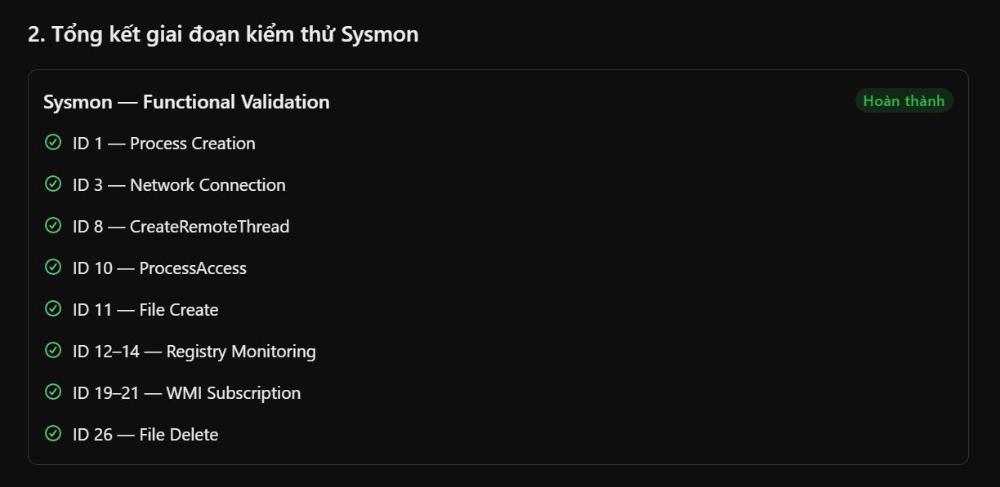

### 2.17. Xuất và bảo toàn Sysmon EVTX

```ps1
$timestamp = Get-Date -Format "yyyyMMdd_HHmmss"

$exportPath = "C:\DFIR\Evidence\EVTX\Sysmon_Test_$timestamp.evtx"

wevtutil epl "Microsoft-Windows-Sysmon/Operational" $exportPath

Write-Host "Exported: $exportPath"
```

```ps1
Get-Item $exportPath |
    Select-Object FullName, Length, CreationTime

Get-FileHash $exportPath -Algorithm SHA256
```

```ps1
Get-WinEvent -Path $exportPath -MaxEvents 5 |
    Select-Object TimeCreated, Id, ProviderName |
    Format-Table -AutoSize
```

<details>
<summary>Bấm vào đây để xem nội dung</summary>

```ps1
PS C:\Windows\system32> $timestamp = Get-Date -Format "yyyyMMdd_HHmmss"
PS C:\Windows\system32>
PS C:\Windows\system32> $exportPath = "C:\DFIR\Evidence\EVTX\Sysmon_Test_$timestamp.evtx"
PS C:\Windows\system32>
PS C:\Windows\system32> wevtutil epl "Microsoft-Windows-Sysmon/Operational" $exportPath
PS C:\Windows\system32>
PS C:\Windows\system32> Write-Host "Exported: $exportPath"
Exported: C:\DFIR\Evidence\EVTX\Sysmon_Test_20261020_102428.evtx
PS C:\Windows\system32> Get-Item $exportPath |
>>     Select-Object FullName, Length, CreationTime

FullName                                                Length CreationTime
--------                                                ------ ------------
C:\DFIR\Evidence\EVTX\Sysmon_Test_20261020_102428.evtx 8458240 10/20/2026 10:24:28 AM


PS C:\Windows\system32>
PS C:\Windows\system32> Get-FileHash $exportPath -Algorithm SHA256

Algorithm       Hash                                                                   Path
---------       ----                                                                   ----
SHA256          FC034181631B9601BF60FE4F2FD633B4788B98A61608A9F4019575D00DAD4745       C:\DFIR\Evidence\EVTX\Sysmon_...


PS C:\Windows\system32> Get-WinEvent -Path $exportPath -MaxEvents 5 |
>>     Select-Object TimeCreated, Id, ProviderName |
>>     Format-Table -AutoSize

TimeCreated            Id ProviderName
-----------            -- ------------
10/20/2026 10:24:15 AM  3 Microsoft-Windows-Sysmon
10/20/2026 10:24:15 AM  3 Microsoft-Windows-Sysmon
10/20/2026 10:22:57 AM 26 Microsoft-Windows-Sysmon
10/20/2026 10:22:57 AM 11 Microsoft-Windows-Sysmon
10/20/2026 10:22:57 AM 11 Microsoft-Windows-Sysmon


PS C:\Windows\system32>
```

</details>

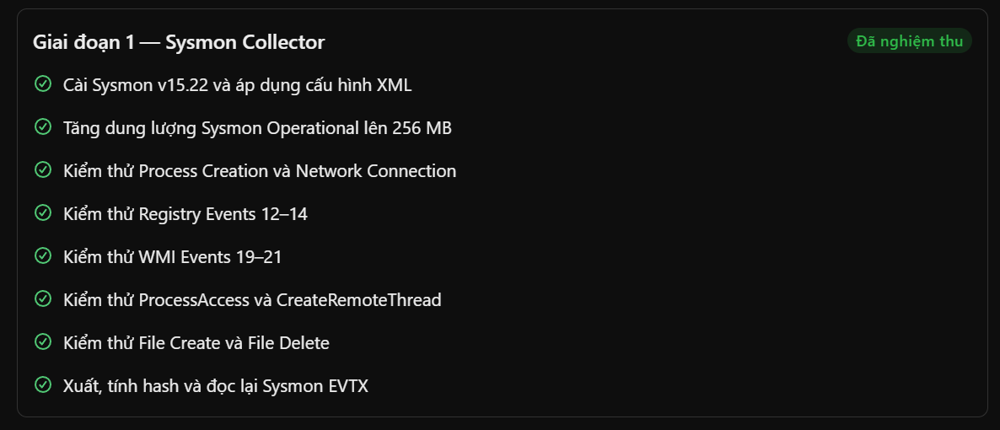

## 3. CẤU HÌNH BẬT EVENT ID

### 3.1. Bật Powershell Script Block Logging (Event Id 4104)

```ps1
$regPath = "HKLM:\SOFTWARE\Policies\Microsoft\Windows\PowerShell\ScriptBlockLogging"

New-Item -Path $regPath -Force | Out-Null

New-ItemProperty `
    -Path $regPath `
    -Name "EnableScriptBlockLogging" `
    -PropertyType DWord `
    -Value 1 `
    -Force | Out-Null

Write-Host "PowerShell Script Block Logging configured." -ForegroundColor Green
```


```ps1
Get-ItemProperty `
    -Path "HKLM:\SOFTWARE\Policies\Microsoft\Windows\PowerShell\ScriptBlockLogging" |
    Select-Object EnableScriptBlockLogging
```

```ps1
Get-WinEvent -ListLog "Microsoft-Windows-PowerShell/Operational" |
    Select-Object LogName, IsEnabled, RecordCount,
        @{Name="MaxSizeMB";Expression={[math]::Round($_.MaximumSizeInBytes / 1MB, 2)}}
```

<details>
<summary>Bấm vào đây để xem nội dung</summary>

```ps1
PS C:\Windows\system32> $regPath = "HKLM:\SOFTWARE\Policies\Microsoft\Windows\PowerShell\ScriptBlockLogging"
PS C:\Windows\system32>
PS C:\Windows\system32> New-Item -Path $regPath -Force | Out-Null
PS C:\Windows\system32>
PS C:\Windows\system32> New-ItemProperty `
>>     -Path $regPath `
>>     -Name "EnableScriptBlockLogging" `
>>     -PropertyType DWord `
>>     -Value 1 `
>>     -Force | Out-Null
PS C:\Windows\system32>
PS C:\Windows\system32> Write-Host "PowerShell Script Block Logging configured." -ForegroundColor Green
PowerShell Script Block Logging configured.
PS C:\Windows\system32> Get-ItemProperty `
>>     -Path "HKLM:\SOFTWARE\Policies\Microsoft\Windows\PowerShell\ScriptBlockLogging" |
>>     Select-Object EnableScriptBlockLogging

EnableScriptBlockLogging
------------------------
                       1


PS C:\Windows\system32> Get-WinEvent -ListLog "Microsoft-Windows-PowerShell/Operational" |
>>     Select-Object LogName, IsEnabled, RecordCount,
>>         @{Name="MaxSizeMB";Expression={[math]::Round($_.MaximumSizeInBytes / 1MB, 2)}}

LogName                                  IsEnabled RecordCount MaxSizeMB
-------                                  --------- ----------- ---------
Microsoft-Windows-PowerShell/Operational      True         306        15


PS C:\Windows\system32>
```

</details>

### 3.2. Kiểm thử PowerShell Event ID 4104

```PS1
$testMarker = "DFIR_SBL_TEST_20261020"

$testCode = @"
`$message = "$testMarker"
`$result = `$message.ToUpper()
Write-Output `$result
"@

$encoded = [Convert]::ToBase64String(
    [Text.Encoding]::Unicode.GetBytes($testCode)
)

powershell.exe -NoProfile -EncodedCommand $encoded
```

```PS1
Get-WinEvent -FilterHashtable @{
    LogName   = "Microsoft-Windows-PowerShell/Operational"
    Id        = 4104
    StartTime = (Get-Date).AddMinutes(-10)
} -ErrorAction SilentlyContinue |
    Where-Object {
        $_.Message -like "*DFIR_SBL_TEST_20261020*"
    } |
    Select-Object -First 5 TimeCreated, Id, Message |
    Format-List
```

<details>
<summary>Bấm vào đây để xem nội dung</summary>

```PS1
PS C:\Windows\system32> $testMarker = "DFIR_SBL_TEST_20261020"
PS C:\Windows\system32>
PS C:\Windows\system32> $testCode = @"
>> `$message = "$testMarker"
>> `$result = `$message.ToUpper()
>> Write-Output `$result
>> "@
PS C:\Windows\system32>
PS C:\Windows\system32> $encoded = [Convert]::ToBase64String(
>>     [Text.Encoding]::Unicode.GetBytes($testCode)
>> )
PS C:\Windows\system32>
PS C:\Windows\system32> powershell.exe -NoProfile -EncodedCommand $encoded
DFIR_SBL_TEST_20261020
PS C:\Windows\system32> Get-WinEvent -FilterHashtable @{
>>     LogName   = "Microsoft-Windows-PowerShell/Operational"
>>     Id        = 4104
>>     StartTime = (Get-Date).AddMinutes(-10)
>> } -ErrorAction SilentlyContinue |
>>     Where-Object {
>>         $_.Message -like "*DFIR_SBL_TEST_20261020*"
>>     } |
>>     Select-Object -First 5 TimeCreated, Id, Message |
>>     Format-List


TimeCreated : 10/20/2026 10:32:04 AM
Id          : 4104
Message     : Creating Scriptblock text (1 of 1):
              $message = "DFIR_SBL_TEST_20261020"
              $result = $message.ToUpper()
              Write-Output $result

              ScriptBlock ID: df33859d-d1b3-41bf-93c4-de72fefee472
              Path:

TimeCreated : 10/20/2026 10:31:16 AM
Id          : 4104
Message     : Creating Scriptblock text (1 of 1):
              $message = DFIR_SBL_TEST_20261020
              $result = $message.ToUpper()
              Write-Output $result

              ScriptBlock ID: 62837e86-c596-4a01-af35-54f0cd8fa5e1
              Path:


PS C:\Windows\system32>
```

</details>

### 3.3 Tăng dung lượng PowerShell Operational Log lên 128 MB

```PS1
wevtutil sl "Microsoft-Windows-PowerShell/Operational" /ms:134217728
```

```PS1
Get-WinEvent -ListLog "Microsoft-Windows-PowerShell/Operational" |
    Select-Object LogName, IsEnabled, RecordCount,
        @{Name="MaxSizeMB";Expression={[math]::Round($_.MaximumSizeInBytes / 1MB, 2)}}
```

<details>
<summary>Bấm vào đây để xem nội dung</summary>

```PS1
PS C:\Windows\system32> wevtutil sl "Microsoft-Windows-PowerShell/Operational" /ms:134217728
PS C:\Windows\system32> Get-WinEvent -ListLog "Microsoft-Windows-PowerShell/Operational" |
>>     Select-Object LogName, IsEnabled, RecordCount,
>>         @{Name="MaxSizeMB";Expression={[math]::Round($_.MaximumSizeInBytes / 1MB, 2)}}

LogName                                  IsEnabled RecordCount MaxSizeMB
-------                                  --------- ----------- ---------
Microsoft-Windows-PowerShell/Operational      True         320       128


PS C:\Windows\system32>
```

</details>

### 3.4. Bật PowerShell Module Logging (Event ID 4103)

```PS1
$moduleLogPath = "HKLM:\SOFTWARE\Policies\Microsoft\Windows\PowerShell\ModuleLogging"

New-Item -Path $moduleLogPath -Force | Out-Null

New-ItemProperty `
    -Path $moduleLogPath `
    -Name "EnableModuleLogging" `
    -PropertyType DWord `
    -Value 1 `
    -Force | Out-Null

$moduleNamesPath = "$moduleLogPath\ModuleNames"

New-Item -Path $moduleNamesPath -Force | Out-Null

New-ItemProperty `
    -Path $moduleNamesPath `
    -Name "*"`
    -PropertyType String `
    -Value "*"`
    -Force | Out-Null

Write-Host "PowerShell Module Logging configured." -ForegroundColor Green
```

```PS1
Get-ItemProperty `
    -Path "HKLM:\SOFTWARE\Policies\Microsoft\Windows\PowerShell\ModuleLogging" |
    Select-Object EnableModuleLogging

Get-ItemProperty `
    -Path "HKLM:\SOFTWARE\Policies\Microsoft\Windows\PowerShell\ModuleLogging\ModuleNames" |
    Select-Object *
```

<details>
<summary>Bấm vào đây để xem nội dung</summary>

```PS1
PS C:\Windows\system32> $moduleLogPath = "HKLM:\SOFTWARE\Policies\Microsoft\Windows\PowerShell\ModuleLogging"
PS C:\Windows\system32>
PS C:\Windows\system32> New-Item -Path $moduleLogPath -Force | Out-Null
PS C:\Windows\system32>
PS C:\Windows\system32> New-ItemProperty `
>>     -Path $moduleLogPath `
>>     -Name "EnableModuleLogging" `
>>     -PropertyType DWord `
>>     -Value 1 `
>>     -Force | Out-Null
PS C:\Windows\system32>
PS C:\Windows\system32> $moduleNamesPath = "$moduleLogPath\ModuleNames"
PS C:\Windows\system32>
PS C:\Windows\system32> New-Item -Path $moduleNamesPath -Force | Out-Null
PS C:\Windows\system32>
PS C:\Windows\system32> New-ItemProperty `
>>     -Path $moduleNamesPath `
>>     -Name "*"`
>>     -PropertyType String `
>>     -Value "*"`
>>     -Force | Out-Null
PS C:\Windows\system32>
PS C:\Windows\system32> Write-Host "PowerShell Module Logging configured." -ForegroundColor Green
PowerShell Module Logging configured.
PS C:\Windows\system32> Get-ItemProperty `
>>     -Path "HKLM:\SOFTWARE\Policies\Microsoft\Windows\PowerShell\ModuleLogging" |
>>     Select-Object EnableModuleLogging

EnableModuleLogging
-------------------
                  1


PS C:\Windows\system32>
PS C:\Windows\system32> Get-ItemProperty `
>>     -Path "HKLM:\SOFTWARE\Policies\Microsoft\Windows\PowerShell\ModuleLogging\ModuleNames" |
>>     Select-Object *


*            : *
PSPath       : Microsoft.PowerShell.Core\Registry::HKEY_LOCAL_MACHINE\SOFTWARE\Policies\Microsoft\Windows\PowerShell\Mo
               duleLogging\ModuleNames
PSParentPath : Microsoft.PowerShell.Core\Registry::HKEY_LOCAL_MACHINE\SOFTWARE\Policies\Microsoft\Windows\PowerShell\Mo
               duleLogging
PSChildName  : ModuleNames
PSDrive      : HKLM
PSProvider   : Microsoft.PowerShell.Core\Registry


PS C:\Windows\system32>
```

</details>


### 3.5. Kiểm thử PowerShell Event ID 4103 (Module Logging)

```PS1
$testStart = Get-Date

powershell.exe -NoProfile -Command "Get-Process -Name notepad -ErrorAction SilentlyContinue | Select-Object -First 1 Name, Id"
```

```PS1
Start-Sleep -Seconds 3

Get-WinEvent -FilterHashtable @{
    LogName   = "Microsoft-Windows-PowerShell/Operational"
    Id        = 4103
    StartTime = $testStart
} -ErrorAction SilentlyContinue |
    Where-Object {
        $_.Message -match "Get-Process|Select-Object"
    } |
    Select-Object -First 5 TimeCreated, Id, Message |
    Format-List
```

<details>
<summary>Bấm vào đây để xem nội dung</summary>

```PS1
PS C:\Windows\system32> $testStart = Get-Date
PS C:\Windows\system32>
PS C:\Windows\system32> powershell.exe -NoProfile -Command "Get-Process -Name notepad -ErrorAction SilentlyContinue | Select-Object -First 1 Name, Id"

Name      Id
----      --
notepad 2656


PS C:\Windows\system32> Start-Sleep -Seconds 3
PS C:\Windows\system32>
PS C:\Windows\system32> Get-WinEvent -FilterHashtable @{
>>     LogName   = "Microsoft-Windows-PowerShell/Operational"
>>     Id        = 4103
>>     StartTime = $testStart
>> } -ErrorAction SilentlyContinue |
>>     Where-Object {
>>         $_.Message -match "Get-Process|Select-Object"
>>     } |
>>     Select-Object -First 5 TimeCreated, Id, Message |
>>     Format-List


TimeCreated : 10/20/2026 10:37:16 AM
Id          : 4103
Message     : CommandInvocation(Out-Default): "Out-Default"
              ParameterBinding(Out-Default): name="InputObject"; value="@{Name=notepad; Id=2656}"


              Context:
                      Severity = Informational
                      Host Name = ConsoleHost
                      Host Version = 5.1.19041.6456
                      Host ID = 1802e51d-f07a-47cc-96a2-40ef4280bddd
                      Host Application = C:\Windows\System32\WindowsPowerShell\v1.0\powershell.exe -NoProfile -Command
              Get-Process -Name notepad -ErrorAction SilentlyContinue | Select-Object -First 1 Name, Id
                      Engine Version = 5.1.19041.6456
                      Runspace ID = 6f70ccb5-16e3-40bb-b5c4-a32cca03ae0a
                      Pipeline ID = 1
                      Command Name =
                      Command Type = Script
                      Script Name =
                      Command Path =
                      Sequence Number = 19
                      User = DESKTOP-3H9MVK0\admin
                      Connected User =
                      Shell ID = Microsoft.PowerShell


              User Data:


TimeCreated : 10/20/2026 10:37:16 AM
Id          : 4103
Message     : CommandInvocation(Get-Process): "Get-Process"
              ParameterBinding(Get-Process): name="Name"; value="notepad"
              ParameterBinding(Get-Process): name="ErrorAction"; value="SilentlyContinue"
              CommandInvocation(Select-Object): "Select-Object"
              ParameterBinding(Select-Object): name="First"; value="1"
              ParameterBinding(Select-Object): name="Property"; value="Name, Id"
              ParameterBinding(Select-Object): name="InputObject"; value="System.Diagnostics.Process (notepad)"


              Context:
                      Severity = Informational
                      Host Name = ConsoleHost
                      Host Version = 5.1.19041.6456
                      Host ID = 1802e51d-f07a-47cc-96a2-40ef4280bddd
                      Host Application = C:\Windows\System32\WindowsPowerShell\v1.0\powershell.exe -NoProfile -Command
              Get-Process -Name notepad -ErrorAction SilentlyContinue | Select-Object -First 1 Name, Id
                      Engine Version = 5.1.19041.6456
                      Runspace ID = 6f70ccb5-16e3-40bb-b5c4-a32cca03ae0a
                      Pipeline ID = 1
                      Command Name = Get-Process
                      Command Type = Cmdlet
                      Script Name =
                      Command Path =
                      Sequence Number = 17
                      User = DESKTOP-3H9MVK0\admin
                      Connected User =
                      Shell ID = Microsoft.PowerShell


              User Data:


PS C:\Windows\system32>
```

</details>

### 3.6. Kiểm tra trạng thái PowerShell Transcription

```PS1
$transcriptionPath = "HKLM:\SOFTWARE\Policies\Microsoft\Windows\PowerShell\Transcription"

Write-Host "Registry key exists: $(Test-Path $transcriptionPath)"

Get-ItemProperty -Path $transcriptionPath -ErrorAction SilentlyContinue |
    Select-Object EnableTranscripting, EnableInvocationHeader, OutputDirectory
```

<details>
<summary>Bấm vào đây để xem nội dung</summary>

```PS1
PS C:\Windows\system32> $transcriptionPath = "HKLM:\SOFTWARE\Policies\Microsoft\Windows\PowerShell\Transcription"
PS C:\Windows\system32>
PS C:\Windows\system32> Write-Host "Registry key exists: $(Test-Path $transcriptionPath)"
Registry key exists: False
PS C:\Windows\system32>
PS C:\Windows\system32> Get-ItemProperty -Path $transcriptionPath -ErrorAction SilentlyContinue |
>>     Select-Object EnableTranscripting, EnableInvocationHeader, OutputDirectory
PS C:\Windows\system32>
```

</details>

### 3.7. Bật PowerShell Transcription

```PS1
$transcriptDir = "C:\DFIR\Evidence\PowerShellTranscripts"

New-Item -ItemType Directory -Path $transcriptDir -Force |
    Out-Null

Test-Path $transcriptDir
```

```PS1
$transcriptionPath = "HKLM:\SOFTWARE\Policies\Microsoft\Windows\PowerShell\Transcription"

New-Item -Path $transcriptionPath -Force | Out-Null

New-ItemProperty -Path $transcriptionPath -Name "EnableTranscripting" -PropertyType DWord -Value 1 -Force | Out-Null

New-ItemProperty -Path $transcriptionPath -Name "EnableInvocationHeader" -PropertyType DWord -Value 1 -Force | Out-Null

New-ItemProperty -Path $transcriptionPath -Name "OutputDirectory" -PropertyType String -Value $transcriptDir -Force | Out-Null
```


```PS1
Get-ItemProperty -Path $transcriptionPath |
    Select-Object EnableTranscripting, EnableInvocationHeader, OutputDirectory
```

<details>
<summary>Bấm vào đây để xem nội dung</summary>

```PS1
PS C:\Windows\system32> $transcriptDir = "C:\DFIR\Evidence\PowerShellTranscripts"
PS C:\Windows\system32>
PS C:\Windows\system32> New-Item -ItemType Directory -Path $transcriptDir -Force |
>>     Out-Null
PS C:\Windows\system32>
PS C:\Windows\system32> Test-Path $transcriptDir
True
PS C:\Windows\system32> $transcriptionPath = "HKLM:\SOFTWARE\Policies\Microsoft\Windows\PowerShell\Transcription"
PS C:\Windows\system32>
PS C:\Windows\system32> New-Item -Path $transcriptionPath -Force | Out-Null
PS C:\Windows\system32>
PS C:\Windows\system32> New-ItemProperty -Path $transcriptionPath -Name "EnableTranscripting" -PropertyType DWord -Value 1 -Force | Out-Null
PS C:\Windows\system32>
PS C:\Windows\system32> New-ItemProperty -Path $transcriptionPath -Name "EnableInvocationHeader" -PropertyType DWord -Value 1 -Force | Out-Null
PS C:\Windows\system32>
PS C:\Windows\system32> New-ItemProperty -Path $transcriptionPath -Name "OutputDirectory" -PropertyType String -Value $transcriptDir -Force | Out-Null
PS C:\Windows\system32> Get-ItemProperty -Path $transcriptionPath |
>>     Select-Object EnableTranscripting, EnableInvocationHeader, OutputDirectory

EnableTranscripting EnableInvocationHeader OutputDirectory
------------------- ---------------------- ---------------
                  1                      1 C:\DFIR\Evidence\PowerShellTranscripts


PS C:\Windows\system32>
```

</details>

### 3.8. Kiểm thử PowerShell Transcription

```PS1
$testMarker = "DFIR_TRANSCRIPT_TEST_20261020"

$testStart = Get-Date

powershell.exe -NoProfile -Command 'Write-Output "DFIR_TRANSCRIPT_TEST_20261020"'
```

```PS1
$transcriptDir = "C:\DFIR\Evidence\PowerShellTranscripts"

$files = Get-ChildItem -Path $transcriptDir -Filter "*.txt" -Recurse -File |
    Where-Object { $_.LastWriteTime -ge $testStart.AddMinutes(-1) }

$files |
    Select-Object FullName, Length, LastWriteTime |
    Format-Table -AutoSize

$files |
    Select-String -Pattern "DFIR_TRANSCRIPT_TEST_20261020" |
    Select-Object Path, LineNumber, Line |
    Format-List
```

<details>
<summary>Bấm vào đây để xem nội dung</summary>

```PS1
PS C:\Windows\system32> $testMarker = "DFIR_TRANSCRIPT_TEST_20261020"
PS C:\Windows\system32>
PS C:\Windows\system32> $testStart = Get-Date
PS C:\Windows\system32>
PS C:\Windows\system32> powershell.exe -NoProfile -Command 'Write-Output "DFIR_TRANSCRIPT_TEST_20261020"'
DFIR_TRANSCRIPT_TEST_20261020
PS C:\Windows\system32> $transcriptDir = "C:\DFIR\Evidence\PowerShellTranscripts"
PS C:\Windows\system32>
PS C:\Windows\system32> $files = Get-ChildItem -Path $transcriptDir -Filter "*.txt" -Recurse -File |
>>     Where-Object { $_.LastWriteTime -ge $testStart.AddMinutes(-1) }
PS C:\Windows\system32>
PS C:\Windows\system32> $files |
>>     Select-Object FullName, Length, LastWriteTime |
>>     Format-Table -AutoSize

FullName                                                                                                          Lengt
                                                                                                                      h
--------                                                                                                          -----
C:\DFIR\Evidence\PowerShellTranscripts\20261020\PowerShell_transcript.DESKTOP-3H9MVK0.LfFNNb2P.20261020104530.txt  1058


PS C:\Windows\system32>
PS C:\Windows\system32> $files |
>>     Select-String -Pattern "DFIR_TRANSCRIPT_TEST_20261020" |
>>     Select-Object Path, LineNumber, Line |
>>     Format-List


Path       : C:\DFIR\Evidence\PowerShellTranscripts\20261020\PowerShell_transcript.DESKTOP-3H9MVK0.LfFNNb2P.20261020104
             530.txt
LineNumber : 8
Line       : Host Application: C:\Windows\System32\WindowsPowerShell\v1.0\powershell.exe -NoProfile -Command
             Write-Output DFIR_TRANSCRIPT_TEST_20261020

Path       : C:\DFIR\Evidence\PowerShellTranscripts\20261020\PowerShell_transcript.DESKTOP-3H9MVK0.LfFNNb2P.20261020104
             530.txt
LineNumber : 22
Line       : PS>Write-Output DFIR_TRANSCRIPT_TEST_20261020

Path       : C:\DFIR\Evidence\PowerShellTranscripts\20261020\PowerShell_transcript.DESKTOP-3H9MVK0.LfFNNb2P.20261020104
             530.txt
LineNumber : 23
Line       : DFIR_TRANSCRIPT_TEST_20261020


PS C:\Windows\system32>
```

</details>

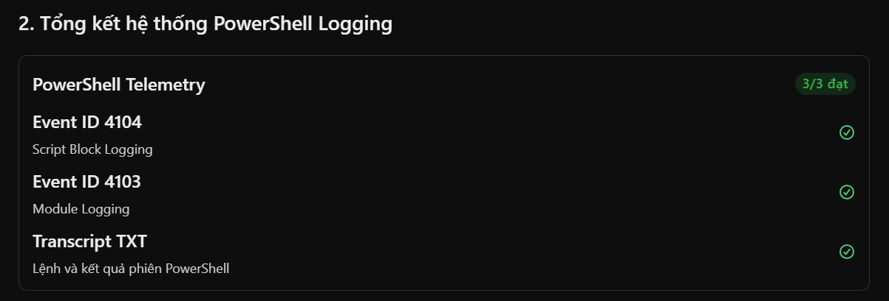

## 4. CẤU HÌNH WINDOWS SECURITY AUDITING

Tiếp theo, chúng ta sẽ thiết lập nguồn evidence cho các hoạt động đăng nhập, tạo tiến trình và Scheduled Task.

Đặc biệt, chuỗi mô phỏng của bạn có thao tác tạo Scheduled Task và thực thi khi người dùng đăng nhập. Vì vậy, các Windows Security Event như 4624, 4688, 4698 sẽ rất hữu ích.

### 4.1. Kiểm tra Windows Security Auditing

```PS1
auditpol /get /category:*
```

<details>
<summary>Bấm vào đây để xem nội dung</summary>

```PS1
PS C:\Windows\system32> auditpol /get /category:*
System audit policy
Category/Subcategory                      Setting
System
  Security System Extension               No Auditing
  System Integrity                        Success and Failure
  IPsec Driver                            No Auditing
  Other System Events                     Success and Failure
  Security State Change                   Success
Logon/Logoff
  Logon                                   Success and Failure
  Logoff                                  Success
  Account Lockout                         Success
  IPsec Main Mode                         No Auditing
  IPsec Quick Mode                        No Auditing
  IPsec Extended Mode                     No Auditing
  Special Logon                           Success
  Other Logon/Logoff Events               No Auditing
  Network Policy Server                   Success and Failure
  User / Device Claims                    No Auditing
  Group Membership                        No Auditing
  Access Rights                           No Auditing
Object Access
  File System                             No Auditing
  Registry                                No Auditing
  Kernel Object                           No Auditing
  SAM                                     No Auditing
  Certification Services                  No Auditing
  Application Generated                   No Auditing
  Handle Manipulation                     No Auditing
  File Share                              No Auditing
  Filtering Platform Packet Drop          No Auditing
  Filtering Platform Connection           No Auditing
  Other Object Access Events              No Auditing
  Detailed File Share                     No Auditing
  Removable Storage                       No Auditing
  Central Policy Staging                  No Auditing
Privilege Use
  Non Sensitive Privilege Use             No Auditing
  Other Privilege Use Events              No Auditing
  Sensitive Privilege Use                 No Auditing
Detailed Tracking
  Process Creation                        No Auditing
  Process Termination                     No Auditing
  DPAPI Activity                          No Auditing
  RPC Events                              No Auditing
  Plug and Play Events                    No Auditing
  Token Right Adjusted Events             No Auditing
Policy Change
  Audit Policy Change                     Success
  Authentication Policy Change            Success
  Authorization Policy Change             No Auditing
  MPSSVC Rule-Level Policy Change         No Auditing
  Filtering Platform Policy Change        No Auditing
  Other Policy Change Events              No Auditing
Account Management
  Computer Account Management             No Auditing
  Security Group Management               Success
  Distribution Group Management           No Auditing
  Application Group Management            No Auditing
  Other Account Management Events         No Auditing
  User Account Management                 Success
DS Access
  Directory Service Access                No Auditing
  Directory Service Changes               No Auditing
  Directory Service Replication           No Auditing
  Detailed Directory Service Replication  No Auditing
Account Logon
  Kerberos Service Ticket Operations      No Auditing
  Other Account Logon Events              No Auditing
  Kerberos Authentication Service         No Auditing
  Credential Validation                   No Auditing
PS C:\Windows\system32>
```


</details>


### 4.2. Bật Audit Process Creation

```PS1
auditpol /set /subcategory:"Process Creation" /success:enable
```

```PS1
auditpol /get /subcategory:"Process Creation"
```

<details>
<summary>Bấm vào đây để xem nội dung</summary>

```PS1
PS C:\Windows\system32> auditpol /set /subcategory:"Process Creation" /success:enable
The command was successfully executed.
PS C:\Windows\system32> auditpol /get /subcategory:"Process Creation"
System audit policy
Category/Subcategory                      Setting
Detailed Tracking
  Process Creation                        Success
PS C:\Windows\system32>
```

</details>

### 4.3. Kiểm thử Security Event ID 4688

```PS1
$testStart = Get-Date

$notepad = Start-Process notepad.exe -PassThru

Start-Sleep -Seconds 3

Write-Host "Test Start : $testStart"
Write-Host "Notepad PID: $($notepad.Id)"
```

```PS1
Get-WinEvent -FilterHashtable @{
    LogName   = "Security"
    Id        = 4688
    StartTime = $testStart
} -ErrorAction SilentlyContinue |
    Where-Object {
        $_.Message -match "notepad\.exe"
    } |
    Select-Object -First 5 TimeCreated, Id, Message |
    Format-List
```

<details>
<summary>Bấm vào đây để xem nội dung</summary>

```PS1
PS C:\Windows\system32> $testStart = Get-Date
PS C:\Windows\system32>
PS C:\Windows\system32> $notepad = Start-Process notepad.exe -PassThru
PS C:\Windows\system32>
PS C:\Windows\system32> Start-Sleep -Seconds 3
PS C:\Windows\system32>
PS C:\Windows\system32> Write-Host "Test Start : $testStart"
Test Start : 10/20/2026 10:54:04
PS C:\Windows\system32> Write-Host "Notepad PID: $($notepad.Id)"
Notepad PID: 980
PS C:\Windows\system32>
PS C:\Windows\system32> Get-WinEvent -FilterHashtable @{
>>     LogName   = "Security"
>>     Id        = 4688
>>     StartTime = $testStart
>> } -ErrorAction SilentlyContinue |
>>     Where-Object {
>>         $_.Message -match "notepad\.exe"
>>     } |
>>     Select-Object -First 5 TimeCreated, Id, Message |
>>     Format-List


TimeCreated : 10/20/2026 10:54:04 AM
Id          : 4688
Message     : A new process has been created.

              Creator Subject:
                Security ID:            S-1-5-21-195670024-3047601688-2024525099-1000
                Account Name:           admin
                Account Domain:         DESKTOP-3H9MVK0
                Logon ID:               0x33B42

              Target Subject:
                Security ID:            S-1-0-0
                Account Name:           -
                Account Domain:         -
                Logon ID:               0x0

              Process Information:
                New Process ID:         0x3d4
                New Process Name:       C:\Windows\System32\notepad.exe
                Token Elevation Type:   %%1937
                Mandatory Label:                S-1-16-12288
                Creator Process ID:     0xce0
                Creator Process Name:   C:\Windows\System32\WindowsPowerShell\v1.0\powershell.exe
                Process Command Line:

              Token Elevation Type indicates the type of token that was assigned to the new process in accordance with
              User Account Control policy.

              Type 1 is a full token with no privileges removed or groups disabled.  A full token is only used if User
              Account Control is disabled or if the user is the built-in Administrator account or a service account.

              Type 2 is an elevated token with no privileges removed or groups disabled.  An elevated token is used
              when User Account Control is enabled and the user chooses to start the program using Run as
              administrator.  An elevated token is also used when an application is configured to always require
              administrative privilege or to always require maximum privilege, and the user is a member of the
              Administrators group.

              Type 3 is a limited token with administrative privileges removed and administrative groups disabled.
              The limited token is used when User Account Control is enabled, the application does not require
              administrative privilege, and the user does not choose to start the program using Run as administrator.


PS C:\Windows\system32>
```


</details>

### 4.4. Bật ghi Command Line trong Security Event ID 4688

```PS1
$regPath = "HKLM:\SOFTWARE\Microsoft\Windows\CurrentVersion\Policies\System\Audit"

New-Item -Path $regPath -Force | Out-Null

New-ItemProperty `
    -Path $regPath `
    -Name "ProcessCreationIncludeCmdLine_Enabled" `
    -PropertyType DWord `
    -Value 1 `
    -Force | Out-Null

Write-Host "Process Creation Command Line Auditing configured."
```

```PS1
Get-ItemProperty `
    -Path "HKLM:\SOFTWARE\Microsoft\Windows\CurrentVersion\Policies\System\Audit" |
    Select-Object ProcessCreationIncludeCmdLine_Enabled
```

<details>
<summary>Bấm vào đây để xem nội dung</summary>

```PS1
PS C:\Windows\system32> $regPath = "HKLM:\SOFTWARE\Microsoft\Windows\CurrentVersion\Policies\System\Audit"
PS C:\Windows\system32>
PS C:\Windows\system32> New-Item -Path $regPath -Force | Out-Null
PS C:\Windows\system32>
PS C:\Windows\system32> New-ItemProperty `
>>     -Path $regPath `
>>     -Name "ProcessCreationIncludeCmdLine_Enabled" `
>>     -PropertyType DWord `
>>     -Value 1 `
>>     -Force | Out-Null
PS C:\Windows\system32>
PS C:\Windows\system32> Write-Host "Process Creation Command Line Auditing configured."
Process Creation Command Line Auditing configured.
PS C:\Windows\system32> Get-ItemProperty `
>>     -Path "HKLM:\SOFTWARE\Microsoft\Windows\CurrentVersion\Policies\System\Audit" |
>>     Select-Object ProcessCreationIncludeCmdLine_Enabled

ProcessCreationIncludeCmdLine_Enabled
-------------------------------------
                                    1


PS C:\Windows\system32>
```

</details>

### 4.5. Kiểm thử Security Event ID 4688 có Command Line

```PS1
$testStart = Get-Date

$testMarker = "C:\DFIR\DFIR_4688_CMDLINE_TEST.txt"

$notepad = Start-Process notepad.exe -ArgumentList $testMarker -PassThru

Start-Sleep -Seconds 3

Write-Host "Test Notepad PID: $($notepad.Id)"
Write-Host "Expected Command Line: notepad.exe $testMarker"
```

```PS1
Get-WinEvent -FilterHashtable @{
    LogName   = "Security"
    Id        = 4688
    StartTime = $testStart
} -ErrorAction SilentlyContinue |
    Where-Object {
        $_.Message -match "notepad\.exe" -and
        $_.Message -match "DFIR_4688_CMDLINE_TEST"
    } |
    Select-Object -First 5 TimeCreated, Id, Message |
    Format-List
```

<details>
<summary>Bấm vào đây để xem nội dung</summary>

```PS1
PS C:\Windows\system32> $testStart = Get-Date
PS C:\Windows\system32>
PS C:\Windows\system32> $testMarker = "C:\DFIR\DFIR_4688_CMDLINE_TEST.txt"
PS C:\Windows\system32>
PS C:\Windows\system32> $notepad = Start-Process notepad.exe -ArgumentList $testMarker -PassThru
PS C:\Windows\system32>
PS C:\Windows\system32> Start-Sleep -Seconds 3
PS C:\Windows\system32>
PS C:\Windows\system32> Write-Host "Test Notepad PID: $($notepad.Id)"
Test Notepad PID: 4172
PS C:\Windows\system32> Write-Host "Expected Command Line: notepad.exe $testMarker"
Expected Command Line: notepad.exe C:\DFIR\DFIR_4688_CMDLINE_TEST.txt
PS C:\Windows\system32>
PS C:\Windows\system32> Get-WinEvent -FilterHashtable @{
>>     LogName   = "Security"
>>     Id        = 4688
>>     StartTime = $testStart
>> } -ErrorAction SilentlyContinue |
>>     Where-Object {
>>         $_.Message -match "notepad\.exe" -and
>>         $_.Message -match "DFIR_4688_CMDLINE_TEST"
>>     } |
>>     Select-Object -First 5 TimeCreated, Id, Message |
>>     Format-List


TimeCreated : 10/20/2026 10:58:04 AM
Id          : 4688
Message     : A new process has been created.

              Creator Subject:
                Security ID:            S-1-5-21-195670024-3047601688-2024525099-1000
                Account Name:           admin
                Account Domain:         DESKTOP-3H9MVK0
                Logon ID:               0x33B42

              Target Subject:
                Security ID:            S-1-0-0
                Account Name:           -
                Account Domain:         -
                Logon ID:               0x0

              Process Information:
                New Process ID:         0x104c
                New Process Name:       C:\Windows\System32\notepad.exe
                Token Elevation Type:   %%1937
                Mandatory Label:                S-1-16-12288
                Creator Process ID:     0xce0
                Creator Process Name:   C:\Windows\System32\WindowsPowerShell\v1.0\powershell.exe
                Process Command Line:   "C:\Windows\system32\notepad.exe" C:\DFIR\DFIR_4688_CMDLINE_TEST.txt

              Token Elevation Type indicates the type of token that was assigned to the new process in accordance with
              User Account Control policy.

              Type 1 is a full token with no privileges removed or groups disabled.  A full token is only used if User
              Account Control is disabled or if the user is the built-in Administrator account or a service account.

              Type 2 is an elevated token with no privileges removed or groups disabled.  An elevated token is used
              when User Account Control is enabled and the user chooses to start the program using Run as
              administrator.  An elevated token is also used when an application is configured to always require
              administrative privilege or to always require maximum privilege, and the user is a member of the
              Administrators group.

              Type 3 is a limited token with administrative privileges removed and administrative groups disabled.
              The limited token is used when User Account Control is enabled, the application does not require
              administrative privilege, and the user does not choose to start the program using Run as administrator.


PS C:\Windows\system32>
```

</details>

### 4.6. Bật Security Auditing cho Scheduled Task

```PS1
auditpol /set /subcategory:"Other Object Access Events" /success:enable
```

```PS1
auditpol /get /subcategory:"Other Object Access Events"
```

<details>
<summary>Bấm vào đây để xem nội dung</summary>

```PS1
PS C:\Windows\system32> auditpol /set /subcategory:"Other Object Access Events" /success:enable
The command was successfully executed.
PS C:\Windows\system32>
PS C:\Windows\system32> auditpol /get /subcategory:"Other Object Access Events"
System audit policy
Category/Subcategory                      Setting
Object Access
  Other Object Access Events              Success
PS C:\Windows\system32>
PS C:\Windows\system32>
```

</details>


### 4.7. Kiểm thử Security Event ID 4698 (Scheduled Task Created)

```PS1
$testStart = Get-Date

$taskName = "DFIR_Test_4698"

$action = New-ScheduledTaskAction `
    -Execute "C:\Windows\System32\cmd.exe" `
    -Argument "/c exit 0"

$trigger = New-ScheduledTaskTrigger `
    -Once `
    -At (Get-Date).AddDays(1)

Register-ScheduledTask `
    -TaskName $taskName `
    -Action $action `
    -Trigger $trigger `
    -Description "Benign DFIR test for Security Event ID 4698" `
    -Force

Get-ScheduledTask -TaskName $taskName |
    Select-Object TaskName, TaskPath, State
```

```PS1
Start-Sleep -Seconds 3

Get-WinEvent -FilterHashtable @{
    LogName   = "Security"
    Id        = 4698
    StartTime = $testStart
} -ErrorAction SilentlyContinue |
    Where-Object {
        $_.Message -match "DFIR_Test_4698"
    } |
    Select-Object TimeCreated, Id, Message |
    Format-List
```

<details>
<summary>Bấm vào đây để xem nội dung</summary>

```PS1
PS C:\Windows\system32> $testStart = Get-Date
PS C:\Windows\system32>
PS C:\Windows\system32> $taskName = "DFIR_Test_4698"
PS C:\Windows\system32>
PS C:\Windows\system32> $action = New-ScheduledTaskAction `
>>     -Execute "C:\Windows\System32\cmd.exe" `
>>     -Argument "/c exit 0"
PS C:\Windows\system32>
PS C:\Windows\system32> $trigger = New-ScheduledTaskTrigger `
>>     -Once `
>>     -At (Get-Date).AddDays(1)
PS C:\Windows\system32>
PS C:\Windows\system32> Register-ScheduledTask `
>>     -TaskName $taskName `
>>     -Action $action `
>>     -Trigger $trigger `
>>     -Description "Benign DFIR test for Security Event ID 4698" `
>>     -Force

TaskPath                                       TaskName                          State
--------                                       --------                          -----
\                                              DFIR_Test_4698                    Ready


PS C:\Windows\system32>
PS C:\Windows\system32> Get-ScheduledTask -TaskName $taskName |
>>     Select-Object TaskName, TaskPath, State

TaskName       TaskPath State
--------       -------- -----
DFIR_Test_4698 \        Ready


PS C:\Windows\system32> Start-Sleep -Seconds 3
PS C:\Windows\system32>
PS C:\Windows\system32> Get-WinEvent -FilterHashtable @{
>>     LogName   = "Security"
>>     Id        = 4698
>>     StartTime = $testStart
>> } -ErrorAction SilentlyContinue |
>>     Where-Object {
>>         $_.Message -match "DFIR_Test_4698"
>>     } |
>>     Select-Object TimeCreated, Id, Message |
>>     Format-List


TimeCreated : 10/20/2026 11:02:03 AM
Id          : 4698
Message     : A scheduled task was created.

              Subject:
                Security ID:            S-1-5-21-195670024-3047601688-2024525099-1000
                Account Name:           admin
                Account Domain:         DESKTOP-3H9MVK0
                Logon ID:               0x33B42

              Task Information:
                Task Name:              \DFIR_Test_4698
                Task Content:           <?xml version="1.0" encoding="UTF-16"?>
              <Task version="1.2" xmlns="http://schemas.microsoft.com/windows/2004/02/mit/task">
                <RegistrationInfo>
                  <Description>Benign DFIR test for Security Event ID 4698</Description>
                  <URI>\DFIR_Test_4698</URI>
                </RegistrationInfo>
                <Triggers>
                  <TimeTrigger>
                    <StartBoundary>2026-10-21T04:02:03Z</StartBoundary>
                    <Enabled>true</Enabled>
                  </TimeTrigger>
                </Triggers>
                <Settings>
                  <MultipleInstancesPolicy>IgnoreNew</MultipleInstancesPolicy>
                  <DisallowStartIfOnBatteries>true</DisallowStartIfOnBatteries>
                  <StopIfGoingOnBatteries>true</StopIfGoingOnBatteries>
                  <AllowHardTerminate>true</AllowHardTerminate>
                  <StartWhenAvailable>false</StartWhenAvailable>
                  <RunOnlyIfNetworkAvailable>false</RunOnlyIfNetworkAvailable>
                  <IdleSettings>
                    <Duration>PT10M</Duration>
                    <WaitTimeout>PT1H</WaitTimeout>
                    <StopOnIdleEnd>true</StopOnIdleEnd>
                    <RestartOnIdle>false</RestartOnIdle>
                  </IdleSettings>
                  <AllowStartOnDemand>true</AllowStartOnDemand>
                  <Enabled>true</Enabled>
                  <Hidden>false</Hidden>
                  <RunOnlyIfIdle>false</RunOnlyIfIdle>
                  <WakeToRun>false</WakeToRun>
                  <ExecutionTimeLimit>PT72H</ExecutionTimeLimit>
                  <Priority>7</Priority>
                </Settings>
                <Actions Context="Author">
                  <Exec>
                    <Command>C:\Windows\System32\cmd.exe</Command>
                    <Arguments>/c exit 0</Arguments>
                  </Exec>
                </Actions>
                <Principals>
                  <Principal id="Author">
                    <UserId>DESKTOP-3H9MVK0\admin</UserId>
                    <LogonType>InteractiveToken</LogonType>
                    <RunLevel>LeastPrivilege</RunLevel>
                  </Principal>
                </Principals>
              </Task>

              Other Information:
                ProcessCreationTime:            3096224743817302
                ClientProcessId:                        2992
                ParentProcessId:                        828
                FQDN:           0


PS C:\Windows\system32>
```


</details>

### 4.8. Kiểm thử Security Event ID 4702 (Scheduled Task Updated)

```PS1
$testStart = Get-Date

$taskName = "DFIR_Test_4698"

$task = Get-ScheduledTask -TaskName $taskName -ErrorAction Stop

$task.Description = "DFIR benign test updated for Security Event ID 4702"

$task | Set-ScheduledTask | Out-Null

Get-ScheduledTask -TaskName $taskName |
    Select-Object TaskName, TaskPath, State, Description
```

```PS1
Start-Sleep -Seconds 3

Get-WinEvent -FilterHashtable @{
    LogName   = "Security"
    Id        = 4702
    StartTime = $testStart
} -ErrorAction SilentlyContinue |
    Where-Object {
        $_.Message -match "DFIR_Test_4698"
    } |
    Select-Object TimeCreated, Id, Message |
    Format-List
```

<details>
<summary>Bấm vào đây để xem nội dung</summary>

```PS1
PS C:\Windows\system32> $testStart = Get-Date
PS C:\Windows\system32>
PS C:\Windows\system32> $taskName = "DFIR_Test_4698"
PS C:\Windows\system32>
PS C:\Windows\system32> $task = Get-ScheduledTask -TaskName $taskName -ErrorAction Stop
PS C:\Windows\system32>
PS C:\Windows\system32> $task.Description = "DFIR benign test updated for Security Event ID 4702"
PS C:\Windows\system32>
PS C:\Windows\system32> $task | Set-ScheduledTask | Out-Null
PS C:\Windows\system32>
PS C:\Windows\system32> Get-ScheduledTask -TaskName $taskName |
>>     Select-Object TaskName, TaskPath, State, Description

TaskName       TaskPath State Description
--------       -------- ----- -----------
DFIR_Test_4698 \        Ready DFIR benign test updated for Security Event ID 4702


PS C:\Windows\system32> Start-Sleep -Seconds 3
PS C:\Windows\system32>
PS C:\Windows\system32> Get-WinEvent -FilterHashtable @{
>>     LogName   = "Security"
>>     Id        = 4702
>>     StartTime = $testStart
>> } -ErrorAction SilentlyContinue |
>>     Where-Object {
>>         $_.Message -match "DFIR_Test_4698"
>>     } |
>>     Select-Object TimeCreated, Id, Message |
>>     Format-List


TimeCreated : 10/20/2026 11:05:22 AM
Id          : 4702
Message     : A scheduled task was updated.

              Subject:
                Security ID:            S-1-5-21-195670024-3047601688-2024525099-1000
                Account Name:           admin
                Account Domain:         DESKTOP-3H9MVK0
                Logon ID:               0x33B42

              Task Information:
                Task Name:              \DFIR_Test_4698
                Task New Content:               <?xml version="1.0" encoding="UTF-16"?>
              <Task version="1.3" xmlns="http://schemas.microsoft.com/windows/2004/02/mit/task">
                <RegistrationInfo>
                  <Description>DFIR benign test updated for Security Event ID 4702</Description>
                  <URI>\DFIR_Test_4698</URI>
                </RegistrationInfo>
                <Triggers>
                  <TimeTrigger>
                    <StartBoundary>2026-10-21T11:02:03+07:00</StartBoundary>
                    <Enabled>true</Enabled>
                  </TimeTrigger>
                </Triggers>
                <Principals>
                  <Principal id="Author">
                    <UserId>admin</UserId>
                    <LogonType>InteractiveToken</LogonType>
                    <RunLevel>LeastPrivilege</RunLevel>
                  </Principal>
                </Principals>
                <Settings>
                  <MultipleInstancesPolicy>IgnoreNew</MultipleInstancesPolicy>
                  <DisallowStartIfOnBatteries>true</DisallowStartIfOnBatteries>
                  <StopIfGoingOnBatteries>true</StopIfGoingOnBatteries>
                  <AllowHardTerminate>true</AllowHardTerminate>
                  <StartWhenAvailable>false</StartWhenAvailable>
                  <RunOnlyIfNetworkAvailable>false</RunOnlyIfNetworkAvailable>
                  <IdleSettings>
                    <Duration>PT10M</Duration>
                    <WaitTimeout>PT1H</WaitTimeout>
                    <StopOnIdleEnd>true</StopOnIdleEnd>
                    <RestartOnIdle>false</RestartOnIdle>
                  </IdleSettings>
                  <AllowStartOnDemand>true</AllowStartOnDemand>
                  <Enabled>true</Enabled>
                  <Hidden>false</Hidden>
                  <RunOnlyIfIdle>false</RunOnlyIfIdle>
                  <DisallowStartOnRemoteAppSession>false</DisallowStartOnRemoteAppSession>
                  <UseUnifiedSchedulingEngine>false</UseUnifiedSchedulingEngine>
                  <WakeToRun>false</WakeToRun>
                  <ExecutionTimeLimit>PT72H</ExecutionTimeLimit>
                  <Priority>7</Priority>
                </Settings>
                <Actions Context="Author">
                  <Exec>
                    <Command>C:\Windows\System32\cmd.exe</Command>
                    <Arguments>/c exit 0</Arguments>
                  </Exec>
                </Actions>
              </Task>

              Other Information:
                ProcessCreationTime:            3096224743817302
                ClientProcessId:                        2992
                ParentProcessId:                        828
                FQDN:           0


PS C:\Windows\system32>
```

</details>

### 4.9. Kiểm thử Security Event ID 4699 (Scheduled Task Deleted)

```PS1
$testStart = Get-Date

$taskName = "DFIR_Test_4698"

Unregister-ScheduledTask -TaskName $taskName -Confirm:$false

Write-Host "Task deletion requested: $taskName"

Get-ScheduledTask -TaskName $taskName -ErrorAction SilentlyContinue
```

```PS1
Start-Sleep -Seconds 3

Get-WinEvent -FilterHashtable @{
    LogName   = "Security"
    Id        = 4699
    StartTime = $testStart
} -ErrorAction SilentlyContinue |
    Where-Object {
        $_.Message -match "DFIR_Test_4698"
    } |
    Select-Object TimeCreated, Id, Message |
    Format-List
```

<details>
<summary>Bấm vào đây để xem nội dung</summary>

```PS1
PS C:\Windows\system32> $testStart = Get-Date
PS C:\Windows\system32>
PS C:\Windows\system32> $taskName = "DFIR_Test_4698"
PS C:\Windows\system32>
PS C:\Windows\system32> Unregister-ScheduledTask -TaskName $taskName -Confirm:$false
PS C:\Windows\system32>
PS C:\Windows\system32> Write-Host "Task deletion requested: $taskName"
Task deletion requested: DFIR_Test_4698
PS C:\Windows\system32>
PS C:\Windows\system32> Get-ScheduledTask -TaskName $taskName -ErrorAction SilentlyContinue
PS C:\Windows\system32> Start-Sleep -Seconds 3
PS C:\Windows\system32>
PS C:\Windows\system32> Get-WinEvent -FilterHashtable @{
>>     LogName   = "Security"
>>     Id        = 4699
>>     StartTime = $testStart
>> } -ErrorAction SilentlyContinue |
>>     Where-Object {
>>         $_.Message -match "DFIR_Test_4698"
>>     } |
>>     Select-Object TimeCreated, Id, Message |
>>     Format-List


TimeCreated : 10/20/2026 11:07:24 AM
Id          : 4699
Message     : A scheduled task was deleted.

              Subject:
                Security ID:            S-1-5-21-195670024-3047601688-2024525099-1000
                Account Name:           admin
                Account Domain:         DESKTOP-3H9MVK0
                Logon ID:               0x33B42

              Task Information:
                Task Name:              \DFIR_Test_4698
                Task Content:

              Other Information:
                ProcessCreationTime:            3096224743817302
                ClientProcessId:                        2992
                ParentProcessId:                        828
                FQDN:           0


PS C:\Windows\system32>
```

</details>

### 4.10. Kiểm tra Task Scheduler Operational Log

```PS1
Get-WinEvent -ListLog "Microsoft-Windows-TaskScheduler/Operational" |
    Select-Object LogName, IsEnabled, RecordCount,
        @{Name="MaxSizeMB";Expression={
            [math]::Round($_.MaximumSizeInBytes / 1MB, 2)
        }}
```

<details>
<summary>Bấm vào đây để xem nội dung</summary>

```PS1
PS C:\Windows\system32> Get-WinEvent -ListLog "Microsoft-Windows-TaskScheduler/Operational" |
>>     Select-Object LogName, IsEnabled, RecordCount,
>>         @{Name="MaxSizeMB";Expression={
>>             [math]::Round($_.MaximumSizeInBytes / 1MB, 2)
>>         }}

LogName                                     IsEnabled RecordCount MaxSizeMB
-------                                     --------- ----------- ---------
Microsoft-Windows-TaskScheduler/Operational     False                    10


PS C:\Windows\system32>
```

</details>

### 4.11. Bật Task Scheduler Operational Log

```PS1
wevtutil sl "Microsoft-Windows-TaskScheduler/Operational" /e:true
```

```PS1
wevtutil sl "Microsoft-Windows-TaskScheduler/Operational" /ms:67108864
```

```PS1
Get-WinEvent -ListLog "Microsoft-Windows-TaskScheduler/Operational" |
    Select-Object LogName, IsEnabled, RecordCount,
        @{Name="MaxSizeMB";Expression={
            [math]::Round($_.MaximumSizeInBytes / 1MB, 2)
        }}
```

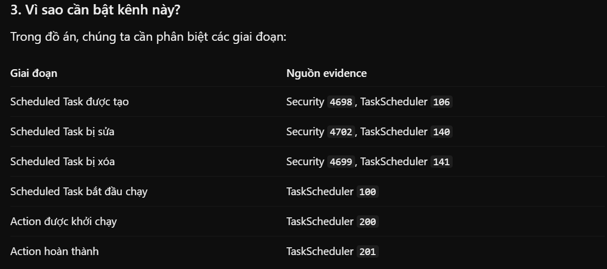

<details>
<summary>Bấm vào đây để xem nội dung</summary>

```PS1
PS C:\Windows\system32> wevtutil sl "Microsoft-Windows-TaskScheduler/Operational" /e:true
PS C:\Windows\system32> wevtutil sl "Microsoft-Windows-TaskScheduler/Operational" /ms:67108864
PS C:\Windows\system32> Get-WinEvent -ListLog "Microsoft-Windows-TaskScheduler/Operational" |
>>     Select-Object LogName, IsEnabled, RecordCount,
>>         @{Name="MaxSizeMB";Expression={
>>             [math]::Round($_.MaximumSizeInBytes / 1MB, 2)
>>         }}

LogName                                     IsEnabled RecordCount MaxSizeMB
-------                                     --------- ----------- ---------
Microsoft-Windows-TaskScheduler/Operational      True           0        64


PS C:\Windows\system32>
```

</details>

### 4.12. Kiểm thử Task Scheduler Operational Event ID 106

```PS1
$testStart = Get-Date

$taskName = "DFIR_Test_TaskScheduler"

$action = New-ScheduledTaskAction `
    -Execute "C:\Windows\System32\cmd.exe" `
    -Argument "/c exit 0"

$trigger = New-ScheduledTaskTrigger `
    -Once `
    -At (Get-Date).AddDays(1)

Register-ScheduledTask `
    -TaskName $taskName `
    -Action $action `
    -Trigger $trigger `
    -Description "Benign DFIR test for Task Scheduler Operational events"

Get-ScheduledTask -TaskName $taskName |
    Select-Object TaskName, TaskPath, State
```

```PS1
Start-Sleep -Seconds 3

Get-WinEvent -FilterHashtable @{
    LogName   = "Microsoft-Windows-TaskScheduler/Operational"
    Id        = 106
    StartTime = $testStart
} -ErrorAction SilentlyContinue |
    Where-Object {
        $_.Message -match "DFIR_Test_TaskScheduler"
    } |
    Select-Object TimeCreated, Id, Message |
    Format-List
```

<details>
<summary>Bấm vào đây để xem nội dung</summary>

```PS1
PS C:\Windows\system32> $testStart = Get-Date
PS C:\Windows\system32>
PS C:\Windows\system32> $taskName = "DFIR_Test_TaskScheduler"
PS C:\Windows\system32>
PS C:\Windows\system32> $action = New-ScheduledTaskAction `
>>     -Execute "C:\Windows\System32\cmd.exe" `
>>     -Argument "/c exit 0"
PS C:\Windows\system32>
PS C:\Windows\system32> $trigger = New-ScheduledTaskTrigger `
>>     -Once `
>>     -At (Get-Date).AddDays(1)
PS C:\Windows\system32>
PS C:\Windows\system32> Register-ScheduledTask `
>>     -TaskName $taskName `
>>     -Action $action `
>>     -Trigger $trigger `
>>     -Description "Benign DFIR test for Task Scheduler Operational events"

TaskPath                                       TaskName                          State
--------                                       --------                          -----
\                                              DFIR_Test_TaskScheduler           Ready


PS C:\Windows\system32>
PS C:\Windows\system32> Get-ScheduledTask -TaskName $taskName |
>>     Select-Object TaskName, TaskPath, State

TaskName                TaskPath State
--------                -------- -----
DFIR_Test_TaskScheduler \        Ready


PS C:\Windows\system32> Start-Sleep -Seconds 3
PS C:\Windows\system32>
PS C:\Windows\system32> Get-WinEvent -FilterHashtable @{
>>     LogName   = "Microsoft-Windows-TaskScheduler/Operational"
>>     Id        = 106
>>     StartTime = $testStart
>> } -ErrorAction SilentlyContinue |
>>     Where-Object {
>>         $_.Message -match "DFIR_Test_TaskScheduler"
>>     } |
>>     Select-Object TimeCreated, Id, Message |
>>     Format-List


TimeCreated : 10/20/2026 11:13:03 AM
Id          : 106
Message     : User "DESKTOP-3H9MVK0\admin"  registered Task Scheduler task "\DFIR_Test_TaskScheduler"


PS C:\Windows\system32>
```

</details>

### 4.13. Kiểm thử Scheduled Task Execution (Event ID 100, 200, 201)

```PS1
$testStart = Get-Date

$taskName = "DFIR_Test_TaskScheduler"

Start-ScheduledTask -TaskName $taskName

Start-Sleep -Seconds 5

Get-ScheduledTaskInfo -TaskName $taskName |
    Select-Object LastRunTime, LastTaskResult, NumberOfMissedRuns
```

```PS1
Get-WinEvent -FilterHashtable @{
    LogName   = "Microsoft-Windows-TaskScheduler/Operational"
    Id        = 100, 200, 201, 102
    StartTime = $testStart
} -ErrorAction SilentlyContinue |
    Where-Object {
        $_.Message -match "DFIR_Test_TaskScheduler"
    } |
    Select-Object TimeCreated, Id, Message |
    Sort-Object TimeCreated |
    Format-List
```

<details>
<summary>Bấm vào đây để xem nội dung</summary>

```PS1
PS C:\Windows\system32> $testStart = Get-Date
PS C:\Windows\system32>
PS C:\Windows\system32> $taskName = "DFIR_Test_TaskScheduler"
PS C:\Windows\system32>
PS C:\Windows\system32> Start-ScheduledTask -TaskName $taskName
PS C:\Windows\system32>
PS C:\Windows\system32> Start-Sleep -Seconds 5
PS C:\Windows\system32>
PS C:\Windows\system32> Get-ScheduledTaskInfo -TaskName $taskName |
>>     Select-Object LastRunTime, LastTaskResult, NumberOfMissedRuns

LastRunTime            LastTaskResult NumberOfMissedRuns
-----------            -------------- ------------------
10/20/2026 11:15:15 AM              0                  0


PS C:\Windows\system32> Get-WinEvent -FilterHashtable @{
>>     LogName   = "Microsoft-Windows-TaskScheduler/Operational"
>>     Id        = 100, 200, 201, 102
>>     StartTime = $testStart
>> } -ErrorAction SilentlyContinue |
>>     Where-Object {
>>         $_.Message -match "DFIR_Test_TaskScheduler"
>>     } |
>>     Select-Object TimeCreated, Id, Message |
>>     Sort-Object TimeCreated |
>>     Format-List


TimeCreated : 10/20/2026 11:15:19 AM
Id          : 100
Message     : Task Scheduler started "{9fe1e59e-921d-425a-a4f5-0a2e15ad5919}" instance of the
              "\DFIR_Test_TaskScheduler" task for user "DESKTOP-3H9MVK0\admin".

TimeCreated : 10/20/2026 11:15:19 AM
Id          : 200
Message     : Task Scheduler launched action "C:\Windows\System32\cmd.exe" in instance
              "{9fe1e59e-921d-425a-a4f5-0a2e15ad5919}" of task "\DFIR_Test_TaskScheduler".

TimeCreated : 10/20/2026 11:15:20 AM
Id          : 201
Message     : Task Scheduler successfully completed task "\DFIR_Test_TaskScheduler" , instance
              "{9fe1e59e-921d-425a-a4f5-0a2e15ad5919}" , action "C:\Windows\System32\cmd.exe" with return code 0.

TimeCreated : 10/20/2026 11:15:20 AM
Id          : 102
Message     : Task Scheduler successfully finished "{9fe1e59e-921d-425a-a4f5-0a2e15ad5919}" instance of the
              "\DFIR_Test_TaskScheduler" task for user "DESKTOP-3H9MVK0\admin".
```

</details>

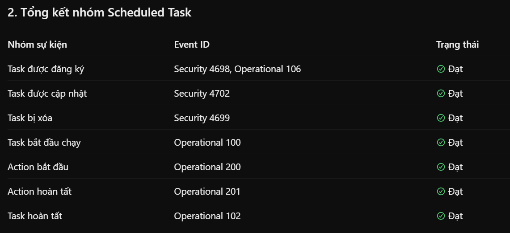

### 4.14. Dọn dẹp Scheduled Task thử nghiệm

```PS1
$taskName = "DFIR_Test_TaskScheduler"

Unregister-ScheduledTask -TaskName $taskName -Confirm:$false

Write-Host "Task removed: $taskName"

$remaining = @(Get-ScheduledTask -TaskName $taskName -ErrorAction SilentlyContinue)

Write-Host "Remaining matching tasks: $($remaining.Count)"
```

```PS1
Get-WinEvent -FilterHashtable @{
    LogName   = "Microsoft-Windows-TaskScheduler/Operational"
    Id        = 141
    StartTime = (Get-Date).AddMinutes(-10)
} -ErrorAction SilentlyContinue |
    Where-Object {
        $_.Message -match "DFIR_Test_TaskScheduler"
    } |
    Select-Object TimeCreated, Id, Message |
    Format-List
```

<details>
<summary>Bấm vào đây để xem nội dung</summary>

```PS1
PS C:\Windows\system32> $taskName = "DFIR_Test_TaskScheduler"
PS C:\Windows\system32>
PS C:\Windows\system32> Unregister-ScheduledTask -TaskName $taskName -Confirm:$false
PS C:\Windows\system32>
PS C:\Windows\system32> Write-Host "Task removed: $taskName"
Task removed: DFIR_Test_TaskScheduler
PS C:\Windows\system32>
PS C:\Windows\system32> $remaining = @(Get-ScheduledTask -TaskName $taskName -ErrorAction SilentlyContinue)
PS C:\Windows\system32>
PS C:\Windows\system32> Write-Host "Remaining matching tasks: $($remaining.Count)"
Remaining matching tasks: 0
PS C:\Windows\system32> Get-WinEvent -FilterHashtable @{
>>     LogName   = "Microsoft-Windows-TaskScheduler/Operational"
>>     Id        = 141
>>     StartTime = (Get-Date).AddMinutes(-10)
>> } -ErrorAction SilentlyContinue |
>>     Where-Object {
>>         $_.Message -match "DFIR_Test_TaskScheduler"
>>     } |
>>     Select-Object TimeCreated, Id, Message |
>>     Format-List


TimeCreated : 10/20/2026 11:18:45 AM
Id          : 141
Message     : User "DESKTOP-3H9MVK0\admin"  deleted Task Scheduler task "\DFIR_Test_TaskScheduler"


PS C:\Windows\system32>
```

</details>

### 4.15. Kiểm tra dung lượng Windows Security Log

```PS1
Get-WinEvent -ListLog "Security" |
    Select-Object LogName, IsEnabled, RecordCount,
        @{Name="MaxSizeMB";Expression={
            [math]::Round($_.MaximumSizeInBytes / 1MB, 2)
        }},
        LogMode
```

<details>
<summary>Bấm vào đây để xem nội dung</summary>

```PS1
PS C:\Windows\system32> Get-WinEvent -ListLog "Security" |
>>     Select-Object LogName, IsEnabled, RecordCount,
>>         @{Name="MaxSizeMB";Expression={
>>             [math]::Round($_.MaximumSizeInBytes / 1MB, 2)
>>         }},
>>         LogMode


LogName     : Security
IsEnabled   : True
RecordCount : 4847
MaxSizeMB   : 20
LogMode     : Circular


PS C:\Windows\system32>
```

</details>

### 4.16. Tăng Windows Security Log lên 256 MiB

```PS1
wevtutil sl "Security" /ms:268435456
```

```PS1
Get-WinEvent -ListLog "Security" |
    Select-Object LogName, IsEnabled, RecordCount,
        @{Name="MaxSizeMB";Expression={
            [math]::Round($_.MaximumSizeInBytes / 1MB, 2)
        }},
        LogMode
```

<details>
<summary>Bấm vào đây để xem nội dung</summary>

```PS1
PS C:\Windows\system32> Get-WinEvent -ListLog "Security" |
>>     Select-Object LogName, IsEnabled, RecordCount,
>>         @{Name="MaxSizeMB";Expression={
>>             [math]::Round($_.MaximumSizeInBytes / 1MB, 2)
>>         }},
>>         LogMode


LogName     : Security
IsEnabled   : True
RecordCount : 4847
MaxSizeMB   : 20
LogMode     : Circular


PS C:\Windows\system32> wevtutil sl "Security" /ms:268435456
PS C:\Windows\system32> Get-WinEvent -ListLog "Security" |
>>     Select-Object LogName, IsEnabled, RecordCount,
>>         @{Name="MaxSizeMB";Expression={
>>             [math]::Round($_.MaximumSizeInBytes / 1MB, 2)
>>         }},
>>         LogMode


LogName     : Security
IsEnabled   : True
RecordCount : 4850
MaxSizeMB   : 256
LogMode     : Circular


PS C:\Windows\system32>
```

</details>

### 4.17. Xuất Windows Security EVTX và kiểm tra SHA-256

```PS1
$timestamp = Get-Date -Format "yyyyMMdd_HHmmss"

$exportPath = "C:\DFIR\Evidence\EVTX\Security_Test_$timestamp.evtx"

wevtutil epl "Security" $exportPath

Write-Host "Exported: $exportPath"
```

```PS1
Get-Item $exportPath |
    Select-Object FullName, Length, CreationTime

Get-FileHash $exportPath -Algorithm SHA256
```

```PS1
Get-WinEvent -Path $exportPath -ErrorAction Stop |
    Where-Object {
        $_.Id -in @(4688, 4698, 4702, 4699)
    } |
    Group-Object Id |
    Sort-Object Name |
    Select-Object Name, Count
```

<details>
<summary>Bấm vào đây để xem nội dung</summary>

```PS1
PS C:\Windows\system32> Get-WinEvent -ListLog "Security" |
>>     Select-Object LogName, IsEnabled, RecordCount,
>>         @{Name="MaxSizeMB";Expression={
>>             [math]::Round($_.MaximumSizeInBytes / 1MB, 2)
>>         }},
>>         LogMode


LogName     : Security
IsEnabled   : True
RecordCount : 4847
MaxSizeMB   : 20
LogMode     : Circular


PS C:\Windows\system32> wevtutil sl "Security" /ms:268435456
PS C:\Windows\system32> Get-WinEvent -ListLog "Security" |
>>     Select-Object LogName, IsEnabled, RecordCount,
>>         @{Name="MaxSizeMB";Expression={
>>             [math]::Round($_.MaximumSizeInBytes / 1MB, 2)
>>         }},
>>         LogMode


LogName     : Security
IsEnabled   : True
RecordCount : 4850
MaxSizeMB   : 256
LogMode     : Circular


PS C:\Windows\system32> $timestamp = Get-Date -Format "yyyyMMdd_HHmmss"
PS C:\Windows\system32>
PS C:\Windows\system32> $exportPath = "C:\DFIR\Evidence\EVTX\Security_Test_$timestamp.evtx"
PS C:\Windows\system32>
PS C:\Windows\system32> wevtutil epl "Security" $exportPath
PS C:\Windows\system32>
PS C:\Windows\system32> Write-Host "Exported: $exportPath"
Exported: C:\DFIR\Evidence\EVTX\Security_Test_20261020_112336.evtx
PS C:\Windows\system32> Get-Item $exportPath |
>>     Select-Object FullName, Length, CreationTime

FullName                                                  Length CreationTime
--------                                                  ------ ------------
C:\DFIR\Evidence\EVTX\Security_Test_20261020_112336.evtx 4263936 10/20/2026 11:23:36 AM


PS C:\Windows\system32>
PS C:\Windows\system32> Get-FileHash $exportPath -Algorithm SHA256

Algorithm       Hash                                                                   Path
---------       ----                                                                   ----
SHA256          219EB1A069E0EBBB3BF3FBCACB7A55BCCDEB623CE2157077C222AD7133718D08       C:\DFIR\Evidence\EVTX\Securit...


PS C:\Windows\system32> Get-WinEvent -Path $exportPath -ErrorAction Stop |
>>     Where-Object {
>>         $_.Id -in @(4688, 4698, 4702, 4699)
>>     } |
>>     Group-Object Id |
>>     Sort-Object Name |
>>     Select-Object Name, Count

Name Count
---- -----
4688   139
4698     2
4699     2
4702     3


PS C:\Windows\system32>
PS C:\Windows\system32>
PS C:\Windows\system32>

```

</details>

### 4.18. Xuất PowerShell Operational EVTX

```PS1
$timestamp = Get-Date -Format "yyyyMMdd_HHmmss"

$exportPath = "C:\DFIR\Evidence\EVTX\PowerShell_Test_$timestamp.evtx"

wevtutil epl "Microsoft-Windows-PowerShell/Operational" $exportPath

Write-Host "Exported: $exportPath"
```

```PS1
Get-Item $exportPath |
    Select-Object FullName, Length, CreationTime

Get-FileHash $exportPath -Algorithm SHA256
```

```PS1
Get-WinEvent -Path $exportPath -ErrorAction Stop |
    Where-Object {
        $_.Id -in @(4103, 4104)
    } |
    Group-Object Id |
    Sort-Object Name |
    Select-Object Name, Count
```

<details>
<summary>Bấm vào đây để xem nội dung</summary>

```PS1
PS C:\Windows\system32> $timestamp = Get-Date -Format "yyyyMMdd_HHmmss"
PS C:\Windows\system32>
PS C:\Windows\system32> $exportPath = "C:\DFIR\Evidence\EVTX\PowerShell_Test_$timestamp.evtx"
PS C:\Windows\system32>
PS C:\Windows\system32> wevtutil epl "Microsoft-Windows-PowerShell/Operational" $exportPath
PS C:\Windows\system32>
PS C:\Windows\system32> Write-Host "Exported: $exportPath"
Exported: C:\DFIR\Evidence\EVTX\PowerShell_Test_20261020_112611.evtx
PS C:\Windows\system32> Get-Item $exportPath |
>>     Select-Object FullName, Length, CreationTime

FullName                                                    Length CreationTime
--------                                                    ------ ------------
C:\DFIR\Evidence\EVTX\PowerShell_Test_20261020_112611.evtx 9506816 10/20/2026 11:26:12 AM


PS C:\Windows\system32>
PS C:\Windows\system32> Get-FileHash $exportPath -Algorithm SHA256

Algorithm       Hash                                                                   Path
---------       ----                                                                   ----
SHA256          4CAE839BD508FD11D98CF78D5F172323FB32BB92D429131E955154FAE2040C4B       C:\DFIR\Evidence\EVTX\PowerSh...


PS C:\Windows\system32> Get-WinEvent -Path $exportPath -ErrorAction Stop |
>>     Where-Object {
>>         $_.Id -in @(4103, 4104)
>>     } |
>>     Group-Object Id |
>>     Sort-Object Name |
>>     Select-Object Name, Count

Name Count
---- -----
4103     7
4104   297


PS C:\Windows\system32>
PS C:\Windows\system32>
```


</details>

### 4.19. Xuất Task Scheduler Operational EVTX

```PS1
$timestamp = Get-Date -Format "yyyyMMdd_HHmmss"

$exportPath = "C:\DFIR\Evidence\EVTX\TaskScheduler_Test_$timestamp.evtx"

wevtutil epl "Microsoft-Windows-TaskScheduler/Operational" $exportPath

Write-Host "Exported: $exportPath"
```

```PS1
Get-Item $exportPath |
    Select-Object FullName, Length, CreationTime

Get-FileHash $exportPath -Algorithm SHA256
```

```PS1
Get-WinEvent -Path $exportPath -ErrorAction Stop |
    Where-Object {
        $_.Id -in @(106, 100, 200, 201, 102, 141)
    } |
    Group-Object Id |
    Sort-Object Name |
    Select-Object Name, Count
```

<details>
<summary>Bấm vào đây để xem nội dung</summary>

```PS1
PS C:\Windows\system32> $timestamp = Get-Date -Format "yyyyMMdd_HHmmss"
PS C:\Windows\system32>
PS C:\Windows\system32> $exportPath = "C:\DFIR\Evidence\EVTX\TaskScheduler_Test_$timestamp.evtx"
PS C:\Windows\system32>
PS C:\Windows\system32> wevtutil epl "Microsoft-Windows-TaskScheduler/Operational" $exportPath
PS C:\Windows\system32>
PS C:\Windows\system32> Write-Host "Exported: $exportPath"
Exported: C:\DFIR\Evidence\EVTX\TaskScheduler_Test_20261020_112857.evtx
PS C:\Windows\system32> Get-Item $exportPath |
>>     Select-Object FullName, Length, CreationTime

FullName                                                      Length CreationTime
--------                                                      ------ ------------
C:\DFIR\Evidence\EVTX\TaskScheduler_Test_20261020_112857.evtx  69632 10/20/2026 11:28:57 AM


PS C:\Windows\system32>
PS C:\Windows\system32> Get-FileHash $exportPath -Algorithm SHA256

Algorithm       Hash                                                                   Path
---------       ----                                                                   ----
SHA256          D7990D059010FEAAA0C7E3202F6DDB98BBBF4E96F0C2F3DA7AF39D74DDC5855D       C:\DFIR\Evidence\EVTX\TaskSch...


PS C:\Windows\system32> Get-WinEvent -Path $exportPath -ErrorAction Stop |
>>     Where-Object {
>>         $_.Id -in @(106, 100, 200, 201, 102, 141)
>>     } |
>>     Group-Object Id |
>>     Sort-Object Name |
>>     Select-Object Name, Count

Name Count
---- -----
100      2
102      2
106      1
141      1
200      2
201      2


PS C:\Windows\system32>
```

</details>

## 5. KẾT NỐI TỚI ANALYSIS

### 5.1. Kiểm tra kết nối từ Windows Client đến máy Analysis

```PS1
Test-NetConnection 192.168.56.150 -InformationLevel Detailed
```

```ps1
Get-NetIPConfiguration |
    Where-Object {
        $_.IPv4Address.IPAddress -eq "192.168.56.200"
    } |
    Select-Object InterfaceAlias, IPv4Address, IPv4DefaultGateway
```

<details>
<summary>Bấm vào đây để xem nội dung</summary>

```ps1
PS C:\Windows\system32> Test-NetConnection 192.168.56.150 -InformationLevel Detailed

                                                                                                                        ComputerName           : 192.168.56.150                                                                                 RemoteAddress          : 192.168.56.150                                                                                 NameResolutionResults  : 192.168.56.150                                                                                 InterfaceAlias         : Ethernet0                                                                                      SourceAddress          : 192.168.56.200                                                                                 NetRoute (NextHop)     : 0.0.0.0
PingSucceeded          : True
PingReplyDetails (RTT) : 0 ms


PS C:\Windows\system32> Get-NetIPConfiguration |
>>     Where-Object {
>>         $_.IPv4Address.IPAddress -eq "192.168.56.200"
>>     } |
>>     Select-Object InterfaceAlias, IPv4Address, IPv4DefaultGateway

InterfaceAlias IPv4Address      IPv4DefaultGateway
-------------- -----------      ------------------
Ethernet0      {192.168.56.200}


PS C:\Windows\system32>
```

</details>

### 5.2. Chuẩn bị thư mục nhận evidence trên Ubuntu

```bash
mkdir -p ~/DFIR-Evidence/Incoming/EVTX

chmod 700 ~/DFIR-Evidence
chmod 700 ~/DFIR-Evidence/Incoming
chmod 700 ~/DFIR-Evidence/Incoming/EVTX

ls -ld ~/DFIR-Evidence ~/DFIR-Evidence/Incoming ~/DFIR-Evidence/Incoming/EVTX
```

```bash
ip route get 192.168.56.200
```

<details>
<summary>Bấm vào đây để xem nội dung</summary>

```bash
tungdvan@ubuntu-server-22044:~$ mkdir -p ~/DFIR-Evidence/Incoming/EVTX

chmod 700 ~/DFIR-Evidence
chmod 700 ~/DFIR-Evidence/Incoming
chmod 700 ~/DFIR-Evidence/Incoming/EVTX

ls -ld ~/DFIR-Evidence ~/DFIR-Evidence/Incoming ~/DFIR-Evidence/Incoming/EVTX
drwx------ 3 tungdvan tungdvan 4096 Oct 20 06:00 /home/tungdvan/DFIR-Evidence
drwx------ 3 tungdvan tungdvan 4096 Oct 20 06:00 /home/tungdvan/DFIR-Evidence/Incoming
drwx------ 2 tungdvan tungdvan 4096 Oct 20 06:00 /home/tungdvan/DFIR-Evidence/Incoming/EVTX
tungdvan@ubuntu-server-22044:~$ ip route get 192.168.56.200
192.168.56.200 dev ens37 src 192.168.56.150 uid 1000
    cache
tungdvan@ubuntu-server-22044:~$
```

</details>

### 5.3. Chuyển thử một file EVTX bằng SFTP

```ps1
sftp tungdvan@192.168.56.150
```

```ps1
cd DFIR-Evidence/Incoming/EVTX
put C:/DFIR/Evidence/EVTX/Sysmon_Test_20261020_102428.evtx
ls -l
bye
```

```bash
sha256sum ~/DFIR-Evidence/Incoming/EVTX/Sysmon_Test_20261020_102428.evtx
```

<details>
<summary>Bấm vào đây để xem nội dung</summary>

```ps1
PS C:\Windows\system32> sftp tungdvan@192.168.56.150
The authenticity of host '192.168.56.150 (192.168.56.150)' can't be established.
ED25519 key fingerprint is SHA256:dMOhciuvR6M6ga91aPNh1UT42big9b65+sPpqPDvoqk.
This key is not known by any other names.
Are you sure you want to continue connecting (yes/no/[fingerprint])?
Warning: Permanently added '192.168.56.150' (ED25519) to the list of known hosts.
tungdvan@192.168.56.150's password:
Permission denied, please try again.
tungdvan@192.168.56.150's password:
Connected to 192.168.56.150.
sftp> cd DFIR-Evidence/Incoming/EVTX
sftp> put C:/DFIR/Evidence/EVTX/Sysmon_Test_20261020_102428.evtx
Uploading C:/DFIR/Evidence/EVTX/Sysmon_Test_20261020_102428.evtx to /home/tungdvan/DFIR-Evidence/Incoming/EVTX/Sysmon_Test_20261020_102428.evtx
Sysmon_Test_20261020_102428.evtx                                                      100% 8260KB  21.5MB/s   00:00
sftp> ls -l
-rw-******    ? tungdvan tungdvan  8458240 Oct 20 13:03 Sysmon_Test_20261020_102428.evtx
sftp> bye
PS C:\Windows\system32>
```

```bash
tungdvan@ubuntu-server-22044:~$ sha256sum ~/DFIR-Evidence/Incoming/EVTX/Sysmon_Test_20261020_102428.evtx
fc034181631b9601bf60fe4f2fd633b4788b98a61608a9f4019575d00dad4745  /home/tungdvan/DFIR-Evidence/Incoming/EVTX/Sysmon_Test_20261020_102428.evtx
```

</details>

### 5.4. Chuyển Windows Security EVTX sang Ubuntu

```bash
sudo ssh-keygen -lf /etc/ssh/ssh_host_ed25519_key.pub
# SHA256:dMOhciuvR6M6ga91aPNh1UT42big9b65+sPpqPDvoqk
```

```ps1
sftp tungdvan@192.168.56.150
```

```ps1
cd DFIR-Evidence/Incoming/EVTX
put C:/DFIR/Evidence/EVTX/Security_Test_20261020_112336.evtx
ls -l
bye
```

```bash
sha256sum ~/DFIR-Evidence/Incoming/EVTX/Security_Test_20261020_112336.evtx
```

<details>
<summary>Bấm vào đây để xem nội dung</summary>

```ps1
PS C:\Windows\system32> sftp tungdvan@192.168.56.150
The authenticity of host '192.168.56.150 (192.168.56.150)' can't be established.
ED25519 key fingerprint is SHA256:dMOhciuvR6M6ga91aPNh1UT42big9b65+sPpqPDvoqk.
This key is not known by any other names.
Are you sure you want to continue connecting (yes/no/[fingerprint])?
Warning: Permanently added '192.168.56.150' (ED25519) to the list of known hosts.
tungdvan@192.168.56.150's password:
Permission denied, please try again.
tungdvan@192.168.56.150's password:
Connected to 192.168.56.150.
sftp> cd DFIR-Evidence/Incoming/EVTX
sftp> put C:/DFIR/Evidence/EVTX/Sysmon_Test_20261020_102428.evtx
Uploading C:/DFIR/Evidence/EVTX/Sysmon_Test_20261020_102428.evtx to /home/tungdvan/DFIR-Evidence/Incoming/EVTX/Sysmon_Test_20261020_102428.evtx
Sysmon_Test_20261020_102428.evtx                                                      100% 8260KB  21.5MB/s   00:00
sftp> ls -l
-rw-******    ? tungdvan tungdvan  8458240 Oct 20 13:03 Sysmon_Test_20261020_102428.evtx
sftp> bye
PS C:\Windows\system32> sftp tungdvan@192.168.56.150
tungdvan@192.168.56.150's password:
Connected to 192.168.56.150.
sftp> cd DFIR-Evidence/Incoming/EVTX
sftp> put C:/DFIR/Evidence/EVTX/Security_Test_20261020_112336.evtx
Uploading C:/DFIR/Evidence/EVTX/Security_Test_20261020_112336.evtx to /home/tungdvan/DFIR-Evidence/Incoming/EVTX/Security_Test_20261020_112336.evtx
Security_Test_20261020_112336.evtx                                                    100% 4164KB  23.6MB/s   00:00
sftp> ls -l
-rw-******    ? tungdvan tungdvan  4263936 Oct 20 13:06 Security_Test_20261020_112336.evtx
-rw-******    ? tungdvan tungdvan  8458240 Oct 20 13:03 Sysmon_Test_20261020_102428.evtx
sftp> bye
```

```bash
tungdvan@ubuntu-server-22044:~$ sudo ssh-keygen -lf /etc/ssh/ssh_host_ed25519_key.pub
[sudo] password for tungdvan:
Sorry, try again.
[sudo] password for tungdvan:
256 SHA256:dMOhciuvR6M6ga91aPNh1UT42big9b65+sPpqPDvoqk root@ubuntu-server-22044 (ED25519)
tungdvan@ubuntu-server-22044:~$ sudo -v
tungdvan@ubuntu-server-22044:~$ sha256sum ~/DFIR-Evidence/Incoming/EVTX/Security_Test_20261020_112336.evtx
219eb1a069e0ebbb3bf3fbcacb7a55bccdeb623ce2157077c222ad7133718d08  /home/tungdvan/DFIR-Evidence/Incoming/EVTX/Security_Test_20261020_112336.evtx
```

</details>

### 5.5. Chuyển PowerShell Operational EVTX

```ps1
sftp tungdvan@192.168.56.150
```

```ps1
cd DFIR-Evidence/Incoming/EVTX
put C:/DFIR/Evidence/EVTX/PowerShell_Test_20261020_112611.evtx
ls -l
bye
```

```bash
sha256sum ~/DFIR-Evidence/Incoming/EVTX/PowerShell_Test_20261020_112611.evtx
```

<details>
<summary>Bấm vào đây để xem nội dung</summary>

```ps1
PS C:\Windows\system32> sftp tungdvan@192.168.56.150
tungdvan@192.168.56.150's password:
Connected to 192.168.56.150.
sftp> cd DFIR-Evidence/Incoming/EVTX
sftp> put C:/DFIR/Evidence/EVTX/PowerShell_Test_20261020_112611.evtx
Uploading C:/DFIR/Evidence/EVTX/PowerShell_Test_20261020_112611.evtx to /home/tungdvan/DFIR-Evidence/Incoming/EVTX/PowerShell_Test_20261020_112611.evtx
PowerShell_Test_20261020_112611.evtx                                                  100% 9284KB  44.7MB/s   00:00
sftp> ls -l
-rw-******    ? tungdvan tungdvan  9506816 Oct 20 13:09 PowerShell_Test_20261020_112611.evtx
-rw-******    ? tungdvan tungdvan  4263936 Oct 20 13:06 Security_Test_20261020_112336.evtx
-rw-******    ? tungdvan tungdvan  8458240 Oct 20 13:03 Sysmon_Test_20261020_102428.evtx
sftp> bye
PS C:\Windows\system32>
```

```bash
tungdvan@ubuntu-server-22044:~$ sha256sum ~/DFIR-Evidence/Incoming/EVTX/PowerShell_Test_20261020_112611.evtx
4cae839bd508fd11d98cf78d5f172323fb32bb92d429131e955154fae2040c4b  /home/tungdvan/DFIR-Evidence/Incoming/EVTX/PowerShell_Test_20261020_112611.evtx
```

</details>

### 5.6. Chuyển TaskScheduler Operational EVTX

```ps1
sftp tungdvan@192.168.56.150
```

```ps1
cd DFIR-Evidence/Incoming/EVTX
put C:/DFIR/Evidence/EVTX/TaskScheduler_Test_20261020_112857.evtx
ls -l
bye
```

```bash
sha256sum ~/DFIR-Evidence/Incoming/EVTX/TaskScheduler_Test_20261020_112857.evtx
```

<details>
<summary>Bấm vào đây để xem nội dung</summary>

```ps1
PS C:\Windows\system32> sftp tungdvan@192.168.56.150
tungdvan@192.168.56.150's password:
Connected to 192.168.56.150.
sftp> cd DFIR-Evidence/Incoming/EVTX
sftp> put C:/DFIR/Evidence/EVTX/TaskScheduler_Test_20261020_112857.evtx
Uploading C:/DFIR/Evidence/EVTX/TaskScheduler_Test_20261020_112857.evtx to /home/tungdvan/DFIR-Evidence/Incoming/EVTX/TaskScheduler_Test_20261020_112857.evtx
TaskScheduler_Test_20261020_112857.evtx                                               100%   68KB   4.2MB/s   00:00
sftp> ls -l
-rw-******    ? tungdvan tungdvan  9506816 Oct 20 13:09 PowerShell_Test_20261020_112611.evtx
-rw-******    ? tungdvan tungdvan  4263936 Oct 20 13:06 Security_Test_20261020_112336.evtx
-rw-******    ? tungdvan tungdvan  8458240 Oct 20 13:03 Sysmon_Test_20261020_102428.evtx
-rw-******    ? tungdvan tungdvan    69632 Oct 20 13:12 TaskScheduler_Test_20261020_112857.evtx
sftp> bye
PS C:\Windows\system32>
PS C:\Windows\system32>
```

```bash
tungdvan@ubuntu-server-22044:~$ sha256sum ~/DFIR-Evidence/Incoming/EVTX/TaskScheduler_Test_20261020_112857.evtx
d7990d059010feaaa0c7e3202f6ddb98bbbf4e96f0c2f3da7af39d74ddc5855d  /home/tungdvan/DFIR-Evidence/Incoming/EVTX/TaskScheduler_Test_20261020_112857.evtx
```

</details>

### 5.7. Tạo Evidence Manifest trên Ubuntu Analysis

```bash
cat > ~/DFIR-Evidence/Incoming/EVTX/manifest.sha256 <<'EOF'
fc034181631b9601bf60fe4f2fd633b4788b98a61608a9f4019575d00dad4745  Sysmon_Test_20261020_102428.evtx
219eb1a069e0ebbb3bf3fbcacb7a55bccdeb623ce2157077c222ad7133718d08  Security_Test_20261020_112336.evtx
4cae839bd508fd11d98cf78d5f172323fb32bb92d429131e955154fae2040c4b  PowerShell_Test_20261020_112611.evtx
d7990d059010feaaa0c7e3202f6ddb98bbbf4e96f0c2f3da7af39d74ddc5855d  TaskScheduler_Test_20261020_112857.evtx
EOF
```

```bash
cd ~/DFIR-Evidence/Incoming/EVTX

sha256sum -c manifest.sha256
```

```bash
stat -c '%n | %s bytes | %y' *.evtx
```

<details>
<summary>Bấm vào đây để xem nội dung</summary>

```bash
tungdvan@ubuntu-server-22044:~$ cat > ~/DFIR-Evidence/Incoming/EVTX/manifest.sha256 <<'EOF'
fc034181631b9601bf60fe4f2fd633b4788b98a61608a9f4019575d00dad4745  Sysmon_Test_20261020_102428.evtx
219eb1a069e0ebbb3bf3fbcacb7a55bccdeb623ce2157077c222ad7133718d08  Security_Test_20261020_112336.evtx
4cae839bd508fd11d98cf78d5f172323fb32bb92d429131e955154fae2040c4b  PowerShell_Test_20261020_112611.evtx
d7990d059010feaaa0c7e3202f6ddb98bbbf4e96f0c2f3da7af39d74ddc5855d  TaskScheduler_Test_20261020_112857.evtx
EOF
tungdvan@ubuntu-server-22044:~$ cd ~/DFIR-Evidence/Incoming/EVTX

sha256sum -c manifest.sha256
Sysmon_Test_20261020_102428.evtx: OK
Security_Test_20261020_112336.evtx: OK
PowerShell_Test_20261020_112611.evtx: OK
TaskScheduler_Test_20261020_112857.evtx: OK
tungdvan@ubuntu-server-22044:~/DFIR-Evidence/Incoming/EVTX$ stat -c '%n | %s bytes | %y' *.evtx
PowerShell_Test_20261020_112611.evtx | 9506816 bytes | 2026-10-20 06:09:30.671459172 +0000
Security_Test_20261020_112336.evtx | 4263936 bytes | 2026-10-20 06:06:53.602098557 +0000
Sysmon_Test_20261020_102428.evtx | 8458240 bytes | 2026-10-20 06:03:41.667673614 +0000
TaskScheduler_Test_20261020_112857.evtx | 69632 bytes | 2026-10-20 06:12:34.322589984 +0000
tungdvan@ubuntu-server-22044:~/DFIR-Evidence/Incoming/EVTX$
```

</details>

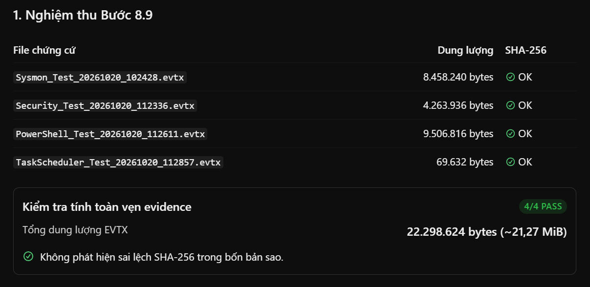

### 5.8. Tách bản chứng cứ lưu trữ và bản phân tích

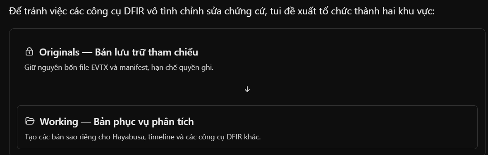

```bash
mkdir -p ~/DFIR-Evidence/Originals/EVTX
mkdir -p ~/DFIR-Evidence/Working/EVTX

chmod 700 ~/DFIR-Evidence/Originals
chmod 700 ~/DFIR-Evidence/Originals/EVTX
chmod 700 ~/DFIR-Evidence/Working
chmod 700 ~/DFIR-Evidence/Working/EVTX
```

```bash
cp -p ~/DFIR-Evidence/Incoming/EVTX/*.evtx \
      ~/DFIR-Evidence/Originals/EVTX/

cp -p ~/DFIR-Evidence/Incoming/EVTX/manifest.sha256 \
      ~/DFIR-Evidence/Originals/EVTX/

cp -p ~/DFIR-Evidence/Incoming/EVTX/*.evtx \
      ~/DFIR-Evidence/Working/EVTX/

cp -p ~/DFIR-Evidence/Incoming/EVTX/manifest.sha256 \
      ~/DFIR-Evidence/Working/EVTX/
```

```bash
cd ~/DFIR-Evidence/Originals/EVTX
sha256sum -c manifest.sha256

cd ~/DFIR-Evidence/Working/EVTX
sha256sum -c manifest.sha256
```

```bash
chmod 400 ~/DFIR-Evidence/Originals/EVTX/*.evtx
chmod 400 ~/DFIR-Evidence/Originals/EVTX/manifest.sha256

ls -l ~/DFIR-Evidence/Originals/EVTX/
```

<details>
<summary>Bấm vào đây để xem nội dung</summary>

```bash
tungdvan@ubuntu-server-22044:~/DFIR-Evidence/Incoming/EVTX$ mkdir -p ~/DFIR-Evidence/Originals/EVTX
mkdir -p ~/DFIR-Evidence/Working/EVTX

chmod 700 ~/DFIR-Evidence/Originals
chmod 700 ~/DFIR-Evidence/Originals/EVTX
chmod 700 ~/DFIR-Evidence/Working
chmod 700 ~/DFIR-Evidence/Working/EVTX
tungdvan@ubuntu-server-22044:~/DFIR-Evidence/Incoming/EVTX$ cp -p ~/DFIR-Evidence/Incoming/EVTX/*.evtx \
      ~/DFIR-Evidence/Originals/EVTX/

cp -p ~/DFIR-Evidence/Incoming/EVTX/manifest.sha256 \
      ~/DFIR-Evidence/Originals/EVTX/

cp -p ~/DFIR-Evidence/Incoming/EVTX/*.evtx \
      ~/DFIR-Evidence/Working/EVTX/

cp -p ~/DFIR-Evidence/Incoming/EVTX/manifest.sha256 \
      ~/DFIR-Evidence/Working/EVTX/
tungdvan@ubuntu-server-22044:~/DFIR-Evidence/Incoming/EVTX$ cd ~/DFIR-Evidence/Originals/EVTX
sha256sum -c manifest.sha256

cd ~/DFIR-Evidence/Working/EVTX
sha256sum -c manifest.sha256
Sysmon_Test_20261020_102428.evtx: OK
Security_Test_20261020_112336.evtx: OK
PowerShell_Test_20261020_112611.evtx: OK
TaskScheduler_Test_20261020_112857.evtx: OK
Sysmon_Test_20261020_102428.evtx: OK
Security_Test_20261020_112336.evtx: OK
PowerShell_Test_20261020_112611.evtx: OK
TaskScheduler_Test_20261020_112857.evtx: OK
tungdvan@ubuntu-server-22044:~/DFIR-Evidence/Working/EVTX$ chmod 400 ~/DFIR-Evidence/Originals/EVTX/*.evtx
chmod 400 ~/DFIR-Evidence/Originals/EVTX/manifest.sha256

ls -l ~/DFIR-Evidence/Originals/EVTX/
total 21780
-r-------- 1 tungdvan tungdvan     409 Oct 20 06:15 manifest.sha256
-r-------- 1 tungdvan tungdvan 9506816 Oct 20 06:09 PowerShell_Test_20261020_112611.evtx
-r-------- 1 tungdvan tungdvan 4263936 Oct 20 06:06 Security_Test_20261020_112336.evtx
-r-------- 1 tungdvan tungdvan 8458240 Oct 20 06:03 Sysmon_Test_20261020_102428.evtx
-r-------- 1 tungdvan tungdvan   69632 Oct 20 06:12 TaskScheduler_Test_20261020_112857.evtx
tungdvan@ubuntu-server-22044:~/DFIR-Evidence/Working/EVTX$
```

</details>

### 5.9. Kiểm tra công cụ đọc EVTX trên Ubuntu Analysis

```bash
command -v evtx_dump || true
command -v hayabusa || true
command -v python3 || true
```

```bash
python3 --version
```

```bash
python3 -m pip show python-evtx 2>/dev/null || true
```

<details>
<summary>Bấm vào đây để xem nội dung</summary>

```bash
tungdvan@ubuntu-server-22044:~/DFIR-Evidence/Working/EVTX$ command -v evtx_dump || true
command -v hayabusa || true
command -v python3 || true
/usr/bin/python3
tungdvan@ubuntu-server-22044:~/DFIR-Evidence/Working/EVTX$ python3 --version
Python 3.12.3
tungdvan@ubuntu-server-22044:~/DFIR-Evidence/Working/EVTX$ python3 -m pip show python-evtx 2>/dev/null || true
tungdvan@ubuntu-server-22044:~/DFIR-Evidence/Working/EVTX$
```

</details>

### 5.10. Chuẩn bị môi trường Python riêng cho DFIR

```bash
python3 -m venv --help >/dev/null 2>&1 && echo "venv available" || echo "venv unavailable"
```

```bash
sudo apt update
sudo apt install -y python3.12-venv
python3 -m venv --clear ~/DFIR-Tools/venv
```

```BASH
~/DFIR-Tools/venv/bin/python --version

~/DFIR-Tools/venv/bin/python -m pip --version

ls -ld ~/DFIR-Tools/venv
```

<details>
<summary>Bấm vào đây để xem nội dung</summary>

```bash
tungdvan@ubuntu-server-22044:~/DFIR-Evidence/Working/EVTX$ sudo apt install -y python3.12-venv
Reading package lists... Done
Building dependency tree... Done
Reading state information... Done
The following additional packages will be installed:
  python3-pip-whl python3-setuptools-whl
The following NEW packages will be installed:
  python3-pip-whl python3-setuptools-whl python3.12-venv
0 upgraded, 3 newly installed, 0 to remove and 58 not upgraded.
Need to get 2,429 kB of archives.
After this operation, 2,777 kB of additional disk space will be used.
Get:1 http://vn.archive.ubuntu.com/ubuntu noble-updates/universe amd64 python3-pip-whl all 24.0+dfsg-1ubuntu1.3 [1,707 kB]
Get:2 http://vn.archive.ubuntu.com/ubuntu noble-updates/universe amd64 python3-setuptools-whl all 68.1.2-2ubuntu1.2 [716 kB]
Get:3 http://vn.archive.ubuntu.com/ubuntu noble-updates/universe amd64 python3.12-venv amd64 3.12.3-1ubuntu0.17 [5,684 B]
Fetched 2,429 kB in 0s (5,684 kB/s)
Selecting previously unselected package python3-pip-whl.
(Reading database ... 125875 files and directories currently installed.)
Preparing to unpack .../python3-pip-whl_24.0+dfsg-1ubuntu1.3_all.deb ...
Unpacking python3-pip-whl (24.0+dfsg-1ubuntu1.3) ...
Selecting previously unselected package python3-setuptools-whl.
Preparing to unpack .../python3-setuptools-whl_68.1.2-2ubuntu1.2_all.deb ...
Unpacking python3-setuptools-whl (68.1.2-2ubuntu1.2) ...
Selecting previously unselected package python3.12-venv.
Preparing to unpack .../python3.12-venv_3.12.3-1ubuntu0.17_amd64.deb ...
Unpacking python3.12-venv (3.12.3-1ubuntu0.17) ...
Setting up python3-setuptools-whl (68.1.2-2ubuntu1.2) ...
Setting up python3-pip-whl (24.0+dfsg-1ubuntu1.3) ...
Setting up python3.12-venv (3.12.3-1ubuntu0.17) ...
Scanning processes...
Scanning candidates...
Scanning linux images...

Pending kernel upgrade!
Running kernel version:
  6.8.0-100-generic
Diagnostics:
  The currently running kernel version is not the expected kernel version 6.8.0-147-generic.

Restarting the system to load the new kernel will not be handled automatically, so you should consider rebooting.

Restarting services...

Service restarts being deferred:
 /etc/needrestart/restart.d/dbus.service
 systemctl restart getty@tty1.service
 systemctl restart systemd-logind.service
 systemctl restart unattended-upgrades.service

No containers need to be restarted.

User sessions running outdated binaries:
 tungdvan @ session #1: sshd[1185,1298]
 tungdvan @ user manager service: systemd[1190]

No VM guests are running outdated hypervisor (qemu) binaries on this host.
tungdvan@ubuntu-server-22044:~/DFIR-Evidence/Working/EVTX$ python3 -m venv --clear ~/DFIR-Tools/venv
tungdvan@ubuntu-server-22044:~/DFIR-Evidence/Working/EVTX$ ~/DFIR-Tools/venv/bin/python --version

~/DFIR-Tools/venv/bin/python -m pip --version

ls -ld ~/DFIR-Tools/venv
Python 3.12.3
pip 24.0 from /home/tungdvan/DFIR-Tools/venv/lib/python3.12/site-packages/pip (python 3.12)
drwxrwxr-x 5 tungdvan tungdvan 4096 Oct 20 06:32 /home/tungdvan/DFIR-Tools/venv
tungdvan@ubuntu-server-22044:~/DFIR-Evidence/Working/EVTX$
```

</details>

### 5.11. Cài thư viện python-evtx

```bash
~/DFIR-Tools/venv/bin/python -m pip install python-evtx
```

```bash
~/DFIR-Tools/venv/bin/python -m pip show python-evtx
```

```bash
~/DFIR-Tools/venv/bin/python -c "from Evtx.Evtx import Evtx; print('python-evtx import: OK')"
```

<details>
<summary>Bấm vào đây để xem nội dung</summary>

```bash
tungdvan@ubuntu-server-22044:~/DFIR-Evidence/Working/EVTX$ ~/DFIR-Tools/venv/bin/python -m pip install python-evtx
Collecting python-evtx
  Downloading python_evtx-0.8.1-py3-none-any.whl.metadata (6.0 kB)
Collecting hexdump>=3.3 (from python-evtx)
  Downloading hexdump-3.3.zip (12 kB)
  Installing build dependencies ... done
  Getting requirements to build wheel ... done
  Preparing metadata (pyproject.toml) ... done
Downloading python_evtx-0.8.1-py3-none-any.whl (26 kB)
Building wheels for collected packages: hexdump
  Building wheel for hexdump (pyproject.toml) ... done
  Created wheel for hexdump: filename=hexdump-3.3-py3-none-any.whl size=8933 sha256=74acf1fcb5cb94fb1aba5d97da0842c99f9137956bd0afef5f94112ac500c6d4
  Stored in directory: /home/tungdvan/.cache/pip/wheels/5e/b9/b5/227a20e7e8bbdb2b17e46a087c0f0119059ee65fe8374cac18
Successfully built hexdump
Installing collected packages: hexdump, python-evtx
Successfully installed hexdump-3.3 python-evtx-0.8.1
tungdvan@ubuntu-server-22044:~/DFIR-Evidence/Working/EVTX$ ~/DFIR-Tools/venv/bin/python -m pip show python-evtx
Name: python-evtx
Version: 0.8.1
Summary: Pure Python parser for Windows event log files (.evtx).
Home-page:
Author:
Author-email: Willi Ballenthin <willi.ballenthin@gmail.com>
License:
Location: /home/tungdvan/DFIR-Tools/venv/lib/python3.12/site-packages
Requires: hexdump
Required-by:
tungdvan@ubuntu-server-22044:~/DFIR-Evidence/Working/EVTX$ ~/DFIR-Tools/venv/bin/python -c "from Evtx.Evtx import Evtx; print('python-evtx import: OK')"
python-evtx import: OK
tungdvan@ubuntu-server-22044:~/DFIR-Evidence/Working/EVTX$
```

</details>

### 5.12. Đọc thử Sysmon EVTX bằng Python trên Ubuntu

```bash
~/DFIR-Tools/venv/bin/python - <<'PY'
from Evtx.Evtx import Evtx
from pathlib import Path
import xml.etree.ElementTree as ET

evtx_path = Path.home() / (
    "DFIR-Evidence/Working/EVTX/"
    "Sysmon_Test_20261020_102428.evtx"
)

ns = {"e": "http://schemas.microsoft.com/win/2004/08/events/event"}

print("File:", evtx_path)
print("Exists:", evtx_path.is_file())
print("=" * 70)

count = 0

with Evtx(str(evtx_path)) as log:
    for record in log.records():
        root = ET.fromstring(record.xml())

        event_id = root.findtext("./e:System/e:EventID", namespaces=ns)
        provider = root.find("./e:System/e:Provider", ns)
        time_created = root.find("./e:System/e:TimeCreated", ns)

        provider_name = provider.get("Name") if provider is not None else "N/A"
        timestamp = time_created.get("SystemTime") if time_created is not None else "N/A"

        print(f"Event ID    : {event_id}")
        print(f"TimeCreated : {timestamp}")
        print(f"Provider    : {provider_name}")
        print("-" * 70)

        count += 1
        if count >= 5:
            break

print(f"Records read: {count}")
PY
```

<details>
<summary>Bấm vào đây để xem nội dung</summary>

```bash
tungdvan@ubuntu-server-22044:~/DFIR-Evidence/Working/EVTX$ ~/DFIR-Tools/venv/bin/python - <<'PY'
from Evtx.Evtx import Evtx
from pathlib import Path
import xml.etree.ElementTree as ET

evtx_path = Path.home() / (
    "DFIR-Evidence/Working/EVTX/"
    "Sysmon_Test_20261020_102428.evtx"
)

ns = {"e": "http://schemas.microsoft.com/win/2004/08/events/event"}

print("File:", evtx_path)
print("Exists:", evtx_path.is_file())
print("=" * 70)

count = 0

with Evtx(str(evtx_path)) as log:
    for record in log.records():
        root = ET.fromstring(record.xml())

        event_id = root.findtext("./e:System/e:EventID", namespaces=ns)
        provider = root.find("./e:System/e:Provider", ns)
        time_created = root.find("./e:System/e:TimeCreated", ns)

        provider_name = provider.get("Name") if provider is not None else "N/A"
        timestamp = time_created.get("SystemTime") if time_created is not None else "N/A"

        print(f"Event ID    : {event_id}")
PYint(f"Records read: {count}")provider_name}")
File: /home/tungdvan/DFIR-Evidence/Working/EVTX/Sysmon_Test_20261020_102428.evtx
Exists: True
======================================================================
Event ID    : 16
TimeCreated : 2026-10-19 09:44:15.112576+00:00
Provider    : Microsoft-Windows-Sysmon
----------------------------------------------------------------------
Event ID    : 4
TimeCreated : 2026-10-19 09:44:15.369961+00:00
Provider    : Microsoft-Windows-Sysmon
----------------------------------------------------------------------
Event ID    : 1
TimeCreated : 2026-10-19 09:44:15.375057+00:00
Provider    : Microsoft-Windows-Sysmon
----------------------------------------------------------------------
Event ID    : 1
TimeCreated : 2026-10-19 09:44:15.376259+00:00
Provider    : Microsoft-Windows-Sysmon
----------------------------------------------------------------------
Event ID    : 11
TimeCreated : 2026-10-19 09:44:15.376520+00:00
Provider    : Microsoft-Windows-Sysmon
----------------------------------------------------------------------
Records read: 5
tungdvan@ubuntu-server-22044:~/DFIR-Evidence/Working/EVTX$
```

</details>

### 5.13. Kiểm tra khả năng đọc cả bốn file EVTX

```bash
~/DFIR-Tools/venv/bin/python - <<'PY'
from Evtx.Evtx import Evtx
from pathlib import Path
import xml.etree.ElementTree as ET

evtx_dir = Path.home() / "DFIR-Evidence/Working/EVTX"

files = [
    "Sysmon_Test_20261020_102428.evtx",
    "Security_Test_20261020_112336.evtx",
    "PowerShell_Test_20261020_112611.evtx",
    "TaskScheduler_Test_20261020_112857.evtx",
]

ns = {"e": "http://schemas.microsoft.com/win/2004/08/events/event"}

for filename in files:
    path = evtx_dir / filename
    print("=" * 75)
    print("File:", filename)

    if not path.is_file():
        print("STATUS: FILE NOT FOUND")
        continue

    try:
        count = 0

        with Evtx(str(path)) as log:
            for record in log.records():
                root = ET.fromstring(record.xml())

                event_id = root.findtext(
                    "./e:System/e:EventID",
                    namespaces=ns
                )

                provider = root.find("./e:System/e:Provider", ns)
                provider_name = (
                    provider.get("Name")
                    if provider is not None
                    else "N/A"
                )

                print(f"  EventID={event_id} | Provider={provider_name}")

                count += 1
                if count >= 3:
                    break

        print(f"STATUS: OK | Records read: {count}")

    except Exception as exc:
        print(f"STATUS: ERROR | {type(exc).__name__}: {exc}")

print("=" * 75)
PY
```

<details>
<summary>Bấm vào đây để xem nội dung</summary>

```bash
tungdvan@ubuntu-server-22044:~/DFIR-Evidence/Working/EVTX$ ~/DFIR-Tools/venv/bin/python - <<'PY'
from Evtx.Evtx import Evtx
from pathlib import Path
import xml.etree.ElementTree as ET

evtx_dir = Path.home() / "DFIR-Evidence/Working/EVTX"

files = [
    "Sysmon_Test_20261020_102428.evtx",
    "Security_Test_20261020_112336.evtx",
    "PowerShell_Test_20261020_112611.evtx",
    "TaskScheduler_Test_20261020_112857.evtx",
]

ns = {"e": "http://schemas.microsoft.com/win/2004/08/events/event"}

for filename in files:
    path = evtx_dir / filename
    print("=" * 75)
    print("File:", filename)

    if not path.is_file():
        print("STATUS: FILE NOT FOUND")
        continue

    try:
        count = 0

        with Evtx(str(path)) as log:
            for record in log.records():
PYint("=" * 75)"STATUS: ERROR | {type(exc).__name__}: {exc}")ider_name}")
===========================================================================
File: Sysmon_Test_20261020_102428.evtx
  EventID=16 | Provider=Microsoft-Windows-Sysmon
  EventID=4 | Provider=Microsoft-Windows-Sysmon
  EventID=1 | Provider=Microsoft-Windows-Sysmon
STATUS: OK | Records read: 3
===========================================================================
File: Security_Test_20261020_112336.evtx
  EventID=4688 | Provider=Microsoft-Windows-Security-Auditing
  EventID=4696 | Provider=Microsoft-Windows-Security-Auditing
  EventID=4826 | Provider=Microsoft-Windows-Security-Auditing
STATUS: OK | Records read: 3
===========================================================================
File: PowerShell_Test_20261020_112611.evtx
  EventID=40961 | Provider=Microsoft-Windows-PowerShell
  EventID=53504 | Provider=Microsoft-Windows-PowerShell
  EventID=40962 | Provider=Microsoft-Windows-PowerShell
STATUS: OK | Records read: 3
===========================================================================
File: TaskScheduler_Test_20261020_112857.evtx
  EventID=106 | Provider=Microsoft-Windows-TaskScheduler
  EventID=325 | Provider=Microsoft-Windows-TaskScheduler
  EventID=129 | Provider=Microsoft-Windows-TaskScheduler
STATUS: OK | Records read: 3
===========================================================================
```

</details>

### 5.14. Đếm Event ID trong Sysmon EVTX

```bash
~/DFIR-Tools/venv/bin/python - <<'PY'
from Evtx.Evtx import Evtx
from pathlib import Path
from collections import Counter
import xml.etree.ElementTree as ET

path = Path.home() / "DFIR-Evidence/Working/EVTX/Sysmon_Test_20261020_102428.evtx"
ns = {"e": "http://schemas.microsoft.com/win/2004/08/events/event"}

counts = Counter()
total = 0

with Evtx(str(path)) as log:
    for record in log.records():
        root = ET.fromstring(record.xml())
        event_id = root.findtext("./e:System/e:EventID", namespaces=ns)

        counts[event_id or "UNKNOWN"] += 1
        total += 1

print("FILE:", path.name)
print("TOTAL RECORDS:", total)
print("-" * 35)
print(f"{'Event ID':<12} {'Count':>10}")
print("-" * 35)

for event_id, count in sorted(
    counts.items(),
    key=lambda item: int(item[0]) if item[0].isdigit() else 999999
):
    print(f"{event_id:<12} {count:>10}")

print("-" * 35)
print("SUM OF COUNTS:", sum(counts.values()))
PY
```

<details>
<summary>Bấm vào đây để xem nội dung</summary>

```bash
tungdvan@ubuntu-server-22044:~/DFIR-Evidence/Working/EVTX$ ~/DFIR-Tools/venv/bin/python - <<'PY'
from Evtx.Evtx import Evtx
from pathlib import Path
from collections import Counter
import xml.etree.ElementTree as ET

path = Path.home() / "DFIR-Evidence/Working/EVTX/Sysmon_Test_20261020_102428.evtx"
ns = {"e": "http://schemas.microsoft.com/win/2004/08/events/event"}

counts = Counter()
total = 0

with Evtx(str(path)) as log:
    for record in log.records():
        root = ET.fromstring(record.xml())
        event_id = root.findtext("./e:System/e:EventID", namespaces=ns)

        counts[event_id or "UNKNOWN"] += 1
        total += 1

print("FILE:", path.name)
print("TOTAL RECORDS:", total)
print("-" * 35)
print(f"{'Event ID':<12} {'Count':>10}")
print("-" * 35)

for event_id, count in sorted(
    counts.items(),
    key=lambda item: int(item[0]) if item[0].isdigit() else 999999
):
PYint("SUM OF COUNTS:", sum(counts.values()))
PYFILE: Sysmon_Test_20261020_102428.evtx
TOTAL RECORDS: 6973
-----------------------------------
Event ID          Count
-----------------------------------
1                   948
3                    52
4                     2
5                   833
7                   652
8                     5
10                  309
11                 2048
12                  231
13                  352
14                    1
16                    1
19                    2
20                    2
21                    2
22                   86
26                 1447
```

</details>

### 5.15. Thống kê Windows Security EVTX

```BASH
~/DFIR-Tools/venv/bin/python - <<'PY'
from Evtx.Evtx import Evtx
from pathlib import Path
from collections import Counter
import xml.etree.ElementTree as ET

p = Path.home() / "DFIR-Evidence/Working/EVTX/Security_Test_20261020_112336.evtx"
ns = {"e": "http://schemas.microsoft.com/win/2004/08/events/event"}
counts = Counter()

with Evtx(str(p)) as log:
    for record in log.records():
        root = ET.fromstring(record.xml())
        eid = root.findtext("./e:System/e:EventID", namespaces=ns)
        counts[eid or "UNKNOWN"] += 1

print("FILE:", p.name)
print("TOTAL RECORDS:", sum(counts.values()))
for eid in ("4688", "4698", "4699", "4702"):
    print("Event ID", eid, ":", counts[eid])
print("DISTINCT EVENT IDS:", len(counts))
PY
```

<details>
<summary>Bấm vào đây để xem nội dung</summary>

```BASH
tungdvan@ubuntu-server-22044:~/DFIR-Evidence/Working/EVTX$ ~/DFIR-Tools/venv/bin/python - <<'PY'
from Evtx.Evtx import Evtx
from pathlib import Path
from collections import Counter
import xml.etree.ElementTree as ET

p = Path.home() / "DFIR-Evidence/Working/EVTX/Security_Test_20261020_112336.evtx"
ns = {"e": "http://schemas.microsoft.com/win/2004/08/events/event"}
counts = Counter()

with Evtx(str(p)) as log:
    for record in log.records():
        root = ET.fromstring(record.xml())
        eid = root.findtext("./e:System/e:EventID", namespaces=ns)
        counts[eid or "UNKNOWN"] += 1

print("FILE:", p.name)
print("TOTAL RECORDS:", sum(counts.values()))
for eid in ("4688", "4698", "4699", "4702"):
    print("Event ID", eid, ":", counts[eid])
print("DISTINCT EVENT IDS:", len(counts))
PY
FILE: Security_Test_20261020_112336.evtx
TOTAL RECORDS: 4850
Event ID 4688 : 139
Event ID 4698 : 2
Event ID 4699 : 2
Event ID 4702 : 3
DISTINCT EVENT IDS: 44
tungdvan@ubuntu-server-22044:~/DFIR-Evidence/Working/EVTX$
```

</details>

### 5.16. Thống kê PowerShell Operational EVTX

```BASH
~/DFIR-Tools/venv/bin/python - <<'PY'
from Evtx.Evtx import Evtx
from pathlib import Path
from collections import Counter
import xml.etree.ElementTree as ET

p = Path.home() / "DFIR-Evidence/Working/EVTX/PowerShell_Test_20261020_112611.evtx"
ns = {"e": "http://schemas.microsoft.com/win/2004/08/events/event"}
counts = Counter()

with Evtx(str(p)) as log:
    for record in log.records():
        root = ET.fromstring(record.xml())
        eid = root.findtext("./e:System/e:EventID", namespaces=ns)
        counts[eid or "UNKNOWN"] += 1

print("FILE:", p.name)
print("TOTAL RECORDS:", sum(counts.values()))
print("Event ID 4103:", counts["4103"])
print("Event ID 4104:", counts["4104"])
print("DISTINCT EVENT IDS:", len(counts))
print("SUM OF COUNTS:", sum(counts.values()))
PY
```

<details>
<summary>Bấm vào đây để xem nội dung</summary>

```BASH
tungdvan@ubuntu-server-22044:~/DFIR-Evidence/Working/EVTX$ ~/DFIR-Tools/venv/bin/python - <<'PY'
from Evtx.Evtx import Evtx
from pathlib import Path
from collections import Counter
import xml.etree.ElementTree as ET

p = Path.home() / "DFIR-Evidence/Working/EVTX/PowerShell_Test_20261020_112611.evtx"
ns = {"e": "http://schemas.microsoft.com/win/2004/08/events/event"}
counts = Counter()

with Evtx(str(p)) as log:
    for record in log.records():
        root = ET.fromstring(record.xml())
        eid = root.findtext("./e:System/e:EventID", namespaces=ns)
        counts[eid or "UNKNOWN"] += 1

print("FILE:", p.name)
print("TOTAL RECORDS:", sum(counts.values()))
print("Event ID 4103:", counts["4103"])
print("Event ID 4104:", counts["4104"])
print("DISTINCT EVENT IDS:", len(counts))
print("SUM OF COUNTS:", sum(counts.values()))
PY
FILE: PowerShell_Test_20261020_112611.evtx
TOTAL RECORDS: 356
Event ID 4103: 7
Event ID 4104: 297
DISTINCT EVENT IDS: 6
SUM OF COUNTS: 356
```

</details>

### 5.17. Thống kê Task Scheduler Operational EVTX

```BASH
~/DFIR-Tools/venv/bin/python - <<'PY'
from Evtx.Evtx import Evtx
from pathlib import Path
from collections import Counter
import xml.etree.ElementTree as ET

p = Path.home() / "DFIR-Evidence/Working/EVTX/TaskScheduler_Test_20261020_112857.evtx"
ns = {"e": "http://schemas.microsoft.com/win/2004/08/events/event"}
counts = Counter()

with Evtx(str(p)) as log:
    for record in log.records():
        root = ET.fromstring(record.xml())
        eid = root.findtext("./e:System/e:EventID", namespaces=ns)
        counts[eid or "UNKNOWN"] += 1

print("FILE:", p.name)
print("TOTAL RECORDS:", sum(counts.values()))

for eid in ("100", "102", "106", "141", "200", "201"):
    print(f"Event ID {eid}: {counts[eid]}")

print("DISTINCT EVENT IDS:", len(counts))
print("SUM OF COUNTS:", sum(counts.values()))
PY
```

<details>
<summary>Bấm vào đây để xem nội dung</summary>

```BASH
tungdvan@ubuntu-server-22044:~/DFIR-Evidence/Working/EVTX$ ~/DFIR-Tools/venv/bin/python - <<'PY'
from Evtx.Evtx import Evtx
from pathlib import Path
from collections import Counter
import xml.etree.ElementTree as ET

p = Path.home() / "DFIR-Evidence/Working/EVTX/TaskScheduler_Test_20261020_112857.evtx"
ns = {"e": "http://schemas.microsoft.com/win/2004/08/events/event"}
counts = Counter()

with Evtx(str(p)) as log:
    for record in log.records():
        root = ET.fromstring(record.xml())
        eid = root.findtext("./e:System/e:EventID", namespaces=ns)
        counts[eid or "UNKNOWN"] += 1

print("FILE:", p.name)
print("TOTAL RECORDS:", sum(counts.values()))

for eid in ("100", "102", "106", "141", "200", "201"):
    print(f"Event ID {eid}: {counts[eid]}")

print("DISTINCT EVENT IDS:", len(counts))
print("SUM OF COUNTS:", sum(counts.values()))
PY
FILE: TaskScheduler_Test_20261020_112857.evtx
TOTAL RECORDS: 18
Event ID 100: 2
Event ID 102: 2
Event ID 106: 1
Event ID 141: 1
Event ID 200: 2
Event ID 201: 2
DISTINCT EVENT IDS: 11
SUM OF COUNTS: 18
```

</details>

### 5.18. Trích xuất chi tiết sự kiện tạo Scheduled Task

```BASH
~/DFIR-Tools/venv/bin/python - <<'PY'
from Evtx.Evtx import Evtx
from pathlib import Path
import xml.etree.ElementTree as ET

p = Path.home() / "DFIR-Evidence/Working/EVTX/TaskScheduler_Test_20261020_112857.evtx"
ns = {"e": "http://schemas.microsoft.com/win/2004/08/events/event"}

with Evtx(str(p)) as log:
    for record in log.records():
        root = ET.fromstring(record.xml())
        event_id = root.findtext("./e:System/e:EventID", namespaces=ns)

        if event_id != "106":
            continue

        print("EVENT ID: 106")
        print("RECORD NUMBER:", record.record_num())

        system = root.find("./e:System", ns)
        data = root.find("./e:EventData", ns)

        print("\nSYSTEM:")
        for item in system:
            print(item.tag.split("}")[-1], item.attrib, item.text or "")

        print("\nEVENT DATA:")
        if data is not None:
            for item in data:
                print(item.attrib.get("Name", "Unnamed"), "=", item.text)

        print("-" * 60)
PY
```

<details>
<summary>Bấm vào đây để xem nội dung</summary>

```BASH
tungdvan@ubuntu-server-22044:~/DFIR-Evidence/Working/EVTX$ ~/DFIR-Tools/venv/bin/python - <<'PY'
from Evtx.Evtx import Evtx
from pathlib import Path
import xml.etree.ElementTree as ET

p = Path.home() / "DFIR-Evidence/Working/EVTX/TaskScheduler_Test_20261020_112857.evtx"
ns = {"e": "http://schemas.microsoft.com/win/2004/08/events/event"}

with Evtx(str(p)) as log:
    for record in log.records():
        root = ET.fromstring(record.xml())
        event_id = root.findtext("./e:System/e:EventID", namespaces=ns)

        if event_id != "106":
            continue

        print("EVENT ID: 106")
        print("RECORD NUMBER:", record.record_num())

        system = root.find("./e:System", ns)
        data = root.find("./e:EventData", ns)

        print("\nSYSTEM:")
        for item in system:
            print(item.tag.split("}")[-1], item.attrib, item.text or "")

        print("\nEVENT DATA:")
        if data is not None:
            for item in data:
PY      print("-" * 60)tem.attrib.get("Name", "Unnamed"), "=", item.text)
EVENT ID: 106
RECORD NUMBER: 1

SYSTEM:
Provider {'Name': 'Microsoft-Windows-TaskScheduler', 'Guid': '{de7b24ea-73c8-4a09-985d-5bdadcfa9017}'}
EventID {'Qualifiers': ''} 106
Version {} 0
Level {} 4
Task {} 106
Opcode {} 0
Keywords {} 0x8000000000000000
TimeCreated {'SystemTime': '2026-10-20 04:13:03.706209+00:00'}
EventRecordID {} 1
Correlation {'ActivityID': '', 'RelatedActivityID': ''}
Execution {'ProcessID': '1480', 'ThreadID': '5256'}
Channel {} Microsoft-Windows-TaskScheduler/Operational
Computer {} DESKTOP-3H9MVK0
Security {'UserID': 'S-1-5-18'}

EVENT DATA:
TaskName = \DFIR_Test_TaskScheduler
UserContext = DESKTOP-3H9MVK0\admin
------------------------------------------------------------
tungdvan@ubuntu-server-22044:~/DFIR-Evidence/Working/EVTX$
```

</details>

### 5.19. Trích xuất vòng đời Scheduled Task thử nghiệm

```BASH
~/DFIR-Tools/venv/bin/python - <<'PY'
from Evtx.Evtx import Evtx
from pathlib import Path
import xml.etree.ElementTree as ET

p = Path.home() / "DFIR-Evidence/Working/EVTX/TaskScheduler_Test_20261020_112857.evtx"
ns = {"e": "http://schemas.microsoft.com/win/2004/08/events/event"}
target = r"\DFIR_Test_TaskScheduler"

rows = []

with Evtx(str(p)) as log:
    for record in log.records():
        root = ET.fromstring(record.xml())
        eid = root.findtext("./e:System/e:EventID", namespaces=ns)

        data = root.find("./e:EventData", ns)
        fields = {}
        if data is not None:
            fields = {
                x.get("Name", ""): x.text or ""
                for x in data
            }

        if fields.get("TaskName") != target:
            continue

        t = root.find("./e:System/e:TimeCreated", ns)
        timestamp = t.get("SystemTime") if t is not None else "N/A"

        rows.append((timestamp, eid, fields))

for timestamp, eid, fields in sorted(rows):
    print("=" * 65)
    print("Time UTC :", timestamp)
    print("Event ID :", eid)
    for name, value in fields.items():
        print(f"{name}: {value}")

print("=" * 65)
print("MATCHING EVENTS:", len(rows))
PY
```

<details>
<summary>Bấm vào đây để xem nội dung</summary>

```BASH
tungdvan@ubuntu-server-22044:~/DFIR-Evidence/Working/EVTX$ ~/DFIR-Tools/venv/bin/python - <<'PY'
from Evtx.Evtx import Evtx
from pathlib import Path
import xml.etree.ElementTree as ET

p = Path.home() / "DFIR-Evidence/Working/EVTX/TaskScheduler_Test_20261020_112857.evtx"
ns = {"e": "http://schemas.microsoft.com/win/2004/08/events/event"}
target = r"\DFIR_Test_TaskScheduler"

rows = []

with Evtx(str(p)) as log:
    for record in log.records():
        root = ET.fromstring(record.xml())
        eid = root.findtext("./e:System/e:EventID", namespaces=ns)

        data = root.find("./e:EventData", ns)
        fields = {}
        if data is not None:
            fields = {
                x.get("Name", ""): x.text or ""
                for x in data
            }

        if fields.get("TaskName") != target:
            continue

        t = root.find("./e:System/e:TimeCreated", ns)
        timestamp = t.get("SystemTime") if t is not None else "N/A"

PYint("MATCHING EVENTS:", len(rows))):ows):))
=================================================================
Time UTC : 2026-10-20 04:13:03.706209+00:00
Event ID : 106
TaskName: \DFIR_Test_TaskScheduler
UserContext: DESKTOP-3H9MVK0\admin
=================================================================
Time UTC : 2026-10-20 04:15:19.931156+00:00
Event ID : 325
TaskName: \DFIR_Test_TaskScheduler
QueuedTaskInstanceId: {9fe1e59e-921d-425a-a4f5-0a2e15ad5919}
=================================================================
Time UTC : 2026-10-20 04:15:19.946918+00:00
Event ID : 129
TaskName: \DFIR_Test_TaskScheduler
Path: C:\Windows\System32\cmd.exe
ProcessID: 4636
Priority: 16384
=================================================================
Time UTC : 2026-10-20 04:15:19.947521+00:00
Event ID : 100
TaskName: \DFIR_Test_TaskScheduler
UserContext: DESKTOP-3H9MVK0\admin
InstanceId: {9fe1e59e-921d-425a-a4f5-0a2e15ad5919}
=================================================================
Time UTC : 2026-10-20 04:15:19.947523+00:00
Event ID : 200
TaskName: \DFIR_Test_TaskScheduler
ActionName: C:\Windows\System32\cmd.exe
TaskInstanceId: {9fe1e59e-921d-425a-a4f5-0a2e15ad5919}
EnginePID: 4636
=================================================================
Time UTC : 2026-10-20 04:15:19.947872+00:00
Event ID : 110
TaskName: \DFIR_Test_TaskScheduler
InstanceId: {9fe1e59e-921d-425a-a4f5-0a2e15ad5919}
UserContext: admin
=================================================================
Time UTC : 2026-10-20 04:15:20.133913+00:00
Event ID : 201
TaskName: \DFIR_Test_TaskScheduler
TaskInstanceId: {9fe1e59e-921d-425a-a4f5-0a2e15ad5919}
ActionName: C:\Windows\System32\cmd.exe
ResultCode: 0
EnginePID: 4636
=================================================================
Time UTC : 2026-10-20 04:15:20.134237+00:00
Event ID : 102
TaskName: \DFIR_Test_TaskScheduler
UserContext: DESKTOP-3H9MVK0\admin
InstanceId: {9fe1e59e-921d-425a-a4f5-0a2e15ad5919}
=================================================================
Time UTC : 2026-10-20 04:18:45.336842+00:00
Event ID : 141
TaskName: \DFIR_Test_TaskScheduler
UserName: DESKTOP-3H9MVK0\admin
=================================================================
MATCHING EVENTS: 9
```

</details>

### 5.20. Đối chiếu Scheduled Task với Windows Security Event ID 4698

```BASH
~/DFIR-Tools/venv/bin/python - <<'PY'
from Evtx.Evtx import Evtx
from pathlib import Path
import xml.etree.ElementTree as ET

p = Path.home() / "DFIR-Evidence/Working/EVTX/Security_Test_20261020_112336.evtx"
ns = {"e": "http://schemas.microsoft.com/win/2004/08/events/event"}

with Evtx(str(p)) as log:
    for record in log.records():
        root = ET.fromstring(record.xml())
        eid = root.findtext("./e:System/e:EventID", namespaces=ns)

        if eid != "4698":
            continue

        timestamp_node = root.find("./e:System/e:TimeCreated", ns)
        timestamp = timestamp_node.get("SystemTime") if timestamp_node is not None else "N/A"

        event_data = root.find("./e:EventData", ns)
        fields = {}

        if event_data is not None:
            fields = {
                item.get("Name", ""): item.text or ""
                for item in event_data
            }

        print("=" * 65)
        print("Event ID:", eid)
        print("Time UTC:", timestamp)
        print("Record Number:", record.record_num())

        for name in ("TaskName", "SubjectUserName", "SubjectDomainName", "SubjectLogonId"):
            print(f"{name}: {fields.get(name, 'N/A')}")

        task_content = fields.get("TaskContent", "")
        print("TaskContent (first 500 chars):")
        print(task_content[:500])

print("=" * 65)
PY
```

<details>
<summary>Bấm vào đây để xem nội dung</summary>

```BASH
tungdvan@ubuntu-server-22044:~/DFIR-Evidence/Working/EVTX$ ~/DFIR-Tools/venv/bin/python - <<'PY'
from Evtx.Evtx import Evtx
from pathlib import Path
import xml.etree.ElementTree as ET

p = Path.home() / "DFIR-Evidence/Working/EVTX/Security_Test_20261020_112336.evtx"
ns = {"e": "http://schemas.microsoft.com/win/2004/08/events/event"}

with Evtx(str(p)) as log:
    for record in log.records():
        root = ET.fromstring(record.xml())
        eid = root.findtext("./e:System/e:EventID", namespaces=ns)

        if eid != "4698":
            continue

        timestamp_node = root.find("./e:System/e:TimeCreated", ns)
        timestamp = timestamp_node.get("SystemTime") if timestamp_node is not None else "N/A"

        event_data = root.find("./e:EventData", ns)
        fields = {}

        if event_data is not None:
            fields = {
                item.get("Name", ""): item.text or ""
                for item in event_data
            }

        print("=" * 65)
        print("Event ID:", eid)
PYint("=" * 65)ask_content[:500]) 500 chars):"), "")}")bjectDomainName", "SubjectLogonId"):
=================================================================
Event ID: 4698
Time UTC: 2026-10-20 04:02:03.538607+00:00
Record Number: 4816
TaskName: \DFIR_Test_4698
SubjectUserName: admin
SubjectDomainName: DESKTOP-3H9MVK0
SubjectLogonId: 0x0000000000033b42
TaskContent (first 500 chars):
<?xml version="1.0" encoding="UTF-16"?>
<Task version="1.2" xmlns="http://schemas.microsoft.com/windows/2004/02/mit/task">
  <RegistrationInfo>
    <Description>Benign DFIR test for Security Event ID 4698</Description>
    <URI>\DFIR_Test_4698</URI>
  </RegistrationInfo>
  <Triggers>
    <TimeTrigger>
      <StartBoundary>2026-10-21T04:02:03Z</StartBoundary>
      <Enabled>true</Enabled>
    </TimeTrigger>
  </Triggers>
  <Settings>
    <MultipleInstancesPolicy>IgnoreNew</MultipleInstancesPolicy
=================================================================
Event ID: 4698
Time UTC: 2026-10-20 04:13:03.706558+00:00
Record Number: 4824
TaskName: \DFIR_Test_TaskScheduler
SubjectUserName: admin
SubjectDomainName: DESKTOP-3H9MVK0
SubjectLogonId: 0x0000000000033b42
TaskContent (first 500 chars):
<?xml version="1.0" encoding="UTF-16"?>
<Task version="1.2" xmlns="http://schemas.microsoft.com/windows/2004/02/mit/task">
  <RegistrationInfo>
    <Description>Benign DFIR test for Task Scheduler Operational events</Description>
    <URI>\DFIR_Test_TaskScheduler</URI>
  </RegistrationInfo>
  <Triggers>
    <TimeTrigger>
      <StartBoundary>2026-10-21T04:13:03Z</StartBoundary>
      <Enabled>true</Enabled>
    </TimeTrigger>
  </Triggers>
  <Settings>
    <MultipleInstancesPolicy>IgnoreNew</Mul
=================================================================
```

</details>

### 5.21. Xác minh action trong cấu hình Scheduled Task

```BASH
~/DFIR-Tools/venv/bin/python - <<'PY'
from Evtx.Evtx import Evtx
from pathlib import Path
import xml.etree.ElementTree as ET

p = Path.home() / "DFIR-Evidence/Working/EVTX/Security_Test_20261020_112336.evtx"
ns = {"e": "http://schemas.microsoft.com/win/2004/08/events/event"}
task_ns = {"t": "http://schemas.microsoft.com/windows/2004/02/mit/task"}

with Evtx(str(p)) as log:
    for record in log.records():
        root = ET.fromstring(record.xml())
        eid = root.findtext("./e:System/e:EventID", namespaces=ns)

        if eid != "4698":
            continue

        data = root.find("./e:EventData", ns)
        fields = {x.get("Name", ""): x.text or "" for x in data}

        if fields.get("TaskName") != r"\DFIR_Test_TaskScheduler":
            continue

        task = ET.fromstring(fields["TaskContent"])

        print("TASK:", fields["TaskName"])
        print("EVENT RECORD:", record.record_num())

        for action in task.findall(".//t:Actions/t:Exec", task_ns):
            print("COMMAND:", action.findtext("t:Command", namespaces=task_ns))
            print("ARGUMENTS:", action.findtext("t:Arguments", namespaces=task_ns))
            print("WORKING DIRECTORY:", action.findtext("t:WorkingDirectory", namespaces=task_ns))

        print("TASK USER:", task.findtext(".//t:Principals/t:Principal/t:UserId", namespaces=task_ns))
        print("RUN LEVEL:", task.findtext(".//t:Principals/t:Principal/t:RunLevel", namespaces=task_ns))
PY
```

<details>
<summary>Bấm vào đây để xem nội dung</summary>

```BASH
tungdvan@ubuntu-server-22044:~/DFIR-Evidence/Working/EVTX$ ~/DFIR-Tools/venv/bin/python - <<'PY'
from Evtx.Evtx import Evtx
from pathlib import Path
import xml.etree.ElementTree as ET

p = Path.home() / "DFIR-Evidence/Working/EVTX/Security_Test_20261020_112336.evtx"
ns = {"e": "http://schemas.microsoft.com/win/2004/08/events/event"}
task_ns = {"t": "http://schemas.microsoft.com/windows/2004/02/mit/task"}

with Evtx(str(p)) as log:
    for record in log.records():
        root = ET.fromstring(record.xml())
        eid = root.findtext("./e:System/e:EventID", namespaces=ns)

        if eid != "4698":
            continue

        data = root.find("./e:EventData", ns)
        fields = {x.get("Name", ""): x.text or "" for x in data}

        if fields.get("TaskName") != r"\DFIR_Test_TaskScheduler":
            continue

        task = ET.fromstring(fields["TaskContent"])

        print("TASK:", fields["TaskName"])
        print("EVENT RECORD:", record.record_num())

        for action in task.findall(".//t:Actions/t:Exec", task_ns):
            print("COMMAND:", action.findtext("t:Command", namespaces=task_ns))
PY      print("RUN LEVEL:", task.findtext(".//t:Principals/t:Principal/t:RunLevel", namespaces=task_ns))
TASK: \DFIR_Test_TaskScheduler
EVENT RECORD: 4824
COMMAND: C:\Windows\System32\cmd.exe
ARGUMENTS: /c exit 0
WORKING DIRECTORY: None
TASK USER: DESKTOP-3H9MVK0\admin
RUN LEVEL: LeastPrivilege
```

</details>

### 5.22. Đối chiếu PID 4636 với Sysmon Event ID 1

```BASH
~/DFIR-Tools/venv/bin/python - <<'PY'
from Evtx.Evtx import Evtx
from pathlib import Path
import xml.etree.ElementTree as ET

p = Path.home() / "DFIR-Evidence/Working/EVTX/Sysmon_Test_20261020_102428.evtx"
ns = {"e": "http://schemas.microsoft.com/win/2004/08/events/event"}
matched = 0

with Evtx(str(p)) as log:
    for record in log.records():
        root = ET.fromstring(record.xml())

        eid = root.findtext("./e:System/e:EventID", namespaces=ns)
        if eid != "1":
            continue

        data = root.find("./e:EventData", ns)
        if data is None:
            continue

        fields = {
            item.get("Name", ""): item.text or ""
            for item in data
        }

        if fields.get("ProcessId") != "4636":
            continue

        matched += 1

        t = root.find("./e:System/e:TimeCreated", ns)
        timestamp = t.get("SystemTime") if t is not None else "N/A"

        print("=" * 65)
        print("Event ID:", eid)
        print("Time UTC:", timestamp)
        print("ProcessId:", fields.get("ProcessId"))
        print("Image:", fields.get("Image"))
        print("CommandLine:", fields.get("CommandLine"))
        print("ParentProcessId:", fields.get("ParentProcessId"))
        print("ParentImage:", fields.get("ParentImage"))
        print("ParentCommandLine:", fields.get("ParentCommandLine"))
        print("ProcessGuid:", fields.get("ProcessGuid"))

print("=" * 65)
print("MATCHING SYSMON EVENTS:", matched)
PY
```

<details>
<summary>Bấm vào đây để xem nội dung</summary>

```BASH
tungdvan@ubuntu-server-22044:~/DFIR-Evidence/Working/EVTX$ ~/DFIR-Tools/venv/bin/python - <<'PY'
from Evtx.Evtx import Evtx
from pathlib import Path
import xml.etree.ElementTree as ET

p = Path.home() / "DFIR-Evidence/Working/EVTX/Sysmon_Test_20261020_102428.evtx"
ns = {"e": "http://schemas.microsoft.com/win/2004/08/events/event"}
matched = 0

with Evtx(str(p)) as log:
    for record in log.records():
        root = ET.fromstring(record.xml())

        eid = root.findtext("./e:System/e:EventID", namespaces=ns)
        if eid != "1":
            continue

        data = root.find("./e:EventData", ns)
        if data is None:
            continue

        fields = {
            item.get("Name", ""): item.text or ""
            for item in data
        }

        if fields.get("ProcessId") != "4636":
            continue

PYint("MATCHING SYSMON EVENTS:", matched)"ProcessGuid"))mmandLine"))
=================================================================
Event ID: 1
Time UTC: 2026-10-20 02:28:39.984135+00:00
ProcessId: 4636
Image: C:\Windows\Microsoft.NET\Framework\v4.0.30319\ngen.exe
CommandLine: "C:\Windows\Microsoft.NET\Framework\v4.0.30319\ngen.exe" uninstall "C:\Windows\assembly\NativeImages_v4.0.30319_32\Microsoft.P34f388c1#\0c45517d05d56b4fc7e07832581fb434\Microsoft.PowerShell.Diagnostics.Activities.ni.dll" /noroot /LegacyServiceBehavior
ParentProcessId: 5368
ParentImage: C:\Windows\Microsoft.NET\Framework\v4.0.30319\ngentask.exe
ParentCommandLine: "C:\Windows\Microsoft.NET\Framework\v4.0.30319\NGenTask.exe" /RuntimeWide /Critical /StopEvent:1020
ProcessGuid: {70b8ae90-d1d7-6ad6-ed01-000000000b00}
=================================================================
MATCHING SYSMON EVENTS: 1
```

</details>

### 5.23. Kiểm tra phạm vi thời gian của Sysmon EVTX

```BASH
~/DFIR-Tools/venv/bin/python - <<'PY'
from Evtx.Evtx import Evtx
from pathlib import Path
from datetime import datetime
import xml.etree.ElementTree as ET

p = Path.home() / "DFIR-Evidence/Working/EVTX/Sysmon_Test_20261020_102428.evtx"
ns = {"e": "http://schemas.microsoft.com/win/2004/08/events/event"}

first = None
last = None
total = 0

with Evtx(str(p)) as log:
    for record in log.records():
        root = ET.fromstring(record.xml())
        node = root.find("./e:System/e:TimeCreated", ns)

        if node is None:
            continue

        timestamp = datetime.fromisoformat(node.get("SystemTime"))

        if first is None or timestamp < first:
            first = timestamp
        if last is None or timestamp > last:
            last = timestamp

        total += 1

print("FILE:", p.name)
print("RECORDS WITH TIMESTAMP:", total)
print("EARLIEST UTC:", first)
print("LATEST UTC:", last)

task_time = datetime.fromisoformat("2026-10-20T04:15:19+00:00")

if last is not None:
    print("TASK EXECUTION UTC:", task_time)
    print("TASK AFTER SYSMON EXPORT RANGE:", task_time > last)
PY
```

<details>
<summary>Bấm vào đây để xem nội dung</summary>

```BASH
tungdvan@ubuntu-server-22044:~/DFIR-Evidence/Working/EVTX$ ~/DFIR-Tools/venv/bin/python - <<'PY'
from Evtx.Evtx import Evtx
from pathlib import Path
from datetime import datetime
import xml.etree.ElementTree as ET

p = Path.home() / "DFIR-Evidence/Working/EVTX/Sysmon_Test_20261020_102428.evtx"
ns = {"e": "http://schemas.microsoft.com/win/2004/08/events/event"}

first = None
last = None
total = 0

with Evtx(str(p)) as log:
    for record in log.records():
        root = ET.fromstring(record.xml())
        node = root.find("./e:System/e:TimeCreated", ns)

        if node is None:
            continue

        timestamp = datetime.fromisoformat(node.get("SystemTime"))

        if first is None or timestamp < first:
            first = timestamp
        if last is None or timestamp > last:
            last = timestamp

        total += 1

PY  print("TASK AFTER SYSMON EXPORT RANGE:", task_time > last))
FILE: Sysmon_Test_20261020_102428.evtx
RECORDS WITH TIMESTAMP: 6973
EARLIEST UTC: 2026-10-19 09:44:15.112576+00:00
LATEST UTC: 2026-10-20 03:24:15.219786+00:00
TASK EXECUTION UTC: 2026-10-20 04:15:19+00:00
TASK AFTER SYSMON EXPORT RANGE: True
```

</details>

### 5.24. Kiểm tra Sysmon trên Windows Client còn lưu sự kiện cần tìm không

```PS1
$start = [datetime]'2026-10-20 11:14:00'
$end   = [datetime]'2026-10-20 11:17:00'

Get-WinEvent -FilterHashtable @{
    LogName   = 'Microsoft-Windows-Sysmon/Operational'
    Id        = 1
    StartTime = $start
    EndTime   = $end
} -ErrorAction SilentlyContinue |
ForEach-Object {
    $xml = [xml]$_.ToXml()
    $data = @{}

    foreach ($item in $xml.Event.EventData.Data) {
        $data[$item.Name] = $item.'#text'
    }

    if ($data.ProcessId -eq '4636' -or
        $data.Image -like '*\cmd.exe') {

        [PSCustomObject]@{
            TimeCreated       = $_.TimeCreated
            EventRecordId     = $_.RecordId
            ProcessId         = $data.ProcessId
            Image             = $data.Image
            CommandLine       = $data.CommandLine
            ParentProcessId   = $data.ParentProcessId
            ParentImage       = $data.ParentImage
            ProcessGuid       = $data.ProcessGuid
        }
    }
} | Format-List
```

<details>
<summary>Bấm vào đây để xem nội dung</summary>

```PS1
PS C:\Windows\system32> $start = [datetime]'2026-10-20 11:14:00'
PS C:\Windows\system32> $end   = [datetime]'2026-10-20 11:17:00'
PS C:\Windows\system32>
PS C:\Windows\system32> Get-WinEvent -FilterHashtable @{
>>     LogName   = 'Microsoft-Windows-Sysmon/Operational'
>>     Id        = 1
>>     StartTime = $start
>>     EndTime   = $end
>> } -ErrorAction SilentlyContinue |
>> ForEach-Object {
>>     $xml = [xml]$_.ToXml()
>>     $data = @{}
>>
>>     foreach ($item in $xml.Event.EventData.Data) {
>>         $data[$item.Name] = $item.'#text'
>>     }
>>
>>     if ($data.ProcessId -eq '4636' -or
>>         $data.Image -like '*\cmd.exe') {
>>
>>         [PSCustomObject]@{
>>             TimeCreated       = $_.TimeCreated
>>             EventRecordId     = $_.RecordId
>>             ProcessId         = $data.ProcessId
>>             Image             = $data.Image
>>             CommandLine       = $data.CommandLine
>>             ParentProcessId   = $data.ParentProcessId
>>             ParentImage       = $data.ParentImage
>>             ProcessGuid       = $data.ProcessGuid
>>         }
>>     }
>> } | Format-List


TimeCreated     : 10/20/2026 11:15:19 AM
EventRecordId   : 7959
ProcessId       : 4636
Image           : C:\Windows\System32\cmd.exe
CommandLine     : "C:\Windows\System32\cmd.exe" /c exit 0
ParentProcessId : 1480
ParentImage     : C:\Windows\System32\svchost.exe
ProcessGuid     : {70b8ae90-ead7-6ad6-c603-000000000b00}


PS C:\Windows\system32>
```

</details>

### 5.25. Xuất bản Sysmon EVTX bổ sung trên Windows Client

```PS1
$exportPath = 'C:\DFIR\Evidence\EVTX\Sysmon_Followup_20261020.evtx'
```

```PS1
wevtutil epl "Microsoft-Windows-Sysmon/Operational" "$exportPath" /ow:true
```

```PS1
Get-Item $exportPath | Select-Object FullName, Length, LastWriteTime

Get-FileHash -Path $exportPath -Algorithm SHA256
```

```PS1
Get-WinEvent -Path $exportPath |
    Where-Object { $_.RecordId -eq 7959 -and $_.Id -eq 1 } |
    Select-Object TimeCreated, Id, RecordId, ProviderName
```

<details>
<summary>Bấm vào đây để xem nội dung</summary>

```PS1
PS C:\Windows\system32> $exportPath = 'C:\DFIR\Evidence\EVTX\Sysmon_Followup_20261020.evtx'
PS C:\Windows\system32> wevtutil epl "Microsoft-Windows-Sysmon/Operational" "$exportPath" /ow:true
PS C:\Windows\system32> Get-Item $exportPath | Select-Object FullName, Length, LastWriteTime

FullName                                              Length LastWriteTime
--------                                              ------ -------------
C:\DFIR\Evidence\EVTX\Sysmon_Followup_20261020.evtx 10555392 10/20/2026 1:59:04 PM


PS C:\Windows\system32>
PS C:\Windows\system32> Get-FileHash -Path $exportPath -Algorithm SHA256

Algorithm       Hash                                                                   Path
---------       ----                                                                   ----
SHA256          9E96FD2FED7C2D93317E6653BFF7C27324CCDAE99862FD0D362F539113929C54       C:\DFIR\Evidence\EVTX\Sysmon_...


PS C:\Windows\system32> Get-WinEvent -Path $exportPath |
>>     Where-Object { $_.RecordId -eq 7959 -and $_.Id -eq 1 } |
>>     Select-Object TimeCreated, Id, RecordId, ProviderName

TimeCreated            Id RecordId ProviderName
-----------            -- -------- ------------
10/20/2026 11:15:19 AM  1     7959 Microsoft-Windows-Sysmon


PS C:\Windows\system32>
```

</details>

### 2.27. Chuyển Sysmon EVTX bổ sung sang Ubuntu Analysis

```PS1
sftp tungdvan@192.168.56.150
```

```PS1
cd DFIR-Evidence/Incoming/EVTX
put C:/DFIR/Evidence/EVTX/Sysmon_Followup_20261020.evtx
ls -l Sysmon_Followup_20261020.evtx
bye
```

<details>
<summary>Bấm vào đây để xem nội dung</summary>

```PS1
PS C:\Windows\system32> sftp tungdvan@192.168.56.150
tungdvan@192.168.56.150's password:
Connected to 192.168.56.150.
sftp> cd DFIR-Evidence/Incoming/EVTX
sftp> put C:/DFIR/Evidence/EVTX/Sysmon_Followup_20261020.evtx
Uploading C:/DFIR/Evidence/EVTX/Sysmon_Followup_20261020.evtx to /home/tungdvan/DFIR-Evidence/Incoming/EVTX/Sysmon_Followup_20261020.evtx
Sysmon_Followup_20261020.evtx                                                         100%   10MB  28.0MB/s   00:00
sftp> ls -l Sysmon_Followup_20261020.evtx
-rw-******    ? tungdvan tungdvan 10555392 Oct 20 14:00 Sysmon_Followup_20261020.evtx
sftp> bye
PS C:\Windows\system32>
```

</details>

### 5.28. Xác minh SHA-256 trên Ubuntu Analysis

```BASH
stat -c '%n | %s bytes' ~/DFIR-Evidence/Incoming/EVTX/Sysmon_Followup_20261020.evtx
```

```BASH
sha256sum ~/DFIR-Evidence/Incoming/EVTX/Sysmon_Followup_20261020.evtx
```

```BASH
echo "9e96fd2fed7c2d93317e6653bff7c27324ccdae99862fd0d362f539113929c54  $HOME/DFIR-Evidence/Incoming/EVTX/Sysmon_Followup_20261020.evtx" | sha256sum -c -
```

<details>
<summary>Bấm vào đây để xem nội dung</summary>

```BASH
tungdvan@ubuntu-server-22044:~/DFIR-Evidence/Working/EVTX$ stat -c '%n | %s bytes' ~/DFIR-Evidence/Incoming/EVTX/Sysmon_Followup_20261020.evtx
/home/tungdvan/DFIR-Evidence/Incoming/EVTX/Sysmon_Followup_20261020.evtx | 10555392 bytes
tungdvan@ubuntu-server-22044:~/DFIR-Evidence/Working/EVTX$ sha256sum ~/DFIR-Evidence/Incoming/EVTX/Sysmon_Followup_20261020.evtx
9e96fd2fed7c2d93317e6653bff7c27324ccdae99862fd0d362f539113929c54  /home/tungdvan/DFIR-Evidence/Incoming/EVTX/Sysmon_Followup_20261020.evtx
tungdvan@ubuntu-server-22044:~/DFIR-Evidence/Working/EVTX$ echo "9e96fd2fed7c2d93317e6653bff7c27324ccdae99862fd0d362f539113929c54  $HOME/DFIR-Evidence/Incoming/EVTX/Sysmon_Followup_20261020.evtx" | sha256sum -c -
/home/tungdvan/DFIR-Evidence/Incoming/EVTX/Sysmon_Followup_20261020.evtx: OK
tungdvan@ubuntu-server-22044:~/DFIR-Evidence/Working/EVTX$
```

</details>

### 5.30. Lưu Sysmon EVTX bổ sung vào Originals và Working

```BASH
cp -pn ~/DFIR-Evidence/Incoming/EVTX/Sysmon_Followup_20261020.evtx ~/DFIR-Evidence/Originals/EVTX/
```

```BASH
cp -pn ~/DFIR-Evidence/Incoming/EVTX/Sysmon_Followup_20261020.evtx ~/DFIR-Evidence/Working/EVTX/
```

```BASH
chmod 400 ~/DFIR-Evidence/Originals/EVTX/Sysmon_Followup_20261020.evtx
```

```BASH
sha256sum ~/DFIR-Evidence/{Incoming,Originals,Working}/EVTX/Sysmon_Followup_20261020.evtx
```

```BASH
ls -l ~/DFIR-Evidence/{Originals,Working}/EVTX/Sysmon_Followup_20261020.evtx
```

<details>
<summary>Bấm vào đây để xem nội dung</summary>

```BASH
tungdvan@ubuntu-server-22044:~/DFIR-Evidence/Working/EVTX$ cp -pn ~/DFIR-Evidence/Incoming/EVTX/Sysmon_Followup_20261020.evtx ~/DFIR-Evidence/Originals/EVTX/
cp: warning: behavior of -n is non-portable and may change in future; use --update=none instead
tungdvan@ubuntu-server-22044:~/DFIR-Evidence/Working/EVTX$ cp -pn ~/DFIR-Evidence/Incoming/EVTX/Sysmon_Followup_20261020.evtx ~/DFIR-Evidence/Originals/EVTX/
cp: warning: behavior of -n is non-portable and may change in future; use --update=none instead
tungdvan@ubuntu-server-22044:~/DFIR-Evidence/Working/EVTX$ cp -pn ~/DFIR-Evidence/Incoming/EVTX/Sysmon_Followup_20261020.evtx ~/DFIR-Evidence/Working/EVTX/
cp: warning: behavior of -n is non-portable and may change in future; use --update=none instead
tungdvan@ubuntu-server-22044:~/DFIR-Evidence/Working/EVTX$ chmod 400 ~/DFIR-Evidence/Originals/EVTX/Sysmon_Followup_20261020.evtx
tungdvan@ubuntu-server-22044:~/DFIR-Evidence/Working/EVTX$ sha256sum ~/DFIR-Evidence/{Incoming,Originals,Working}/EVTX/Sysmon_Followup_20261020.evtx
9e96fd2fed7c2d93317e6653bff7c27324ccdae99862fd0d362f539113929c54  /home/tungdvan/DFIR-Evidence/Incoming/EVTX/Sysmon_Followup_20261020.evtx
9e96fd2fed7c2d93317e6653bff7c27324ccdae99862fd0d362f539113929c54  /home/tungdvan/DFIR-Evidence/Originals/EVTX/Sysmon_Followup_20261020.evtx
9e96fd2fed7c2d93317e6653bff7c27324ccdae99862fd0d362f539113929c54  /home/tungdvan/DFIR-Evidence/Working/EVTX/Sysmon_Followup_20261020.evtx
tungdvan@ubuntu-server-22044:~/DFIR-Evidence/Working/EVTX$ ls -l ~/DFIR-Evidence/{Originals,Working}/EVTX/Sysmon_Followup_20261020.evtx
-r-------- 1 tungdvan tungdvan 10555392 Oct 20 07:00 /home/tungdvan/DFIR-Evidence/Originals/EVTX/Sysmon_Followup_20261020.evtx
-rw-rw-r-- 1 tungdvan tungdvan 10555392 Oct 20 07:00 /home/tungdvan/DFIR-Evidence/Working/EVTX/Sysmon_Followup_20261020.evtx
tungdvan@ubuntu-server-22044:~/DFIR-Evidence/Working/EVTX$
```


</details>

### 5.31. Đọc Sysmon Event Record ID 7959 trên Ubuntu Analysis

```BASH
~/DFIR-Tools/venv/bin/python - <<'PY'
from Evtx.Evtx import Evtx
from pathlib import Path
import xml.etree.ElementTree as ET

p = Path.home() / "DFIR-Evidence/Working/EVTX/Sysmon_Followup_20261020.evtx"
ns = {"e": "http://schemas.microsoft.com/win/2004/08/events/event"}
matched = 0

with Evtx(str(p)) as log:
    for record in log.records():
        if record.record_num() != 7959:
            continue

        root = ET.fromstring(record.xml())
        eid = root.findtext("./e:System/e:EventID", namespaces=ns)

        data = root.find("./e:EventData", ns)
        fields = {
            x.get("Name", ""): x.text or ""
            for x in data
        } if data is not None else {}

        t = root.find("./e:System/e:TimeCreated", ns)

        print("Event ID:", eid)
        print("Record ID:", record.record_num())
        print("Time UTC:", t.get("SystemTime"))
        print("ProcessId:", fields.get("ProcessId"))
        print("Image:", fields.get("Image"))
        print("CommandLine:", fields.get("CommandLine"))
        print("ParentProcessId:", fields.get("ParentProcessId"))
        print("ParentImage:", fields.get("ParentImage"))
        print("ProcessGuid:", fields.get("ProcessGuid"))

        matched += 1

print("MATCHING EVENTS:", matched)
PY
```

<details>
<summary>Bấm vào đây để xem nội dung</summary>

```BASH
tungdvan@ubuntu-server-22044:~/DFIR-Evidence/Working/EVTX$ ~/DFIR-Tools/venv/bin/python - <<'PY'
from Evtx.Evtx import Evtx
from pathlib import Path
import xml.etree.ElementTree as ET

p = Path.home() / "DFIR-Evidence/Working/EVTX/Sysmon_Followup_20261020.evtx"
ns = {"e": "http://schemas.microsoft.com/win/2004/08/events/event"}
matched = 0

with Evtx(str(p)) as log:
    for record in log.records():
        if record.record_num() != 7959:
            continue

        root = ET.fromstring(record.xml())
        eid = root.findtext("./e:System/e:EventID", namespaces=ns)

        data = root.find("./e:EventData", ns)
        fields = {
            x.get("Name", ""): x.text or ""
            for x in data
        } if data is not None else {}

        t = root.find("./e:System/e:TimeCreated", ns)

        print("Event ID:", eid)
        print("Record ID:", record.record_num())
        print("Time UTC:", t.get("SystemTime"))
        print("ProcessId:", fields.get("ProcessId"))
        print("Image:", fields.get("Image"))
PYint("MATCHING EVENTS:", matched)ds.get("ProcessGuid"))essId"))
Event ID: 1
Record ID: 7959
Time UTC: 2026-10-20 04:15:19.946680+00:00
ProcessId: 4636
Image: C:\Windows\System32\cmd.exe
CommandLine: "C:\Windows\System32\cmd.exe" /c exit 0
ParentProcessId: 1480
ParentImage: C:\Windows\System32\svchost.exe
ProcessGuid: {70b8ae90-ead7-6ad6-c603-000000000b00}
MATCHING EVENTS: 1
```


</details>

### 5.32. Kiểm tra Security Event ID 4688 của cùng tiến trình

```BASH
~/DFIR-Tools/venv/bin/python - <<'PY'
from Evtx.Evtx import Evtx
from pathlib import Path
import xml.etree.ElementTree as ET

p = Path.home() / "DFIR-Evidence/Working/EVTX/Security_Test_20261020_112336.evtx"
ns = {"e": "http://schemas.microsoft.com/win/2004/08/events/event"}
matched = 0

with Evtx(str(p)) as log:
    for record in log.records():
        root = ET.fromstring(record.xml())

        eid = root.findtext("./e:System/e:EventID", namespaces=ns)
        if eid != "4688":
            continue

        data = root.find("./e:EventData", ns)
        if data is None:
            continue

        fields = {
            x.get("Name", ""): x.text or ""
            for x in data
        }

        pid = fields.get("NewProcessId", "")
        image = fields.get("NewProcessName", "")

        if pid.lower() != "0x121c" or not image.lower().endswith("\\cmd.exe"):
            continue

        matched += 1
        t = root.find("./e:System/e:TimeCreated", ns)

        print("=" * 60)
        print("Event ID:", eid)
        print("Record ID:", record.record_num())
        print("Time UTC:", t.get("SystemTime") if t is not None else "N/A")
        print("NewProcessId:", pid)
        print("NewProcessName:", image)
        print("CommandLine:", fields.get("CommandLine"))
        print("CreatorProcessId:", fields.get("ProcessId"))
        print("ParentProcessName:", fields.get("ParentProcessName"))
        print("SubjectUserName:", fields.get("SubjectUserName"))

print("=" * 60)
print("MATCHING SECURITY EVENTS:", matched)
PY
```

<details>
<summary>Bấm vào đây để xem nội dung</summary>

```BASH
tungdvan@ubuntu-server-22044:~/DFIR-Evidence/Working/EVTX$ ~/DFIR-Tools/venv/bin/python - <<'PY'
from Evtx.Evtx import Evtx
from pathlib import Path
import xml.etree.ElementTree as ET

p = Path.home() / "DFIR-Evidence/Working/EVTX/Security_Test_20261020_112336.evtx"
ns = {"e": "http://schemas.microsoft.com/win/2004/08/events/event"}
matched = 0

with Evtx(str(p)) as log:
    for record in log.records():
        root = ET.fromstring(record.xml())

        eid = root.findtext("./e:System/e:EventID", namespaces=ns)
        if eid != "4688":
            continue

        data = root.find("./e:EventData", ns)
        if data is None:
            continue

        fields = {
            x.get("Name", ""): x.text or ""
            for x in data
        }

        pid = fields.get("NewProcessId", "")
        image = fields.get("NewProcessName", "")

        if pid.lower() != "0x121c" or not image.lower().endswith("\\cmd.exe"):
PYint("MATCHING SECURITY EVENTS:", matched)t("SubjectUserName"))e")) "N/A")
============================================================
MATCHING SECURITY EVENTS: 0
tungdvan@ubuntu-server-22044:~/DFIR-Evidence/Working/EVTX$
```


</details>

### 5.33. Kiểm tra Security 4688 quanh thời điểm Scheduled Task chạy

```BASH
~/DFIR-Tools/venv/bin/python - <<'PY'
from Evtx.Evtx import Evtx
from pathlib import Path
from datetime import datetime, timezone
import xml.etree.ElementTree as ET

p = Path.home() / "DFIR-Evidence/Working/EVTX/Security_Test_20261020_112336.evtx"
ns = {"e": "http://schemas.microsoft.com/win/2004/08/events/event"}

start = datetime(2026, 10, 20, 4, 14, tzinfo=timezone.utc)
end = datetime(2026, 10, 20, 4, 17, tzinfo=timezone.utc)

total_4688 = 0
matched_time = 0

with Evtx(str(p)) as log:
    for record in log.records():
        root = ET.fromstring(record.xml())

        eid = root.findtext("./e:System/e:EventID", namespaces=ns)
        if eid != "4688":
            continue

        total_4688 += 1

        t = root.find("./e:System/e:TimeCreated", ns)
        if t is None:
            continue

        timestamp = datetime.fromisoformat(t.get("SystemTime"))

        if not (start <= timestamp <= end):
            continue

        matched_time += 1

        data = root.find("./e:EventData", ns)
        fields = {
            x.get("Name", ""): x.text or ""
            for x in data
        } if data is not None else {}

        print("-" * 60)
        print("Time UTC:", timestamp)
        print("Record ID:", record.record_num())
        print("PID:", fields.get("NewProcessId"))
        print("Image:", fields.get("NewProcessName"))
        print("CommandLine:", fields.get("CommandLine"))

print("=" * 60)
print("TOTAL 4688 IN FILE:", total_4688)
print("4688 IN TIME WINDOW:", matched_time)
PY
```

<details>
<summary>Bấm vào đây để xem nội dung</summary>

```BASH
tungdvan@ubuntu-server-22044:~/DFIR-Evidence/Working/EVTX$ ~/DFIR-Tools/venv/bin/python - <<'PY'
from Evtx.Evtx import Evtx
from pathlib import Path
from datetime import datetime, timezone
import xml.etree.ElementTree as ET

p = Path.home() / "DFIR-Evidence/Working/EVTX/Security_Test_20261020_112336.evtx"
ns = {"e": "http://schemas.microsoft.com/win/2004/08/events/event"}

start = datetime(2026, 10, 20, 4, 14, tzinfo=timezone.utc)
end = datetime(2026, 10, 20, 4, 17, tzinfo=timezone.utc)

total_4688 = 0
matched_time = 0

with Evtx(str(p)) as log:
    for record in log.records():
        root = ET.fromstring(record.xml())

        eid = root.findtext("./e:System/e:EventID", namespaces=ns)
        if eid != "4688":
            continue

        total_4688 += 1

        t = root.find("./e:System/e:TimeCreated", ns)
        if t is None:
            continue

PYint("4688 IN TIME WINDOW:", matched_time)ommandLine"))Time"))
------------------------------------------------------------
Time UTC: 2026-10-20 04:15:19.934723+00:00
Record ID: 4827
PID: 0x000000000000121c
Image: C:\Windows\System32\cmd.exe
CommandLine: "C:\Windows\System32\cmd.exe" /c exit 0
------------------------------------------------------------
Time UTC: 2026-10-20 04:15:19.952593+00:00
Record ID: 4828
PID: 0x0000000000001aec
Image: C:\Windows\System32\conhost.exe
CommandLine: \??\C:\Windows\system32\conhost.exe 0xffffffff -ForceV1
============================================================
TOTAL 4688 IN FILE: 139
4688 IN TIME WINDOW: 2
```

</details>

### 5.34. Xác minh PID bằng so sánh giá trị số

```BASH
~/DFIR-Tools/venv/bin/python - <<'PY'
security_pid = "0x000000000000121c"
sysmon_pid = "4636"

security_value = int(security_pid, 16)
sysmon_value = int(sysmon_pid, 10)

print("Security PID (decimal):", security_value)
print("Sysmon PID (decimal):", sysmon_value)
print("PID MATCH:", security_value == sysmon_value)
PY
```

<details>
<summary>Bấm vào đây để xem nội dung</summary>

```BASH
tungdvan@ubuntu-server-22044:~/DFIR-Evidence/Working/EVTX$ ~/DFIR-Tools/venv/bin/python - <<'PY'
security_pid = "0x000000000000121c"
sysmon_pid = "4636"

security_value = int(security_pid, 16)
sysmon_value = int(sysmon_pid, 10)

print("Security PID (decimal):", security_value)
print("Sysmon PID (decimal):", sysmon_value)
print("PID MATCH:", security_value == sysmon_value)
PY
Security PID (decimal): 4636
Sysmon PID (decimal): 4636
PID MATCH: True
```

</details>

### 5.35. Xác minh tiến trình cha trong Security Event ID 4688

```BASH
~/DFIR-Tools/venv/bin/python - <<'PY'
from Evtx.Evtx import Evtx
from pathlib import Path
import xml.etree.ElementTree as ET

p = Path.home() / "DFIR-Evidence/Working/EVTX/Security_Test_20261020_112336.evtx"
ns = {"e": "http://schemas.microsoft.com/win/2004/08/events/event"}

with Evtx(str(p)) as log:
    for record in log.records():
        if record.record_num() != 4827:
            continue

        root = ET.fromstring(record.xml())

        fields = {
            x.get("Name", ""): x.text or ""
            for x in root.findall("./e:EventData/e:Data", ns)
        }

        print("EVENT RECORD:", record.record_num())
        print("NewProcessId:", fields.get("NewProcessId"))
        print("NewProcessName:", fields.get("NewProcessName"))
        print("CommandLine:", fields.get("CommandLine"))
        print("CreatorProcessId:", fields.get("ProcessId"))
        print("ParentProcessName:", fields.get("ParentProcessName"))
        print("SubjectUserName:", fields.get("SubjectUserName"))
        print("SubjectDomainName:", fields.get("SubjectDomainName"))

        parent_pid = fields.get("ProcessId", "")
        if parent_pid:
            print("Creator PID (decimal):", int(parent_pid, 0))
PY
```

<details>
<summary>Bấm vào đây để xem nội dung</summary>

```BASH
tungdvan@ubuntu-server-22044:~/DFIR-Evidence/Working/EVTX$ ~/DFIR-Tools/venv/bin/python - <<'PY'
from Evtx.Evtx import Evtx
from pathlib import Path
import xml.etree.ElementTree as ET

p = Path.home() / "DFIR-Evidence/Working/EVTX/Security_Test_20261020_112336.evtx"
ns = {"e": "http://schemas.microsoft.com/win/2004/08/events/event"}

with Evtx(str(p)) as log:
    for record in log.records():
        if record.record_num() != 4827:
            continue

        root = ET.fromstring(record.xml())

        fields = {
            x.get("Name", ""): x.text or ""
            for x in root.findall("./e:EventData/e:Data", ns)
        }

        print("EVENT RECORD:", record.record_num())
        print("NewProcessId:", fields.get("NewProcessId"))
        print("NewProcessName:", fields.get("NewProcessName"))
        print("CommandLine:", fields.get("CommandLine"))
        print("CreatorProcessId:", fields.get("ProcessId"))
        print("ParentProcessName:", fields.get("ParentProcessName"))
        print("SubjectUserName:", fields.get("SubjectUserName"))
        print("SubjectDomainName:", fields.get("SubjectDomainName"))

        parent_pid = fields.get("ProcessId", "")
PY          print("Creator PID (decimal):", int(parent_pid, 0))
EVENT RECORD: 4827
NewProcessId: 0x000000000000121c
NewProcessName: C:\Windows\System32\cmd.exe
CommandLine: "C:\Windows\System32\cmd.exe" /c exit 0
CreatorProcessId: 0x00000000000005c8
ParentProcessName: C:\Windows\System32\svchost.exe
SubjectUserName: DESKTOP-3H9MVK0$
SubjectDomainName: WORKGROUP
Creator PID (decimal): 1480
```


</details>

### 5.36. Xác minh ngữ cảnh bảo mật của Security Event ID 4688

```BASH
~/DFIR-Tools/venv/bin/python - <<'PY'
from Evtx.Evtx import Evtx
from pathlib import Path
import xml.etree.ElementTree as ET

p = Path.home() / "DFIR-Evidence/Working/EVTX/Security_Test_20261020_112336.evtx"
ns = {"e": "http://schemas.microsoft.com/win/2004/08/events/event"}

with Evtx(str(p)) as log:
    for record in log.records():
        if record.record_num() != 4827:
            continue

        root = ET.fromstring(record.xml())

        print("EVENT RECORD:", record.record_num())
        print("EVENT ID:", root.findtext("./e:System/e:EventID", namespaces=ns))
        print("-" * 60)

        for item in root.findall("./e:EventData/e:Data", ns):
            name = item.get("Name", "Unnamed")
            value = item.text or ""
            print(f"{name}: {value}")
PY
```

<details>
<summary>Bấm vào đây để xem nội dung</summary>

```BASH
tungdvan@ubuntu-server-22044:~/DFIR-Evidence/Working/EVTX$ ~/DFIR-Tools/venv/bin/python - <<'PY'
from Evtx.Evtx import Evtx
from pathlib import Path
import xml.etree.ElementTree as ET

p = Path.home() / "DFIR-Evidence/Working/EVTX/Security_Test_20261020_112336.evtx"
ns = {"e": "http://schemas.microsoft.com/win/2004/08/events/event"}

with Evtx(str(p)) as log:
    for record in log.records():
        if record.record_num() != 4827:
            continue

        root = ET.fromstring(record.xml())

        print("EVENT RECORD:", record.record_num())
        print("EVENT ID:", root.findtext("./e:System/e:EventID", namespaces=ns))
        print("-" * 60)

        for item in root.findall("./e:EventData/e:Data", ns):
            name = item.get("Name", "Unnamed")
            value = item.text or ""
            print(f"{name}: {value}")
PY
EVENT RECORD: 4827
EVENT ID: 4688
------------------------------------------------------------
SubjectUserSid: S-1-5-18
SubjectUserName: DESKTOP-3H9MVK0$
SubjectDomainName: WORKGROUP
SubjectLogonId: 0x00000000000003e7
NewProcessId: 0x000000000000121c
NewProcessName: C:\Windows\System32\cmd.exe
TokenElevationType: %%1938
ProcessId: 0x00000000000005c8
CommandLine: "C:\Windows\System32\cmd.exe" /c exit 0
TargetUserSid: S-1-5-21-195670024-3047601688-2024525099-1000
TargetUserName: admin
TargetDomainName: DESKTOP-3H9MVK0
TargetLogonId: 0x0000000000033bbb
ParentProcessName: C:\Windows\System32\svchost.exe
MandatoryLabel: S-1-16-8192
```

</details>

### 5.37. Đối chiếu Logon ID của Scheduled Task

```BASH
~/DFIR-Tools/venv/bin/python - <<'PY'
from Evtx.Evtx import Evtx
from pathlib import Path
import xml.etree.ElementTree as ET

p = Path.home() / "DFIR-Evidence/Working/EVTX/Security_Test_20261020_112336.evtx"
ns = {"e": "http://schemas.microsoft.com/win/2004/08/events/event"}

target_logon = int("0x33bbb", 16)
matched = 0

with Evtx(str(p)) as log:
    for record in log.records():
        root = ET.fromstring(record.xml())

        eid = root.findtext("./e:System/e:EventID", namespaces=ns)
        if eid != "4624":
            continue

        fields = {
            x.get("Name", ""): x.text or ""
            for x in root.findall("./e:EventData/e:Data", ns)
        }

        logon_id = fields.get("TargetLogonId", "")
        if not logon_id:
            continue

        if int(logon_id, 16) != target_logon:
            continue

        matched += 1
        time_node = root.find("./e:System/e:TimeCreated", ns)

        print("EVENT RECORD:", record.record_num())
        print("TIME UTC:", time_node.get("SystemTime"))
        print("TargetUserName:", fields.get("TargetUserName"))
        print("TargetDomainName:", fields.get("TargetDomainName"))
        print("TargetLogonId:", logon_id)
        print("LogonType:", fields.get("LogonType"))
        print("LogonProcessName:", fields.get("LogonProcessName"))
        print("AuthenticationPackageName:", fields.get("AuthenticationPackageName"))
        print("-" * 60)

print("MATCHING LOGON EVENTS:", matched)
PY
```

<details>
<summary>Bấm vào đây để xem nội dung</summary>

```BASH
tungdvan@ubuntu-server-22044:~/DFIR-Evidence/Working/EVTX$ ~/DFIR-Tools/venv/bin/python - <<'PY'
from Evtx.Evtx import Evtx
from pathlib import Path
import xml.etree.ElementTree as ET

p = Path.home() / "DFIR-Evidence/Working/EVTX/Security_Test_20261020_112336.evtx"
ns = {"e": "http://schemas.microsoft.com/win/2004/08/events/event"}

target_logon = int("0x33bbb", 16)
matched = 0

with Evtx(str(p)) as log:
    for record in log.records():
        root = ET.fromstring(record.xml())

        eid = root.findtext("./e:System/e:EventID", namespaces=ns)
        if eid != "4624":
            continue

        fields = {
            x.get("Name", ""): x.text or ""
            for x in root.findall("./e:EventData/e:Data", ns)
        }

        logon_id = fields.get("TargetLogonId", "")
        if not logon_id:
            continue

        if int(logon_id, 16) != target_logon:
PYint("MATCHING LOGON EVENTS:", matched):", fields.get("AuthenticationPackageName"))
EVENT RECORD: 4562
TIME UTC: 2026-10-20 01:57:13.003374+00:00
TargetUserName: admin
TargetDomainName: DESKTOP-3H9MVK0
TargetLogonId: 0x0000000000033bbb
LogonType: 2
LogonProcessName: User32
AuthenticationPackageName: Negotiate
------------------------------------------------------------
MATCHING LOGON EVENTS: 1
```

</details>

### 5.38. Kiểm tra thời điểm và nội dung phiên đăng nhập

```BASH
~/DFIR-Tools/venv/bin/python - <<'PY'
from Evtx.Evtx import Evtx
from pathlib import Path
import xml.etree.ElementTree as ET

p = Path.home() / "DFIR-Evidence/Working/EVTX/Security_Test_20261020_112336.evtx"
ns = {"e": "http://schemas.microsoft.com/win/2004/08/events/event"}

with Evtx(str(p)) as log:
    for record in log.records():
        if record.record_num() != 4562:
            continue

        root = ET.fromstring(record.xml())

        print("EVENT RECORD:", record.record_num())
        print("EVENT ID:", root.findtext("./e:System/e:EventID", namespaces=ns))
        print("-" * 60)

        fields = {
            x.get("Name", ""): x.text or ""
            for x in root.findall("./e:EventData/e:Data", ns)
        }

        wanted = (
            "TargetUserName",
            "TargetDomainName",
            "TargetLogonId",
            "LogonType",
            "LogonProcessName",
            "AuthenticationPackageName",
            "WorkstationName",
            "IpAddress",
            "IpPort",
            "ElevatedToken",
            "VirtualAccount",
            "LinkedLogonId",
        )

        for name in wanted:
            print(f"{name}: {fields.get(name, 'NOT PRESENT')}")
PY
```

<details>
<summary>Bấm vào đây để xem nội dung</summary>

```BASH
tungdvan@ubuntu-server-22044:~/DFIR-Evidence/Working/EVTX$ ~/DFIR-Tools/venv/bin/python - <<'PY'
from Evtx.Evtx import Evtx
from pathlib import Path
import xml.etree.ElementTree as ET

p = Path.home() / "DFIR-Evidence/Working/EVTX/Security_Test_20261020_112336.evtx"
ns = {"e": "http://schemas.microsoft.com/win/2004/08/events/event"}

with Evtx(str(p)) as log:
    for record in log.records():
        if record.record_num() != 4562:
            continue

        root = ET.fromstring(record.xml())

        print("EVENT RECORD:", record.record_num())
        print("EVENT ID:", root.findtext("./e:System/e:EventID", namespaces=ns))
        print("-" * 60)

        fields = {
            x.get("Name", ""): x.text or ""
            for x in root.findall("./e:EventData/e:Data", ns)
        }

        wanted = (
            "TargetUserName",
            "TargetDomainName",
            "TargetLogonId",
            "LogonType",
            "LogonProcessName",
PY          print(f"{name}: {fields.get(name, 'NOT PRESENT')}")
EVENT RECORD: 4562
EVENT ID: 4624
------------------------------------------------------------
TargetUserName: admin
TargetDomainName: DESKTOP-3H9MVK0
TargetLogonId: 0x0000000000033bbb
LogonType: 2
LogonProcessName: User32
AuthenticationPackageName: Negotiate
WorkstationName: DESKTOP-3H9MVK0
IpAddress: 127.0.0.1
IpPort: 0
ElevatedToken: %%1843
VirtualAccount: %%1843
LinkedLogonId: NOT PRESENT
```

</details>

### 5.39. Kiểm tra trạng thái thư viện và chứng cứ trước khi tạo timeline

```bash
cd ~/DFIR-Evidence/Working/EVTX
sha256sum *.evtx
```

<details>
<summary>Bấm vào đây để xem nội dung</summary>

```bash
tungdvan@ubuntu-server-22044:~/DFIR-Evidence/Working/EVTX$ cd ~/DFIR-Evidence/Working/EVTX
sha256sum *.evtx
4cae839bd508fd11d98cf78d5f172323fb32bb92d429131e955154fae2040c4b  PowerShell_Test_20261020_112611.evtx
219eb1a069e0ebbb3bf3fbcacb7a55bccdeb623ce2157077c222ad7133718d08  Security_Test_20261020_112336.evtx
9e96fd2fed7c2d93317e6653bff7c27324ccdae99862fd0d362f539113929c54  Sysmon_Followup_20261020.evtx
fc034181631b9601bf60fe4f2fd633b4788b98a61608a9f4019575d00dad4745  Sysmon_Test_20261020_102428.evtx
d7990d059010feaaa0c7e3202f6ddb98bbbf4e96f0c2f3da7af39d74ddc5855d  TaskScheduler_Test_20261020_112857.evtx
tungdvan@ubuntu-server-22044:~/DFIR-Evidence/Working/EVTX$

```

</details>

### 5.40. Tạo thư mục lưu kết quả phân tích timeline

```bash
mkdir -p ~/DFIR-Evidence/Working/Timeline
chmod 700 ~/DFIR-Evidence/Working/Timeline
ls -ld ~/DFIR-Evidence/Working/Timeline
```

<details>
<summary>Bấm vào đây để xem nội dung</summary>


```bash
tungdvan@ubuntu-server-22044:~/DFIR-Evidence/Working/EVTX$  mkdir -p ~/DFIR-Evidence/Working/Timeline
chmod 700 ~/DFIR-Evidence/Working/Timeline
ls -ld ~/DFIR-Evidence/Working/Timeline
drwx------ 2 tungdvan tungdvan 4096 Oct 20 07:41 /home/tungdvan/DFIR-Evidence/Working/Timeline
tungdvan@ubuntu-server-22044:~/DFIR-Evidence/Working/EVTX$
```

</details>


### 5.41. Tạo timeline CSV thử nghiệm từ Task Scheduler

```bash
~/DFIR-Tools/venv/bin/python - <<'PY'
from Evtx.Evtx import Evtx
from pathlib import Path
import xml.etree.ElementTree as ET
import csv

base = Path.home() / "DFIR-Evidence/Working"
source = base / "EVTX/TaskScheduler_Test_20261020_112857.evtx"
output = base / "Timeline/TaskScheduler_Baseline_20261020.csv"

ns = {"e": "http://schemas.microsoft.com/win/2004/08/events/event"}
target = r"\DFIR_Test_TaskScheduler"
rows = []

with Evtx(str(source)) as log:
    for record in log.records():
        root = ET.fromstring(record.xml())
        data = root.find("./e:EventData", ns)

        fields = {}
        if data is not None:
            fields = {
                item.get("Name", ""): item.text or ""
                for item in data
            }

        if fields.get("TaskName") != target:
            continue

        time_node = root.find("./e:System/e:TimeCreated", ns)

        rows.append({
            "TimestampUTC": time_node.get("SystemTime"),
            "EventID": root.findtext(
                "./e:System/e:EventID", namespaces=ns
            ),
            "EventRecordID": record.record_num(),
            "Source": "TaskScheduler",
            "TaskName": fields.get("TaskName", ""),
            "UserContext": fields.get("UserContext", ""),
            "ActionName": fields.get("ActionName", ""),
            "ResultCode": fields.get("ResultCode", ""),
            "InstanceID": (
                fields.get("InstanceId")
                or fields.get("TaskInstanceId")
                or fields.get("QueuedTaskInstanceId", "")
            ),
        })

rows.sort(key=lambda row: row["TimestampUTC"])

columns = [
    "TimestampUTC", "EventID", "EventRecordID",
    "Source", "TaskName", "UserContext",
    "ActionName", "ResultCode", "InstanceID"
]

with output.open("w", newline="", encoding="utf-8") as f:
    writer = csv.DictWriter(f, fieldnames=columns)
    writer.writeheader()
    writer.writerows(rows)

print("OUTPUT:", output)
print("EXPORTED EVENTS:", len(rows))
print("FILE SIZE:", output.stat().st_size, "bytes")
PY
```

<details>
<summary>Bấm vào đây để xem nội dung</summary>

```bash
tungdvan@ubuntu-server-22044:~/DFIR-Evidence/Working/EVTX$ ~/DFIR-Tools/venv/bin/python - <<'PY'
from Evtx.Evtx import Evtx
from pathlib import Path
import xml.etree.ElementTree as ET
import csv

base = Path.home() / "DFIR-Evidence/Working"
source = base / "EVTX/TaskScheduler_Test_20261020_112857.evtx"
output = base / "Timeline/TaskScheduler_Baseline_20261020.csv"

ns = {"e": "http://schemas.microsoft.com/win/2004/08/events/event"}
target = r"\DFIR_Test_TaskScheduler"
rows = []

with Evtx(str(source)) as log:
    for record in log.records():
        root = ET.fromstring(record.xml())
        data = root.find("./e:EventData", ns)

        fields = {}
        if data is not None:
            fields = {
                item.get("Name", ""): item.text or ""
                for item in data
            }

        if fields.get("TaskName") != target:
            continue

PYint("FILE SIZE:", output.stat().st_size, "bytes") as f: ns)
OUTPUT: /home/tungdvan/DFIR-Evidence/Working/Timeline/TaskScheduler_Baseline_20261020.csv
EXPORTED EVENTS: 9
FILE SIZE: 1195 bytes
tungdvan@ubuntu-server-22044:~/DFIR-Evidence/Working/EVTX$
```

</details>

#### 5.41.1. Kiểm tra nội dung CSV vừa tạo

```bash
wc -l ~/DFIR-Evidence/Working/Timeline/TaskScheduler_Baseline_20261020.csv

head -n 4 ~/DFIR-Evidence/Working/Timeline/TaskScheduler_Baseline_20261020.csv
```

<details>
<summary>Bấm vào đây để xem nội dung</summary>

```bash
tungdvan@ubuntu-server-22044:~/DFIR-Evidence/Working/EVTX$ wc -l ~/DFIR-Evidence/Working/Timeline/TaskScheduler_Baseline_20261020.csv

head -n 4 ~/DFIR-Evidence/Working/Timeline/TaskScheduler_Baseline_20261020.csv
10 /home/tungdvan/DFIR-Evidence/Working/Timeline/TaskScheduler_Baseline_20261020.csv
TimestampUTC,EventID,EventRecordID,Source,TaskName,UserContext,ActionName,ResultCode,InstanceID
2026-10-20 04:13:03.706209+00:00,106,1,TaskScheduler,\DFIR_Test_TaskScheduler,DESKTOP-3H9MVK0\admin,,,
2026-10-20 04:15:19.931156+00:00,325,2,TaskScheduler,\DFIR_Test_TaskScheduler,,,,{9fe1e59e-921d-425a-a4f5-0a2e15ad5919}
2026-10-20 04:15:19.946918+00:00,129,3,TaskScheduler,\DFIR_Test_TaskScheduler,,,
```

</details>

### 5.42. Kiểm tra toàn bộ timeline CSV bằng Python

```bash
~/DFIR-Tools/venv/bin/python - <<'PY'
import csv
from pathlib import Path
from datetime import datetime

p = Path.home() / "DFIR-Evidence/Working/Timeline/TaskScheduler_Baseline_20261020.csv"

with p.open("r", encoding="utf-8", newline="") as f:
    reader = csv.DictReader(f)
    columns = reader.fieldnames
    rows = list(reader)

timestamps = [
    datetime.fromisoformat(row["TimestampUTC"])
    for row in rows
]

ids = [row["EventID"] for row in rows]

print("FILE:", p.name)
print("COLUMNS:", len(columns))
print("EVENTS:", len(rows))
print("EVENT IDS:", ", ".join(ids))
print("TIME ORDER OK:", timestamps == sorted(timestamps))
print("UTC OK:", all(t.utcoffset().total_seconds() == 0 for t in timestamps))
print("TASK NAME OK:", all(
    row["TaskName"] == r"\DFIR_Test_TaskScheduler"
    for row in rows
))
print("FIRST EVENT:", rows[0]["TimestampUTC"], rows[0]["EventID"])
print("LAST EVENT:", rows[-1]["TimestampUTC"], rows[-1]["EventID"])
PY
```

<details>
<summary>Bấm vào đây để xem nội dung</summary>

```bash
tungdvan@ubuntu-server-22044:~/DFIR-Evidence/Working/EVTX$ ~/DFIR-Tools/venv/bin/python - <<'PY'
import csv
from pathlib import Path
from datetime import datetime

p = Path.home() / "DFIR-Evidence/Working/Timeline/TaskScheduler_Baseline_20261020.csv"

with p.open("r", encoding="utf-8", newline="") as f:
    reader = csv.DictReader(f)
    columns = reader.fieldnames
    rows = list(reader)

timestamps = [
    datetime.fromisoformat(row["TimestampUTC"])
    for row in rows
]

ids = [row["EventID"] for row in rows]

print("FILE:", p.name)
print("COLUMNS:", len(columns))
print("EVENTS:", len(rows))
print("EVENT IDS:", ", ".join(ids))
print("TIME ORDER OK:", timestamps == sorted(timestamps))
print("UTC OK:", all(t.utcoffset().total_seconds() == 0 for t in timestamps))
print("TASK NAME OK:", all(
    row["TaskName"] == r"\DFIR_Test_TaskScheduler"
    for row in rows
))
print("FIRST EVENT:", rows[0]["TimestampUTC"], rows[0]["EventID"])
PYint("LAST EVENT:", rows[-1]["TimestampUTC"], rows[-1]["EventID"])
FILE: TaskScheduler_Baseline_20261020.csv
COLUMNS: 9
EVENTS: 9
EVENT IDS: 106, 325, 129, 100, 200, 110, 201, 102, 141
TIME ORDER OK: True
UTC OK: True
TASK NAME OK: True
FIRST EVENT: 2026-10-20 04:13:03.706209+00:00 106
LAST EVENT: 2026-10-20 04:18:45.336842+00:00 141
```

</details>


### 5.43. Tạo timeline Security cho Scheduled Task thử nghiệm

```bash
~/DFIR-Tools/venv/bin/python - <<'PY'
from Evtx.Evtx import Evtx
from pathlib import Path
import xml.etree.ElementTree as ET
import csv

base = Path.home() / "DFIR-Evidence/Working"
source = base / "EVTX/Security_Test_20261020_112336.evtx"
output = base / "Timeline/Security_Baseline_20261020.csv"

ns = {"e": "http://schemas.microsoft.com/win/2004/08/events/event"}
wanted = {4562, 4824, 4827}
rows = []

with Evtx(str(source)) as log:
    for record in log.records():
        if record.record_num() not in wanted:
            continue

        root = ET.fromstring(record.xml())
        fields = {
            x.get("Name", ""): x.text or ""
            for x in root.findall("./e:EventData/e:Data", ns)
        }

        time_node = root.find("./e:System/e:TimeCreated", ns)

        rows.append({
            "TimestampUTC": time_node.get("SystemTime"),
            "EventID": root.findtext("./e:System/e:EventID", namespaces=ns),
            "EventRecordID": record.record_num(),
            "Source": "Security",
            "UserName": fields.get("TargetUserName") or fields.get("SubjectUserName", ""),
            "TaskName": fields.get("TaskName", ""),
            "ProcessName": fields.get("NewProcessName", ""),
            "ProcessId": fields.get("NewProcessId", ""),
            "CommandLine": fields.get("CommandLine", ""),
            "LogonId": fields.get("TargetLogonId", ""),
        })

rows.sort(key=lambda row: row["TimestampUTC"])

columns = [
    "TimestampUTC", "EventID", "EventRecordID", "Source",
    "UserName", "TaskName", "ProcessName", "ProcessId",
    "CommandLine", "LogonId"
]

with output.open("w", newline="", encoding="utf-8") as f:
    writer = csv.DictWriter(f, fieldnames=columns)
    writer.writeheader()
    writer.writerows(rows)

print("OUTPUT:", output)
print("EXPORTED EVENTS:", len(rows))
print("EVENT IDS:", ", ".join(row["EventID"] for row in rows))
print("FILE SIZE:", output.stat().st_size, "bytes")
PY
```

<details>
<summary>Bấm vào đây để xem nội dung</summary>

```bash
tungdvan@ubuntu-server-22044:~/DFIR-Evidence/Working/EVTX$ ~/DFIR-Tools/venv/bin/python - <<'PY'
from Evtx.Evtx import Evtx
from pathlib import Path
import xml.etree.ElementTree as ET
import csv

base = Path.home() / "DFIR-Evidence/Working"
source = base / "EVTX/Security_Test_20261020_112336.evtx"
output = base / "Timeline/Security_Baseline_20261020.csv"

ns = {"e": "http://schemas.microsoft.com/win/2004/08/events/event"}
wanted = {4562, 4824, 4827}
rows = []

with Evtx(str(source)) as log:
    for record in log.records():
        if record.record_num() not in wanted:
            continue

        root = ET.fromstring(record.xml())
        fields = {
            x.get("Name", ""): x.text or ""
            for x in root.findall("./e:EventData/e:Data", ns)
        }

        time_node = root.find("./e:System/e:TimeCreated", ns)

        rows.append({
            "TimestampUTC": time_node.get("SystemTime"),
            "EventID": root.findtext("./e:System/e:EventID", namespaces=ns),
PYint("FILE SIZE:", output.stat().st_size, "bytes")w in rows)).get("SubjectUserName", ""),
OUTPUT: /home/tungdvan/DFIR-Evidence/Working/Timeline/Security_Baseline_20261020.csv
EXPORTED EVENTS: 3
EVENT IDS: 4624, 4698, 4688
FILE SIZE: 443 bytes
```

</details>

### 5.44. Kiểm tra nội dung Security Baseline CSV

```bash
~/DFIR-Tools/venv/bin/python - <<'PY'
import csv
from pathlib import Path
from datetime import datetime

p = Path.home() / "DFIR-Evidence/Working/Timeline/Security_Baseline_20261020.csv"

with p.open("r", encoding="utf-8", newline="") as f:
    reader = csv.DictReader(f)
    columns = reader.fieldnames
    rows = list(reader)

expected_ids = ["4624", "4698", "4688"]
expected_records = ["4562", "4824", "4827"]

times = [datetime.fromisoformat(r["TimestampUTC"]) for r in rows]

print("FILE:", p.name)
print("COLUMNS:", len(columns))
print("EVENTS:", len(rows))
print("EVENT IDS:", ", ".join(r["EventID"] for r in rows))
print("RECORD IDS:", ", ".join(r["EventRecordID"] for r in rows))
print("EVENT IDS OK:", [r["EventID"] for r in rows] == expected_ids)
print("RECORD IDS OK:", [r["EventRecordID"] for r in rows] == expected_records)
print("TIME ORDER OK:", times == sorted(times))
print("UTC OK:", all(t.utcoffset().total_seconds() == 0 for t in times))

print("-" * 60)
for r in rows:
    print(
        "ID:", r["EventID"],
        "| User:", r["UserName"],
        "| Task:", r["TaskName"],
        "| Process:", r["ProcessName"],
        "| PID:", r["ProcessId"]
    )
PY
```

<details>
<summary>Bấm vào đây để xem nội dung</summary>

```bash
tungdvan@ubuntu-server-22044:~/DFIR-Evidence/Working/EVTX$ ~/DFIR-Tools/venv/bin/python - <<'PY'
import csv
from pathlib import Path
from datetime import datetime

p = Path.home() / "DFIR-Evidence/Working/Timeline/Security_Baseline_20261020.csv"

with p.open("r", encoding="utf-8", newline="") as f:
    reader = csv.DictReader(f)
    columns = reader.fieldnames
    rows = list(reader)

expected_ids = ["4624", "4698", "4688"]
expected_records = ["4562", "4824", "4827"]

times = [datetime.fromisoformat(r["TimestampUTC"]) for r in rows]

print("FILE:", p.name)
print("COLUMNS:", len(columns))
print("EVENTS:", len(rows))
print("EVENT IDS:", ", ".join(r["EventID"] for r in rows))
print("RECORD IDS:", ", ".join(r["EventRecordID"] for r in rows))
print("EVENT IDS OK:", [r["EventID"] for r in rows] == expected_ids)
print("RECORD IDS OK:", [r["EventRecordID"] for r in rows] == expected_records)
print("TIME ORDER OK:", times == sorted(times))
print("UTC OK:", all(t.utcoffset().total_seconds() == 0 for t in times))

print("-" * 60)
for r in rows:
    print(
PY  )   "| PID:", r["ProcessId"]Name"],
FILE: Security_Baseline_20261020.csv
COLUMNS: 10
EVENTS: 3
EVENT IDS: 4624, 4698, 4688
RECORD IDS: 4562, 4824, 4827
EVENT IDS OK: True
RECORD IDS OK: True
TIME ORDER OK: True
UTC OK: True
------------------------------------------------------------
ID: 4624 | User: admin | Task:  | Process:  | PID:
ID: 4698 | User: admin | Task: \DFIR_Test_TaskScheduler | Process:  | PID:
ID: 4688 | User: admin | Task:  | Process: C:\Windows\System32\cmd.exe | PID: 0x000000000000121c
```

</details>

### 5.45. Tạo Sysmon Baseline CSV cho tiến trình Scheduled Task

```bash
~/DFIR-Tools/venv/bin/python - <<'PY'
from Evtx.Evtx import Evtx
from pathlib import Path
import xml.etree.ElementTree as ET
import csv

base = Path.home() / "DFIR-Evidence/Working"
source = base / "EVTX/Sysmon_Followup_20261020.evtx"
output = base / "Timeline/Sysmon_Baseline_20261020.csv"

ns = {"e": "http://schemas.microsoft.com/win/2004/08/events/event"}
rows = []

with Evtx(str(source)) as log:
    for record in log.records():
        if record.record_num() != 7959:
            continue

        root = ET.fromstring(record.xml())
        fields = {
            x.get("Name", ""): x.text or ""
            for x in root.findall("./e:EventData/e:Data", ns)
        }

        t = root.find("./e:System/e:TimeCreated", ns)

        rows.append({
            "TimestampUTC": t.get("SystemTime"),
            "EventID": root.findtext("./e:System/e:EventID", namespaces=ns),
            "EventRecordID": record.record_num(),
            "Source": "Sysmon",
            "ProcessName": fields.get("Image", ""),
            "ProcessId": fields.get("ProcessId", ""),
            "CommandLine": fields.get("CommandLine", ""),
            "ParentProcessId": fields.get("ParentProcessId", ""),
            "ParentImage": fields.get("ParentImage", ""),
            "ProcessGuid": fields.get("ProcessGuid", "")
        })

columns = [
    "TimestampUTC", "EventID", "EventRecordID", "Source",
    "ProcessName", "ProcessId", "CommandLine",
    "ParentProcessId", "ParentImage", "ProcessGuid"
]

with output.open("w", newline="", encoding="utf-8") as f:
    writer = csv.DictWriter(f, fieldnames=columns)
    writer.writeheader()
    writer.writerows(rows)

print("OUTPUT:", output)
print("EXPORTED EVENTS:", len(rows))
print("EVENT IDS:", ", ".join(row["EventID"] for row in rows))
print("FILE SIZE:", output.stat().st_size, "bytes")
PY
```

<details>
<summary>Bấm vào đây để xem nội dung</summary>

```bash
tungdvan@ubuntu-server-22044:~/DFIR-Evidence/Working/EVTX$ ~/DFIR-Tools/venv/bin/python - <<'PY'
from Evtx.Evtx import Evtx
from pathlib import Path
import xml.etree.ElementTree as ET
import csv

base = Path.home() / "DFIR-Evidence/Working"
source = base / "EVTX/Sysmon_Followup_20261020.evtx"
output = base / "Timeline/Sysmon_Baseline_20261020.csv"

ns = {"e": "http://schemas.microsoft.com/win/2004/08/events/event"}
rows = []

with Evtx(str(source)) as log:
    for record in log.records():
        if record.record_num() != 7959:
            continue

        root = ET.fromstring(record.xml())
        fields = {
            x.get("Name", ""): x.text or ""
            for x in root.findall("./e:EventData/e:Data", ns)
        }

        t = root.find("./e:System/e:TimeCreated", ns)

        rows.append({
            "TimestampUTC": t.get("SystemTime"),
            "EventID": root.findtext("./e:System/e:EventID", namespaces=ns),
            "EventRecordID": record.record_num(),
PYint("FILE SIZE:", output.stat().st_size, "bytes")w in rows))"),
OUTPUT: /home/tungdvan/DFIR-Evidence/Working/Timeline/Sysmon_Baseline_20261020.csv
EXPORTED EVENTS: 1
EVENT IDS: 1
FILE SIZE: 318 bytes
tungdvan@ubuntu-server-22044:~/DFIR-Evidence/Working/EVTX$
```

</details>

### 5.46. Xác minh nội dung Sysmon Baseline CSV

```bash
~/DFIR-Tools/venv/bin/python - <<'PY'
import csv
from pathlib import Path
from datetime import datetime, timezone

p = Path.home() / "DFIR-Evidence/Working/Timeline/Sysmon_Baseline_20261020.csv"

with p.open("r", encoding="utf-8", newline="") as f:
    reader = csv.DictReader(f)
    rows = list(reader)
    columns = reader.fieldnames

print("FILE:", p.name)
print("COLUMNS:", len(columns))
print("EVENTS:", len(rows))

if len(rows) != 1:
    print("VALIDATION: FAILED - Expected exactly 1 event")
else:
    r = rows[0]

    checks = {
        "EVENT ID OK": r["EventID"] == "1",
        "RECORD ID OK": r["EventRecordID"] == "7959",
        "PID OK": r["ProcessId"] == "4636",
        "IMAGE OK": r["ProcessName"].lower() == r"c:\windows\system32\cmd.exe",
        "COMMAND LINE OK": r["CommandLine"] == '"C:\\Windows\\System32\\cmd.exe" /c exit 0',
        "PARENT PID OK": r["ParentProcessId"] == "1480",
        "PROCESS GUID OK": r["ProcessGuid"].lower() == "{70b8ae90-ead7-6ad6-c603-000000000b00}",
        "UTC OK": datetime.fromisoformat(r["TimestampUTC"]).utcoffset().total_seconds() == 0,
    }

    for name, passed in checks.items():
        print(f"{name}: {passed}")

    print("TIMESTAMP UTC:", r["TimestampUTC"])
    print("PARENT IMAGE:", r["ParentImage"])
    print("ALL CHECKS PASSED:", all(checks.values()))
PY
```

<details>
<summary>Bấm vào đây để xem nội dung</summary>

```bash
tungdvan@ubuntu-server-22044:~/DFIR-Evidence/Working/EVTX$ ~/DFIR-Tools/venv/bin/python - <<'PY'
import csv
from pathlib import Path
from datetime import datetime, timezone

p = Path.home() / "DFIR-Evidence/Working/Timeline/Sysmon_Baseline_20261020.csv"

with p.open("r", encoding="utf-8", newline="") as f:
    reader = csv.DictReader(f)
    rows = list(reader)
    columns = reader.fieldnames

print("FILE:", p.name)
print("COLUMNS:", len(columns))
print("EVENTS:", len(rows))

if len(rows) != 1:
    print("VALIDATION: FAILED - Expected exactly 1 event")
else:
    r = rows[0]

    checks = {
        "EVENT ID OK": r["EventID"] == "1",
        "RECORD ID OK": r["EventRecordID"] == "7959",
        "PID OK": r["ProcessId"] == "4636",
        "IMAGE OK": r["ProcessName"].lower() == r"c:\windows\system32\cmd.exe",
        "COMMAND LINE OK": r["CommandLine"] == '"C:\\Windows\\System32\\cmd.exe" /c exit 0',
        "PARENT PID OK": r["ParentProcessId"] == "1480",
        "PROCESS GUID OK": r["ProcessGuid"].lower() == "{70b8ae90-ead7-6ad6-c603-000000000b00}",
        "UTC OK": datetime.fromisoformat(r["TimestampUTC"]).utcoffset().total_seconds() == 0,
PY  print("ALL CHECKS PASSED:", all(checks.values()))
FILE: Sysmon_Baseline_20261020.csv
COLUMNS: 10
EVENTS: 1
EVENT ID OK: True
RECORD ID OK: True
PID OK: True
IMAGE OK: True
COMMAND LINE OK: True
PARENT PID OK: True
PROCESS GUID OK: True
UTC OK: True
TIMESTAMP UTC: 2026-10-20 04:15:19.946680+00:00
PARENT IMAGE: C:\Windows\System32\svchost.exe
ALL CHECKS PASSED: True
```

</details>

### 5.47. Tạo timeline tổng hợp từ ba nguồn

```bash
~/DFIR-Tools/venv/bin/python - <<'PY'
import csv
from pathlib import Path
from datetime import datetime

base = Path.home() / "DFIR-Evidence/Working/Timeline"

sources = [
    "TaskScheduler_Baseline_20261020.csv",
    "Security_Baseline_20261020.csv",
    "Sysmon_Baseline_20261020.csv",
]

output = base / "DFIR_Baseline_Timeline_20261020.csv"

columns = [
    "TimestampUTC", "Source", "EventID", "EventRecordID",
    "UserName", "TaskName", "ProcessName", "ProcessId",
    "CommandLine", "ParentProcessId", "ParentImage",
    "ProcessGuid", "ActionName", "ResultCode",
    "InstanceID", "LogonId", "UserContext"
]

rows = []

for filename in sources:
    with (base / filename).open(
        "r", encoding="utf-8", newline=""
    ) as f:
        for row in csv.DictReader(f):
            normalized = {
                col: row.get(col, "")
                for col in columns
            }
            normalized["SourceFile"] = filename
            rows.append(normalized)

rows.sort(
    key=lambda row: datetime.fromisoformat(
        row["TimestampUTC"]
    )
)

columns.append("SourceFile")

with output.open(
    "w", encoding="utf-8", newline=""
) as f:
    writer = csv.DictWriter(f, fieldnames=columns)
    writer.writeheader()
    writer.writerows(rows)

print("OUTPUT:", output)
print("TOTAL EVENTS:", len(rows))

for filename in sources:
    count = sum(
        row["SourceFile"] == filename
        for row in rows
    )
    print(filename, ":", count)

print("FIRST EVENT:", rows[0]["TimestampUTC"])
print("LAST EVENT:", rows[-1]["TimestampUTC"])
print("FILE SIZE:", output.stat().st_size, "bytes")
PY
```

<details>
<summary>Bấm vào đây để xem nội dung</summary>

```bash
tungdvan@ubuntu-server-22044:~/DFIR-Evidence/Working/EVTX$ ~/DFIR-Tools/venv/bin/python - <<'PY'
import csv
from pathlib import Path
from datetime import datetime

base = Path.home() / "DFIR-Evidence/Working/Timeline"

sources = [
    "TaskScheduler_Baseline_20261020.csv",
    "Security_Baseline_20261020.csv",
    "Sysmon_Baseline_20261020.csv",
]

output = base / "DFIR_Baseline_Timeline_20261020.csv"

columns = [
    "TimestampUTC", "Source", "EventID", "EventRecordID",
    "UserName", "TaskName", "ProcessName", "ProcessId",
    "CommandLine", "ParentProcessId", "ParentImage",
    "ProcessGuid", "ActionName", "ResultCode",
    "InstanceID", "LogonId", "UserContext"
]

rows = []

for filename in sources:
    with (base / filename).open(
        "r", encoding="utf-8", newline=""
    ) as f:
        for row in csv.DictReader(f):
PYint("FILE SIZE:", output.stat().st_size, "bytes")
OUTPUT: /home/tungdvan/DFIR-Evidence/Working/Timeline/DFIR_Baseline_Timeline_20261020.csv
TOTAL EVENTS: 13
TaskScheduler_Baseline_20261020.csv : 9
Security_Baseline_20261020.csv : 3
Sysmon_Baseline_20261020.csv : 1
FIRST EVENT: 2026-10-20 01:57:13.003374+00:00
LAST EVENT: 2026-10-20 04:18:45.336842+00:00
FILE SIZE: 2384 bytes
tungdvan@ubuntu-server-22044:~/DFIR-Evidence/Working/EVTX$
```

</details>

### 5.48. Nghiệm thu timeline DFIR tổng hợp

```bash
~/DFIR-Tools/venv/bin/python - <<'PY'
import csv
from pathlib import Path
from datetime import datetime
from collections import Counter

p = Path.home() / "DFIR-Evidence/Working/Timeline/DFIR_Baseline_Timeline_20261020.csv"

with p.open("r", encoding="utf-8", newline="") as f:
    rows = list(csv.DictReader(f))

times = [datetime.fromisoformat(r["TimestampUTC"]) for r in rows]
sources = Counter(r["Source"] for r in rows)
keys = [(r["Source"], r["EventRecordID"]) for r in rows]

checks = {
    "EVENT COUNT OK": len(rows) == 13,
    "TIME ORDER OK": times == sorted(times),
    "UTC OK": all(t.utcoffset().total_seconds() == 0 for t in times),
    "SOURCE COUNTS OK": sources == {
        "TaskScheduler": 9,
        "Security": 3,
        "Sysmon": 1
    },
    "NO DUPLICATE RECORDS": len(keys) == len(set(keys))
}

print("FILE:", p.name)
print("TOTAL EVENTS:", len(rows))
print("SOURCES:", dict(sources))
print("-" * 55)

for name, passed in checks.items():
    print(f"{name}: {passed}")

print("-" * 55)
print("ALL CHECKS PASSED:", all(checks.values()))

print("\nTIMELINE:")
for r in rows:
    print(
        r["TimestampUTC"],
        "|", r["Source"],
        "| ID", r["EventID"],
        "| Record", r["EventRecordID"]
    )
PY
```

<details>
<summary>Bấm vào đây để xem nội dung</summary>

```bash
tungdvan@ubuntu-server-22044:~/DFIR-Evidence/Working/EVTX$ ~/DFIR-Tools/venv/bin/python - <<'PY'
import csv
from pathlib import Path
from datetime import datetime
from collections import Counter

p = Path.home() / "DFIR-Evidence/Working/Timeline/DFIR_Baseline_Timeline_20261020.csv"

with p.open("r", encoding="utf-8", newline="") as f:
    rows = list(csv.DictReader(f))

times = [datetime.fromisoformat(r["TimestampUTC"]) for r in rows]
sources = Counter(r["Source"] for r in rows)
keys = [(r["Source"], r["EventRecordID"]) for r in rows]

checks = {
    "EVENT COUNT OK": len(rows) == 13,
    "TIME ORDER OK": times == sorted(times),
    "UTC OK": all(t.utcoffset().total_seconds() == 0 for t in times),
    "SOURCE COUNTS OK": sources == {
        "TaskScheduler": 9,
        "Security": 3,
        "Sysmon": 1
    },
    "NO DUPLICATE RECORDS": len(keys) == len(set(keys))
}

print("FILE:", p.name)
print("TOTAL EVENTS:", len(rows))
print("SOURCES:", dict(sources))
PY  )   "| Record", r["EventRecordID"].values()))
FILE: DFIR_Baseline_Timeline_20261020.csv
TOTAL EVENTS: 13
SOURCES: {'Security': 3, 'TaskScheduler': 9, 'Sysmon': 1}
-------------------------------------------------------
EVENT COUNT OK: True
TIME ORDER OK: True
UTC OK: True
SOURCE COUNTS OK: True
NO DUPLICATE RECORDS: True
-------------------------------------------------------
ALL CHECKS PASSED: True

TIMELINE:
2026-10-20 01:57:13.003374+00:00 | Security | ID 4624 | Record 4562
2026-10-20 04:13:03.706209+00:00 | TaskScheduler | ID 106 | Record 1
2026-10-20 04:13:03.706558+00:00 | Security | ID 4698 | Record 4824
2026-10-20 04:15:19.931156+00:00 | TaskScheduler | ID 325 | Record 2
2026-10-20 04:15:19.934723+00:00 | Security | ID 4688 | Record 4827
2026-10-20 04:15:19.946680+00:00 | Sysmon | ID 1 | Record 7959
2026-10-20 04:15:19.946918+00:00 | TaskScheduler | ID 129 | Record 3
2026-10-20 04:15:19.947521+00:00 | TaskScheduler | ID 100 | Record 4
2026-10-20 04:15:19.947523+00:00 | TaskScheduler | ID 200 | Record 5
2026-10-20 04:15:19.947872+00:00 | TaskScheduler | ID 110 | Record 6
2026-10-20 04:15:20.133913+00:00 | TaskScheduler | ID 201 | Record 7
2026-10-20 04:15:20.134237+00:00 | TaskScheduler | ID 102 | Record 8
2026-10-20 04:18:45.336842+00:00 | TaskScheduler | ID 141 | Record 9
```

</details>

### 5.49. Lưu SHA-256 của timeline tổng hợp

```bash
sha256sum ~/DFIR-Evidence/Working/Timeline/DFIR_Baseline_Timeline_20261020.csv
stat -c 'File: %n%nSize: %s bytes%nModified: %y' ~/DFIR-Evidence/Working/Timeline/DFIR_Baseline_Timeline_20261020.csv

```

<details>
<summary>Bấm vào đây để xem nội dung</summary>

```bash
tungdvan@ubuntu-server-22044:~/DFIR-Evidence/Working/EVTX$ sha256sum ~/DFIR-Evidence/Working/Timeline/DFIR_Baseline_Timeline_20261020.csv
stat -c 'File: %n%nSize: %s bytes%nModified: %y' ~/DFIR-Evidence/Working/Timeline/DFIR_Baseline_Timeline_20261020.csv

d8b269cdb370fb5ed18a6160ce10de626ca1ec4ed434baf39118bf9c4a5b889a  /home/tungdvan/DFIR-Evidence/Working/Timeline/DFIR_Baseline_Timeline_20261020.csv
File: /home/tungdvan/DFIR-Evidence/Working/Timeline/DFIR_Baseline_Timeline_20261020.csv/home/tungdvan/DFIR-Evidence/Working/Timeline/DFIR_Baseline_Timeline_20261020.csvSize: 2384 bytes/home/tungdvan/DFIR-Evidence/Working/Timeline/DFIR_Baseline_Timeline_20261020.csvModified: 2026-10-20 08:00:46.058654691 +0000
```

</details>

### 5.50. Tạo manifest SHA-256 cho các timeline CSV

```bash
cd ~/DFIR-Evidence/Working/Timeline
sha256sum TaskScheduler_Baseline_20261020.csv Security_Baseline_20261020.csv Sysmon_Baseline_20261020.csv DFIR_Baseline_Timeline_20261020.csv > timeline_manifest.sha256
sha256sum -c timeline_manifest.sha256
```

<details>
<summary>Bấm vào đây để xem nội dung</summary>

```bash
tungdvan@ubuntu-server-22044:~/DFIR-Evidence/Working/EVTX$ cd ~/DFIR-Evidence/Working/Timeline
sha256sum TaskScheduler_Baseline_20261020.csv Security_Baseline_20261020.csv Sysmon_Baseline_20261020.csv DFIR_Baseline_Timeline_20261020.csv > timeline_manifest.sha256
sha256sum -c timeline_manifest.sha256
TaskScheduler_Baseline_20261020.csv: OK
Security_Baseline_20261020.csv: OK
Sysmon_Baseline_20261020.csv: OK
DFIR_Baseline_Timeline_20261020.csv: OK
```

</details>

### 5.51. Kiểm tra khả năng cài evtx_dump

```bash
command -v cargo || true
command -v rustc || true
cargo --version 2>/dev/null || true
```

<details>
<summary>Bấm vào đây để xem nội dung</summary>

```bash
tungdvan@ubuntu-server-22044:~/DFIR-Evidence/Working/Timeline$ command -v cargo || true
command -v rustc || true
cargo --version 2>/dev/null || true
tungdvan@ubuntu-server-22044:~/DFIR-Evidence/Working/Timeline$
```

</details>

### 5.52. Kiểm tra gói Rust/Cargo trong kho Ubuntu

```bash
apt-cache policy cargo rustc
```

<details>
<summary>Bấm vào đây để xem nội dung</summary>

```bash
tungdvan@ubuntu-server-22044:~/DFIR-Evidence/Working/Timeline$ apt-cache policy cargo rustc
cargo:
  Installed: (none)
  Candidate: 1.75.0+dfsg0ubuntu1-0ubuntu7.4
  Version table:
     1.75.0+dfsg0ubuntu1-0ubuntu7.4 500
        500 http://vn.archive.ubuntu.com/ubuntu noble-updates/main amd64 Packages
        500 http://security.ubuntu.com/ubuntu noble-security/main amd64 Packages
     1.75.0+dfsg0ubuntu1-0ubuntu7 500
        500 http://vn.archive.ubuntu.com/ubuntu noble/main amd64 Packages
rustc:
  Installed: (none)
  Candidate: 1.75.0+dfsg0ubuntu1-0ubuntu7.4
  Version table:
     1.75.0+dfsg0ubuntu1-0ubuntu7.4 500
        500 http://vn.archive.ubuntu.com/ubuntu noble-updates/main amd64 Packages
        500 http://security.ubuntu.com/ubuntu noble-security/main amd64 Packages
     1.75.0+dfsg0ubuntu1-0ubuntu7 500
        500 http://vn.archive.ubuntu.com/ubuntu noble/main amd64 Packages
tungdvan@ubuntu-server-22044:~/DFIR-Evidence/Working/Timeline$
```

</details>

### 5.53 — Kiểm tra kiến trúc Ubuntu trước khi tải evtx_dump

```bash
uname -m
command -v curl || true
command -v tar || true
```

<details>
<summary>Bấm vào đây để xem nội dung</summary>

```bash
tungdvan@ubuntu-server-22044:~/DFIR-Evidence/Working/Timeline$ uname -m
command -v curl || true
command -v tar || true
x86_64
/usr/bin/curl
/usr/bin/tar
```

</details>

### 5.54. Kiểm tra bản phát hành evtx_dump dành cho Linux

```bash
curl -fsSL https://api.github.com/repos/omerbenamram/evtx/releases/latest | python3 -c '
import json, sys
data = json.load(sys.stdin)
print("Release:", data.get("tag_name"))
print("Assets:")
for asset in data.get("assets", []):
    print(" -", asset["name"])
'
```

<details>
<summary>Bấm vào đây để xem nội dung</summary>

```bash
tungdvan@ubuntu-server-22044:~/DFIR-Evidence/Working/Timeline$ curl -fsSL https://api.github.com/repos/omerbenamram/evtx/releases/latest | python3 -c '
import json, sys
data = json.load(sys.stdin)
print("Release:", data.get("tag_name"))
print("Assets:")
for asset in data.get("assets", []):
    print(" -", asset["name"])
'
Release: v0.12.3
Assets:
 - evtx_dump-v0.12.3-aarch64-apple-darwin
 - evtx_dump-v0.12.3-aarch64-unknown-linux-gnu
 - evtx_dump-v0.12.3-x86_64-apple-darwin
 - evtx_dump-v0.12.3-x86_64-unknown-linux-gnu
 - evtx_dump-v0.12.3-x86_64-unknown-linux-musl
 - evtx_dump-v0.12.3.exe
```

</details>

### 5.55 — Tải evtx_dump về Ubuntu Analysis

```bash
mkdir -p ~/DFIR-Tools/evtx
curl -fL --retry 3 \
  -o ~/DFIR-Tools/evtx/evtx_dump-v0.12.3-x86_64-unknown-linux-gnu \
  https://github.com/omerbenamram/evtx/releases/download/v0.12.3/evtx_dump-v0.12.3-x86_64-unknown-linux-gnu
file ~/DFIR-Tools/evtx/evtx_dump-v0.12.3-x86_64-unknown-linux-gnu
```

<details>
<summary>Bấm vào đây để xem nội dung</summary>

```bash
tungdvan@ubuntu-server-22044:~/DFIR-Evidence/Working/Timeline$ mkdir -p ~/DFIR-Tools/evtx
curl -fL --retry 3 \
  -o ~/DFIR-Tools/evtx/evtx_dump-v0.12.3-x86_64-unknown-linux-gnu \
  https://github.com/omerbenamram/evtx/releases/download/v0.12.3/evtx_dump-v0.12.3-x86_64-unknown-linux-gnu
file ~/DFIR-Tools/evtx/evtx_dump-v0.12.3-x86_64-unknown-linux-gnu
  % Total    % Received % Xferd  Average Speed   Time    Time     Time  Current
                                 Dload  Upload   Total   Spent    Left  Speed
  0     0    0     0    0     0      0      0 --:--:-- --:--:-- --:--:--     0
100 3412k  100 3412k    0     0  2406k      0  0:00:01  0:00:01 --:--:-- 5934k
/home/tungdvan/DFIR-Tools/evtx/evtx_dump-v0.12.3-x86_64-unknown-linux-gnu: ELF 64-bit LSB pie executable, x86-64, version 1 (SYSV), dynamically linked, interpreter /lib64/ld-linux-x86-64.so.2, for GNU/Linux 3.2.0, BuildID[sha1]=1f1ce87facfc7b5314851bf1922eb6f3f7027cd1, not stripped
tungdvan@ubuntu-server-22044:~/DFIR-Evidence/Working/Timeline$
```

</details>

### 5.56 — Kiểm tra SHA-256 và quyền truy cập của evtx_dump

```bash
sha256sum ~/DFIR-Tools/evtx/evtx_dump-v0.12.3-x86_64-unknown-linux-gnu
ls -lh ~/DFIR-Tools/evtx/evtx_dump-v0.12.3-x86_64-unknown-linux-gnu
```

<details>
<summary>Bấm vào đây để xem nội dung</summary>

```bash
tungdvan@ubuntu-server-22044:~/DFIR-Evidence/Working/Timeline$ sha256sum ~/DFIR-Tools/evtx/evtx_dump-v0.12.3-x86_64-unknown-linux-gnu
ls -lh ~/DFIR-Tools/evtx/evtx_dump-v0.12.3-x86_64-unknown-linux-gnu
a64220cd31e006b4d37c90adb6cca776120f463953b59de71a8089563307b937  /home/tungdvan/DFIR-Tools/evtx/evtx_dump-v0.12.3-x86_64-unknown-linux-gnu
-rw-rw-r-- 1 tungdvan tungdvan 3.4M Oct 20 08:16 /home/tungdvan/DFIR-Tools/evtx/evtx_dump-v0.12.3-x86_64-unknown-linux-gnu
tungdvan@ubuntu-server-22044:~/DFIR-Evidence/Working/Timeline$
```

</details>

### 5.57 — Cấp quyền thực thi và kiểm tra evtx_dump

```bash
chmod 755 ~/DFIR-Tools/evtx/evtx_dump-v0.12.3-x86_64-unknown-linux-gnu
~/DFIR-Tools/evtx/evtx_dump-v0.12.3-x86_64-unknown-linux-gnu --version
~/DFIR-Tools/evtx/evtx_dump-v0.12.3-x86_64-unknown-linux-gnu --help
```

<details>
<summary>Bấm vào đây để xem nội dung</summary>

```bash
tungdvan@ubuntu-server-22044:~/DFIR-Evidence/Working/Timeline$ chmod 755 ~/DFIR-Tools/evtx/evtx_dump-v0.12.3-x86_64-unknown-linux-gnu
~/DFIR-Tools/evtx/evtx_dump-v0.12.3-x86_64-unknown-linux-gnu --version
~/DFIR-Tools/evtx/evtx_dump-v0.12.3-x86_64-unknown-linux-gnu --help
EVTX Parser 0.12.3
Utility to parse EVTX files

Usage: evtx_dump-v0.12.3-x86_64-unknown-linux-gnu [OPTIONS] [INPUT] [COMMAND]

Commands:
  extract-wevt-templates   Build a WEVT template cache from PE files (EXE/DLL)
  dump-template-instances  Dump BinXML TemplateInstance substitution arrays from EVTX records (JSONL)
  apply-wevt-cache         Render a WEVT template using an offline cache + substitution values
  help                     Print this message or the help of the given subcommand(s)

Arguments:
  [INPUT]
          Input EVTX file path, or '-' to read from stdin. Required unless using a subcommand.

Options:
  -t, --threads <num-threads>
          Sets the number of worker threads, defaults to number of CPU cores.

          [default: 0]

  -o, --format <output-format>
          Sets the output format:
          "xml"   - prints XML output.
          "json"  - prints JSON output.
          "jsonl" - (jsonlines) same as json with --no-indent --dont-show-record-number


          [default: xml]
          [possible values: json, xml, jsonl]

  -f, --output <output-target>
          Writes output to the file specified instead of stdout, errors will still be printed to stderr.
          Will ask for confirmation before overwriting files, to allow overwriting, pass `--no-confirm-overwrite`
          Will create parent directories if needed.

      --no-confirm-overwrite
          When set, will not ask for confirmation before overwriting files, useful for automation

      --events <event-ranges>
          When set, only the specified events (offseted reltaive to file) will be outputted.
          For example:
              --events=1 will output the first event.
              --events=0-10,20-30 will output events 0-10 and 20-30.


      --validate-checksums
          When set, chunks with invalid checksums will not be parsed. Usually dirty files have bad checksums, so using this flag will result in fewer records.

      --no-indent
          When set, output will not be indented.

      --separate-json-attributes
          If outputting JSON, XML Element's attributes will be stored in a separate object named '<ELEMENTNAME>_attributes', with <ELEMENTNAME> containing the value of the node.

      --dont-show-record-number
          When set, `Record <id>` will not be printed.

      --ansi-codec <ansi-codec>
          When set, controls the codec of ansi encoded strings the file.

          [default: windows-1252]
          [possible values: ascii, ibm866, iso-8859-1, iso-8859-2, iso-8859-3, iso-8859-4, iso-8859-5, iso-8859-6, iso-8859-7, iso-8859-8, iso-8859-10, iso-8859-13, iso-8859-14, iso-8859-15, iso-8859-16, koi8-r, koi8-u, mac-roman, windows-874, windows-1250, windows-1251, windows-1252, windows-1253, windows-1254, windows-1255, windows-1256, windows-1257, windows-1258, mac-cyrillic, utf-8, windows-949, euc-jp, windows-31j, gbk, gb18030, hz, big5-2003, pua-mapped-binary, iso-8859-8-i]

      --wevt-cache <WEVTCACHE>
          Path to a WEVT template cache file (`.wevtcache`). When set, evtx_dump will try to render records using this cache if the embedded EVTX template expansion fails.

      --stop-after-one-error
          When set, will exit after any failure of reading a record. Useful for debugging.

  -v...
          Sets debug prints level for the application:
              -v   - info
              -vv  - debug
              -vvv - trace
          NOTE: trace output is only available in debug builds, as it is extremely verbose.

  -h, --help
          Print help (see a summary with '-h')

  -V, --version
          Print version
tungdvan@ubuntu-server-22044:~/DFIR-Evidence/Working/Timeline$

```

</details>

### 5.58 — Đọc thử EVTX bằng evtx_dump

```bash
~/DFIR-Tools/evtx/evtx_dump-v0.12.3-x86_64-unknown-linux-gnu \
  --format jsonl \
  --events=1-3 \
  ~/DFIR-Evidence/Working/EVTX/TaskScheduler_Test_20261020_112857.evtx
```

<details>
<summary>Bấm vào đây để xem nội dung</summary>

```bash
tungdvan@ubuntu-server-22044:~/DFIR-Evidence/Working/Timeline$ ~/DFIR-Tools/evtx/evtx_dump-v0.12.3-x86_64-unknown-linux-gnu \
  --format jsonl \
  --events=1-3 \
  ~/DFIR-Evidence/Working/EVTX/TaskScheduler_Test_20261020_112857.evtx
{"Event":{"#attributes":{"xmlns":"http://schemas.microsoft.com/win/2004/08/events/event"},"System":{"Provider":{"#attributes":{"Name":"Microsoft-Windows-TaskScheduler","Guid":"DE7B24EA-73C8-4A09-985D-5BDADCFA9017"}},"EventID":106,"Version":0,"Level":4,"Task":106,"Opcode":0,"Keywords":"0x8000000000000000","TimeCreated":{"#attributes":{"SystemTime":"2026-10-20T04:13:03.706209Z"}},"EventRecordID":1,"Correlation":null,"Execution":{"#attributes":{"ProcessID":1480,"ThreadID":5256}},"Channel":"Microsoft-Windows-TaskScheduler/Operational","Computer":"DESKTOP-3H9MVK0","Security":{"#attributes":{"UserID":"S-1-5-18"}}},"EventData":{"#attributes":{"Name":"TaskRegisteredEvent"},"TaskName":"\\DFIR_Test_TaskScheduler","UserContext":"DESKTOP-3H9MVK0\\admin"}}}
{"Event":{"#attributes":{"xmlns":"http://schemas.microsoft.com/win/2004/08/events/event"},"System":{"Provider":{"#attributes":{"Name":"Microsoft-Windows-TaskScheduler","Guid":"DE7B24EA-73C8-4A09-985D-5BDADCFA9017"}},"EventID":325,"Version":0,"Level":3,"Task":325,"Opcode":0,"Keywords":"0x8000000000000000","TimeCreated":{"#attributes":{"SystemTime":"2026-10-20T04:15:19.931157Z"}},"EventRecordID":2,"Correlation":{"#attributes":{"ActivityID":"9FE1E59E-921D-425A-A4F5-0A2E15AD5919"}},"Execution":{"#attributes":{"ProcessID":1480,"ThreadID":2780}},"Channel":"Microsoft-Windows-TaskScheduler/Operational","Computer":"DESKTOP-3H9MVK0","Security":{"#attributes":{"UserID":"S-1-5-18"}}},"EventData":{"#attributes":{"Name":"TaskInstanceQueued"},"TaskName":"\\DFIR_Test_TaskScheduler","QueuedTaskInstanceId":"9FE1E59E-921D-425A-A4F5-0A2E15AD5919"}}}
{"Event":{"#attributes":{"xmlns":"http://schemas.microsoft.com/win/2004/08/events/event"},"System":{"Provider":{"#attributes":{"Name":"Microsoft-Windows-TaskScheduler","Guid":"DE7B24EA-73C8-4A09-985D-5BDADCFA9017"}},"EventID":129,"Version":0,"Level":4,"Task":129,"Opcode":0,"Keywords":"0x8000000000000000","TimeCreated":{"#attributes":{"SystemTime":"2026-10-20T04:15:19.946919Z"}},"EventRecordID":3,"Correlation":null,"Execution":{"#attributes":{"ProcessID":1480,"ThreadID":5256}},"Channel":"Microsoft-Windows-TaskScheduler/Operational","Computer":"DESKTOP-3H9MVK0","Security":{"#attributes":{"UserID":"S-1-5-18"}}},"EventData":{"#attributes":{"Name":"CreatedTaskProcess"},"TaskName":"\\DFIR_Test_TaskScheduler","Path":"C:\\Windows\\System32\\cmd.exe","ProcessID":4636,"Priority":16384}}}
```

</details>

### 5.59 — Kiểm tra kiến trúc trước khi cài Hayabusa

```bash
curl -fsSL https://api.github.com/repos/Yamato-Security/hayabusa/releases/latest | python3 -c '
import json, sys
data = json.load(sys.stdin)
print("Release:", data.get("tag_name"))
print("Assets:")
for asset in data.get("assets", []):
    print(" -", asset["name"])
'
```

<details>
<summary>Bấm vào đây để xem nội dung</summary>

```bash
tungdvan@ubuntu-server-22044:~/DFIR-Evidence/Working/Timeline$ curl -fsSL https://api.github.com/repos/Yamato-Security/hayabusa/releases/latest | python3 -c '
import json, sys
data = json.load(sys.stdin)
print("Release:", data.get("tag_name"))
print("Assets:")
for asset in data.get("assets", []):
    print(" -", asset["name"])
'
Release: v4.2.0
Assets:
 - hayabusa-4.2.0-all-platforms.zip
 - hayabusa-4.2.0-lin-aarch64-gnu.zip
 - hayabusa-4.2.0-lin-aarch64-musl.zip
 - hayabusa-4.2.0-lin-x64-gnu.zip
 - hayabusa-4.2.0-lin-x64-musl.zip
 - hayabusa-4.2.0-mac-aarch64.zip
 - hayabusa-4.2.0-mac-x64.zip
 - hayabusa-4.2.0-win-aarch64-live-response.zip
 - hayabusa-4.2.0-win-aarch64.zip
 - hayabusa-4.2.0-win-x64-live-response.zip
 - hayabusa-4.2.0-win-x64.zip
 - hayabusa-4.2.0-win-x86-live-response.zip
 - hayabusa-4.2.0-win-x86.zip
tungdvan@ubuntu-server-22044:~/DFIR-Evidence/Working/Timeline$
```

</details>


### 5.60 — Tải Hayabusa về Ubuntu Analysis

```bash
mkdir -p ~/DFIR-Tools/Hayabusa

curl -fL --retry 3 \
  -o ~/DFIR-Tools/Hayabusa/hayabusa-4.2.0-lin-x64-gnu.zip \
  https://github.com/Yamato-Security/hayabusa/releases/download/v4.2.0/hayabusa-4.2.0-lin-x64-gnu.zip

file ~/DFIR-Tools/Hayabusa/hayabusa-4.2.0-lin-x64-gnu.zip
sha256sum ~/DFIR-Tools/Hayabusa/hayabusa-4.2.0-lin-x64-gnu.zip
```

<details>
<summary>Bấm vào đây để xem nội dung</summary>

```bash
tungdvan@ubuntu-server-22044:~/DFIR-Evidence/Working/Timeline$ mkdir -p ~/DFIR-Tools/Hayabusa

curl -fL --retry 3 \
  -o ~/DFIR-Tools/Hayabusa/hayabusa-4.2.0-lin-x64-gnu.zip \
  https://github.com/Yamato-Security/hayabusa/releases/download/v4.2.0/hayabusa-4.2.0-lin-x64-gnu.zip

file ~/DFIR-Tools/Hayabusa/hayabusa-4.2.0-lin-x64-gnu.zip
sha256sum ~/DFIR-Tools/Hayabusa/hayabusa-4.2.0-lin-x64-gnu.zip
  % Total    % Received % Xferd  Average Speed   Time    Time     Time  Current
                                 Dload  Upload   Total   Spent    Left  Speed
  0     0    0     0    0     0      0      0 --:--:-- --:--:-- --:--:--     0
100 46.1M  100 46.1M    0     0  12.8M      0  0:00:03  0:00:03 --:--:-- 16.4M
/home/tungdvan/DFIR-Tools/Hayabusa/hayabusa-4.2.0-lin-x64-gnu.zip: Zip archive data, at least v1.0 to extract, compression method=store
955d483adf2e952cdeed06a4057b81acd11dd8c208e18f1f5c8eb37cc09b6d1c  /home/tungdvan/DFIR-Tools/Hayabusa/hayabusa-4.2.0-lin-x64-gnu.zip
```

</details>

### 5.61 — Kiểm tra nội dung gói Hayabusa trước khi giải nén

```bash
unzip -t ~/DFIR-Tools/Hayabusa/hayabusa-4.2.0-lin-x64-gnu.zip | tail -n 5

unzip -Z -1 ~/DFIR-Tools/Hayabusa/hayabusa-4.2.0-lin-x64-gnu.zip | head -n 35
```

<details>
<summary>Bấm vào đây để xem nội dung</summary>

```bash
tungdvan@ubuntu-server-22044:~/DFIR-Evidence/Working/Timeline$ unzip -t ~/DFIR-Tools/Hayabusa/hayabusa-4.2.0-lin-x64-gnu.zip | tail -n 5

unzip -Z -1 ~/DFIR-Tools/Hayabusa/hayabusa-4.2.0-lin-x64-gnu.zip | head -n 35


    testing: rules/config/proven_rules.txt   OK
    testing: rules/config/windows_versions.csv   OK
    testing: rules/config/windash_characters.txt   OK
    testing: rules/config/opening_messages.txt   OK
No errors detected in compressed data of /home/tungdvan/DFIR-Tools/Hayabusa/hayabusa-4.2.0-lin-x64-gnu.zip.
config/
config/default_profile.yaml
config/expand/
config/expand/.gitignore
config/critical_systems.txt
config/mitre_tactics.txt
config/default_profile_name.txt
config/html_report/
config/html_report/logo.png
config/html_report/hayabusa_report.css
config/html_report/background_image.jpg
config/html_report/favicon.png
config/level_color.txt
config/profiles.yaml
hayabusa-4.2.0-lin-x64-gnu
rules/
rules/hayabusa/
rules/hayabusa/builtin/
rules/hayabusa/builtin/TerminalServices-LocalSessionManager_Op/
rules/hayabusa/builtin/TerminalServices-LocalSessionManager_Op/LocalSessManager_24_Info_RDP-Disconnect.yml
rules/hayabusa/builtin/TerminalServices-LocalSessionManager_Op/LocalSessManager_21_Info_RDP-Logon.yml
rules/hayabusa/builtin/TerminalServices-LocalSessionManager_Op/LocalSessManager_25_Info_RDP-Reconnect.yml
rules/hayabusa/builtin/TerminalServices-LocalSessionManager_Op/LocalSessManager_23_Info_RDP-Logoff.yml
rules/hayabusa/builtin/TerminalServices-LocalSessionManager_Op/LocalSessManager_22_Info_RDP-SessStart_Noisy.yml
rules/hayabusa/builtin/WLAN-AutoConfig/
rules/hayabusa/builtin/WLAN-AutoConfig/Sec_8001_Info_Wifi-AP-Conn.yml
rules/hayabusa/builtin/TerminalServices-RDPClient_Op/
rules/hayabusa/builtin/TerminalServices-RDPClient_Op/RDP-Client_1024_Info_ConnAttempt.yml
rules/hayabusa/builtin/TerminalServices-RDPClient_Op/RDP-Client_1102_Info_ConnAttempt.yml
rules/hayabusa/builtin/TaskScheduler_Op/
rules/hayabusa/builtin/TaskScheduler_Op/TaskSch_140_Info_TaskUpdated.yml
rules/hayabusa/builtin/TaskScheduler_Op/TaskSch_200_Info_TaskExecuted.yml
rules/hayabusa/builtin/TaskScheduler_Op/TaskSch_106_Info_TaskCreated.yml
rules/hayabusa/builtin/TaskScheduler_Op/TaskSch_141_Info_TaskDeleted.yml
rules/hayabusa/builtin/DriverFrameworks_UserMode_Op/
```

</details>


### 5.62 — Giải nén Hayabusa vào thư mục công cụ

```bash
mkdir -p ~/DFIR-Tools/Hayabusa/v4.2.0

unzip -n -q \
  ~/DFIR-Tools/Hayabusa/hayabusa-4.2.0-lin-x64-gnu.zip \
  -d ~/DFIR-Tools/Hayabusa/v4.2.0

ls -lh ~/DFIR-Tools/Hayabusa/v4.2.0/

ls -ld ~/DFIR-Tools/Hayabusa/v4.2.0/{config,rules}

```

<details>
<summary>Bấm vào đây để xem nội dung</summary>

```bash
tungdvan@ubuntu-server-22044:~/DFIR-Evidence/Working/Timeline$ mkdir -p ~/DFIR-Tools/Hayabusa/v4.2.0

unzip -n -q \
  ~/DFIR-Tools/Hayabusa/hayabusa-4.2.0-lin-x64-gnu.zip \
  -d ~/DFIR-Tools/Hayabusa/v4.2.0

ls -lh ~/DFIR-Tools/Hayabusa/v4.2.0/

ls -ld ~/DFIR-Tools/Hayabusa/v4.2.0/{config,rules}

total 16M
drwxr-xr-x 4 tungdvan tungdvan 4.0K Oct 13 02:43 config
-rw-r--r-- 1 tungdvan tungdvan  16M Oct 13 02:43 hayabusa-4.2.0-lin-x64-gnu
drwxr-xr-x 6 tungdvan tungdvan 4.0K Oct 13 02:43 rules
drwxr-xr-x 4 tungdvan tungdvan 4096 Oct 13 02:43 /home/tungdvan/DFIR-Tools/Hayabusa/v4.2.0/config
drwxr-xr-x 6 tungdvan tungdvan 4096 Oct 13 02:43 /home/tungdvan/DFIR-Tools/Hayabusa/v4.2.0/rules
tungdvan@ubuntu-server-22044:~/DFIR-Evidence/Working/Timeline$
```

</details>


### 5.63 — Cấp quyền thực thi và kiểm tra Hayabusa

```bash
chmod 755 ~/DFIR-Tools/Hayabusa/v4.2.0/hayabusa-4.2.0-lin-x64-gnu

~/DFIR-Tools/Hayabusa/v4.2.0/hayabusa-4.2.0-lin-x64-gnu help
```

<details>
<summary>Bấm vào đây để xem nội dung</summary>

```bash
tungdvan@ubuntu-server-22044:~/DFIR-Evidence/Working/Timeline$ chmod 755 ~/DFIR-Tools/Hayabusa/v4.2.0/hayabusa-4.2.0-lin-x64-gnu

~/DFIR-Tools/Hayabusa/v4.2.0/hayabusa-4.2.0-lin-x64-gnu --version

~/DFIR-Tools/Hayabusa/v4.2.0/hayabusa-4.2.0-lin-x64-gnu --help
error: unexpected argument '--version' found

Usage: hayabusa-4.2.0-lin-x64-gnu [COMMAND]

For more information, try 'help'.
error: unexpected argument '--help' found

Usage: hayabusa-4.2.0-lin-x64-gnu [COMMAND]

For more information, try 'help'.
tungdvan@ubuntu-server-22044:~/DFIR-Evidence/Working/Timeline$ ~/DFIR-Tools/Hayabusa/v4.2.0/hayabusa-4.2.0-lin-x64-gnu help
Hayabusa v4.2.0 - Autumn Release
Yamato Security (https://github.com/Yamato-Security/hayabusa - @SecurityYamato)

Usage:
  hayabusa.exe <COMMAND> [OPTIONS]
  hayabusa.exe help <COMMAND> or hayabusa.exe <COMMAND> -h

Commands:
  computer-metrics         Output the total number of events according to computer names
  config-critical-systems  Find critical systems like domain controllers and file servers
  dfir-timeline            Create a DFIR timeline
  eid-metrics              Output event ID metrics
  expand-list              Extract expand placeholders from the rules folder
  extract-base64           Extract and decode base64 strings from events
  level-tuning             Tune alert levels for the DFIR timeline
  list-contributors        Print the list of contributors
  list-profiles            List the output profiles for the DFIR timeline
  log-metrics              Output evtx file metadata
  logon-summary            Output a summary of successful and failed logons
  pivot-keywords-list      Create a list of pivot keywords
  search                   Search all events by keyword(s) or regular expression
  set-default-profile      Set default output profile for the DFIR timeline
  sort-csv                 Sort a Hayabusa CSV by timestamp and remove duplicate detections
  update-rules             Update to the latest rules in the hayabusa-rules github repository
  help                     Print this message or the help of the given subcommand(s)
tungdvan@ubuntu-server-22044:~/DFIR-Evidence/Working/Timeline$
```

</details>

### 5.64 — Kiểm tra cú pháp dfir-timeline

```bash
~/DFIR-Tools/Hayabusa/v4.2.0/hayabusa-4.2.0-lin-x64-gnu help dfir-timeline
```

<details>
<summary>Bấm vào đây để xem nội dung</summary>

```bash
tungdvan@ubuntu-server-22044:~/DFIR-Evidence/Working/Timeline$ ~/DFIR-Tools/Hayabusa/v4.2.0/hayabusa-4.2.0-lin-x64-gnu help dfir-timeline
Hayabusa v4.2.0 - Autumn Release
Yamato Security (https://github.com/Yamato-Security/hayabusa - @SecurityYamato)

Usage:
  hayabusa.exe dfir-timeline <INPUT> [OPTIONS]

Input:
  -d, --directory <DIR>  Directory of multiple .evtx files
  -f, --file <FILE>      File path to one .evtx file
  -l, --live-analysis    Analyze the local C:\Windows\System32\winevt\Logs folder

General Options:
  -C, --clobber                        Overwrite files when saving
  -h, --help                           Show the help menu
  -J, --json-input                     Scan JSON formatted logs instead of .evtx (.json or .jsonl)
  -w, --no-wizard                      Do not ask questions. Scan for all events and alerts
  -Q, --quiet-errors                   Quiet errors mode: do not save error logs
  -x, --recover-records                Carve evtx records from slack space (default: disabled)
  -r, --rules <DIR/FILE>               Specify a custom rule directory or file (default: ./rules)
  -c, --rules-config <DIR>             Specify custom rule config directory (default: ./rules/config)
  -s, --sort                           Sort results before saving the file (warning: this uses much more memory!)
      --target-file-ext <FILE-EXT...>  Specify additional evtx file extensions (ex: evtx_data)
      --threads <NUMBER>               Number of threads (default: optimal number for performance)
  -V, --validate-checksums             Enable checksum validation

Filtering:
  -E, --eid-filter                      Scan only common EIDs for faster speed (./rules/config/target_event_IDs.txt)
  -A, --enable-all-rules                Enable all rules regardless of loaded evtx files (disable channel filter for rules)
  -D, --enable-deprecated-rules         Enable rules with a status of deprecated
  -n, --enable-noisy-rules              Enable rules set to noisy (./rules/config/noisy_rules.txt)
  -u, --enable-unsupported-rules        Enable rules with a status of unsupported
  -e, --exact-level <LEVEL>             Only load rules with a specific level (informational, low, medium, high, critical)
      --exclude-category <CATEGORY...>  Do not load rules with specified logsource categories (ex: process_creation,pipe_created)
      --exclude-computer <COMPUTER...>  Do not scan specified computer names (ex: ComputerA) (ex: ComputerA,ComputerB)
      --exclude-eid <EID...>            Do not scan specific EIDs for faster speed (ex: 1) (ex: 1,4688)
      --exclude-status <STATUS...>      Do not load rules according to status (ex: experimental) (ex: stable,test)
      --exclude-tag <TAG...>            Do not load rules with specific tags (ex: sysmon)
      --include-category <CATEGORY...>  Only load rules with specified logsource categories (ex: process_creation,pipe_created)
      --include-computer <COMPUTER...>  Scan only specified computer names (ex: ComputerA) (ex: ComputerA,ComputerB)
      --include-eid <EID...>            Scan only specified EIDs for faster speed (ex: 1) (ex: 1,4688)
      --include-status <STATUS...>      Only load rules with specific status (ex: experimental) (ex: stable,test)
      --include-tag <TAG...>            Only load rules with specific tags (ex: attack.execution,attack.discovery)
  -m, --min-level <LEVEL>               Minimum level for rules to load (default: informational)
  -P, --proven-rules                    Scan with only proven rules for faster speed (./rules/config/proven_rules.txt)
  -a, --scan-all-evtx-files             Scan all evtx files regardless of loaded rules (disable channel filter for evtx files)
      --time-offset <OFFSET>            Scan recent events based on an offset (ex: 1y, 3M, 30d, 24h, 30m)
      --timeline-end <DATE>             End time of the event logs to load (ex: "2022-02-22 23:59:59 +09:00")
      --timeline-start <DATE>           Start time of the event logs to load (ex: "2020-02-22 00:00:00 +09:00")

Output:
  -b, --disable-abbreviations        Disable abbreviations
  -G, --geo-ip <MAXMIND-DB-DIR>      Add GeoIP (ASN, city, country) info to IP addresses
  -H, --html-report <FILE>           Save Results Summary details to an HTML report (ex: results.html)
  -F, --no-field-data-mapping        Disable field data mapping
      --no-pwsh-field-extraction     Disable field extraction of PowerShell classic logs
  -o, --output <FILE>                Save the timeline to a file (ex: results.csv)
  -t, --output-type <OUTPUT_FORMAT>  Output format: csv (default), json, or jsonl
  -p, --profile <PROFILE>            Specify output profile
  -R, --remove-duplicate-data        Duplicate field data will be replaced with "DUP" (sort required)
  -X, --remove-duplicate-detections  Remove duplicate detections (sort required)

Display Settings:
  -K, --no-color            Disable color output
  -N, --no-summary          Do not display Results Summary for faster speed
  -q, --quiet               Quiet mode: do not display the launch banner
  -v, --verbose             Output verbose information
  -T, --visualize-timeline  Output event frequency timeline (terminal needs to support unicode, sort required)

Time Format:
      --european-time     Output timestamp in European time format (ex: 22-02-2022 22:00:00.123 +02:00)
  -O, --iso-8601          Output timestamp in original ISO-8601 format (ex: 2022-02-22T10:10:10.1234567Z) (Always UTC)
      --rfc-2822          Output timestamp in RFC 2822 format (ex: Fri, 22 Feb 2022 22:00:00 -0600)
      --rfc-3339          Output timestamp in RFC 3339 format (ex: 2022-02-22 22:00:00.123456-06:00)
  -U, --utc               Output time in UTC format (default: local time)
      --us-military-time  Output timestamp in US military time format (ex: 02-22-2022 22:00:00.123 -06:00)
      --us-time           Output timestamp in US time format (ex: 02-22-2022 10:00:00.123 PM -06:00)

CSV Output:
  -M, --multiline      Separate event field information by newline characters (CSV output only)
  -S, --tab-separator  Separate event field information by tabs (CSV output only)
```

</details>

### 5. 65 — Chạy Hayabusa trên Task Scheduler EVTX

```bash
cd ~/DFIR-Tools/Hayabusa/v4.2.0

./hayabusa-4.2.0-lin-x64-gnu dfir-timeline \
  -f ~/DFIR-Evidence/Working/EVTX/TaskScheduler_Test_20261020_112857.evtx \
  -r ./rules \
  -c ./rules/config \
  -w \
  -m informational \
  -O \
  -t csv \
  -o ~/DFIR-Evidence/Working/Timeline/Hayabusa_TaskScheduler_Baseline_20261020.csv
```

<details>
<summary>Bấm vào đây để xem nội dung</summary>

```bash
tungdvan@ubuntu-server-22044:~/DFIR-Evidence/Working/Timeline$ cd ~/DFIR-Tools/Hayabusa/v4.2.0

./hayabusa-4.2.0-lin-x64-gnu dfir-timeline \
  -f ~/DFIR-Evidence/Working/EVTX/TaskScheduler_Test_20261020_112857.evtx \
  -r ./rules \
  -c ./rules/config \
  -w \
  -m informational \
  -O \
  -t csv \
  -o ~/DFIR-Evidence/Working/Timeline/Hayabusa_TaskScheduler_Baseline_20261020.csv

┏┓ ┏┳━━━┳┓  ┏┳━━━┳━━┓┏┓ ┏┳━━━┳━━━┓
┃┃ ┃┃┏━┓┃┗┓┏┛┃┏━┓┃┏┓┃┃┃ ┃┃┏━┓┃┏━┓┃
┃┗━┛┃┃ ┃┣┓┗┛┏┫┃ ┃┃┗┛┗┫┃ ┃┃┗━━┫┃ ┃┃
┃┏━┓┃┗━┛┃┗┓┏┛┃┗━┛┃┏━┓┃┃ ┃┣━━┓┃┗━┛┃
┃┃ ┃┃┏━┓┃ ┃┃ ┃┏━┓┃┗━┛┃┗━┛┃┗━┛┃┏━┓┃
┗┛ ┗┻┛ ┗┛ ┗┛ ┗┛ ┗┻━━━┻━━━┻━━━┻┛ ┗┛
   by Yamato Security

As fast as a peregrine falcon~

Start time: 2026/10/20 08:30
Total event log files: 1
Total file size: 68.0 KiB

Loading detection rules. Please wait.

Excluded rules: 26
Noisy rules: 12 (Disabled)

Deprecated rules: 230 (4.92%) (Disabled)
Experimental rules: 380 (8.13%)
Stable rules: 245 (5.24%)
Test rules: 4,049 (86.63%)
Unsupported rules: 42 (0.90%) (Disabled)

Correlation rules: 3 (0.06%)
Correlation referenced rules: 3 (0.06%)

Expand rules: 19 (0.41%)
Enabled expand rules: 0 (0.00%)

Hayabusa rules: 183
Sigma rules: 4,490
hayabusa rules: 1
Total detection rules: 4,674

Creating the channel filter. Please wait.

Evtx files loaded after channel filter: 1
Detection rules enabled after channel filter: 11

Output profile: standard

Scanning in progress. Please wait.

[00:00:00] 1 / 1   [========================================] 100%                                                                                                                                                                              Scanning finished. Please wait while the results are being saved.                                                                                                                                                                               Rule Authors:

╭─────────────────╮
│ Zach Mathis (4) │
╰─────────────────╯

Results Summary:

Events with hits / Total events: 7 / 18 (Data reduction: 11 events (61.11%))

Total | Unique detections: 7 | 4
Total | Unique emergency detections: 0 (0.00%) | 0 (0.00%)
Total | Unique critical detections: 0 (0.00%) | 0 (0.00%)
Total | Unique high detections: 0 (0.00%) | 0 (0.00%)
Total | Unique medium detections: 0 (0.00%) | 0 (0.00%)
Total | Unique low detections: 0 (0.00%) | 0 (0.00%)
Total | Unique informational detections: 7 (100.00%) | 4 (100.00%)

First timestamp: 2026-10-20T04:13:03.706209Z
Last timestamp: 2026-10-20T04:27:47.363755Z

First detection: 2026-10-20T04:13:03.706209Z
Last detection: 2026-10-20T04:27:47.363755Z

Dates with most total detections:
emergency: n/a, critical: n/a, high: n/a, medium: n/a, low: n/a, informational: 2026-10-20 (7)

Top 5 computers with most unique detections:
emergency: n/a
critical: n/a
high: n/a
medium: n/a
low: n/a
informational: DESKTOP-3H9MVK0 (4)

╭───────────────────────────────────────────────────╮
│ Top emergency alerts:   Top critical alerts:      │
├╌╌╌╌╌╌╌╌╌╌╌╌╌╌╌╌╌╌╌╌╌╌╌╌╌╌╌╌╌╌╌╌╌╌╌╌╌╌╌╌╌╌╌╌╌╌╌╌╌╌╌┤
│ n/a                     n/a                       │
│ n/a                     n/a                       │
│ n/a                     n/a                       │
│ n/a                     n/a                       │
│ n/a                     n/a                       │
├╌╌╌╌╌╌╌╌╌╌╌╌╌╌╌╌╌╌╌╌╌╌╌╌╌╌╌╌╌╌╌╌╌╌╌╌╌╌╌╌╌╌╌╌╌╌╌╌╌╌╌┤
│ Top high alerts:        Top medium alerts:        │
├╌╌╌╌╌╌╌╌╌╌╌╌╌╌╌╌╌╌╌╌╌╌╌╌╌╌╌╌╌╌╌╌╌╌╌╌╌╌╌╌╌╌╌╌╌╌╌╌╌╌╌┤
│ n/a                     n/a                       │
│ n/a                     n/a                       │
│ n/a                     n/a                       │
│ n/a                     n/a                       │
│ n/a                     n/a                       │
├╌╌╌╌╌╌╌╌╌╌╌╌╌╌╌╌╌╌╌╌╌╌╌╌╌╌╌╌╌╌╌╌╌╌╌╌╌╌╌╌╌╌╌╌╌╌╌╌╌╌╌┤
│ Top low alerts:         Top informational alerts: │
├╌╌╌╌╌╌╌╌╌╌╌╌╌╌╌╌╌╌╌╌╌╌╌╌╌╌╌╌╌╌╌╌╌╌╌╌╌╌╌╌╌╌╌╌╌╌╌╌╌╌╌┤
│ n/a                     Task Updated (3)          │
│ n/a                     Task Executed (2)         │
│ n/a                     Task Created (1)          │
│ n/a                     Task Deleted (1)          │
│ n/a                     n/a                       │
╰───────────────────────╌───────────────────────────╯

Saved file: /home/tungdvan/DFIR-Evidence/Working/Timeline/Hayabusa_TaskScheduler_Baseline_20261020.csv (1.9 KiB)

Elapsed time: 00:00:02.781

Please report any issues with Hayabusa rules to: https://github.com/Yamato-Security/hayabusa-rules/issues
Please report any false positives with Sigma rules to: https://github.com/SigmaHQ/sigma/issues
Please submit new Sigma rules with pull requests to: https://github.com/SigmaHQ/sigma/pulls

一念通天 - Ichinen Tsuuten - Single-mindedness will take you to the heavens.

tungdvan@ubuntu-server-22044:~/DFIR-Tools/Hayabusa/v4.2.0$
```

</details>


### 5.66 — Kiểm tra nội dung CSV của Hayabusa

```bash
~/DFIR-Tools/venv/bin/python - <<'PY'
import csv
from pathlib import Path

p = Path.home() / (
    "DFIR-Evidence/Working/Timeline/"
    "Hayabusa_TaskScheduler_Baseline_20261020.csv"
)

with p.open("r", encoding="utf-8-sig", newline="") as f:
    reader = csv.DictReader(f)
    rows = list(reader)
    columns = reader.fieldnames

print("FILE:", p.name)
print("TOTAL DETECTIONS:", len(rows))
print("COLUMNS:", columns)
print("=" * 70)

for i, row in enumerate(rows, 1):
    print(f"DETECTION {i}")
    for key, value in row.items():
        if value:
            print(f"  {key}: {value}")
    print("-" * 70)
PY
```

<details>
<summary>Bấm vào đây để xem nội dung</summary>

```bash
tungdvan@ubuntu-server-22044:~/DFIR-Tools/Hayabusa/v4.2.0$ ~/DFIR-Tools/venv/bin/python - <<'PY'
import csv
from pathlib import Path

p = Path.home() / (
    "DFIR-Evidence/Working/Timeline/"
    "Hayabusa_TaskScheduler_Baseline_20261020.csv"
)

with p.open("r", encoding="utf-8-sig", newline="") as f:
    reader = csv.DictReader(f)
    rows = list(reader)
    columns = reader.fieldnames

print("FILE:", p.name)
print("TOTAL DETECTIONS:", len(rows))
print("COLUMNS:", columns)
print("=" * 70)

for i, row in enumerate(rows, 1):
    print(f"DETECTION {i}")
    for key, value in row.items():
        if value:
            print(f"  {key}: {value}")
    print("-" * 70)
PY
FILE: Hayabusa_TaskScheduler_Baseline_20261020.csv
TOTAL DETECTIONS: 7
COLUMNS: ['Timestamp', 'RuleTitle', 'Level', 'Computer', 'Channel', 'EventID', 'RecordID', 'Details', 'ExtraFieldInfo', 'RuleID']
======================================================================
DETECTION 1
  Timestamp: 2026-10-20T04:13:03.706209Z
  RuleTitle: Task Created
  Level: info
  Computer: DESKTOP-3H9MVK0
  Channel: TaskSch
  EventID: 106
  RecordID: 1
  Details: Name: \DFIR_Test_TaskScheduler ¦ UserContext: DESKTOP-3H9MVK0\admin
  ExtraFieldInfo: Name: TaskRegisteredEvent
  RuleID: 33599dfb-f3e4-4298-8d3f-59407f65f4e7
----------------------------------------------------------------------
DETECTION 2
  Timestamp: 2026-10-20T04:19:53.701663Z
  RuleTitle: Task Updated
  Level: info
  Computer: DESKTOP-3H9MVK0
  Channel: TaskSch
  EventID: 140
  RecordID: 14
  Details: Name: \Microsoft\Windows\Flighting\OneSettings\RefreshCache ¦ User: WORKGROUP\DESKTOP-3H9MVK0$
  ExtraFieldInfo: Name: TaskUpdated
  RuleID: aba04101-e439-4e2f-b051-4be561993c31
----------------------------------------------------------------------
DETECTION 3
  Timestamp: 2026-10-20T04:20:23.601003Z
  RuleTitle: Task Updated
  Level: info
  Computer: DESKTOP-3H9MVK0
  Channel: TaskSch
  EventID: 140
  RecordID: 17
  Details: Name: \Microsoft\Windows\SoftwareProtectionPlatform\SvcRestartTask ¦ User: WORKGROUP\DESKTOP-3H9MVK0$
  ExtraFieldInfo: Name: TaskUpdated
  RuleID: aba04101-e439-4e2f-b051-4be561993c31
----------------------------------------------------------------------
DETECTION 4
  Timestamp: 2026-10-20T04:27:47.363755Z
  RuleTitle: Task Updated
  Level: info
  Computer: DESKTOP-3H9MVK0
  Channel: TaskSch
  EventID: 140
  RecordID: 18
  Details: Name: \Microsoft\Windows\SoftwareProtectionPlatform\SvcRestartTask ¦ User: WORKGROUP\DESKTOP-3H9MVK0$
  ExtraFieldInfo: Name: TaskUpdated
  RuleID: aba04101-e439-4e2f-b051-4be561993c31
----------------------------------------------------------------------
DETECTION 5
  Timestamp: 2026-10-20T04:18:45.336841Z
  RuleTitle: Task Deleted
  Level: info
  Computer: DESKTOP-3H9MVK0
  Channel: TaskSch
  EventID: 141
  RecordID: 9
  Details: Name: \DFIR_Test_TaskScheduler ¦ User: DESKTOP-3H9MVK0\admin
  ExtraFieldInfo: Name: TaskDeleted
  RuleID: ff6ada24-c7f0-4ae5-a7a6-f20ddb7b591f
----------------------------------------------------------------------
DETECTION 6
  Timestamp: 2026-10-20T04:15:19.947524Z
  RuleTitle: Task Executed
  Level: info
  Computer: DESKTOP-3H9MVK0
  Channel: TaskSch
  EventID: 200
  RecordID: 5
  Details: Name: \DFIR_Test_TaskScheduler ¦ Action: C:\Windows\System32\cmd.exe
  ExtraFieldInfo: EnginePID: 4636 ¦ Name: ActionStart ¦ TaskInstanceId: 9FE1E59E-921D-425A-A4F5-0A2E15AD5919
  RuleID: d1923809-955b-47c4-b3e5-37c0e461919c
----------------------------------------------------------------------
DETECTION 7
  Timestamp: 2026-10-20T04:19:52.007432Z
  RuleTitle: Task Executed
  Level: info
  Computer: DESKTOP-3H9MVK0
  Channel: TaskSch
  EventID: 200
  RecordID: 13
  Details: Name: \Microsoft\Windows\Flighting\OneSettings\RefreshCache ¦ Action: OneSettings Refresh Cache Task Handler
  ExtraFieldInfo: EnginePID: 5384 ¦ Name: ActionStart ¦ TaskInstanceId: FF4EA942-50BD-428A-B60D-314B7CB05993
  RuleID: d1923809-955b-47c4-b3e5-37c0e461919c
----------------------------------------------------------------------
```

</details>

### 5.67 — Kiểm tra thứ tự thời gian trong CSV Hayabusa

```bash
~/DFIR-Tools/venv/bin/python - <<'PY'
import csv
from pathlib import Path
from datetime import datetime

p = Path.home() / "DFIR-Evidence/Working/Timeline/Hayabusa_TaskScheduler_Baseline_20261020.csv"

with p.open("r", encoding="utf-8-sig", newline="") as f:
    rows = list(csv.DictReader(f))

timestamps = [
    datetime.fromisoformat(row["Timestamp"].replace("Z", "+00:00"))
    for row in rows
]

print("TOTAL DETECTIONS:", len(rows))
print("TIME ORDER OK:", timestamps == sorted(timestamps))
print("FIRST ROW:", rows[0]["Timestamp"], rows[0]["RuleTitle"])
print("LAST ROW:", rows[-1]["Timestamp"], rows[-1]["RuleTitle"])
print("EARLIEST:", min(timestamps))
print("LATEST:", max(timestamps))
PY
```

<details>
<summary>Bấm vào đây để xem nội dung</summary>

```bash
tungdvan@ubuntu-server-22044:~/DFIR-Tools/Hayabusa/v4.2.0$ ~/DFIR-Tools/venv/bin/python - <<'PY'
import csv
from pathlib import Path
from datetime import datetime

p = Path.home() / "DFIR-Evidence/Working/Timeline/Hayabusa_TaskScheduler_Baseline_20261020.csv"

with p.open("r", encoding="utf-8-sig", newline="") as f:
    rows = list(csv.DictReader(f))

timestamps = [
    datetime.fromisoformat(row["Timestamp"].replace("Z", "+00:00"))
    for row in rows
]

print("TOTAL DETECTIONS:", len(rows))
print("TIME ORDER OK:", timestamps == sorted(timestamps))
print("FIRST ROW:", rows[0]["Timestamp"], rows[0]["RuleTitle"])
print("LAST ROW:", rows[-1]["Timestamp"], rows[-1]["RuleTitle"])
print("EARLIEST:", min(timestamps))
print("LATEST:", max(timestamps))
PY
TOTAL DETECTIONS: 7
TIME ORDER OK: False
FIRST ROW: 2026-10-20T04:13:03.706209Z Task Created
LAST ROW: 2026-10-20T04:19:52.007432Z Task Executed
EARLIEST: 2026-10-20 04:13:03.706209+00:00
LATEST: 2026-10-20 04:27:47.363755+00:00
```

</details>

### 5.68 — Kiểm tra cú pháp sort-csv của Hayabusa

```bash
~/DFIR-Tools/Hayabusa/v4.2.0/hayabusa-4.2.0-lin-x64-gnu help sort-csv
```

<details>
<summary>Bấm vào đây để xem nội dung</summary>

```bash
tungdvan@ubuntu-server-22044:~/DFIR-Tools/Hayabusa/v4.2.0$ ~/DFIR-Tools/Hayabusa/v4.2.0/hayabusa-4.2.0-lin-x64-gnu help sort-csv
Hayabusa v4.2.0 - Autumn Release
Yamato Security (https://github.com/Yamato-Security/hayabusa - @SecurityYamato)

Usage:
  hayabusa.exe sort-csv <-f FILE | -d DIR> [OPTIONS]

Input:
  -d, --directory <DIR>  Directory of CSV files to sort together
  -f, --file <FILE>      CSV file to sort

Output:
  -o, --output <FILE>  Save the sorted CSV to the given file (default: print to screen)
  -C, --clobber        Overwrite the output file if it already exists

Display Settings:
  -K, --no-color  Disable color output
  -q, --quiet     Quiet mode: do not display the launch banner

General Options:
  -h, --help  Show the help menu
```

</details>

### 5.69 — Sắp xếp CSV Hayabusa theo thời gian

```bash
~/DFIR-Tools/Hayabusa/v4.2.0/hayabusa-4.2.0-lin-x64-gnu sort-csv \
  -f ~/DFIR-Evidence/Working/Timeline/Hayabusa_TaskScheduler_Baseline_20261020.csv \
  -o ~/DFIR-Evidence/Working/Timeline/Hayabusa_TaskScheduler_Baseline_20261020_Sorted.csv
```

<details>
<summary>Bấm vào đây để xem nội dung</summary>

```bash
tungdvan@ubuntu-server-22044:~/DFIR-Tools/Hayabusa/v4.2.0$ ~/DFIR-Tools/Hayabusa/v4.2.0/hayabusa-4.2.0-lin-x64-gnu sort-csv \
  -f ~/DFIR-Evidence/Working/Timeline/Hayabusa_TaskScheduler_Baseline_20261020.csv \
  -o ~/DFIR-Evidence/Working/Timeline/Hayabusa_TaskScheduler_Baseline_20261020_Sorted.csv
tungdvan@ubuntu-server-22044:~/DFIR-Tools/Hayabusa/v4.2.0$
```

</details>


### 5.70 — Xác minh CSV sau khi sắp xếp

```bash
~/DFIR-Tools/venv/bin/python - <<'PY'
import csv
from collections import Counter
from datetime import datetime
from pathlib import Path

folder = Path.home() / "DFIR-Evidence/Working/Timeline"

original = folder / "Hayabusa_TaskScheduler_Baseline_20261020.csv"
sorted_file = folder / "Hayabusa_TaskScheduler_Baseline_20261020_Sorted.csv"

def load_csv(path):
    with path.open("r", encoding="utf-8-sig", newline="") as f:
        reader = csv.DictReader(f)
        return reader.fieldnames, list(reader)

print("SORTED FILE EXISTS:", sorted_file.is_file())

if not sorted_file.is_file():
    raise SystemExit("ERROR: Sorted CSV not found")

original_columns, original_rows = load_csv(original)
sorted_columns, sorted_rows = load_csv(sorted_file)

times = [
    datetime.fromisoformat(row["Timestamp"].replace("Z", "+00:00"))
    for row in sorted_rows
]

print("ORIGINAL ROWS:", len(original_rows))
print("SORTED ROWS:", len(sorted_rows))
print("SAME COLUMNS:", original_columns == sorted_columns)
print("TIME ORDER OK:", times == sorted(times))

def signature(rows, columns):
    return Counter(tuple(row.get(c, "") for c in columns) for row in rows)

print("SAME DETECTIONS:",
      signature(original_rows, original_columns) ==
      signature(sorted_rows, original_columns))

print("-" * 65)
for row in sorted_rows:
    print(
        row["Timestamp"],
        "| EID:", row["EventID"],
        "| Record:", row["RecordID"],
        "|", row["RuleTitle"]
    )
PY
```

<details>
<summary>Bấm vào đây để xem nội dung</summary>

```bash
tungdvan@ubuntu-server-22044:~/DFIR-Tools/Hayabusa/v4.2.0$ ~/DFIR-Tools/venv/bin/python - <<'PY'
import csv
from collections import Counter
from datetime import datetime
from pathlib import Path

folder = Path.home() / "DFIR-Evidence/Working/Timeline"

original = folder / "Hayabusa_TaskScheduler_Baseline_20261020.csv"
sorted_file = folder / "Hayabusa_TaskScheduler_Baseline_20261020_Sorted.csv"

def load_csv(path):
    with path.open("r", encoding="utf-8-sig", newline="") as f:
        reader = csv.DictReader(f)
        return reader.fieldnames, list(reader)

print("SORTED FILE EXISTS:", sorted_file.is_file())

if not sorted_file.is_file():
    raise SystemExit("ERROR: Sorted CSV not found")

original_columns, original_rows = load_csv(original)
sorted_columns, sorted_rows = load_csv(sorted_file)

times = [
    datetime.fromisoformat(row["Timestamp"].replace("Z", "+00:00"))
    for row in sorted_rows
]

print("ORIGINAL ROWS:", len(original_rows))
PY  )   "|", row["RuleTitle"]ordID"],_columns))) ==lumns) for row in rows)
SORTED FILE EXISTS: True
ORIGINAL ROWS: 7
SORTED ROWS: 7
SAME COLUMNS: True
TIME ORDER OK: True
SAME DETECTIONS: True
-----------------------------------------------------------------
2026-10-20T04:13:03.706209Z | EID: 106 | Record: 1 | Task Created
2026-10-20T04:15:19.947524Z | EID: 200 | Record: 5 | Task Executed
2026-10-20T04:18:45.336841Z | EID: 141 | Record: 9 | Task Deleted
2026-10-20T04:19:52.007432Z | EID: 200 | Record: 13 | Task Executed
2026-10-20T04:19:53.701663Z | EID: 140 | Record: 14 | Task Updated
2026-10-20T04:20:23.601003Z | EID: 140 | Record: 17 | Task Updated
2026-10-20T04:27:47.363755Z | EID: 140 | Record: 18 | Task Updated
```

</details>

### 5.71 — Ghi nhận SHA-256 của hai file Hayabusa CSV

```bash
cd ~/DFIR-Evidence/Working/Timeline

sha256sum \
  Hayabusa_TaskScheduler_Baseline_20261020.csv \
  Hayabusa_TaskScheduler_Baseline_20261020_Sorted.csv
```

<details>
<summary>Bấm vào đây để xem nội dung</summary>

```bash
tungdvan@ubuntu-server-22044:~/DFIR-Tools/Hayabusa/v4.2.0$ cd ~/DFIR-Evidence/Working/Timeline

sha256sum \
  Hayabusa_TaskScheduler_Baseline_20261020.csv \
  Hayabusa_TaskScheduler_Baseline_20261020_Sorted.csv
b7eaef1dea956c4e8bfcb896b849b9c5faed1bb31f7ae725c4bbb972db94c4fd  Hayabusa_TaskScheduler_Baseline_20261020.csv
b9a5ef1bd485c854473d31a12aa415b75a23b6164ef319adf61e6fb6ed4bd305  Hayabusa_TaskScheduler_Baseline_20261020_Sorted.csv
tungdvan@ubuntu-server-22044:~/DFIR-Evidence/Working/Timeline$
```

</details>

### 5.72 — Bổ sung hai CSV vào manifest SHA-256

```bash
cd ~/DFIR-Evidence/Working/Timeline

for f in \
  Hayabusa_TaskScheduler_Baseline_20261020.csv \
  Hayabusa_TaskScheduler_Baseline_20261020_Sorted.csv
do
  if ! grep -Fq "  $f" timeline_manifest.sha256; then
    sha256sum "$f" >> timeline_manifest.sha256
  fi
done

sha256sum -c timeline_manifest.sha256
```

<details>
<summary>Bấm vào đây để xem nội dung</summary>

```bash
tungdvan@ubuntu-server-22044:~/DFIR-Evidence/Working/Timeline$ cd ~/DFIR-Evidence/Working/Timeline

for f in \
  Hayabusa_TaskScheduler_Baseline_20261020.csv \
  Hayabusa_TaskScheduler_Baseline_20261020_Sorted.csv
do
  if ! grep -Fq "  $f" timeline_manifest.sha256; then
    sha256sum "$f" >> timeline_manifest.sha256
  fi
done

sha256sum -c timeline_manifest.sha256
TaskScheduler_Baseline_20261020.csv: OK
Security_Baseline_20261020.csv: OK
Sysmon_Baseline_20261020.csv: OK
DFIR_Baseline_Timeline_20261020.csv: OK
Hayabusa_TaskScheduler_Baseline_20261020.csv: OK
Hayabusa_TaskScheduler_Baseline_20261020_Sorted.csv: OK
tungdvan@ubuntu-server-22044:~/DFIR-Evidence/Working/Timeline$
```

</details>

### 5.73 — Kiểm tra các file EVTX trước khi quét nhiều nguồn

```bash
ls -lh ~/DFIR-Evidence/Working/EVTX/
```

<details>
<summary>Bấm vào đây để xem nội dung</summary>

```bash
tungdvan@ubuntu-server-22044:~/DFIR-Evidence/Working/Timeline$ ls -lh ~/DFIR-Evidence/Working/EVTX/
total 32M
-rw-rw-r-- 1 tungdvan tungdvan  409 Oct 20 06:15 manifest.sha256
-rw-rw-r-- 1 tungdvan tungdvan 9.1M Oct 20 06:09 PowerShell_Test_20261020_112611.evtx
-rw-rw-r-- 1 tungdvan tungdvan 4.1M Oct 20 06:06 Security_Test_20261020_112336.evtx
-rw-rw-r-- 1 tungdvan tungdvan  11M Oct 20 07:00 Sysmon_Followup_20261020.evtx
-rw-rw-r-- 1 tungdvan tungdvan 8.1M Oct 20 06:03 Sysmon_Test_20261020_102428.evtx
-rw-rw-r-- 1 tungdvan tungdvan  68K Oct 20 06:12 TaskScheduler_Test_20261020_112857.evtx
```

</details>


### 5.74 — Chạy Hayabusa trên Sysmon Follow-up

```bash
cd ~/DFIR-Tools/Hayabusa/v4.2.0

./hayabusa-4.2.0-lin-x64-gnu dfir-timeline \
  -f ~/DFIR-Evidence/Working/EVTX/Sysmon_Followup_20261020.evtx \
  -r ./rules \
  -c ./rules/config \
  -w \
  -m informational \
  -O \
  -s \
  -t csv \
  -o ~/DFIR-Evidence/Working/Timeline/Hayabusa_Sysmon_Followup_Baseline_20261020.csv
```

<details>
<summary>Bấm vào đây để xem nội dung</summary>

```bash
tungdvan@ubuntu-server-22044:~/DFIR-Evidence/Working/Timeline$ cd ~/DFIR-Tools/Hayabusa/v4.2.0

./hayabusa-4.2.0-lin-x64-gnu dfir-timeline \
  -f ~/DFIR-Evidence/Working/EVTX/Sysmon_Followup_20261020.evtx \
  -r ./rules \
  -c ./rules/config \
  -w \
  -m informational \
  -O \
  -s \
  -t csv \
  -o ~/DFIR-Evidence/Working/Timeline/Hayabusa_Sysmon_Followup_Baseline_20261020.csv

┏┓ ┏┳━━━┳┓  ┏┳━━━┳━━┓┏┓ ┏┳━━━┳━━━┓
┃┃ ┃┃┏━┓┃┗┓┏┛┃┏━┓┃┏┓┃┃┃ ┃┃┏━┓┃┏━┓┃
┃┗━┛┃┃ ┃┣┓┗┛┏┫┃ ┃┃┗┛┗┫┃ ┃┃┗━━┫┃ ┃┃
┃┏━┓┃┗━┛┃┗┓┏┛┃┗━┛┃┏━┓┃┃ ┃┣━━┓┃┗━┛┃
┃┃ ┃┃┏━┓┃ ┃┃ ┃┏━┓┃┗━┛┃┗━┛┃┗━┛┃┏━┓┃
┗┛ ┗┻┛ ┗┛ ┗┛ ┗┛ ┗┻━━━┻━━━┻━━━┻┛ ┗┛
   by Yamato Security

Forged for the modern-day digital detective~

Start time: 2026/10/20 08:41
Total event log files: 1
Total file size: 10.1 MiB

Loading detection rules. Please wait.

Excluded rules: 26
Noisy rules: 12 (Disabled)

Deprecated rules: 230 (4.92%) (Disabled)
Experimental rules: 380 (8.13%)
Stable rules: 245 (5.24%)
Test rules: 4,049 (86.63%)
Unsupported rules: 42 (0.90%) (Disabled)

Correlation rules: 3 (0.06%)
Correlation referenced rules: 3 (0.06%)

Expand rules: 19 (0.41%)
Enabled expand rules: 0 (0.00%)

Hayabusa rules: 183
Sigma rules: 4,490
hayabusa rules: 1
Total detection rules: 4,674

Creating the channel filter. Please wait.

Evtx files loaded after channel filter: 1
Detection rules enabled after channel filter: 2,301

Output profile: standard

Scanning in progress. Please wait.

[00:00:02] 1 / 1   [========================================] 100%                                                                                                                                                                              Scanning finished. Please wait while the results are being saved.                                                                                                                                                                               Rule Authors:

╭─────────────────────────────────────────────────────────────────────────────────────────────────────╮
│ Zach Mathis (14)                  frack113 (6)                      Florian Roth (4)                │
│ Nasreddine Bencherchali (4)       oscd.community (3)                Center for Threat Inform... (2) │
│ D3F7A5105 (2)                     Daniil Yugoslavskiy (2)           Anton Kutepov (1)               │
│ Ecco (1)                          Jonhnathan Ribeiro (1)            Markus Neis (1)                 │
│ Roberto Rodriguez @Cyb3r... (1)   Swachchhanda Shrawan Poudel (1)   X__Junior (1)                   │
╰─────────────────────────────────╌─────────────────────────────────╌─────────────────────────────────╯

Results Summary:

Events with hits / Total events: 7,783 / 8,956 (Data reduction: 1,173 events (13.10%))

Total | Unique detections: 7,844 | 31
Total | Unique emergency detections: 0 (0.00%) | 0 (0.00%)
Total | Unique critical detections: 0 (0.00%) | 0 (0.00%)
Total | Unique high detections: 7 (0.09%) | 3 (9.68%)
Total | Unique medium detections: 23 (0.29%) | 7 (22.58%)
Total | Unique low detections: 1,550 (19.76%) | 9 (29.03%)
Total | Unique informational detections: 6,264 (79.86%) | 12 (38.71%)

First timestamp: 2026-10-19T09:44:15.112576Z
Last timestamp: 2026-10-20T06:58:31.106802Z

First detection: 2026-10-19T09:44:15.112576Z
Last detection: 2026-10-20T06:58:31.106802Z

Dates with most total detections:
emergency: n/a, critical: n/a, high: 2026-10-20 (6), medium: 2026-10-20 (23), low: 2026-10-20 (1,467), informational: 2026-10-20 (6,078)

Top 5 computers with most unique detections:
emergency: n/a
critical: n/a
high: DESKTOP-3H9MVK0 (3)
medium: DESKTOP-3H9MVK0 (7)
low: DESKTOP-3H9MVK0 (9)
informational: DESKTOP-3H9MVK0 (12)

╭────────────────────────────────────────────────────────────────────────────────────────────────────────╮
│ Top emergency alerts:                                Top critical alerts:                              │
├╌╌╌╌╌╌╌╌╌╌╌╌╌╌╌╌╌╌╌╌╌╌╌╌╌╌╌╌╌╌╌╌╌╌╌╌╌╌╌╌╌╌╌╌╌╌╌╌╌╌╌╌╌╌╌╌╌╌╌╌╌╌╌╌╌╌╌╌╌╌╌╌╌╌╌╌╌╌╌╌╌╌╌╌╌╌╌╌╌╌╌╌╌╌╌╌╌╌╌╌╌╌╌╌┤
│ n/a                                                  n/a                                               │
│ n/a                                                  n/a                                               │
│ n/a                                                  n/a                                               │
│ n/a                                                  n/a                                               │
│ n/a                                                  n/a                                               │
├╌╌╌╌╌╌╌╌╌╌╌╌╌╌╌╌╌╌╌╌╌╌╌╌╌╌╌╌╌╌╌╌╌╌╌╌╌╌╌╌╌╌╌╌╌╌╌╌╌╌╌╌╌╌╌╌╌╌╌╌╌╌╌╌╌╌╌╌╌╌╌╌╌╌╌╌╌╌╌╌╌╌╌╌╌╌╌╌╌╌╌╌╌╌╌╌╌╌╌╌╌╌╌╌┤
│ Top high alerts:                                     Top medium alerts:                                │
├╌╌╌╌╌╌╌╌╌╌╌╌╌╌╌╌╌╌╌╌╌╌╌╌╌╌╌╌╌╌╌╌╌╌╌╌╌╌╌╌╌╌╌╌╌╌╌╌╌╌╌╌╌╌╌╌╌╌╌╌╌╌╌╌╌╌╌╌╌╌╌╌╌╌╌╌╌╌╌╌╌╌╌╌╌╌╌╌╌╌╌╌╌╌╌╌╌╌╌╌╌╌╌╌┤
│ Suspicious Eventlog Clearing or Configurat... (5)    Proc Injection (6)                                │
│ Suspicious Encoded PowerShell Command Line (1)       EVTX Created In Uncommon Location (4)             │
│ Suspicious PowerShell Encoded Command Patt... (1)    Dynamic .NET Compilation Via Csc.EXE (3)          │
│ n/a                                                  Dynamic .NET Compilation Via Csc.EXE - Hun... (3) │
│ n/a                                                  Elevated System Shell Spawned (3)                 │
├╌╌╌╌╌╌╌╌╌╌╌╌╌╌╌╌╌╌╌╌╌╌╌╌╌╌╌╌╌╌╌╌╌╌╌╌╌╌╌╌╌╌╌╌╌╌╌╌╌╌╌╌╌╌╌╌╌╌╌╌╌╌╌╌╌╌╌╌╌╌╌╌╌╌╌╌╌╌╌╌╌╌╌╌╌╌╌╌╌╌╌╌╌╌╌╌╌╌╌╌╌╌╌╌┤
│ Top low alerts:                                      Top informational alerts:                         │
├╌╌╌╌╌╌╌╌╌╌╌╌╌╌╌╌╌╌╌╌╌╌╌╌╌╌╌╌╌╌╌╌╌╌╌╌╌╌╌╌╌╌╌╌╌╌╌╌╌╌╌╌╌╌╌╌╌╌╌╌╌╌╌╌╌╌╌╌╌╌╌╌╌╌╌╌╌╌╌╌╌╌╌╌╌╌╌╌╌╌╌╌╌╌╌╌╌╌╌╌╌╌╌╌┤
│ Scheduled Task Created - Registry (873)              File Created (2,342)                              │
│ Proc Access (642)                                    File Deleted (1,602)                              │
│ Uncommon Process Access Rights For Target ... (16)   Proc Exec (1,099)                                 │
│ Renamed Exe File (7)                                 Proc Terminated (977)                             │
│ Non Interactive PowerShell Process Spawned (4)       Net Conn (126)                                    │
╰────────────────────────────────────────────────────╌───────────────────────────────────────────────────╯

Saved file: /home/tungdvan/DFIR-Evidence/Working/Timeline/Hayabusa_Sysmon_Followup_Baseline_20261020.csv (4.8 MiB)

Elapsed time: 00:00:05.141

Please report any issues with Hayabusa rules to: https://github.com/Yamato-Security/hayabusa-rules/issues
Please report any false positives with Sigma rules to: https://github.com/SigmaHQ/sigma/issues
Please submit new Sigma rules with pull requests to: https://github.com/SigmaHQ/sigma/pulls

大器晩成 - Taiki Bansei - Great talents take time to mature.

tungdvan@ubuntu-server-22044:~/DFIR-Tools/Hayabusa/v4.2.0$
```

</details>


### 5.75 — Trích xuất riêng các cảnh báo High và Medium

```bash
~/DFIR-Tools/venv/bin/python - <<'PY'
import csv
from collections import Counter
from pathlib import Path

p = Path.home() / (
    "DFIR-Evidence/Working/Timeline/"
    "Hayabusa_Sysmon_Followup_Baseline_20261020.csv"
)

with p.open("r", encoding="utf-8-sig", newline="") as f:
    rows = list(csv.DictReader(f))

selected = [
    row for row in rows
    if row.get("Level", "").strip().lower() in ("high", "med")
    or row.get("Level", "").strip().lower() == "medium"
]

print("TOTAL CSV ROWS:", len(rows))
print("HIGH + MEDIUM:", len(selected))
print("LEVEL COUNTS:", dict(Counter(r["Level"] for r in selected)))
print("=" * 80)

for i, row in enumerate(selected, 1):
    print(f"\nDETECTION {i}")
    for field in (
        "Timestamp", "Level", "RuleTitle", "EventID",
        "RecordID", "Details", "ExtraFieldInfo", "RuleID"
    ):
        print(f"{field}: {row.get(field, '')}")
PY
```

<details>
<summary>Bấm vào đây để xem nội dung</summary>

```bash
tungdvan@ubuntu-server-22044:~/DFIR-Tools/Hayabusa/v4.2.0$ ~/DFIR-Tools/venv/bin/python - <<'PY'
import csv
from collections import Counter
from pathlib import Path

p = Path.home() / (
    "DFIR-Evidence/Working/Timeline/"
    "Hayabusa_Sysmon_Followup_Baseline_20261020.csv"
)

with p.open("r", encoding="utf-8-sig", newline="") as f:
    rows = list(csv.DictReader(f))

selected = [
    row for row in rows
    if row.get("Level", "").strip().lower() in ("high", "med")
    or row.get("Level", "").strip().lower() == "medium"
]

print("TOTAL CSV ROWS:", len(rows))
print("HIGH + MEDIUM:", len(selected))
print("LEVEL COUNTS:", dict(Counter(r["Level"] for r in selected)))
print("=" * 80)

for i, row in enumerate(selected, 1):
    print(f"\nDETECTION {i}")
    for field in (
        "Timestamp", "Level", "RuleTitle", "EventID",
        "RecordID", "Details", "ExtraFieldInfo", "RuleID"
    ):
PY      print(f"{field}: {row.get(field, '')}")
TOTAL CSV ROWS: 7844
HIGH + MEDIUM: 30
LEVEL COUNTS: {'high': 7, 'med': 23}
================================================================================

DETECTION 1
Timestamp: 2026-10-19T09:51:01.078213Z
Level: high
RuleTitle: Suspicious Eventlog Clearing or Configuration Change Activity
EventID: 1
RecordID: 244
Details: Cmdline: "C:\Windows\system32\wevtutil.exe" sl Microsoft-Windows-Sysmon/Operational /ms:268435456 ¦ Proc: C:\Windows\System32\wevtutil.exe ¦ User: DESKTOP-3H9MVK0\admin ¦ ParentCmdline: "C:\Windows\System32\WindowsPowerShell\v1.0\powershell.exe" ¦ LID: 0x2d7f0 ¦ LGUID: 70B8AE90-E085-6AD5-F0D7-020000000000 ¦ PID: 5540 ¦ PGUID: 70B8AE90-E805-6AD5-0501-000000000A00 ¦ ParentPID: 1844 ¦ ParentPGUID: 70B8AE90-E0FD-6AD5-A000-000000000A00 ¦ Description: Eventing Command Line Utility ¦ Product: Microsoft® Windows® Operating System ¦ Company: Microsoft Corporation ¦ Hashes: SHA256=0B732D9AD576D1400DB44EDF3E750849AC481E9BBAA628A3914E5EEF9B7181B0
ExtraFieldInfo: CurrentDirectory: C:\Windows\system32\ ¦ FileVersion: 10.0.19041.5794 (WinBuild.160101.0800) ¦ IntegrityLevel: High ¦ OriginalFileName: wevtutil.exe ¦ ParentImage: C:\Windows\System32\WindowsPowerShell\v1.0\powershell.exe ¦ RuleName: - ¦ TerminalSessionId: 1 ¦ UtcTime: 2026-10-19 09:51:01.072
RuleID: c587d2e5-df4a-55b2-8617-db15b850b468

DETECTION 2
Timestamp: 2026-10-20T01:57:16.081223Z
Level: med
RuleTitle: Elevated System Shell Spawned
EventID: 1
RecordID: 506
Details: Cmdline: C:\Windows\system32\cmd.exe /c ""C:\Program Files\VMware\VMware Tools\poweron-vm-default.bat"" ¦ Proc: C:\Windows\System32\cmd.exe ¦ User: NT AUTHORITY\SYSTEM ¦ ParentCmdline: "C:\Program Files\VMware\VMware Tools\vmtoolsd.exe" ¦ LID: 0x3e7 ¦ LGUID: 70B8AE90-CA74-6AD6-E703-000000000000 ¦ PID: 3744 ¦ PGUID: 70B8AE90-CA79-6AD6-4E00-000000000B00 ¦ ParentPID: 3032 ¦ ParentPGUID: 70B8AE90-CA78-6AD6-4200-000000000B00 ¦ Description: Windows Command Processor ¦ Product: Microsoft® Windows® Operating System ¦ Company: Microsoft Corporation ¦ Hashes: SHA256=BADF4752413CB0CBDC03FB95820CA167F0CDC63B597CCDB5EF43111180E088B0
ExtraFieldInfo: CurrentDirectory: C:\Windows\system32\ ¦ FileVersion: 10.0.19041.4355 (WinBuild.160101.0800) ¦ IntegrityLevel: System ¦ OriginalFileName: Cmd.Exe ¦ ParentImage: C:\Program Files\VMware\VMware Tools\vmtoolsd.exe ¦ RuleName: - ¦ TerminalSessionId: 0 ¦ UtcTime: 2026-10-20 01:57:13.315
RuleID: c005c1ff-e6dd-15e5-b3bb-fe0dc1dd67bf

DETECTION 3
Timestamp: 2026-10-20T01:57:16.178490Z
Level: med
RuleTitle: Proc Injection
EventID: 8
RecordID: 515
Details: SrcProc: C:\Program Files\VMware\VMware Tools\VMwareResolutionSet.exe ¦ TgtProc: C:\Windows\System32\csrss.exe ¦ SrcPID: 3816 ¦ SrcPGUID: 70B8AE90-CA79-6AD6-5000-000000000B00 ¦ TgtPID: 564 ¦ TgtPGUID: 70B8AE90-CA74-6AD6-0900-000000000B00
ExtraFieldInfo: NewThreadId: 4000 ¦ RuleName: - ¦ SourceUser: NT AUTHORITY\SYSTEM ¦ StartAddress: 0xFFFFF51D2A4A20D0 ¦ StartFunction: - ¦ StartModule: - ¦ TargetUser: NT AUTHORITY\SYSTEM ¦ UtcTime: 2026-10-20 01:57:14.178
RuleID: 3ac6bf98-e71d-4397-8b44-b8a80d8fb058

DETECTION 4
Timestamp: 2026-10-20T01:57:16.855580Z
Level: med
RuleTitle: Proc Injection
EventID: 8
RecordID: 544
Details: SrcProc: C:\Windows\System32\winlogon.exe ¦ TgtProc: C:\Windows\System32\csrss.exe ¦ SrcPID: 712 ¦ SrcPGUID: 70B8AE90-CA74-6AD6-0C00-000000000B00 ¦ TgtPID: 564 ¦ TgtPGUID: 70B8AE90-CA74-6AD6-0900-000000000B00
ExtraFieldInfo: NewThreadId: 4440 ¦ RuleName: - ¦ SourceUser: NT AUTHORITY\SYSTEM ¦ StartAddress: 0xFFFFF51D2A4A20D0 ¦ StartFunction: - ¦ StartModule: - ¦ TargetUser: NT AUTHORITY\SYSTEM ¦ UtcTime: 2026-10-20 01:57:16.835
RuleID: 3ac6bf98-e71d-4397-8b44-b8a80d8fb058

DETECTION 5
Timestamp: 2026-10-20T01:57:45.691514Z
Level: med
RuleTitle: Proc Injection
EventID: 8
RecordID: 916
Details: SrcProc: C:\Program Files\VMware\VMware Tools\VMwareResolutionSet.exe ¦ TgtProc: C:\Windows\System32\csrss.exe ¦ SrcPID: 7844 ¦ SrcPGUID: 70B8AE90-CA99-6AD6-8F00-000000000B00 ¦ TgtPID: 564 ¦ TgtPGUID: 70B8AE90-CA74-6AD6-0900-000000000B00
ExtraFieldInfo: NewThreadId: 7908 ¦ RuleName: - ¦ SourceUser: NT AUTHORITY\SYSTEM ¦ StartAddress: 0xFFFFF51D2A4A20D0 ¦ StartFunction: - ¦ StartModule: - ¦ TargetUser: NT AUTHORITY\SYSTEM ¦ UtcTime: 2026-10-20 01:57:45.678
RuleID: 3ac6bf98-e71d-4397-8b44-b8a80d8fb058

DETECTION 6
Timestamp: 2026-10-20T01:59:12.157550Z
Level: med
RuleTitle: Dynamic .NET Compilation Via Csc.EXE
EventID: 1
RecordID: 1203
Details: Cmdline: "C:\Windows\Microsoft.NET\Framework64\v4.0.30319\csc.exe" /noconfig /fullpaths @"C:\Users\admin\AppData\Local\Temp\isntwuuq\isntwuuq.cmdline" ¦ Proc: C:\Windows\Microsoft.NET\Framework64\v4.0.30319\csc.exe ¦ User: DESKTOP-3H9MVK0\admin ¦ ParentCmdline: "C:\Windows\System32\WindowsPowerShell\v1.0\powershell.exe" ¦ LID: 0x33b42 ¦ LGUID: 70B8AE90-CA78-6AD6-423B-030000000000 ¦ PID: 2792 ¦ PGUID: 70B8AE90-CAF0-6AD6-A800-000000000B00 ¦ ParentPID: 8108 ¦ ParentPGUID: 70B8AE90-CAAE-6AD6-9C00-000000000B00 ¦ Description: Visual C# Command Line Compiler ¦ Product: Microsoft® .NET Framework ¦ Company: Microsoft Corporation ¦ Hashes: SHA256=A9429CFEDA0E64A6E7A998B9852188AB6A9835082C229F0CF7F9B3BD787F74E9
ExtraFieldInfo: CurrentDirectory: C:\Windows\system32\ ¦ FileVersion: 4.8.9037.0 built by: NET481REL1 ¦ IntegrityLevel: High ¦ OriginalFileName: csc.exe ¦ ParentImage: C:\Windows\System32\WindowsPowerShell\v1.0\powershell.exe ¦ RuleName: - ¦ TerminalSessionId: 1 ¦ UtcTime: 2026-10-20 01:59:12.145
RuleID: 29fb510e-d79c-6420-e60d-c05b708a6f9e

DETECTION 7
Timestamp: 2026-10-20T01:59:12.157550Z
Level: med
RuleTitle: Dynamic .NET Compilation Via Csc.EXE - Hunting
EventID: 1
RecordID: 1203
Details: Cmdline: "C:\Windows\Microsoft.NET\Framework64\v4.0.30319\csc.exe" /noconfig /fullpaths @"C:\Users\admin\AppData\Local\Temp\isntwuuq\isntwuuq.cmdline" ¦ Proc: C:\Windows\Microsoft.NET\Framework64\v4.0.30319\csc.exe ¦ User: DESKTOP-3H9MVK0\admin ¦ ParentCmdline: "C:\Windows\System32\WindowsPowerShell\v1.0\powershell.exe" ¦ LID: 0x33b42 ¦ LGUID: 70B8AE90-CA78-6AD6-423B-030000000000 ¦ PID: 2792 ¦ PGUID: 70B8AE90-CAF0-6AD6-A800-000000000B00 ¦ ParentPID: 8108 ¦ ParentPGUID: 70B8AE90-CAAE-6AD6-9C00-000000000B00 ¦ Description: Visual C# Command Line Compiler ¦ Product: Microsoft® .NET Framework ¦ Company: Microsoft Corporation ¦ Hashes: SHA256=A9429CFEDA0E64A6E7A998B9852188AB6A9835082C229F0CF7F9B3BD787F74E9
ExtraFieldInfo: CurrentDirectory: C:\Windows\system32\ ¦ FileVersion: 4.8.9037.0 built by: NET481REL1 ¦ IntegrityLevel: High ¦ OriginalFileName: csc.exe ¦ ParentImage: C:\Windows\System32\WindowsPowerShell\v1.0\powershell.exe ¦ RuleName: - ¦ TerminalSessionId: 1 ¦ UtcTime: 2026-10-20 01:59:12.145
RuleID: f9e69aab-6557-350e-1581-b1648bc0fff3

DETECTION 8
Timestamp: 2026-10-20T02:12:34.172753Z
Level: med
RuleTitle: Elevated System Shell Spawned
EventID: 1
RecordID: 1804
Details: Cmdline: powershell.exe -ExecutionPolicy Restricted -Command $Res = 0 $InboxIMEs = (@( '{0000897b-83df-4b96-be07-0fb58b01c4a4}','{03b5835f-f03c-411b-9ce2-aa23e1171e36}', '{531fdebf-9b4c-4a43-a2aa-960e8fcdc732}','{6a498709-e00b-4c45-a018-8f9e4081ae40}', '{7c472071-36a7-4709-88cc-859513e583a9}','{81d4e9c9-1d3b-41bc-9e6c-4b40bf79e35e}', '{81ea0a17-aa39-455b-ba20-ea79a8f98966}','{8613e14c-d0c0-4161-ac0f-1dd2563286bc}', '{a028ae76-01b1-46c2-99c4-acd9858ae02f}','{a1e2b86b-924a-4d43-80f6-8a820df7190f}', '{b115690a-ea02-48d5-a231-e3578d2fdf80}','{c2cb2cf0-af47-413e-9780-8bc3a3c16068}', '{dcbd6fa8-032f-11d3-b5b1-00c04fc324a1}','{e429b25a-e5d3-4d1f-9be3-0c608477e3a1}', '{f25e9f57-2fc8-4eb3-a41a-cce5f08541e6}','{fa445657-9379-11d6-b41a-00065b83ee53}' ) | ForEach-Object { [regex]::Escape($_) }) -join '|' $InboxPattern = 'TIP\\(?:' + $InboxIMEs + ')' $LanguageProfiles = Get-Item 'HKLM:\SOFTWARE\Microsoft\CTF\TIP\{????????-????-????-????-????????????}\LanguageProfile\0x*\{????????-????-????-????-????????????}' -EA SilentlyContinue foreach ($prof in @($LanguageProfiles)) { if ($prof.PSPath -match $InboxPattern) { continue } $pp = Get-ItemProperty $prof.PSPath -EA SilentlyContinue $hasEnable = ($pp.PSObject.Properties.Name -contains 'Enable') if ((-not $hasEnable) -or ($pp.Enable -eq 1)) { $Res = 1 break } } Write-Host 'Final result:',$Res ¦ Proc: C:\Windows\System32\WindowsPowerShell\v1.0\powershell.exe ¦ User: NT AUTHORITY\SYSTEM ¦ ParentCmdline: C:\Windows\system32\CompatTelRunner.exe -m:appraiser.dll -f:DoScheduledTelemetryRun -cv:Hri5KYffr0uWrNBV.1 ¦ LID: 0x3e7 ¦ LGUID: 70B8AE90-CA74-6AD6-E703-000000000000 ¦ PID: 6752 ¦ PGUID: 70B8AE90-CE12-6AD6-F200-000000000B00 ¦ ParentPID: 7712 ¦ ParentPGUID: 70B8AE90-CE02-6AD6-EE00-000000000B00 ¦ Description: Windows PowerShell ¦ Product: Microsoft® Windows® Operating System ¦ Company: Microsoft Corporation ¦ Hashes: SHA256=9785001B0DCF755EDDB8AF294A373C0B87B2498660F724E76C4D53F9C217C7A3
ExtraFieldInfo: CommandLine: powershell.exe -ExecutionPolicy Restricted -Command $Res = 0 $InboxIMEs = (@( '{0000897b-83df-4b96-be07-0fb58b01c4a4}','{03b5835f-f03c-411b-9ce2-aa23e1171e36}', '{531fdebf-9b4c-4a43-a2aa-960e8fcdc732}','{6a498709-e00b-4c45-a018-8f9e4081ae40}', '{7c472071-36a7-4709-88cc-859513e583a9}','{81d4e9c9-1d3b-41bc-9e6c-4b40bf79e35e}', '{81ea0a17-aa39-455b-ba20-ea79a8f98966}','{8613e14c-d0c0-4161-ac0f-1dd2563286bc}', '{a028ae76-01b1-46c2-99c4-acd9858ae02f}','{a1e2b86b-924a-4d43-80f6-8a820df7190f}', '{b115690a-ea02-48d5-a231-e3578d2fdf80}','{c2cb2cf0-af47-413e-9780-8bc3a3c16068}', '{dcbd6fa8-032f-11d3-b5b1-00c04fc324a1}','{e429b25a-e5d3-4d1f-9be3-0c608477e3a1}', '{f25e9f57-2fc8-4eb3-a41a-cce5f08541e6}','{fa445657-9379-11d6-b41a-00065b83ee53}' ) | ForEach-Object { [regex]::Escape($_) }) -join '|' $InboxPattern = 'TIP\\(?:' + $InboxIMEs + ')' $LanguageProfiles = Get-Item 'HKLM:\SOFTWARE\Microsoft\CTF\TIP\{????????-????-????-????-????????????}\LanguageProfile\0x*\{????????-????-????-????-????????????}' -EA SilentlyContinue foreach ($prof in @($LanguageProfiles)) { if ($prof.PSPath -match $InboxPattern) { continue } $pp = Get-ItemProperty $prof.PSPath -EA SilentlyContinue $hasEnable = ($pp.PSObject.Properties.Name -contains 'Enable') if ((-not $hasEnable) -or ($pp.Enable -eq 1)) { $Res = 1 break } } Write-Host 'Final result:',$Res ¦ CurrentDirectory: C:\Windows\system32\ ¦ FileVersion: 10.0.19041.3996 (WinBuild.160101.0800) ¦ IntegrityLevel: System ¦ OriginalFileName: PowerShell.EXE ¦ ParentImage: C:\Windows\System32\CompatTelRunner.exe ¦ RuleName: - ¦ TerminalSessionId: 0 ¦ UtcTime: 2026-10-20 02:12:34.161
RuleID: c005c1ff-e6dd-15e5-b3bb-fe0dc1dd67bf

DETECTION 9
Timestamp: 2026-10-20T02:12:37.337538Z
Level: med
RuleTitle: Elevated System Shell Spawned
EventID: 1
RecordID: 1888
Details: Cmdline: powershell.exe -ExecutionPolicy Restricted -Command Write-Host 'Final result: 1'; ¦ Proc: C:\Windows\System32\WindowsPowerShell\v1.0\powershell.exe ¦ User: NT AUTHORITY\SYSTEM ¦ ParentCmdline: C:\Windows\system32\CompatTelRunner.exe -m:appraiser.dll -f:DoScheduledTelemetryRun -cv:Hri5KYffr0uWrNBV.1 ¦ LID: 0x3e7 ¦ LGUID: 70B8AE90-CA74-6AD6-E703-000000000000 ¦ PID: 4256 ¦ PGUID: 70B8AE90-CE15-6AD6-F500-000000000B00 ¦ ParentPID: 7712 ¦ ParentPGUID: 70B8AE90-CE02-6AD6-EE00-000000000B00 ¦ Description: Windows PowerShell ¦ Product: Microsoft® Windows® Operating System ¦ Company: Microsoft Corporation ¦ Hashes: SHA256=9785001B0DCF755EDDB8AF294A373C0B87B2498660F724E76C4D53F9C217C7A3
ExtraFieldInfo: CurrentDirectory: C:\Windows\system32\ ¦ FileVersion: 10.0.19041.3996 (WinBuild.160101.0800) ¦ IntegrityLevel: System ¦ OriginalFileName: PowerShell.EXE ¦ ParentImage: C:\Windows\System32\CompatTelRunner.exe ¦ RuleName: - ¦ TerminalSessionId: 0 ¦ UtcTime: 2026-10-20 02:12:37.327
RuleID: c005c1ff-e6dd-15e5-b3bb-fe0dc1dd67bf

DETECTION 10
Timestamp: 2026-10-20T02:21:31.029574Z
Level: med
RuleTitle: Sysmon Configuration Update
EventID: 1
RecordID: 2049
Details: Cmdline: "C:\DFIR\Tools\Sysmon\Sysmon64.exe" -c ¦ Proc: C:\DFIR\Tools\Sysmon\Sysmon64.exe ¦ User: DESKTOP-3H9MVK0\admin ¦ ParentCmdline: "C:\Windows\System32\WindowsPowerShell\v1.0\powershell.exe" ¦ LID: 0x33b42 ¦ LGUID: 70B8AE90-CA78-6AD6-423B-030000000000 ¦ PID: 5376 ¦ PGUID: 70B8AE90-D02B-6AD6-FD00-000000000B00 ¦ ParentPID: 8108 ¦ ParentPGUID: 70B8AE90-CAAE-6AD6-9C00-000000000B00 ¦ Description: System activity monitor ¦ Product: Sysinternals Sysmon ¦ Company: Sysinternals - www.sysinternals.com ¦ Hashes: SHA256=83D31F2478DC6716CFDBF69E5C384BF043072B5F0D8D7B2EEA365F709FDA4352
ExtraFieldInfo: CurrentDirectory: C:\Windows\system32\ ¦ FileVersion: 15.22 ¦ IntegrityLevel: High ¦ OriginalFileName: - ¦ ParentImage: C:\Windows\System32\WindowsPowerShell\v1.0\powershell.exe ¦ RuleName: - ¦ TerminalSessionId: 1 ¦ UtcTime: 2026-10-20 02:21:31.020
RuleID: 33e3c792-8c2d-ecd5-0764-40bfbf7c57d3

DETECTION 11
Timestamp: 2026-10-20T02:22:17.950324Z
Level: med
RuleTitle: Sysmon Configuration Update
EventID: 1
RecordID: 2065
Details: Cmdline: "C:\DFIR\Tools\Sysmon\Sysmon64.exe" -c ¦ Proc: C:\DFIR\Tools\Sysmon\Sysmon64.exe ¦ User: DESKTOP-3H9MVK0\admin ¦ ParentCmdline: "C:\Windows\System32\WindowsPowerShell\v1.0\powershell.exe" ¦ LID: 0x33b42 ¦ LGUID: 70B8AE90-CA78-6AD6-423B-030000000000 ¦ PID: 2416 ¦ PGUID: 70B8AE90-D059-6AD6-FE00-000000000B00 ¦ ParentPID: 8108 ¦ ParentPGUID: 70B8AE90-CAAE-6AD6-9C00-000000000B00 ¦ Description: System activity monitor ¦ Product: Sysinternals Sysmon ¦ Company: Sysinternals - www.sysinternals.com ¦ Hashes: SHA256=83D31F2478DC6716CFDBF69E5C384BF043072B5F0D8D7B2EEA365F709FDA4352
ExtraFieldInfo: CurrentDirectory: C:\Windows\system32\ ¦ FileVersion: 15.22 ¦ IntegrityLevel: High ¦ OriginalFileName: - ¦ ParentImage: C:\Windows\System32\WindowsPowerShell\v1.0\powershell.exe ¦ RuleName: - ¦ TerminalSessionId: 1 ¦ UtcTime: 2026-10-20 02:22:17.948
RuleID: 33e3c792-8c2d-ecd5-0764-40bfbf7c57d3

DETECTION 12
Timestamp: 2026-10-20T02:22:23.871986Z
Level: med
RuleTitle: Sysmon Configuration Update
EventID: 1
RecordID: 2067
Details: Cmdline: "C:\DFIR\Tools\Sysmon\Sysmon64.exe" -c ¦ Proc: C:\DFIR\Tools\Sysmon\Sysmon64.exe ¦ User: DESKTOP-3H9MVK0\admin ¦ ParentCmdline: "C:\Windows\System32\WindowsPowerShell\v1.0\powershell.exe" ¦ LID: 0x33b42 ¦ LGUID: 70B8AE90-CA78-6AD6-423B-030000000000 ¦ PID: 4200 ¦ PGUID: 70B8AE90-D05F-6AD6-FF00-000000000B00 ¦ ParentPID: 8108 ¦ ParentPGUID: 70B8AE90-CAAE-6AD6-9C00-000000000B00 ¦ Description: System activity monitor ¦ Product: Sysinternals Sysmon ¦ Company: Sysinternals - www.sysinternals.com ¦ Hashes: SHA256=83D31F2478DC6716CFDBF69E5C384BF043072B5F0D8D7B2EEA365F709FDA4352
ExtraFieldInfo: CurrentDirectory: C:\Windows\system32\ ¦ FileVersion: 15.22 ¦ IntegrityLevel: High ¦ OriginalFileName: - ¦ ParentImage: C:\Windows\System32\WindowsPowerShell\v1.0\powershell.exe ¦ RuleName: - ¦ TerminalSessionId: 1 ¦ UtcTime: 2026-10-20 02:22:23.870
RuleID: 33e3c792-8c2d-ecd5-0764-40bfbf7c57d3

DETECTION 13
Timestamp: 2026-10-20T02:29:13.024315Z
Level: med
RuleTitle: Proc Injection
EventID: 8
RecordID: 4907
Details: SrcProc: C:\Windows\System32\csrss.exe ¦ TgtProc: C:\Windows\System32\CompatTelRunner.exe ¦ SrcPID: 456 ¦ SrcPGUID: 70B8AE90-CA73-6AD6-0600-000000000B00 ¦ TgtPID: 840 ¦ TgtPGUID: 70B8AE90-D162-6AD6-1501-000000000B00
ExtraFieldInfo: NewThreadId: 4408 ¦ RuleName: - ¦ SourceUser: NT AUTHORITY\SYSTEM ¦ StartAddress: 0x00007FFB04F6C140 ¦ StartFunction: CtrlRoutine ¦ StartModule: C:\Windows\System32\KERNELBASE.dll ¦ TargetUser: NT AUTHORITY\SYSTEM ¦ UtcTime: 2026-10-20 02:29:13.019
RuleID: 3ac6bf98-e71d-4397-8b44-b8a80d8fb058

DETECTION 14
Timestamp: 2026-10-20T03:12:17.571690Z
Level: med
RuleTitle: Dynamic .NET Compilation Via Csc.EXE
EventID: 1
RecordID: 6448
Details: Cmdline: "C:\Windows\Microsoft.NET\Framework64\v4.0.30319\csc.exe" /noconfig /fullpaths @"C:\Users\admin\AppData\Local\Temp\tf1hmiiu\tf1hmiiu.cmdline" ¦ Proc: C:\Windows\Microsoft.NET\Framework64\v4.0.30319\csc.exe ¦ User: DESKTOP-3H9MVK0\admin ¦ ParentCmdline: "C:\Windows\System32\WindowsPowerShell\v1.0\powershell.exe" ¦ LID: 0x33b42 ¦ LGUID: 70B8AE90-CA78-6AD6-423B-030000000000 ¦ PID: 6212 ¦ PGUID: 70B8AE90-DC11-6AD6-8B03-000000000B00 ¦ ParentPID: 8108 ¦ ParentPGUID: 70B8AE90-CAAE-6AD6-9C00-000000000B00 ¦ Description: Visual C# Command Line Compiler ¦ Product: Microsoft® .NET Framework ¦ Company: Microsoft Corporation ¦ Hashes: SHA256=A9429CFEDA0E64A6E7A998B9852188AB6A9835082C229F0CF7F9B3BD787F74E9
ExtraFieldInfo: CurrentDirectory: C:\Windows\system32\ ¦ FileVersion: 4.8.9037.0 built by: NET481REL1 ¦ IntegrityLevel: High ¦ OriginalFileName: csc.exe ¦ ParentImage: C:\Windows\System32\WindowsPowerShell\v1.0\powershell.exe ¦ RuleName: - ¦ TerminalSessionId: 1 ¦ UtcTime: 2026-10-20 03:12:17.567
RuleID: 29fb510e-d79c-6420-e60d-c05b708a6f9e

DETECTION 15
Timestamp: 2026-10-20T03:12:17.571690Z
Level: med
RuleTitle: Dynamic .NET Compilation Via Csc.EXE - Hunting
EventID: 1
RecordID: 6448
Details: Cmdline: "C:\Windows\Microsoft.NET\Framework64\v4.0.30319\csc.exe" /noconfig /fullpaths @"C:\Users\admin\AppData\Local\Temp\tf1hmiiu\tf1hmiiu.cmdline" ¦ Proc: C:\Windows\Microsoft.NET\Framework64\v4.0.30319\csc.exe ¦ User: DESKTOP-3H9MVK0\admin ¦ ParentCmdline: "C:\Windows\System32\WindowsPowerShell\v1.0\powershell.exe" ¦ LID: 0x33b42 ¦ LGUID: 70B8AE90-CA78-6AD6-423B-030000000000 ¦ PID: 6212 ¦ PGUID: 70B8AE90-DC11-6AD6-8B03-000000000B00 ¦ ParentPID: 8108 ¦ ParentPGUID: 70B8AE90-CAAE-6AD6-9C00-000000000B00 ¦ Description: Visual C# Command Line Compiler ¦ Product: Microsoft® .NET Framework ¦ Company: Microsoft Corporation ¦ Hashes: SHA256=A9429CFEDA0E64A6E7A998B9852188AB6A9835082C229F0CF7F9B3BD787F74E9
ExtraFieldInfo: CurrentDirectory: C:\Windows\system32\ ¦ FileVersion: 4.8.9037.0 built by: NET481REL1 ¦ IntegrityLevel: High ¦ OriginalFileName: csc.exe ¦ ParentImage: C:\Windows\System32\WindowsPowerShell\v1.0\powershell.exe ¦ RuleName: - ¦ TerminalSessionId: 1 ¦ UtcTime: 2026-10-20 03:12:17.567
RuleID: f9e69aab-6557-350e-1581-b1648bc0fff3

DETECTION 16
Timestamp: 2026-10-20T03:16:13.359475Z
Level: med
RuleTitle: Proc Injection
EventID: 8
RecordID: 6470
Details: SrcProc: C:\Windows\System32\csrss.exe ¦ TgtProc: C:\Windows\System32\WindowsPowerShell\v1.0\powershell.exe ¦ SrcPID: 564 ¦ SrcPGUID: 70B8AE90-CA74-6AD6-0900-000000000B00 ¦ TgtPID: 8108 ¦ TgtPGUID: 70B8AE90-CAAE-6AD6-9C00-000000000B00
ExtraFieldInfo: NewThreadId: 3188 ¦ RuleName: - ¦ SourceUser: NT AUTHORITY\SYSTEM ¦ StartAddress: 0x00007FFB04F6C140 ¦ StartFunction: CtrlRoutine ¦ StartModule: C:\Windows\System32\KERNELBASE.dll ¦ TargetUser: DESKTOP-3H9MVK0\admin ¦ UtcTime: 2026-10-20 03:16:13.346
RuleID: 3ac6bf98-e71d-4397-8b44-b8a80d8fb058

DETECTION 17
Timestamp: 2026-10-20T03:17:44.809799Z
Level: med
RuleTitle: Dynamic .NET Compilation Via Csc.EXE
EventID: 1
RecordID: 6742
Details: Cmdline: "C:\Windows\Microsoft.NET\Framework64\v4.0.30319\csc.exe" /noconfig /fullpaths @"C:\Users\admin\AppData\Local\Temp\bkd2tkb1\bkd2tkb1.cmdline" ¦ Proc: C:\Windows\Microsoft.NET\Framework64\v4.0.30319\csc.exe ¦ User: DESKTOP-3H9MVK0\admin ¦ ParentCmdline: - ¦ LID: 0x33b42 ¦ LGUID: 70B8AE90-CA78-6AD6-423B-030000000000 ¦ PID: 7144 ¦ PGUID: 70B8AE90-DD58-6AD6-9803-000000000B00 ¦ ParentPID: 3296 ¦ ParentPGUID: 00000000-0000-0000-0000-000000000000 ¦ Description: Visual C# Command Line Compiler ¦ Product: Microsoft® .NET Framework ¦ Company: Microsoft Corporation ¦ Hashes: SHA256=A9429CFEDA0E64A6E7A998B9852188AB6A9835082C229F0CF7F9B3BD787F74E9
ExtraFieldInfo: CurrentDirectory: C:\Windows\system32\ ¦ FileVersion: 4.8.9037.0 built by: NET481REL1 ¦ IntegrityLevel: High ¦ OriginalFileName: csc.exe ¦ TerminalSessionId: 1 ¦ UtcTime: 2026-10-20 03:17:44.805
RuleID: 29fb510e-d79c-6420-e60d-c05b708a6f9e

DETECTION 18
Timestamp: 2026-10-20T03:17:44.809799Z
Level: med
RuleTitle: Dynamic .NET Compilation Via Csc.EXE - Hunting
EventID: 1
RecordID: 6742
Details: Cmdline: "C:\Windows\Microsoft.NET\Framework64\v4.0.30319\csc.exe" /noconfig /fullpaths @"C:\Users\admin\AppData\Local\Temp\bkd2tkb1\bkd2tkb1.cmdline" ¦ Proc: C:\Windows\Microsoft.NET\Framework64\v4.0.30319\csc.exe ¦ User: DESKTOP-3H9MVK0\admin ¦ ParentCmdline: - ¦ LID: 0x33b42 ¦ LGUID: 70B8AE90-CA78-6AD6-423B-030000000000 ¦ PID: 7144 ¦ PGUID: 70B8AE90-DD58-6AD6-9803-000000000B00 ¦ ParentPID: 3296 ¦ ParentPGUID: 00000000-0000-0000-0000-000000000000 ¦ Description: Visual C# Command Line Compiler ¦ Product: Microsoft® .NET Framework ¦ Company: Microsoft Corporation ¦ Hashes: SHA256=A9429CFEDA0E64A6E7A998B9852188AB6A9835082C229F0CF7F9B3BD787F74E9
ExtraFieldInfo: CurrentDirectory: C:\Windows\system32\ ¦ FileVersion: 4.8.9037.0 built by: NET481REL1 ¦ IntegrityLevel: High ¦ OriginalFileName: csc.exe ¦ TerminalSessionId: 1 ¦ UtcTime: 2026-10-20 03:17:44.805
RuleID: f9e69aab-6557-350e-1581-b1648bc0fff3

DETECTION 19
Timestamp: 2026-10-20T03:24:28.474716Z
Level: med
RuleTitle: EVTX Created In Uncommon Location
EventID: 11
RecordID: 6975
Details: Path: C:\DFIR\Evidence\EVTX\Sysmon_Test_20261020_102428.evtx ¦ Proc: C:\Windows\System32\svchost.exe ¦ PID: 1096 ¦ PGUID: 70B8AE90-CA75-6AD6-1600-000000000B00
ExtraFieldInfo: CreationUtcTime: 2026-10-20 03:24:28.469 ¦ RuleName: - ¦ User: NT AUTHORITY\LOCAL SERVICE ¦ UtcTime: 2026-10-20 03:24:28.469
RuleID: ad54c9c1-7d1a-4681-7f8e-74d2569b6332

DETECTION 20
Timestamp: 2026-10-20T03:32:03.927429Z
Level: med
RuleTitle: Suspicious Execution of Powershell with Base64
EventID: 1
RecordID: 7078
Details: Cmdline: "C:\Windows\System32\WindowsPowerShell\v1.0\powershell.exe" -NoProfile -EncodedCommand JABtAGUAcwBzAGEAZwBlACAAPQAgACIARABGAEkAUgBfAFMAQgBMAF8AVABFAFMAVABfADIAMAAyADYAMQAwADIAMAAiAAoAJAByAGUAcwB1AGwAdAAgAD0AIAAkAG0AZQBzAHMAYQBnAGUALgBUAG8AVQBwAHAAZQByACgAKQAKAFcAcgBpAHQAZQAtAE8AdQB0AHAAdQB0ACAAJAByAGUAcwB1AGwAdAA= ¦ Proc: C:\Windows\System32\WindowsPowerShell\v1.0\powershell.exe ¦ User: DESKTOP-3H9MVK0\admin ¦ ParentCmdline: "C:\Windows\System32\WindowsPowerShell\v1.0\powershell.exe" ¦ LID: 0x33b42 ¦ LGUID: 70B8AE90-CA78-6AD6-423B-030000000000 ¦ PID: 8044 ¦ PGUID: 70B8AE90-E0B3-6AD6-9F03-000000000B00 ¦ ParentPID: 3296 ¦ ParentPGUID: 70B8AE90-DD03-6AD6-9203-000000000B00 ¦ Description: Windows PowerShell ¦ Product: Microsoft® Windows® Operating System ¦ Company: Microsoft Corporation ¦ Hashes: SHA256=9785001B0DCF755EDDB8AF294A373C0B87B2498660F724E76C4D53F9C217C7A3
ExtraFieldInfo: CurrentDirectory: C:\Windows\system32\ ¦ FileVersion: 10.0.19041.3996 (WinBuild.160101.0800) ¦ IntegrityLevel: High ¦ OriginalFileName: PowerShell.EXE ¦ RuleName: - ¦ TerminalSessionId: 1 ¦ UtcTime: 2026-10-20 03:32:03.912
RuleID: 933ebaef-7094-f078-010a-588967a13430

DETECTION 21
Timestamp: 2026-10-20T03:32:03.927429Z
Level: high
RuleTitle: Suspicious Encoded PowerShell Command Line
EventID: 1
RecordID: 7078
Details: Cmdline: "C:\Windows\System32\WindowsPowerShell\v1.0\powershell.exe" -NoProfile -EncodedCommand JABtAGUAcwBzAGEAZwBlACAAPQAgACIARABGAEkAUgBfAFMAQgBMAF8AVABFAFMAVABfADIAMAAyADYAMQAwADIAMAAiAAoAJAByAGUAcwB1AGwAdAAgAD0AIAAkAG0AZQBzAHMAYQBnAGUALgBUAG8AVQBwAHAAZQByACgAKQAKAFcAcgBpAHQAZQAtAE8AdQB0AHAAdQB0ACAAJAByAGUAcwB1AGwAdAA= ¦ Proc: C:\Windows\System32\WindowsPowerShell\v1.0\powershell.exe ¦ User: DESKTOP-3H9MVK0\admin ¦ ParentCmdline: "C:\Windows\System32\WindowsPowerShell\v1.0\powershell.exe" ¦ LID: 0x33b42 ¦ LGUID: 70B8AE90-CA78-6AD6-423B-030000000000 ¦ PID: 8044 ¦ PGUID: 70B8AE90-E0B3-6AD6-9F03-000000000B00 ¦ ParentPID: 3296 ¦ ParentPGUID: 70B8AE90-DD03-6AD6-9203-000000000B00 ¦ Description: Windows PowerShell ¦ Product: Microsoft® Windows® Operating System ¦ Company: Microsoft Corporation ¦ Hashes: SHA256=9785001B0DCF755EDDB8AF294A373C0B87B2498660F724E76C4D53F9C217C7A3
ExtraFieldInfo: CurrentDirectory: C:\Windows\system32\ ¦ FileVersion: 10.0.19041.3996 (WinBuild.160101.0800) ¦ IntegrityLevel: High ¦ OriginalFileName: PowerShell.EXE ¦ RuleName: - ¦ TerminalSessionId: 1 ¦ UtcTime: 2026-10-20 03:32:03.912
RuleID: 40d8f009-02f9-7db7-6504-25193624ab0a

DETECTION 22
Timestamp: 2026-10-20T03:32:03.927429Z
Level: high
RuleTitle: Suspicious PowerShell Encoded Command Patterns
EventID: 1
RecordID: 7078
Details: Cmdline: "C:\Windows\System32\WindowsPowerShell\v1.0\powershell.exe" -NoProfile -EncodedCommand JABtAGUAcwBzAGEAZwBlACAAPQAgACIARABGAEkAUgBfAFMAQgBMAF8AVABFAFMAVABfADIAMAAyADYAMQAwADIAMAAiAAoAJAByAGUAcwB1AGwAdAAgAD0AIAAkAG0AZQBzAHMAYQBnAGUALgBUAG8AVQBwAHAAZQByACgAKQAKAFcAcgBpAHQAZQAtAE8AdQB0AHAAdQB0ACAAJAByAGUAcwB1AGwAdAA= ¦ Proc: C:\Windows\System32\WindowsPowerShell\v1.0\powershell.exe ¦ User: DESKTOP-3H9MVK0\admin ¦ ParentCmdline: "C:\Windows\System32\WindowsPowerShell\v1.0\powershell.exe" ¦ LID: 0x33b42 ¦ LGUID: 70B8AE90-CA78-6AD6-423B-030000000000 ¦ PID: 8044 ¦ PGUID: 70B8AE90-E0B3-6AD6-9F03-000000000B00 ¦ ParentPID: 3296 ¦ ParentPGUID: 70B8AE90-DD03-6AD6-9203-000000000B00 ¦ Description: Windows PowerShell ¦ Product: Microsoft® Windows® Operating System ¦ Company: Microsoft Corporation ¦ Hashes: SHA256=9785001B0DCF755EDDB8AF294A373C0B87B2498660F724E76C4D53F9C217C7A3
ExtraFieldInfo: CurrentDirectory: C:\Windows\system32\ ¦ FileVersion: 10.0.19041.3996 (WinBuild.160101.0800) ¦ IntegrityLevel: High ¦ OriginalFileName: PowerShell.EXE ¦ RuleName: - ¦ TerminalSessionId: 1 ¦ UtcTime: 2026-10-20 03:32:03.912
RuleID: 6d3e0b3d-d213-686e-f552-9fe157d5ee32

DETECTION 23
Timestamp: 2026-10-20T03:33:39.531188Z
Level: high
RuleTitle: Suspicious Eventlog Clearing or Configuration Change Activity
EventID: 1
RecordID: 7165
Details: Cmdline: "C:\Windows\system32\wevtutil.exe" sl Microsoft-Windows-PowerShell/Operational /ms:134217728 ¦ Proc: C:\Windows\System32\wevtutil.exe ¦ User: DESKTOP-3H9MVK0\admin ¦ ParentCmdline: "C:\Windows\System32\WindowsPowerShell\v1.0\powershell.exe" ¦ LID: 0x33b42 ¦ LGUID: 70B8AE90-CA78-6AD6-423B-030000000000 ¦ PID: 7960 ¦ PGUID: 70B8AE90-E113-6AD6-A003-000000000B00 ¦ ParentPID: 3296 ¦ ParentPGUID: 70B8AE90-DD03-6AD6-9203-000000000B00 ¦ Description: Eventing Command Line Utility ¦ Product: Microsoft® Windows® Operating System ¦ Company: Microsoft Corporation ¦ Hashes: SHA256=0B732D9AD576D1400DB44EDF3E750849AC481E9BBAA628A3914E5EEF9B7181B0
ExtraFieldInfo: CurrentDirectory: C:\Windows\system32\ ¦ FileVersion: 10.0.19041.5794 (WinBuild.160101.0800) ¦ IntegrityLevel: High ¦ OriginalFileName: wevtutil.exe ¦ ParentImage: C:\Windows\System32\WindowsPowerShell\v1.0\powershell.exe ¦ RuleName: - ¦ TerminalSessionId: 1 ¦ UtcTime: 2026-10-20 03:33:39.522
RuleID: c587d2e5-df4a-55b2-8617-db15b850b468

DETECTION 24
Timestamp: 2026-10-20T04:11:00.639108Z
Level: high
RuleTitle: Suspicious Eventlog Clearing or Configuration Change Activity
EventID: 1
RecordID: 7913
Details: Cmdline: "C:\Windows\system32\wevtutil.exe" sl Microsoft-Windows-TaskScheduler/Operational /e:true ¦ Proc: C:\Windows\System32\wevtutil.exe ¦ User: DESKTOP-3H9MVK0\admin ¦ ParentCmdline: "C:\Windows\System32\WindowsPowerShell\v1.0\powershell.exe" ¦ LID: 0x33b42 ¦ LGUID: 70B8AE90-CA78-6AD6-423B-030000000000 ¦ PID: 3336 ¦ PGUID: 70B8AE90-E9D4-6AD6-C103-000000000B00 ¦ ParentPID: 3296 ¦ ParentPGUID: 70B8AE90-DD03-6AD6-9203-000000000B00 ¦ Description: Eventing Command Line Utility ¦ Product: Microsoft® Windows® Operating System ¦ Company: Microsoft Corporation ¦ Hashes: SHA256=0B732D9AD576D1400DB44EDF3E750849AC481E9BBAA628A3914E5EEF9B7181B0
ExtraFieldInfo: CurrentDirectory: C:\Windows\system32\ ¦ FileVersion: 10.0.19041.5794 (WinBuild.160101.0800) ¦ IntegrityLevel: High ¦ OriginalFileName: wevtutil.exe ¦ ParentImage: C:\Windows\System32\WindowsPowerShell\v1.0\powershell.exe ¦ RuleName: - ¦ TerminalSessionId: 1 ¦ UtcTime: 2026-10-20 04:11:00.631
RuleID: c587d2e5-df4a-55b2-8617-db15b850b468

DETECTION 25
Timestamp: 2026-10-20T04:11:06.664587Z
Level: high
RuleTitle: Suspicious Eventlog Clearing or Configuration Change Activity
EventID: 1
RecordID: 7916
Details: Cmdline: "C:\Windows\system32\wevtutil.exe" sl Microsoft-Windows-TaskScheduler/Operational /ms:67108864 ¦ Proc: C:\Windows\System32\wevtutil.exe ¦ User: DESKTOP-3H9MVK0\admin ¦ ParentCmdline: "C:\Windows\System32\WindowsPowerShell\v1.0\powershell.exe" ¦ LID: 0x33b42 ¦ LGUID: 70B8AE90-CA78-6AD6-423B-030000000000 ¦ PID: 1732 ¦ PGUID: 70B8AE90-E9DA-6AD6-C203-000000000B00 ¦ ParentPID: 3296 ¦ ParentPGUID: 70B8AE90-DD03-6AD6-9203-000000000B00 ¦ Description: Eventing Command Line Utility ¦ Product: Microsoft® Windows® Operating System ¦ Company: Microsoft Corporation ¦ Hashes: SHA256=0B732D9AD576D1400DB44EDF3E750849AC481E9BBAA628A3914E5EEF9B7181B0
ExtraFieldInfo: CurrentDirectory: C:\Windows\system32\ ¦ FileVersion: 10.0.19041.5794 (WinBuild.160101.0800) ¦ IntegrityLevel: High ¦ OriginalFileName: wevtutil.exe ¦ ParentImage: C:\Windows\System32\WindowsPowerShell\v1.0\powershell.exe ¦ RuleName: - ¦ TerminalSessionId: 1 ¦ UtcTime: 2026-10-20 04:11:06.658
RuleID: c587d2e5-df4a-55b2-8617-db15b850b468

DETECTION 26
Timestamp: 2026-10-20T04:21:44.559189Z
Level: high
RuleTitle: Suspicious Eventlog Clearing or Configuration Change Activity
EventID: 1
RecordID: 8011
Details: Cmdline: "C:\Windows\system32\wevtutil.exe" sl Security /ms:268435456 ¦ Proc: C:\Windows\System32\wevtutil.exe ¦ User: DESKTOP-3H9MVK0\admin ¦ ParentCmdline: "C:\Windows\System32\WindowsPowerShell\v1.0\powershell.exe" ¦ LID: 0x33b42 ¦ LGUID: 70B8AE90-CA78-6AD6-423B-030000000000 ¦ PID: 7144 ¦ PGUID: 70B8AE90-EC58-6AD6-CD03-000000000B00 ¦ ParentPID: 3296 ¦ ParentPGUID: 70B8AE90-DD03-6AD6-9203-000000000B00 ¦ Description: Eventing Command Line Utility ¦ Product: Microsoft® Windows® Operating System ¦ Company: Microsoft Corporation ¦ Hashes: SHA256=0B732D9AD576D1400DB44EDF3E750849AC481E9BBAA628A3914E5EEF9B7181B0
ExtraFieldInfo: CurrentDirectory: C:\Windows\system32\ ¦ FileVersion: 10.0.19041.5794 (WinBuild.160101.0800) ¦ IntegrityLevel: High ¦ OriginalFileName: wevtutil.exe ¦ ParentImage: C:\Windows\System32\WindowsPowerShell\v1.0\powershell.exe ¦ RuleName: - ¦ TerminalSessionId: 1 ¦ UtcTime: 2026-10-20 04:21:44.542
RuleID: c587d2e5-df4a-55b2-8617-db15b850b468

DETECTION 27
Timestamp: 2026-10-20T04:23:36.708549Z
Level: med
RuleTitle: EVTX Created In Uncommon Location
EventID: 11
RecordID: 8031
Details: Path: C:\DFIR\Evidence\EVTX\Security_Test_20261020_112336.evtx ¦ Proc: C:\Windows\System32\svchost.exe ¦ PID: 1096 ¦ PGUID: 70B8AE90-CA75-6AD6-1600-000000000B00
ExtraFieldInfo: CreationUtcTime: 2026-10-20 04:23:36.704 ¦ RuleName: - ¦ User: NT AUTHORITY\LOCAL SERVICE ¦ UtcTime: 2026-10-20 04:23:36.704
RuleID: ad54c9c1-7d1a-4681-7f8e-74d2569b6332

DETECTION 28
Timestamp: 2026-10-20T04:26:12.036764Z
Level: med
RuleTitle: EVTX Created In Uncommon Location
EventID: 11
RecordID: 8037
Details: Path: C:\DFIR\Evidence\EVTX\PowerShell_Test_20261020_112611.evtx ¦ Proc: C:\Windows\System32\svchost.exe ¦ PID: 1096 ¦ PGUID: 70B8AE90-CA75-6AD6-1600-000000000B00
ExtraFieldInfo: CreationUtcTime: 2026-10-20 04:26:12.032 ¦ RuleName: - ¦ User: NT AUTHORITY\LOCAL SERVICE ¦ UtcTime: 2026-10-20 04:26:12.032
RuleID: ad54c9c1-7d1a-4681-7f8e-74d2569b6332

DETECTION 29
Timestamp: 2026-10-20T04:28:57.846701Z
Level: med
RuleTitle: EVTX Created In Uncommon Location
EventID: 11
RecordID: 8069
Details: Path: C:\DFIR\Evidence\EVTX\TaskScheduler_Test_20261020_112857.evtx ¦ Proc: C:\Windows\System32\svchost.exe ¦ PID: 1096 ¦ PGUID: 70B8AE90-CA75-6AD6-1600-000000000B00
ExtraFieldInfo: CreationUtcTime: 2026-10-20 04:28:57.845 ¦ RuleName: - ¦ User: NT AUTHORITY\LOCAL SERVICE ¦ UtcTime: 2026-10-20 04:28:57.845
RuleID: ad54c9c1-7d1a-4681-7f8e-74d2569b6332

DETECTION 30
Timestamp: 2026-10-20T04:34:34.851269Z
Level: med
RuleTitle: Proc Injection
EventID: 8
RecordID: 8100
Details: SrcProc: C:\Program Files\VMware\VMware Tools\VMwareResolutionSet.exe ¦ TgtProc: C:\Windows\System32\csrss.exe ¦ SrcPID: 4024 ¦ SrcPGUID: 70B8AE90-EF5A-6AD6-D903-000000000B00 ¦ TgtPID: 564 ¦ TgtPGUID: 70B8AE90-CA74-6AD6-0900-000000000B00
ExtraFieldInfo: NewThreadId: 3740 ¦ RuleName: - ¦ SourceUser: NT AUTHORITY\SYSTEM ¦ StartAddress: 0xFFFFF51D2A4A20D0 ¦ StartFunction: - ¦ StartModule: - ¦ TargetUser: NT AUTHORITY\SYSTEM ¦ UtcTime: 2026-10-20 04:34:34.845
RuleID: 3ac6bf98-e71d-4397-8b44-b8a80d8fb058
tungdvan@ubuntu-server-22044:~/DFIR-Tools/Hayabusa/v4.2.0$
```

</details>


### 5.76 — Xác minh số sự kiện độc lập trong 30 detection

```bash
~/DFIR-Tools/venv/bin/python - <<'PY'
import csv
from collections import defaultdict
from pathlib import Path

p = Path.home() / (
    "DFIR-Evidence/Working/Timeline/"
    "Hayabusa_Sysmon_Followup_Baseline_20261020.csv"
)

events = defaultdict(list)

with p.open("r", encoding="utf-8-sig", newline="") as f:
    for row in csv.DictReader(f):
        if row["Level"].lower() not in ("high", "med", "medium"):
            continue
        key = (row["Computer"], row["Channel"], row["RecordID"])
        events[key].append(row["RuleTitle"])

print("HIGH/MED DETECTIONS:", sum(map(len, events.values())))
print("UNIQUE SYSMON EVENTS:", len(events))
print("EVENTS MATCHING MULTIPLE RULES:")

for key, rules in sorted(events.items(), key=lambda x: int(x[0][2])):
    if len(rules) > 1:
        print("RecordID:", key[2])
        for rule in rules:
            print("  -", rule)
PY
```

<details>
<summary>Bấm vào đây để xem nội dung</summary>

```bash
tungdvan@ubuntu-server-22044:~/DFIR-Tools/Hayabusa/v4.2.0$ ~/DFIR-Tools/venv/bin/python - <<'PY'
import csv
from collections import defaultdict
from pathlib import Path

p = Path.home() / (
    "DFIR-Evidence/Working/Timeline/"
    "Hayabusa_Sysmon_Followup_Baseline_20261020.csv"
)

events = defaultdict(list)

with p.open("r", encoding="utf-8-sig", newline="") as f:
    for row in csv.DictReader(f):
        if row["Level"].lower() not in ("high", "med", "medium"):
            continue
        key = (row["Computer"], row["Channel"], row["RecordID"])
        events[key].append(row["RuleTitle"])

print("HIGH/MED DETECTIONS:", sum(map(len, events.values())))
print("UNIQUE SYSMON EVENTS:", len(events))
print("EVENTS MATCHING MULTIPLE RULES:")

for key, rules in sorted(events.items(), key=lambda x: int(x[0][2])):
    if len(rules) > 1:
        print("RecordID:", key[2])
        for rule in rules:
            print("  -", rule)
PY
HIGH/MED DETECTIONS: 30
UNIQUE SYSMON EVENTS: 25
EVENTS MATCHING MULTIPLE RULES:
RecordID: 1203
  - Dynamic .NET Compilation Via Csc.EXE
  - Dynamic .NET Compilation Via Csc.EXE - Hunting
RecordID: 6448
  - Dynamic .NET Compilation Via Csc.EXE
  - Dynamic .NET Compilation Via Csc.EXE - Hunting
RecordID: 6742
  - Dynamic .NET Compilation Via Csc.EXE
  - Dynamic .NET Compilation Via Csc.EXE - Hunting
RecordID: 7078
  - Suspicious Execution of Powershell with Base64
  - Suspicious Encoded PowerShell Command Line
  - Suspicious PowerShell Encoded Command Patterns
tungdvan@ubuntu-server-22044:~/DFIR-Tools/Hayabusa/v4.2.0$
```

</details>


### 5.77 — Chạy Hayabusa trên Security EVTX baseline

```bash
cd ~/DFIR-Tools/Hayabusa/v4.2.0

./hayabusa-4.2.0-lin-x64-gnu dfir-timeline \
  -f ~/DFIR-Evidence/Working/EVTX/Security_Test_20261020_112336.evtx \
  -r ./rules \
  -c ./rules/config \
  -w \
  -m informational \
  -O \
  -s \
  -t csv \
  -o ~/DFIR-Evidence/Working/Timeline/Hayabusa_Security_Baseline_20261020.csv
```

<details>
<summary>Bấm vào đây để xem nội dung</summary>

```bash
tungdvan@ubuntu-server-22044:~/DFIR-Tools/Hayabusa/v4.2.0$ cd ~/DFIR-Tools/Hayabusa/v4.2.0

./hayabusa-4.2.0-lin-x64-gnu dfir-timeline \
  -f ~/DFIR-Evidence/Working/EVTX/Security_Test_20261020_112336.evtx \
  -r ./rules \
  -c ./rules/config \
  -w \
  -m informational \
  -O \
  -s \
  -t csv \
  -o ~/DFIR-Evidence/Working/Timeline/Hayabusa_Security_Baseline_20261020.csv

┏┓ ┏┳━━━┳┓  ┏┳━━━┳━━┓┏┓ ┏┳━━━┳━━━┓
┃┃ ┃┃┏━┓┃┗┓┏┛┃┏━┓┃┏┓┃┃┃ ┃┃┏━┓┃┏━┓┃
┃┗━┛┃┃ ┃┣┓┗┛┏┫┃ ┃┃┗┛┗┫┃ ┃┃┗━━┫┃ ┃┃
┃┏━┓┃┗━┛┃┗┓┏┛┃┗━┛┃┏━┓┃┃ ┃┣━━┓┃┗━┛┃
┃┃ ┃┃┏━┓┃ ┃┃ ┃┏━┓┃┗━┛┃┗━┛┃┗━┛┃┏━┓┃
┗┛ ┗┻┛ ┗┛ ┗┛ ┗┛ ┗┻━━━┻━━━┻━━━┻┛ ┗┛
   by Yamato Security

Giving you the Windows event logs you've always wanted~

Start time: 2026/10/20 08:45
Total event log files: 1
Total file size: 4.1 MiB

Loading detection rules. Please wait.

Excluded rules: 26
Noisy rules: 12 (Disabled)

Deprecated rules: 230 (4.92%) (Disabled)
Experimental rules: 380 (8.13%)
Stable rules: 245 (5.24%)
Test rules: 4,049 (86.63%)
Unsupported rules: 42 (0.90%) (Disabled)

Correlation rules: 3 (0.06%)
Correlation referenced rules: 3 (0.06%)

Expand rules: 19 (0.41%)
Enabled expand rules: 0 (0.00%)

Hayabusa rules: 183
Sigma rules: 4,490
hayabusa rules: 1
Total detection rules: 4,674

Creating the channel filter. Please wait.

Evtx files loaded after channel filter: 1
Detection rules enabled after channel filter: 1,869

Output profile: standard

Scanning in progress. Please wait.

[00:00:00] 1 / 1   [========================================] 100%                                                                                                                                                                              Scanning finished. Please wait while the results are being saved.                                                                                                                                                                               Rule Authors:

╭─────────────────────────────────────────────────────────────────────────────────────╮
│ Zach Mathis (13)                  @neu5ron (1)              Alexandr Yampolskyi (1) │
│ D3F7A5105 (1)                     Daniil Yugoslavskiy (1)   Darkrael (1)            │
│ David Strassegger (1)             Ecco (1)                  SOC Prime (1)           │
│ Swachchhanda Shrawan Poudel (1)   Tim Shelton (1)           oscd.community (1)      │
╰─────────────────────────────────╌─────────────────────────╌─────────────────────────╯

Results Summary:

Events with hits / Total events: 211 / 4,850 (Data reduction: 4,639 events (95.65%))

Total | Unique detections: 217 | 18
Total | Unique emergency detections: 0 (0.00%) | 0 (0.00%)
Total | Unique critical detections: 0 (0.00%) | 0 (0.00%)
Total | Unique high detections: 4 (1.84%) | 2 (11.11%)
Total | Unique medium detections: 1 (0.46%) | 1 (5.56%)
Total | Unique low detections: 33 (15.21%) | 8 (44.44%)
Total | Unique informational detections: 179 (82.49%) | 7 (38.89%)

First timestamp: 2025-06-28T16:34:21.525407Z
Last timestamp: 2026-10-20T04:21:47.532109Z

First detection: 2025-06-28T02:36:30.697866Z
Last detection: 2026-10-20T04:21:47.532109Z

Dates with most total detections:
emergency: n/a, critical: n/a, high: 2026-10-20 (3), medium: 2025-06-28 (1), low: 2026-10-19 (20), informational: 2026-10-19 (86)

Top 5 computers with most unique detections:
emergency: n/a
critical: n/a
high: DESKTOP-3H9MVK0 (2)
medium: DESKTOP-3H9MVK0 (1)
low: DESKTOP-3H9MVK0 (8), WIN-1PMS75DHURL (2)
informational: DESKTOP-3H9MVK0 (7), WIN-1PMS75DHURL (2)

╭────────────────────────────────────────────────────────────────────────────────────────────────╮
│ Top emergency alerts:                               Top critical alerts:                       │
├╌╌╌╌╌╌╌╌╌╌╌╌╌╌╌╌╌╌╌╌╌╌╌╌╌╌╌╌╌╌╌╌╌╌╌╌╌╌╌╌╌╌╌╌╌╌╌╌╌╌╌╌╌╌╌╌╌╌╌╌╌╌╌╌╌╌╌╌╌╌╌╌╌╌╌╌╌╌╌╌╌╌╌╌╌╌╌╌╌╌╌╌╌╌╌╌┤
│ n/a                                                 n/a                                        │
│ n/a                                                 n/a                                        │
│ n/a                                                 n/a                                        │
│ n/a                                                 n/a                                        │
│ n/a                                                 n/a                                        │
├╌╌╌╌╌╌╌╌╌╌╌╌╌╌╌╌╌╌╌╌╌╌╌╌╌╌╌╌╌╌╌╌╌╌╌╌╌╌╌╌╌╌╌╌╌╌╌╌╌╌╌╌╌╌╌╌╌╌╌╌╌╌╌╌╌╌╌╌╌╌╌╌╌╌╌╌╌╌╌╌╌╌╌╌╌╌╌╌╌╌╌╌╌╌╌╌┤
│ Top high alerts:                                    Top medium alerts:                         │
├╌╌╌╌╌╌╌╌╌╌╌╌╌╌╌╌╌╌╌╌╌╌╌╌╌╌╌╌╌╌╌╌╌╌╌╌╌╌╌╌╌╌╌╌╌╌╌╌╌╌╌╌╌╌╌╌╌╌╌╌╌╌╌╌╌╌╌╌╌╌╌╌╌╌╌╌╌╌╌╌╌╌╌╌╌╌╌╌╌╌╌╌╌╌╌╌┤
│ Suspicious Eventlog Clearing or Configurat... (3)   Password Reset By Admin (1)                │
│ User Added To Local Admin Grp (1)                   n/a                                        │
│ n/a                                                 n/a                                        │
│ n/a                                                 n/a                                        │
│ n/a                                                 n/a                                        │
├╌╌╌╌╌╌╌╌╌╌╌╌╌╌╌╌╌╌╌╌╌╌╌╌╌╌╌╌╌╌╌╌╌╌╌╌╌╌╌╌╌╌╌╌╌╌╌╌╌╌╌╌╌╌╌╌╌╌╌╌╌╌╌╌╌╌╌╌╌╌╌╌╌╌╌╌╌╌╌╌╌╌╌╌╌╌╌╌╌╌╌╌╌╌╌╌┤
│ Top low alerts:                                     Top informational alerts:                  │
├╌╌╌╌╌╌╌╌╌╌╌╌╌╌╌╌╌╌╌╌╌╌╌╌╌╌╌╌╌╌╌╌╌╌╌╌╌╌╌╌╌╌╌╌╌╌╌╌╌╌╌╌╌╌╌╌╌╌╌╌╌╌╌╌╌╌╌╌╌╌╌╌╌╌╌╌╌╌╌╌╌╌╌╌╌╌╌╌╌╌╌╌╌╌╌╌┤
│ Credential Manager Enumerated (19)                  Proc Exec (139)                            │
│ Credential Manager Accessed (5)                     Logon (Interactive) *Creds in memory* (16) │
│ A Member Was Added to a Security-Enabled G... (2)   Logon (System) - Bootup (10)               │
│ Local User Account Created (2)                      Admin Logon (8)                            │
│ Scheduled Task Deletion (2)                         Logoff (User Initiated) (2)                │
╰───────────────────────────────────────────────────╌────────────────────────────────────────────╯

Saved file: /home/tungdvan/DFIR-Evidence/Working/Timeline/Hayabusa_Security_Baseline_20261020.csv (111.7 KiB)

Elapsed time: 00:00:03.656

Please report any issues with Hayabusa rules to: https://github.com/Yamato-Security/hayabusa-rules/issues
Please report any false positives with Sigma rules to: https://github.com/SigmaHQ/sigma/issues
Please submit new Sigma rules with pull requests to: https://github.com/SigmaHQ/sigma/pulls

侘び寂び - Wabi Sabi - Beauty in imperfection and impermanence.

tungdvan@ubuntu-server-22044:~/DFIR-Tools/Hayabusa/v4.2.0$
```

</details>

### 5.78 — Trích xuất 5 detection High/Medium của Security

```bash
~/DFIR-Tools/venv/bin/python - <<'PY'
import csv
from pathlib import Path

p = Path.home() / (
    "DFIR-Evidence/Working/Timeline/"
    "Hayabusa_Security_Baseline_20261020.csv"
)

with p.open("r", encoding="utf-8-sig", newline="") as f:
    rows = list(csv.DictReader(f))

selected = [
    r for r in rows
    if r.get("Level", "").strip().lower()
    in ("high", "med", "medium")
]

print("TOTAL DETECTIONS:", len(rows))
print("HIGH/MED DETECTIONS:", len(selected))
print("=" * 75)

for i, r in enumerate(selected, 1):
    print(f"DETECTION {i}")
    for field in (
        "Timestamp", "Computer", "Level", "RuleTitle",
        "EventID", "RecordID", "Details",
        "ExtraFieldInfo", "RuleID"
    ):
        print(f"{field}: {r.get(field, '')}")
    print("-" * 75)
PY
```

<details>
<summary>Bấm vào đây để xem nội dung</summary>

```bash
tungdvan@ubuntu-server-22044:~/DFIR-Tools/Hayabusa/v4.2.0$ ~/DFIR-Tools/venv/bin/python - <<'PY'
import csv
from pathlib import Path

p = Path.home() / (
    "DFIR-Evidence/Working/Timeline/"
    "Hayabusa_Security_Baseline_20261020.csv"
)

with p.open("r", encoding="utf-8-sig", newline="") as f:
    rows = list(csv.DictReader(f))

selected = [
    r for r in rows
    if r.get("Level", "").strip().lower()
    in ("high", "med", "medium")
]

print("TOTAL DETECTIONS:", len(rows))
print("HIGH/MED DETECTIONS:", len(selected))
print("=" * 75)

for i, r in enumerate(selected, 1):
    print(f"DETECTION {i}")
    for field in (
        "Timestamp", "Computer", "Level", "RuleTitle",
        "EventID", "RecordID", "Details",
        "ExtraFieldInfo", "RuleID"
    ):
        print(f"{field}: {r.get(field, '')}")
PY  print("-" * 75)
TOTAL DETECTIONS: 217
HIGH/MED DETECTIONS: 5
===========================================================================
DETECTION 1
Timestamp: 2025-06-28T02:36:30.758424Z
Computer: DESKTOP-3H9MVK0
Level: med
RuleTitle: Password Reset By Admin
EventID: 4724
RecordID: 211
Details: SubjectDomainName: WORKGROUP ¦ SubjectLogonId: 0x3e7 ¦ SubjectUserName: WIN-1PMS75DHURL$ ¦ SubjectUserSid: S-1-5-18 ¦ TargetDomainName: WIN-1PMS75DHURL ¦ TargetSid: S-1-5-21-195670024-3047601688-2024525099-1000 ¦ TargetUserName: admin
ExtraFieldInfo: -
RuleID: 0b78aca4-35f0-4bec-acce-c5743ff26614
---------------------------------------------------------------------------
DETECTION 2
Timestamp: 2025-06-28T02:36:30.764355Z
Computer: DESKTOP-3H9MVK0
Level: high
RuleTitle: User Added To Local Admin Grp
EventID: 4732
RecordID: 212
Details: SrcSID: S-1-5-21-195670024-3047601688-2024525099-1000 ¦ TgtGrp: Administrators ¦ LID: 0x3e7
ExtraFieldInfo: MemberName: - ¦ PrivilegeList: - ¦ SubjectDomainName: WORKGROUP ¦ SubjectUserName: WIN-1PMS75DHURL$ ¦ SubjectUserSid: S-1-5-18 ¦ TargetDomainName: Builtin ¦ TargetSid: S-1-5-32-544
RuleID: 611e2e76-a28f-4255-812c-eb8836b2f5bb
---------------------------------------------------------------------------
DETECTION 3
Timestamp: 2026-10-20T04:11:00.631905Z
Computer: DESKTOP-3H9MVK0
Level: high
RuleTitle: Suspicious Eventlog Clearing or Configuration Change Activity
EventID: 4688
RecordID: 4821
Details: Cmdline: "C:\Windows\system32\wevtutil.exe" sl Microsoft-Windows-TaskScheduler/Operational /e:true ¦ Proc: C:\Windows\System32\wevtutil.exe ¦ PID: 3336 ¦ User: admin ¦ LID: 0x33b42
ExtraFieldInfo: MandatoryLabel: HIGH_INTEGRITY ¦ ParentProcessName: C:\Windows\System32\WindowsPowerShell\v1.0\powershell.exe ¦ ProcessId: 3296 ¦ SubjectDomainName: DESKTOP-3H9MVK0 ¦ SubjectUserSid: S-1-5-21-195670024-3047601688-2024525099-1000 ¦ TargetDomainName: - ¦ TargetLogonId: 0x0 ¦ TargetUserName: - ¦ TargetUserSid: S-1-0-0 ¦ TokenElevationType: ELEVATED_TOKEN
RuleID: 676111e7-0d6f-b5f4-e267-6399b5052fdc
---------------------------------------------------------------------------
DETECTION 4
Timestamp: 2026-10-20T04:11:06.658928Z
Computer: DESKTOP-3H9MVK0
Level: high
RuleTitle: Suspicious Eventlog Clearing or Configuration Change Activity
EventID: 4688
RecordID: 4822
Details: Cmdline: "C:\Windows\system32\wevtutil.exe" sl Microsoft-Windows-TaskScheduler/Operational /ms:67108864 ¦ Proc: C:\Windows\System32\wevtutil.exe ¦ PID: 1732 ¦ User: admin ¦ LID: 0x33b42
ExtraFieldInfo: MandatoryLabel: HIGH_INTEGRITY ¦ ParentProcessName: C:\Windows\System32\WindowsPowerShell\v1.0\powershell.exe ¦ ProcessId: 3296 ¦ SubjectDomainName: DESKTOP-3H9MVK0 ¦ SubjectUserSid: S-1-5-21-195670024-3047601688-2024525099-1000 ¦ TargetDomainName: - ¦ TargetLogonId: 0x0 ¦ TargetUserName: - ¦ TargetUserSid: S-1-0-0 ¦ TokenElevationType: ELEVATED_TOKEN
RuleID: 676111e7-0d6f-b5f4-e267-6399b5052fdc
---------------------------------------------------------------------------
DETECTION 5
Timestamp: 2026-10-20T04:21:44.542640Z
Computer: DESKTOP-3H9MVK0
Level: high
RuleTitle: Suspicious Eventlog Clearing or Configuration Change Activity
EventID: 4688
RecordID: 4848
Details: Cmdline: "C:\Windows\system32\wevtutil.exe" sl Security /ms:268435456 ¦ Proc: C:\Windows\System32\wevtutil.exe ¦ PID: 7144 ¦ User: admin ¦ LID: 0x33b42
ExtraFieldInfo: MandatoryLabel: HIGH_INTEGRITY ¦ ParentProcessName: C:\Windows\System32\WindowsPowerShell\v1.0\powershell.exe ¦ ProcessId: 3296 ¦ SubjectDomainName: DESKTOP-3H9MVK0 ¦ SubjectUserSid: S-1-5-21-195670024-3047601688-2024525099-1000 ¦ TargetDomainName: - ¦ TargetLogonId: 0x0 ¦ TargetUserName: - ¦ TargetUserSid: S-1-0-0 ¦ TokenElevationType: ELEVATED_TOKEN
RuleID: 676111e7-0d6f-b5f4-e267-6399b5052fdc
---------------------------------------------------------------------------
tungdvan@ubuntu-server-22044:~/DFIR-Tools/Hayabusa/v4.2.0$
```

</details>

### 5.79 — Chạy Hayabusa trên PowerShell EVTX baseline

```bash
cd ~/DFIR-Tools/Hayabusa/v4.2.0

./hayabusa-4.2.0-lin-x64-gnu dfir-timeline \
  -f ~/DFIR-Evidence/Working/EVTX/PowerShell_Test_20261020_112611.evtx \
  -r ./rules \
  -c ./rules/config \
  -w \
  -m informational \
  -O \
  -s \
  -t csv \
  -o ~/DFIR-Evidence/Working/Timeline/Hayabusa_PowerShell_Baseline_20261020.csv
```

<details>
<summary>Bấm vào đây để xem nội dung</summary>

```bash
tungdvan@ubuntu-server-22044:~/DFIR-Tools/Hayabusa/v4.2.0$ cd ~/DFIR-Tools/Hayabusa/v4.2.0

./hayabusa-4.2.0-lin-x64-gnu dfir-timeline \
  -f ~/DFIR-Evidence/Working/EVTX/PowerShell_Test_20261020_112611.evtx \
  -r ./rules \
  -c ./rules/config \
  -w \
  -m informational \
  -O \
  -s \
  -t csv \
  -o ~/DFIR-Evidence/Working/Timeline/Hayabusa_PowerShell_Baseline_20261020.csv

┏┓ ┏┳━━━┳┓  ┏┳━━━┳━━┓┏┓ ┏┳━━━┳━━━┓
┃┃ ┃┃┏━┓┃┗┓┏┛┃┏━┓┃┏┓┃┃┃ ┃┃┏━┓┃┏━┓┃
┃┗━┛┃┃ ┃┣┓┗┛┏┫┃ ┃┃┗┛┗┫┃ ┃┃┗━━┫┃ ┃┃
┃┏━┓┃┗━┛┃┗┓┏┛┃┗━┛┃┏━┓┃┃ ┃┣━━┓┃┗━┛┃
┃┃ ┃┃┏━┓┃ ┃┃ ┃┏━┓┃┗━┛┃┗━┛┃┗━┛┃┏━┓┃
┗┛ ┗┻┛ ┗┛ ┗┛ ┗┛ ┗┻━━━┻━━━┻━━━┻┛ ┗┛
   by Yamato Security

Fine-tuned for the art of detection~

Start time: 2026/10/20 08:48
Total event log files: 1
Total file size: 9.1 MiB

Loading detection rules. Please wait.

Excluded rules: 26
Noisy rules: 12 (Disabled)

Deprecated rules: 230 (4.92%) (Disabled)
Experimental rules: 380 (8.13%)
Stable rules: 245 (5.24%)
Test rules: 4,049 (86.63%)
Unsupported rules: 42 (0.90%) (Disabled)

Correlation rules: 3 (0.06%)
Correlation referenced rules: 3 (0.06%)

Expand rules: 19 (0.41%)
Enabled expand rules: 0 (0.00%)

Hayabusa rules: 183
Sigma rules: 4,490
hayabusa rules: 1
Total detection rules: 4,674

Creating the channel filter. Please wait.

Evtx files loaded after channel filter: 1
Detection rules enabled after channel filter: 220

Output profile: standard

Scanning in progress. Please wait.

[00:00:00] 1 / 1   [========================================] 100%                                                                                                                                                                              Scanning finished. Please wait while the results are being saved.                                                                                                                                                                               Rule Authors:

╭───────────────────────────────────────────────────────────────────────╮
│ Zach Mathis (3)      Nasreddine Bencherchali (2)   Nikita Nazarov (2) │
│ oscd.community (2)   frack113 (1)                                     │
╰────────────────────╌─────────────────────────────╌────────────────────╯

Results Summary:

Events with hits / Total events: 304 / 356 (Data reduction: 52 events (14.61%))

Total | Unique detections: 337 | 6
Total | Unique emergency detections: 0 (0.00%) | 0 (0.00%)
Total | Unique critical detections: 0 (0.00%) | 0 (0.00%)
Total | Unique high detections: 0 (0.00%) | 0 (0.00%)
Total | Unique medium detections: 317 (94.07%) | 3 (50.00%)
Total | Unique low detections: 1 (0.30%) | 1 (16.67%)
Total | Unique informational detections: 19 (5.64%) | 2 (33.33%)

First timestamp: 2026-10-19T07:09:34.611908Z
Last timestamp: 2026-10-20T04:02:03.083122Z

First detection: 2026-10-19T07:09:40.481096Z
Last detection: 2026-10-20T04:02:03.083122Z

Dates with most total detections:
emergency: n/a, critical: n/a, high: n/a, medium: 2026-10-19 (235), low: 2026-10-20 (1), informational: 2026-10-20 (19)

Top 5 computers with most unique detections:
emergency: n/a
critical: n/a
high: n/a
medium: DESKTOP-3H9MVK0 (3)
low: DESKTOP-3H9MVK0 (1)
informational: DESKTOP-3H9MVK0 (2)

╭────────────────────────────────────────────────────────────────────────────────────────────────────────╮
│ Top emergency alerts:                               Top critical alerts:                               │
├╌╌╌╌╌╌╌╌╌╌╌╌╌╌╌╌╌╌╌╌╌╌╌╌╌╌╌╌╌╌╌╌╌╌╌╌╌╌╌╌╌╌╌╌╌╌╌╌╌╌╌╌╌╌╌╌╌╌╌╌╌╌╌╌╌╌╌╌╌╌╌╌╌╌╌╌╌╌╌╌╌╌╌╌╌╌╌╌╌╌╌╌╌╌╌╌╌╌╌╌╌╌╌╌┤
│ n/a                                                 n/a                                                │
│ n/a                                                 n/a                                                │
│ n/a                                                 n/a                                                │
│ n/a                                                 n/a                                                │
│ n/a                                                 n/a                                                │
├╌╌╌╌╌╌╌╌╌╌╌╌╌╌╌╌╌╌╌╌╌╌╌╌╌╌╌╌╌╌╌╌╌╌╌╌╌╌╌╌╌╌╌╌╌╌╌╌╌╌╌╌╌╌╌╌╌╌╌╌╌╌╌╌╌╌╌╌╌╌╌╌╌╌╌╌╌╌╌╌╌╌╌╌╌╌╌╌╌╌╌╌╌╌╌╌╌╌╌╌╌╌╌╌┤
│ Top high alerts:                                    Top medium alerts:                                 │
├╌╌╌╌╌╌╌╌╌╌╌╌╌╌╌╌╌╌╌╌╌╌╌╌╌╌╌╌╌╌╌╌╌╌╌╌╌╌╌╌╌╌╌╌╌╌╌╌╌╌╌╌╌╌╌╌╌╌╌╌╌╌╌╌╌╌╌╌╌╌╌╌╌╌╌╌╌╌╌╌╌╌╌╌╌╌╌╌╌╌╌╌╌╌╌╌╌╌╌╌╌╌╌╌┤
│ n/a                                                 Potentially Malicious PwSh (285)                   │
│ n/a                                                 WinAPI Function Calls Via PowerShell Scrip... (28) │
│ n/a                                                 WinAPI Library Calls Via PowerShell Script... (4)  │
│ n/a                                                 n/a                                                │
│ n/a                                                 n/a                                                │
├╌╌╌╌╌╌╌╌╌╌╌╌╌╌╌╌╌╌╌╌╌╌╌╌╌╌╌╌╌╌╌╌╌╌╌╌╌╌╌╌╌╌╌╌╌╌╌╌╌╌╌╌╌╌╌╌╌╌╌╌╌╌╌╌╌╌╌╌╌╌╌╌╌╌╌╌╌╌╌╌╌╌╌╌╌╌╌╌╌╌╌╌╌╌╌╌╌╌╌╌╌╌╌╌┤
│ Top low alerts:                                     Top informational alerts:                          │
├╌╌╌╌╌╌╌╌╌╌╌╌╌╌╌╌╌╌╌╌╌╌╌╌╌╌╌╌╌╌╌╌╌╌╌╌╌╌╌╌╌╌╌╌╌╌╌╌╌╌╌╌╌╌╌╌╌╌╌╌╌╌╌╌╌╌╌╌╌╌╌╌╌╌╌╌╌╌╌╌╌╌╌╌╌╌╌╌╌╌╌╌╌╌╌╌╌╌╌╌╌╌╌╌┤
│ Suspicious Process Discovery With Get-Proc... (1)   PwSh Scriptblock (12)                              │
│ n/a                                                 PwSh Pipeline Exec (7)                             │
│ n/a                                                 n/a                                                │
│ n/a                                                 n/a                                                │
│ n/a                                                 n/a                                                │
╰───────────────────────────────────────────────────╌────────────────────────────────────────────────────╯

Saved file: /home/tungdvan/DFIR-Evidence/Working/Timeline/Hayabusa_PowerShell_Baseline_20261020.csv (5.2 MiB)

Elapsed time: 00:00:03.139

Please report any issues with Hayabusa rules to: https://github.com/Yamato-Security/hayabusa-rules/issues
Please report any false positives with Sigma rules to: https://github.com/SigmaHQ/sigma/issues
Please submit new Sigma rules with pull requests to: https://github.com/SigmaHQ/sigma/pulls

塞翁が馬 - Saiou Ga Uma - Misfortune becomes a blessing.

tungdvan@ubuntu-server-22044:~/DFIR-Tools/Hayabusa/v4.2.0$
```

</details>

### 5.80 — Phân tích 317 detection Medium theo sự kiện độc lập

```bash
~/DFIR-Tools/venv/bin/python - <<'PY'
import csv
from collections import Counter, defaultdict
from pathlib import Path

p = Path.home() / (
    "DFIR-Evidence/Working/Timeline/"
    "Hayabusa_PowerShell_Baseline_20261020.csv"
)

with p.open("r", encoding="utf-8-sig", newline="") as f:
    rows = list(csv.DictReader(f))

medium = [
    r for r in rows
    if r.get("Level", "").strip().lower() in ("med", "medium")
]

events = defaultdict(list)

for r in medium:
    key = (r["Computer"], r["Channel"], r["RecordID"])
    events[key].append(r["RuleTitle"])

print("TOTAL DETECTIONS:", len(rows))
print("MEDIUM DETECTIONS:", len(medium))
print("UNIQUE MEDIUM EVENTS:", len(events))

print("\nRULE COUNTS:")
for title, count in Counter(r["RuleTitle"] for r in medium).most_common():
    print(f"  {count:>4} | {title}")

print("\nEVENT ID COUNTS:")
for eid, count in sorted(Counter(r["EventID"] for r in medium).items()):
    print(f"  EID {eid}: {count}")

print("\nEVENTS MATCHING MULTIPLE MEDIUM RULES:")
for key, titles in sorted(events.items(), key=lambda x: int(x[0][2])):
    if len(titles) > 1:
        print(f"  RecordID {key[2]}: {', '.join(titles)}")

print("\nFIRST 5 MEDIUM DETECTIONS:")
for r in medium[:5]:
    print(
        r["Timestamp"],
        "| EID:", r["EventID"],
        "| Record:", r["RecordID"],
        "|", r["RuleTitle"]
    )
PY
```

<details>
<summary>Bấm vào đây để xem nội dung</summary>

```bash
tungdvan@ubuntu-server-22044:~/DFIR-Tools/Hayabusa/v4.2.0$ ~/DFIR-Tools/venv/bin/python - <<'PY'
import csv
from collections import Counter, defaultdict
from pathlib import Path

p = Path.home() / (
    "DFIR-Evidence/Working/Timeline/"
    "Hayabusa_PowerShell_Baseline_20261020.csv"
)

with p.open("r", encoding="utf-8-sig", newline="") as f:
    rows = list(csv.DictReader(f))

medium = [
    r for r in rows
    if r.get("Level", "").strip().lower() in ("med", "medium")
]

events = defaultdict(list)

for r in medium:
    key = (r["Computer"], r["Channel"], r["RecordID"])
    events[key].append(r["RuleTitle"])

print("TOTAL DETECTIONS:", len(rows))
print("MEDIUM DETECTIONS:", len(medium))
print("UNIQUE MEDIUM EVENTS:", len(events))

print("\nRULE COUNTS:")
for title, count in Counter(r["RuleTitle"] for r in medium).most_common():
PY  )   "|", r["RuleTitle"]ordID"],"){', '.join(titles)}")t(x[0][2])):):
TOTAL DETECTIONS: 337
MEDIUM DETECTIONS: 317
UNIQUE MEDIUM EVENTS: 285

RULE COUNTS:
   285 | Potentially Malicious PwSh
    28 | WinAPI Function Calls Via PowerShell Scripts
     4 | WinAPI Library Calls Via PowerShell Scripts

EVENT ID COUNTS:
  EID 4104: 317

EVENTS MATCHING MULTIPLE MEDIUM RULES:
  RecordID 47: Potentially Malicious PwSh, WinAPI Function Calls Via PowerShell Scripts
  RecordID 48: Potentially Malicious PwSh, WinAPI Function Calls Via PowerShell Scripts
  RecordID 51: Potentially Malicious PwSh, WinAPI Function Calls Via PowerShell Scripts
  RecordID 57: Potentially Malicious PwSh, WinAPI Function Calls Via PowerShell Scripts
  RecordID 58: Potentially Malicious PwSh, WinAPI Function Calls Via PowerShell Scripts
  RecordID 260: Potentially Malicious PwSh, WinAPI Library Calls Via PowerShell Scripts
  RecordID 270: Potentially Malicious PwSh, WinAPI Function Calls Via PowerShell Scripts
  RecordID 271: Potentially Malicious PwSh, WinAPI Library Calls Via PowerShell Scripts, WinAPI Function Calls Via PowerShell Scripts
  RecordID 274: Potentially Malicious PwSh, WinAPI Function Calls Via PowerShell Scripts
  RecordID 275: Potentially Malicious PwSh, WinAPI Function Calls Via PowerShell Scripts
  RecordID 276: Potentially Malicious PwSh, WinAPI Function Calls Via PowerShell Scripts
  RecordID 277: Potentially Malicious PwSh, WinAPI Function Calls Via PowerShell Scripts
  RecordID 279: Potentially Malicious PwSh, WinAPI Function Calls Via PowerShell Scripts
  RecordID 283: Potentially Malicious PwSh, WinAPI Function Calls Via PowerShell Scripts
  RecordID 284: Potentially Malicious PwSh, WinAPI Function Calls Via PowerShell Scripts
  RecordID 285: Potentially Malicious PwSh, WinAPI Function Calls Via PowerShell Scripts
  RecordID 286: Potentially Malicious PwSh, WinAPI Function Calls Via PowerShell Scripts
  RecordID 287: Potentially Malicious PwSh, WinAPI Function Calls Via PowerShell Scripts
  RecordID 288: Potentially Malicious PwSh, WinAPI Function Calls Via PowerShell Scripts
  RecordID 289: Potentially Malicious PwSh, WinAPI Library Calls Via PowerShell Scripts, WinAPI Function Calls Via PowerShell Scripts
  RecordID 292: Potentially Malicious PwSh, WinAPI Function Calls Via PowerShell Scripts
  RecordID 293: Potentially Malicious PwSh, WinAPI Function Calls Via PowerShell Scripts
  RecordID 294: Potentially Malicious PwSh, WinAPI Function Calls Via PowerShell Scripts
  RecordID 295: Potentially Malicious PwSh, WinAPI Function Calls Via PowerShell Scripts
  RecordID 298: Potentially Malicious PwSh, WinAPI Library Calls Via PowerShell Scripts, WinAPI Function Calls Via PowerShell Scripts
  RecordID 300: Potentially Malicious PwSh, WinAPI Function Calls Via PowerShell Scripts
  RecordID 301: Potentially Malicious PwSh, WinAPI Function Calls Via PowerShell Scripts
  RecordID 302: Potentially Malicious PwSh, WinAPI Function Calls Via PowerShell Scripts
  RecordID 303: Potentially Malicious PwSh, WinAPI Function Calls Via PowerShell Scripts

FIRST 5 MEDIUM DETECTIONS:
2026-10-19T07:09:40.481096Z | EID: 4104 | Record: 5 | Potentially Malicious PwSh
2026-10-19T07:16:31.484262Z | EID: 4104 | Record: 9 | Potentially Malicious PwSh
2026-10-19T09:04:57.839541Z | EID: 4104 | Record: 16 | Potentially Malicious PwSh
2026-10-19T09:06:39.862558Z | EID: 4104 | Record: 18 | Potentially Malicious PwSh
2026-10-19T09:06:41.526545Z | EID: 4104 | Record: 22 | Potentially Malicious PwSh
tungdvan@ubuntu-server-22044:~/DFIR-Tools/Hayabusa/v4.2.0$
```

</details>

### 5.81 — Xem một mẫu ScriptBlock có cảnh báo WinAPI

```bash
~/DFIR-Tools/venv/bin/python - <<'PY'
import csv
from pathlib import Path

p = Path.home() / (
    "DFIR-Evidence/Working/Timeline/"
    "Hayabusa_PowerShell_Baseline_20261020.csv"
)

with p.open("r", encoding="utf-8-sig", newline="") as f:
    rows = [
        row for row in csv.DictReader(f)
        if row.get("RecordID") == "271"
    ]

print("RECORD ID: 271")
print("MATCHING RULES:", len(rows))
print("=" * 70)

for row in rows:
    print("TIMESTAMP:", row.get("Timestamp"))
    print("EVENT ID:", row.get("EventID"))
    print("LEVEL:", row.get("Level"))
    print("RULE:", row.get("RuleTitle"))
    print("RULE ID:", row.get("RuleID"))
    print("-" * 70)

if rows:
    print("DETAILS (first 2500 characters):")
    print(rows[0].get("Details", "")[:2500])
    print("\nEXTRA FIELD INFO (first 1000 characters):")
    print(rows[0].get("ExtraFieldInfo", "")[:1000])
PY
```

<details>
<summary>Bấm vào đây để xem nội dung</summary>

```bash
tungdvan@ubuntu-server-22044:~/DFIR-Tools/Hayabusa/v4.2.0$ ~/DFIR-Tools/venv/bin/python - <<'PY'
import csv
from pathlib import Path

p = Path.home() / (
    "DFIR-Evidence/Working/Timeline/"
    "Hayabusa_PowerShell_Baseline_20261020.csv"
)

with p.open("r", encoding="utf-8-sig", newline="") as f:
    rows = [
        row for row in csv.DictReader(f)
        if row.get("RecordID") == "271"
    ]

print("RECORD ID: 271")
print("MATCHING RULES:", len(rows))
print("=" * 70)

for row in rows:
    print("TIMESTAMP:", row.get("Timestamp"))
    print("EVENT ID:", row.get("EventID"))
    print("LEVEL:", row.get("Level"))
    print("RULE:", row.get("RuleTitle"))
    print("RULE ID:", row.get("RuleID"))
    print("-" * 70)

if rows:
    print("DETAILS (first 2500 characters):")
    print(rows[0].get("Details", "")[:2500])
PY  print(rows[0].get("ExtraFieldInfo", "")[:1000])s):")
RECORD ID: 271
MATCHING RULES: 3
======================================================================
TIMESTAMP: 2026-10-20T03:12:17.480201Z
EVENT ID: 4104
LEVEL: med
RULE: Potentially Malicious PwSh
RULE ID: 73be1519-4648-4ed7-b305-605504afc242
----------------------------------------------------------------------
TIMESTAMP: 2026-10-20T03:12:17.480201Z
EVENT ID: 4104
LEVEL: med
RULE: WinAPI Library Calls Via PowerShell Scripts
RULE ID: 66cccc69-033d-56e2-a1e1-f190cc0a9ca0
----------------------------------------------------------------------
TIMESTAMP: 2026-10-20T03:12:17.480201Z
EVENT ID: 4104
LEVEL: med
RULE: WinAPI Function Calls Via PowerShell Scripts
RULE ID: fc457d0e-1ed4-ecab-aa1f-bd5c4b53c2d9
----------------------------------------------------------------------
DETAILS (first 2500 characters):
ScriptBlock: $code = @' using System; using System.Runtime.InteropServices; public static class DFIRProcessAccessTest { [DllImport("kernel32.dll", SetLastError = true)] public static extern IntPtr OpenProcess( uint dwDesiredAccess, bool bInheritHandle, int dwProcessId ); [DllImport("kernel32.dll", SetLastError = true)] [return: MarshalAs(UnmanagedType.Bool)] public static extern bool CloseHandle(IntPtr hObject); } '@

EXTRA FIELD INFO (first 1000 characters):
MessageNumber: 1 ¦ MessageTotal: 1 ¦ Path: ¦ ScriptBlockId: 5999d383-c68f-4d8d-af80-14fe22a2ee71 ¦ ScriptBlockText: $code = @' using System; using System.Runtime.InteropServices; public static class DFIRProcessAccessTest { [DllImport("kernel32.dll", SetLastError = true)] public static extern IntPtr OpenProcess( uint dwDesiredAccess, bool bInheritHandle, int dwProcessId ); [DllImport("kernel32.dll", SetLastError = true)] [return: MarshalAs(UnmanagedType.Bool)] public static extern bool CloseHandle(IntPtr hObject); } '@
tungdvan@ubuntu-server-22044:~/DFIR-Tools/Hayabusa/v4.2.0$
```

</details>

### 5.82 — Đối chiếu các ScriptBlock gần Record ID 271

```bash
~/DFIR-Tools/venv/bin/python - <<'PY'
from Evtx.Evtx import Evtx
from pathlib import Path
import xml.etree.ElementTree as ET

p = Path.home() / "DFIR-Evidence/Working/EVTX/PowerShell_Test_20261020_112611.evtx"
ns = {"e": "http://schemas.microsoft.com/win/2004/08/events/event"}

with Evtx(str(p)) as log:
    for record in log.records():
        root = ET.fromstring(record.xml())
        rid = int(root.findtext("e:System/e:EventRecordID", namespaces=ns))

        if not 268 <= rid <= 276:
            continue

        eid = root.findtext("e:System/e:EventID", namespaces=ns)
        time_node = root.find("e:System/e:TimeCreated", ns)
        utc = time_node.attrib.get("SystemTime", "") if time_node is not None else ""

        fields = {}
        for node in root.findall("e:EventData/e:Data", ns):
            fields[node.attrib.get("Name", "")] = node.text or ""

        script = fields.get("ScriptBlockText", "")
        print(f"\nRecordID={rid} | EID={eid} | UTC={utc}")
        print("ScriptBlock:", script[:450].replace("\n", " "))
        if len(script) > 450:
            print(f"... truncated; total characters: {len(script)}")
PY
```

<details>
<summary>Bấm vào đây để xem nội dung</summary>

```bash
tungdvan@ubuntu-server-22044:~/DFIR-Tools/Hayabusa/v4.2.0$ ~/DFIR-Tools/venv/bin/python - <<'PY'
from Evtx.Evtx import Evtx
from pathlib import Path
import xml.etree.ElementTree as ET

p = Path.home() / "DFIR-Evidence/Working/EVTX/PowerShell_Test_20261020_112611.evtx"
ns = {"e": "http://schemas.microsoft.com/win/2004/08/events/event"}

with Evtx(str(p)) as log:
    for record in log.records():
        root = ET.fromstring(record.xml())
        rid = int(root.findtext("e:System/e:EventRecordID", namespaces=ns))

        if not 268 <= rid <= 276:
            continue

        eid = root.findtext("e:System/e:EventID", namespaces=ns)
        time_node = root.find("e:System/e:TimeCreated", ns)
        utc = time_node.attrib.get("SystemTime", "") if time_node is not None else ""

        fields = {}
        for node in root.findall("e:EventData/e:Data", ns):
            fields[node.attrib.get("Name", "")] = node.text or ""

        script = fields.get("ScriptBlockText", "")
        print(f"\nRecordID={rid} | EID={eid} | UTC={utc}")
        print("ScriptBlock:", script[:450].replace("\n", " "))
        if len(script) > 450:
            print(f"... truncated; total characters: {len(script)}")
PY

RecordID=268 | EID=53504 | UTC=2026-10-20 02:12:37.884701+00:00
ScriptBlock:

RecordID=269 | EID=40962 | UTC=2026-10-20 02:12:38.300549+00:00
ScriptBlock:

RecordID=270 | EID=4104 | UTC=2026-10-20 02:21:37.261768+00:00
ScriptBlock: <CreateRemoteThread onmatch="exclude" />

RecordID=271 | EID=4104 | UTC=2026-10-20 03:12:17.480202+00:00
ScriptBlock: $code = @' using System; using System.Runtime.InteropServices;  public static class DFIRProcessAccessTest {     [DllImport("kernel32.dll", SetLastError = true)]     public static extern IntPtr OpenProcess(         uint dwDesiredAccess,         bool bInheritHandle,         int dwProcessId     );      [DllImport("kernel32.dll", SetLastError = true)]     [return: MarshalAs(UnmanagedType.Bool)]     public static extern bool CloseHandle(IntPtr hObject
... truncated; total characters: 457

RecordID=272 | EID=4104 | UTC=2026-10-20 03:12:17.509911+00:00
ScriptBlock: Add-Type -TypeDefinition $code

RecordID=273 | EID=4103 | UTC=2026-10-20 03:12:17.717491+00:00
ScriptBlock:

RecordID=274 | EID=4104 | UTC=2026-10-20 03:12:17.825584+00:00
ScriptBlock: $handle = [DFIRProcessAccessTest]::OpenProcess(     0x1000,     $false,     $notepad.Id )

RecordID=275 | EID=4104 | UTC=2026-10-20 03:12:17.908146+00:00
ScriptBlock: if ($handle -eq [IntPtr]::Zero) {     Write-Host "OpenProcess failed." }

RecordID=276 | EID=4104 | UTC=2026-10-20 03:12:18.845299+00:00
ScriptBlock: else {     Write-Host "OpenProcess succeeded."     [DFIRProcessAccessTest]::CloseHandle($handle) | Out-Null }
```

</details>

### 5.83 — Kiểm tra kết quả thực thi OpenProcess trong PowerShell Module Logging

```bash
~/DFIR-Tools/venv/bin/python - <<'PY'
from Evtx.Evtx import Evtx
from pathlib import Path
import xml.etree.ElementTree as ET

p = Path.home() / "DFIR-Evidence/Working/EVTX/PowerShell_Test_20261020_112611.evtx"
ns = {"e": "http://schemas.microsoft.com/win/2004/08/events/event"}

with Evtx(str(p)) as log:
    for record in log.records():
        root = ET.fromstring(record.xml())
        rid = root.findtext("e:System/e:EventRecordID", namespaces=ns)

        if rid != "273":
            continue

        print("RECORD ID:", rid)
        print("EVENT ID:", root.findtext("e:System/e:EventID", namespaces=ns))

        for node in root.findall("e:EventData/e:Data", ns):
            name = node.attrib.get("Name", "(unnamed)")
            value = node.text or ""
            print(f"\n{name}:")
            print(value[:2000])
            if len(value) > 2000:
                print(f"... truncated; total characters: {len(value)}")
PY
```

<details>
<summary>Bấm vào đây để xem nội dung</summary>

```bash
tungdvan@ubuntu-server-22044:~/DFIR-Tools/Hayabusa/v4.2.0$ ~/DFIR-Tools/venv/bin/python - <<'PY'
from Evtx.Evtx import Evtx
from pathlib import Path
import xml.etree.ElementTree as ET

p = Path.home() / "DFIR-Evidence/Working/EVTX/PowerShell_Test_20261020_112611.evtx"
ns = {"e": "http://schemas.microsoft.com/win/2004/08/events/event"}

with Evtx(str(p)) as log:
    for record in log.records():
        root = ET.fromstring(record.xml())
        rid = root.findtext("e:System/e:EventRecordID", namespaces=ns)

        if rid != "273":
            continue

        print("RECORD ID:", rid)
        print("EVENT ID:", root.findtext("e:System/e:EventID", namespaces=ns))

        for node in root.findall("e:EventData/e:Data", ns):
            name = node.attrib.get("Name", "(unnamed)")
            value = node.text or ""
            print(f"\n{name}:")
            print(value[:2000])
            if len(value) > 2000:
                print(f"... truncated; total characters: {len(value)}")
PY
RECORD ID: 273
EVENT ID: 4103

ContextInfo:
        Severity = Informational
        Host Name = ConsoleHost
        Host Version = 5.1.19041.6456
        Host ID = cf4e4ec8-a4f0-4f34-840f-1b88f0ced4b8
        Host Application = C:\Windows\System32\WindowsPowerShell\v1.0\powershell.exe
        Engine Version = 5.1.19041.6456
        Runspace ID = 54c294c6-be52-45d1-8276-29dd6ce06b36
        Pipeline ID = 261
        Command Name = Add-Type
        Command Type = Cmdlet
        Script Name =
        Command Path =
        Sequence Number = 18
        User = DESKTOP-3H9MVK0\admin
        Connected User =
        Shell ID = Microsoft.PowerShell


UserData:


Payload:
CommandInvocation(Add-Type): "Add-Type"
ParameterBinding(Add-Type): name="TypeDefinition"; value="using System;
using System.Runtime.InteropServices;

public static class DFIRProcessAccessTest
{
    [DllImport("kernel32.dll", SetLastError = true)]
    public static extern IntPtr OpenProcess(
        uint dwDesiredAccess,
        bool bInheritHandle,
        int dwProcessId
    );

    [DllImport("kernel32.dll", SetLastError = true)]
    [return: MarshalAs(UnmanagedType.Bool)]
    public static extern bool CloseHandle(IntPtr hObject);
}"
```

</details>

### 5.84 — Đối chiếu Sysmon Event ID 10 với thời điểm thử OpenProcess

```bash
~/DFIR-Tools/venv/bin/python - <<'PY'
from Evtx.Evtx import Evtx
from pathlib import Path
from datetime import datetime, timezone
import xml.etree.ElementTree as ET

p = Path.home() / "DFIR-Evidence/Working/EVTX/Sysmon_Followup_20261020.evtx"
ns = {"e": "http://schemas.microsoft.com/win/2004/08/events/event"}

start = datetime.fromisoformat("2026-10-20T03:12:00+00:00")
end = datetime.fromisoformat("2026-10-20T03:13:00+00:00")

count = 0

with Evtx(str(p)) as log:
    for record in log.records():
        root = ET.fromstring(record.xml())

        if root.findtext("e:System/e:EventID", namespaces=ns) != "10":
            continue

        time_node = root.find("e:System/e:TimeCreated", ns)
        if time_node is None:
            continue

        timestamp = datetime.fromisoformat(
            time_node.attrib["SystemTime"].replace("Z", "+00:00")
        )

        if not start <= timestamp <= end:
            continue

        fields = {
            node.attrib.get("Name", ""): node.text or ""
            for node in root.findall("e:EventData/e:Data", ns)
        }

        source = fields.get("SourceImage", "")
        target = fields.get("TargetImage", "")

        if "powershell.exe" not in source.lower():
            continue

        count += 1
        print("RecordID:", root.findtext("e:System/e:EventRecordID", namespaces=ns))
        print("UTC:", timestamp.isoformat())
        print("SourceImage:", source)
        print("TargetImage:", target)
        print("GrantedAccess:", fields.get("GrantedAccess", ""))
        print("CallTrace:", fields.get("CallTrace", "")[:350])
        print("-" * 70)

print("MATCHING PROCESS ACCESS
```

<details>
<summary>Bấm vào đây để xem nội dung</summary>

```bash
tungdvan@ubuntu-server-22044:~/DFIR-Tools/Hayabusa/v4.2.0$ ~/DFIR-Tools/venv/bin/python - <<'PY'
from Evtx.Evtx import Evtx
from pathlib import Path
from datetime import datetime, timezone
import xml.etree.ElementTree as ET

p = Path.home() / "DFIR-Evidence/Working/EVTX/Sysmon_Followup_20261020.evtx"
ns = {"e": "http://schemas.microsoft.com/win/2004/08/events/event"}

start = datetime.fromisoformat("2026-10-20T03:12:00+00:00")
end = datetime.fromisoformat("2026-10-20T03:13:00+00:00")

count = 0

with Evtx(str(p)) as log:
    for record in log.records():
        root = ET.fromstring(record.xml())

        if root.findtext("e:System/e:EventID", namespaces=ns) != "10":
            continue

        time_node = root.find("e:System/e:TimeCreated", ns)
        if time_node is None:
            continue

        timestamp = datetime.fromisoformat(
            time_node.attrib["SystemTime"].replace("Z", "+00:00")
        )

        if not start <= timestamp <= end:
PYint("MATCHING PROCESS ACCESS EVENTS:", count)ce", "")[:350])))ID", namespaces=ns))
RecordID: 6344
UTC: 2026-10-20T03:12:03.309322+00:00
SourceImage: C:\Windows\System32\WindowsPowerShell\v1.0\powershell.exe
TargetImage: C:\Windows\system32\notepad.exe
GrantedAccess: 0x001fffff
CallTrace: C:\Windows\SYSTEM32\ntdll.dll+9eeb4|C:\Windows\System32\KERNELBASE.dll+43845|C:\Windows\System32\KERNELBASE.dll+408c6|C:\Windows\System32\KERNEL32.DLL+1cef4|C:\Windows\system32\windows.storage.dll+1714bd|C:\Windows\system32\windows.storage.dll+12dabc|C:\Windows\system32\windows.storage.dll+15a84c|C:\Windows\system32\windows.storage.dll+15a673|C:\Wi
----------------------------------------------------------------------
RecordID: 6464
UTC: 2026-10-20T03:12:17.832710+00:00
SourceImage: C:\Windows\System32\WindowsPowerShell\v1.0\powershell.exe
TargetImage: C:\Windows\system32\notepad.exe
GrantedAccess: 0x00001000
CallTrace: C:\Windows\SYSTEM32\ntdll.dll+9da64|C:\Windows\System32\KERNELBASE.dll+28d3e|UNKNOWN(00007FFA6654AE88)
----------------------------------------------------------------------
MATCHING PROCESS ACCESS EVENTS: 2
```

</details>

### 5.85 — Đối chiếu ProcessGuid và PID của hai sự kiện Sysmon

```bash
~/DFIR-Tools/venv/bin/python - <<'PY'
from Evtx.Evtx import Evtx
from pathlib import Path
import xml.etree.ElementTree as ET

p = Path.home() / "DFIR-Evidence/Working/EVTX/Sysmon_Followup_20261020.evtx"
ns = {"e": "http://schemas.microsoft.com/win/2004/08/events/event"}
wanted = {"6344", "6464"}

with Evtx(str(p)) as log:
    for record in log.records():
        root = ET.fromstring(record.xml())
        rid = root.findtext("e:System/e:EventRecordID", namespaces=ns)

        if rid not in wanted:
            continue

        fields = {
            node.attrib.get("Name", ""): node.text or ""
            for node in root.findall("e:EventData/e:Data", ns)
        }

        print("RecordID:", rid)
        for key in (
            "SourceProcessGUID",
            "SourceProcessGuid",
            "SourceProcessId",
            "SourceImage",
            "TargetProcessGUID",
            "TargetProcessGuid",
            "TargetProcessId",
            "TargetImage",
            "GrantedAccess",
        ):
            if key in fields:
                print(f"  {key}: {fields[key]}")
        print("-" * 65)
PY
```

<details>
<summary>Bấm vào đây để xem nội dung</summary>

```bash
tungdvan@ubuntu-server-22044:~/DFIR-Tools/Hayabusa/v4.2.0$ ~/DFIR-Tools/venv/bin/python - <<'PY'
from Evtx.Evtx import Evtx
from pathlib import Path
import xml.etree.ElementTree as ET

p = Path.home() / "DFIR-Evidence/Working/EVTX/Sysmon_Followup_20261020.evtx"
ns = {"e": "http://schemas.microsoft.com/win/2004/08/events/event"}
wanted = {"6344", "6464"}

with Evtx(str(p)) as log:
    for record in log.records():
        root = ET.fromstring(record.xml())
        rid = root.findtext("e:System/e:EventRecordID", namespaces=ns)

        if rid not in wanted:
            continue

        fields = {
            node.attrib.get("Name", ""): node.text or ""
            for node in root.findall("e:EventData/e:Data", ns)
        }

        print("RecordID:", rid)
        for key in (
            "SourceProcessGUID",
            "SourceProcessGuid",
            "SourceProcessId",
            "SourceImage",
            "TargetProcessGUID",
            "TargetProcessGuid",
PY      print("-" * 65)"  {key}: {fields[key]}")
RecordID: 6344
  SourceProcessGUID: {70b8ae90-caae-6ad6-9c00-000000000b00}
  SourceProcessId: 8108
  SourceImage: C:\Windows\System32\WindowsPowerShell\v1.0\powershell.exe
  TargetProcessGUID: {70b8ae90-dc03-6ad6-8a03-000000000b00}
  TargetProcessId: 7356
  TargetImage: C:\Windows\system32\notepad.exe
  GrantedAccess: 0x001fffff
-----------------------------------------------------------------
RecordID: 6464
  SourceProcessGUID: {70b8ae90-caae-6ad6-9c00-000000000b00}
  SourceProcessId: 8108
  SourceImage: C:\Windows\System32\WindowsPowerShell\v1.0\powershell.exe
  TargetProcessGUID: {70b8ae90-dc03-6ad6-8a03-000000000b00}
  TargetProcessId: 7356
  TargetImage: C:\Windows\system32\notepad.exe
  GrantedAccess: 0x00001000
-----------------------------------------------------------------
```

</details>

### 5.86 — Xác định hoạt động tạo nên quyền truy cập rộng 0x001fffff

```bash
~/DFIR-Tools/venv/bin/python - <<'PY'
from Evtx.Evtx import Evtx
from pathlib import Path
from datetime import datetime
import xml.etree.ElementTree as ET

p = Path.home() / "DFIR-Evidence/Working/EVTX/PowerShell_Test_20261020_112611.evtx"
ns = {"e": "http://schemas.microsoft.com/win/2004/08/events/event"}

start = datetime.fromisoformat("2026-10-20T03:11:55+00:00")
end = datetime.fromisoformat("2026-10-20T03:12:10+00:00")

with Evtx(str(p)) as log:
    for record in log.records():
        root = ET.fromstring(record.xml())

        if root.findtext("e:System/e:EventID", namespaces=ns) != "4104":
            continue

        time_node = root.find("e:System/e:TimeCreated", ns)
        if time_node is None:
            continue

        timestamp = datetime.fromisoformat(
            time_node.attrib["SystemTime"].replace("Z", "+00:00")
        )

        if not start <= timestamp <= end:
            continue

        rid = root.findtext("e:System/e:EventRecordID", namespaces=ns)

        fields = {
            node.attrib.get("Name", ""): node.text or ""
            for node in root.findall("e:EventData/e:Data", ns)
        }

        script = fields.get("ScriptBlockText", "")
        print(f"\nRecordID: {rid} | UTC: {timestamp.isoformat()}")
        print("ScriptBlock:", script[:600].replace("\n", " "))
        if len(script) > 600:
            print(f"... truncated; total characters: {len(script)}")
PY
```

<details>
<summary>Bấm vào đây để xem nội dung</summary>

```bash
tungdvan@ubuntu-server-22044:~/DFIR-Tools/Hayabusa/v4.2.0$ ~/DFIR-Tools/venv/bin/python - <<'PY'
from Evtx.Evtx import Evtx
from pathlib import Path
from datetime import datetime
import xml.etree.ElementTree as ET

p = Path.home() / "DFIR-Evidence/Working/EVTX/PowerShell_Test_20261020_112611.evtx"
ns = {"e": "http://schemas.microsoft.com/win/2004/08/events/event"}

start = datetime.fromisoformat("2026-10-20T03:11:55+00:00")
end = datetime.fromisoformat("2026-10-20T03:12:10+00:00")

with Evtx(str(p)) as log:
    for record in log.records():
        root = ET.fromstring(record.xml())

        if root.findtext("e:System/e:EventID", namespaces=ns) != "4104":
            continue

        time_node = root.find("e:System/e:TimeCreated", ns)
        if time_node is None:
            continue

        timestamp = datetime.fromisoformat(
            time_node.attrib["SystemTime"].replace("Z", "+00:00")
        )

        if not start <= timestamp <= end:
            continue

PY          print(f"... truncated; total characters: {len(script)}")s)
tungdvan@ubuntu-server-22044:~/DFIR-Tools/Hayabusa/v4.2.0$
```

</details>

### 5.87 — Ghi nhận SHA-256 của ba CSV Hayabusa mới

```bash
cd ~/DFIR-Evidence/Working/Timeline

sha256sum \
  Hayabusa_Sysmon_Followup_Baseline_20261020.csv \
  Hayabusa_Security_Baseline_20261020.csv \
  Hayabusa_PowerShell_Baseline_20261020.csv
```

<details>
<summary>Bấm vào đây để xem nội dung</summary>

```bash
tungdvan@ubuntu-server-22044:~/DFIR-Tools/Hayabusa/v4.2.0$ cd ~/DFIR-Evidence/Working/Timeline

sha256sum \
  Hayabusa_Sysmon_Followup_Baseline_20261020.csv \
  Hayabusa_Security_Baseline_20261020.csv \
  Hayabusa_PowerShell_Baseline_20261020.csv
e885db15626609f2b747b7bad9d8be2db7a2e1395e62918ebab9702d6a56510a  Hayabusa_Sysmon_Followup_Baseline_20261020.csv
4f1578b153af6e01ae1cc36e5027d29bd4f9f4b8fed207d0c9bfdc4056273ede  Hayabusa_Security_Baseline_20261020.csv
5b86f67db5cb2dae735478da3ad1492328123d547de11293b7bebc7ed419eb12  Hayabusa_PowerShell_Baseline_20261020.csv
tungdvan@ubuntu-server-22044:~/DFIR-Evidence/Working/Timeline$
```

</details>

### 5.88 — Bổ sung ba CSV vào manifest SHA-256

```bash
cd ~/DFIR-Evidence/Working/Timeline

for f in \
  Hayabusa_Sysmon_Followup_Baseline_20261020.csv \
  Hayabusa_Security_Baseline_20261020.csv \
  Hayabusa_PowerShell_Baseline_20261020.csv
do
  if ! grep -Fq "  $f" timeline_manifest.sha256; then
    sha256sum "$f" >> timeline_manifest.sha256
  fi
done

sha256sum -c timeline_manifest.sha256
```

<details>
<summary>Bấm vào đây để xem nội dung</summary>

```bash
tungdvan@ubuntu-server-22044:~/DFIR-Evidence/Working/Timeline$ cd ~/DFIR-Evidence/Working/Timeline

for f in \
  Hayabusa_Sysmon_Followup_Baseline_20261020.csv \
  Hayabusa_Security_Baseline_20261020.csv \
  Hayabusa_PowerShell_Baseline_20261020.csv
do
  if ! grep -Fq "  $f" timeline_manifest.sha256; then
    sha256sum "$f" >> timeline_manifest.sha256
  fi
done

sha256sum -c timeline_manifest.sha256
TaskScheduler_Baseline_20261020.csv: OK
Security_Baseline_20261020.csv: OK
Sysmon_Baseline_20261020.csv: OK
DFIR_Baseline_Timeline_20261020.csv: OK
Hayabusa_TaskScheduler_Baseline_20261020.csv: OK
Hayabusa_TaskScheduler_Baseline_20261020_Sorted.csv: OK
Hayabusa_Sysmon_Followup_Baseline_20261020.csv: OK
Hayabusa_Security_Baseline_20261020.csv: OK
Hayabusa_PowerShell_Baseline_20261020.csv: OK
tungdvan@ubuntu-server-22044:~/DFIR-Evidence/Working/Timeline$
```

</details>

### 5.89 — Ghi nhận SHA-256 của chính file manifest

```bash
sha256sum ~/DFIR-Evidence/Working/Timeline/timeline_manifest.sha256
```

<details>
<summary>Bấm vào đây để xem nội dung</summary>

```bash
tungdvan@ubuntu-server-22044:~/DFIR-Evidence/Working/Timeline$ sha256sum ~/DFIR-Evidence/Working/Timeline/timeline_manifest.sha256
cee6ccf36870f90c91ea114c1fbbd3da818f10323d8e3ee26392ef3bc0f705de  /home/tungdvan/DFIR-Evidence/Working/Timeline/timeline_manifest.sha256
tungdvan@ubuntu-server-22044:~/DFIR-Evidence/Working/Timeline$
```

</details>

## 6. CẤU HÌNH PROMON

### 6.1 — Chuẩn bị Procmon để ghi chứng cứ

```bash
Get-ChildItem "C:\DFIR\Tools" -Recurse -File -ErrorAction SilentlyContinue |
Where-Object { $_.Name -in @("Procmon.exe", "Procmon64.exe", "Procmon64a.exe") } |
Select-Object FullName, Length
```

<details>
<summary>Bấm vào đây để xem nội dung</summary>

```bash
PS C:\Windows\system32> Get-ChildItem "C:\DFIR\Tools" -Recurse -File -ErrorAction SilentlyContinue |
>> Where-Object { $_.Name -in @("Procmon.exe", "Procmon64.exe", "Procmon64a.exe") } |
>> Select-Object FullName, Length

FullName                                     Length
--------                                     ------
C:\DFIR\Tools\ProcessMonitor\Procmon.exe    4257576
C:\DFIR\Tools\ProcessMonitor\Procmon64.exe  2237208
C:\DFIR\Tools\ProcessMonitor\Procmon64a.exe 2305840


PS C:\Windows\system32>
```

</details>

### 6.2 — Khởi động Procmon để thu thập chứng cứ

```bash
& "C:\DFIR\Tools\ProcessMonitor\Procmon64.exe" -accepteula
```

Ctrl + L: Process Name is:

```txt
powershell.exe
mshta.exe
ComputerDefaults.exe
notepad.exe
svchost.exe
cmd.exe
schtasks.exe
reg.exe
```

```txt
Bây giờ mình lưu các filter thành file .PMC, để lần sau mở Procmon không cần thiết lập lại.
    1. Nhấn OK trong cửa sổ Filter.
    2. Tại cửa sổ Procmon chính, chọn File → Export Configuration...
    3. Lưu file với đường dẫn:
C:\DFIR\Config\Procmon_Fileless_Demo.pmc
```

## 7. CẤU HÌNH PROCESS EXPLORER

```PS1
Get-ChildItem "C:\DFIR\Tools" -Recurse -File |
Where-Object { $_.Name -in @("procexp.exe", "procexp64.exe", "procexp64a.exe") } |
Select-Object FullName, Length

& "C:\DFIR\Tools\ProcessExplorer\procexp64.exe" -accepteula
```

```TXT
Trong cửa sổ Process Explorer:
    1. Chọn View → Select Columns...
    2. Trong cửa sổ hiện ra, chọn các cột sau:

Tab	                    Cột đã bật	        
-----------------------------------------------------------
Process Image	        Process Name, PID, PPID	
Process Image	        User Name, Command Line, Image Path	
Process Image	        Verified Signer	
Process Performance	    CPU Usage	
Process Memory	        Private Bytes, Working Set Size

Trong cửa sổ Process Explorer:
    1. Nhấn OK để áp dụng các cột vừa chọn.
    2. Vào menu Options → Verify Image Signatures.
    3. Đảm bảo mục này được đánh dấu ✓.

BƯỚC 9.11 — Bật khung DLL/Handles
Đây là cấu hình cuối cùng tui muốn làm với Process Explorer.
Trong cửa sổ Process Explorer:
    1. Vào View → Show Lower Pane hoặc nhấn Ctrl + L.
    2. Vào View → Lower Pane View → DLLs hoặc nhấn Ctrl + D.
    3. Chọn một tiến trình, chẳng hạn notepad.exe hoặc powershell.exe.
Ctrl D, H, Y để đổi
```

## 8. CẤU HÌNH WIRESHARK

```PS1
Get-Item "C:\Program Files\Wireshark\Wireshark.exe" -ErrorAction SilentlyContinue |
Select-Object FullName, Length

Get-Service npcap -ErrorAction SilentlyContinue |
Select-Object Name, Status, StartType
```


<!-- ======================================================================= -->

## 9. CẤU HÌNH FTK-IMAGE

```PS1
New-Item -ItemType Directory -Path "C:\DFIR\Evidence\Memory" -Force
```

## 10. CẤU HÌNH PE-SIEVE

```PS1
Get-ChildItem "C:\DFIR\Tools" -Recurse -File -ErrorAction SilentlyContinue |
Where-Object { $_.Name -match '^pe-sieve.*\.exe$' } |
Select-Object FullName, Length


New-Item -ItemType Directory `
  -Path "C:\DFIR\Evidence\Process\PE-sieve" `
  -Force


FullName                             Length
--------                             ------
C:\DFIR\Tools\PE-sieve\pe-sieve.exe 1265152


PS C:\Windows\system32>
```

## 10. AUTORUNS

```PS1
Get-ChildItem "C:\DFIR\Tools" -Recurse -File -ErrorAction SilentlyContinue |
Where-Object {
    $_.Name -in @("Autoruns.exe", "Autoruns64.exe", "Autorunsc.exe", "Autorunsc64.exe")
} |
Select-Object FullName, Length

# BÂT LÊN
& "C:\DFIR\Tools\Autoruns\Autoruns64.exe" -e
```

## KAPE

```PS1
PS C:\Windows\system32> Get-ChildItem "C:\DFIR\Tools" -Recurse -File -ErrorAction SilentlyContinue |
>> Where-Object { $_.Name -in @("kape.exe", "gkape.exe") } |
>> Select-Object FullName, Length

FullName                       Length
--------                       ------
C:\DFIR\Tools\KAPE\gkape.exe 63133368
C:\DFIR\Tools\KAPE\kape.exe   7003832


New-Item -ItemType Directory -Path "C:\DFIR\Evidence\Filesystem\KAPE_Collection" -Force
```

## CẤU HÌNH REPRIPPER

```bash
Get-ChildItem "C:\DFIR\Tools" -Recurse -File -ErrorAction SilentlyContinue |
Where-Object {
    $_.Name -in @(
        "rr.exe",
        "rip.exe",
        "rip.pl",
        "rr64.exe"
    )
} |
Select-Object FullName, Length
```

<details>
<summary>Bấm vào đây để xem nội dung</summary>

```bash
PS C:\Windows\system32> Get-ChildItem "C:\DFIR\Tools" -Recurse -File -ErrorAction SilentlyContinue |
>> Where-Object {
>>     $_.Name -in @(
>>         "rr.exe",
>>         "rip.exe",
>>         "rip.pl",
>>         "rr64.exe"
>>     )
>> } |
>> Select-Object FullName, Length

FullName                         Length
--------                         ------
C:\DFIR\Tools\RegRipper\rip.exe 1903187
C:\DFIR\Tools\RegRipper\rip.pl    15586
C:\DFIR\Tools\RegRipper\rr.exe  2553715


PS C:\Windows\system32>
```

</details>

### Kiểm tra bộ plugin của RegRipper

```bash
$pluginPath = "C:\DFIR\Tools\RegRipper\plugins"

Write-Host "PLUGIN FOLDER EXISTS:"
Test-Path $pluginPath

Write-Host "`nTOTAL PLUGINS:"
(Get-ChildItem $pluginPath -Filter "*.pl" -File -ErrorAction SilentlyContinue).Count

Write-Host "`nRELEVANT PLUGINS:"
Get-ChildItem $pluginPath -Filter "*.pl" -File -ErrorAction SilentlyContinue |
Where-Object {
    $_.Name -match "run|task|service|shim|appcompat|userassist|amcache"
} |
Select-Object -ExpandProperty Name
```

<details>
<summary>Bấm vào đây để xem nội dung</summary>

```bash
PS C:\Windows\system32> $pluginPath = "C:\DFIR\Tools\RegRipper\plugins"
PS C:\Windows\system32>
PS C:\Windows\system32> Write-Host "PLUGIN FOLDER EXISTS:"
PLUGIN FOLDER EXISTS:
PS C:\Windows\system32> Test-Path $pluginPath
True
PS C:\Windows\system32>
PS C:\Windows\system32> Write-Host "`nTOTAL PLUGINS:"

TOTAL PLUGINS:
PS C:\Windows\system32> (Get-ChildItem $pluginPath -Filter "*.pl" -File -ErrorAction SilentlyContinue).Count
386
PS C:\Windows\system32>
PS C:\Windows\system32> Write-Host "`nRELEVANT PLUGINS:"

RELEVANT PLUGINS:
PS C:\Windows\system32> Get-ChildItem $pluginPath -Filter "*.pl" -File -ErrorAction SilentlyContinue |
>> Where-Object {
>>     $_.Name -match "run|task|service|shim|appcompat|userassist|amcache"
>> } |
>> Select-Object -ExpandProperty Name
amcache.pl
amcache_tln.pl
appcompatcache.pl
appcompatcache_json.pl
appcompatcache_tln.pl
appcompatflags.pl
autorun.pl
hiddentasks.pl
networkproviderservices.pl
railrunonce.pl
run.pl
rundisabled.pl
runmru.pl
runmru_tln.pl
runonceex.pl
runvirtual.pl
runvirtual_tln.pl
run_json.pl
run_yara.pl
services.pl
shimcache.pl
shimcache_tln.pl
tasks.pl
tasks_tln.pl
userassist.pl
userassist_tln.pl
PS C:\Windows\system32>

```

</details>

### Kiểm tra Target thu thập WMI của KAPE

```bash
Get-ChildItem "C:\DFIR\Tools\KAPE\Targets" -Recurse -File -Filter "*.tkape" |
Where-Object {
    $_.Name -match "WMI|Repository"
} |
Select-Object FullName
```

<details>
<summary>Bấm vào đây để xem nội dung</summary>

```bash
PS C:\Windows\system32> Get-ChildItem "C:\DFIR\Tools\KAPE\Targets" -Recurse -File -Filter "*.tkape" |
>> Where-Object {
>>     $_.Name -match "WMI|Repository"
>> } |
>> Select-Object FullName
PS C:\Windows\system32>
```

</details>

### Kiểm tra KAPE có thu thập WMI Repository hay chưa

```bash
Get-ChildItem "C:\DFIR\Tools\KAPE\Targets" -Recurse -File -Filter "*.tkape" |
Select-String -Pattern "wbem", "OBJECTS.DATA", "INDEX.BTR", "MAPPING" |
Select-Object Path, LineNumber, Line
```

<details>
<summary>Bấm vào đây để xem nội dung</summary>

```bash
PS C:\Windows\system32> Get-ChildItem "C:\DFIR\Tools\KAPE\Targets" -Recurse -File -Filter "*.tkape" |
>> Select-String -Pattern "wbem", "OBJECTS.DATA", "INDEX.BTR", "MAPPING" |
>> Select-Object Path, LineNumber, Line

Path                                                   LineNumber Line
----                                                   ---------- ----
C:\DFIR\Tools\KAPE\Targets\Compound\!SANS_Triage.tkape         64         Name: WBEM
C:\DFIR\Tools\KAPE\Targets\Compound\!SANS_Triage.tkape         65         Category: WBEM
C:\DFIR\Tools\KAPE\Targets\Compound\!SANS_Triage.tkape         66         Path: WBEM.tkape
C:\DFIR\Tools\KAPE\Targets\Windows\WBEM.tkape                   1 Description: Web-Based Enterprise Management (WBEM)
C:\DFIR\Tools\KAPE\Targets\Windows\WBEM.tkape                   8         Name: WBEM
C:\DFIR\Tools\KAPE\Targets\Windows\WBEM.tkape                   9         Category: WBEM
C:\DFIR\Tools\KAPE\Targets\Windows\WBEM.tkape                  10         Path: C:\Windows\System32\wbem\Repository\
C:\DFIR\Tools\KAPE\Targets\Windows\WBEM.tkape                  13         Name: WBEM
C:\DFIR\Tools\KAPE\Targets\Windows\WBEM.tkape                  14         Category: WBEM
C:\DFIR\Tools\KAPE\Targets\Windows\WBEM.tkape                  15         Path: C:\Windows.old\Windows\System32\wbem...


PS C:\Windows\system32>
```

</details>

### Bổ sung WBEM vào cấu hình KAPE

```bash

```

<details>
<summary>Bấm vào đây để xem nội dung</summary>

```bash
Bạn thực hiện:
1. Quay lại cửa sổ gKAPE.
2. Trong bảng Targets bên trái, nhấn biểu tượng kính lúp.
3. Tìm WBEM.
4. Tích chọn WBEM thuộc thư mục Windows.
5. Giữ nguyên !BasicCollection đang được chọn.
6. Chưa nhấn Execute.
Sau đó, phần Current command line cần có cả hai target, tương tự:
```

</details>

### 

```bash
.\kape.exe --tsource C: --tdest C:\DFIR\Evidence\Filesystem\KAPE_Collection --target !BasicCollection,WBEM --gui
```

<details>
<summary>Bấm vào đây để xem nội dung</summary>

```bash

```

</details>

### Chuẩn bị thư mục lưu WMI artifact

```bash
New-Item -ItemType Directory -Path "C:\DFIR\Evidence\WMI" -Force
```

<details>
<summary>Bấm vào đây để xem nội dung</summary>

```bash
PS C:\Windows\system32> New-Item -ItemType Directory -Path "C:\DFIR\Evidence\WMI" -Force


    Directory: C:\DFIR\Evidence


Mode                 LastWriteTime         Length Name
----                 -------------         ------ ----
d-----        10/19/2026   4:21 PM                WMI


PS C:\Windows\system32>
```

</details>

### Tạo script thu thập WMI artifact

```bash
New-Item -ItemType Directory -Path "C:\DFIR\Scripts" -Force | Out-Null

$script = @'
$ErrorActionPreference = "Stop"

$destination = "C:\DFIR\Evidence\WMI"
New-Item -ItemType Directory -Path $destination -Force | Out-Null

$timestamp = Get-Date -Format "yyyyMMdd_HHmmss"

$classes = @(
    "__EventFilter",
    "CommandLineEventConsumer",
    "__FilterToConsumerBinding"
)

foreach ($class in $classes) {
    $objects = @(
        Get-CimInstance -Namespace "root/subscription" -ClassName $class
    )

    $output = Join-Path $destination "${class}_${timestamp}.json"

    $objects |
        Select-Object * -ExcludeProperty CimClass, CimInstanceProperties, CimSystemProperties |
        ConvertTo-Json -Depth 8 |
        Set-Content -Path $output -Encoding UTF8

    Write-Host "$class : $($objects.Count) objects"
    Write-Host "Saved: $output"
}
'@

Set-Content -Path "C:\DFIR\Scripts\Collect-WMIArtifacts.ps1" `
    -Value $script -Encoding UTF8

Get-Item "C:\DFIR\Scripts\Collect-WMIArtifacts.ps1" |
    Select-Object FullName, Length
```

<details>
<summary>Bấm vào đây để xem nội dung</summary>

```bash
PS C:\Windows\system32> New-Item -ItemType Directory -Path "C:\DFIR\Scripts" -Force | Out-Null
PS C:\Windows\system32>
PS C:\Windows\system32> $script = @'
>> $ErrorActionPreference = "Stop"
>>
>> $destination = "C:\DFIR\Evidence\WMI"
>> New-Item -ItemType Directory -Path $destination -Force | Out-Null
>>
>> $timestamp = Get-Date -Format "yyyyMMdd_HHmmss"
>>
>> $classes = @(
>>     "__EventFilter",
>>     "CommandLineEventConsumer",
>>     "__FilterToConsumerBinding"
>> )
>>
>> foreach ($class in $classes) {
>>     $objects = @(
>>         Get-CimInstance -Namespace "root/subscription" -ClassName $class
>>     )
>>
>>     $output = Join-Path $destination "${class}_${timestamp}.json"
>>
>>     $objects |
>>         Select-Object * -ExcludeProperty CimClass, CimInstanceProperties, CimSystemProperties |
>>         ConvertTo-Json -Depth 8 |
>>         Set-Content -Path $output -Encoding UTF8
>>
>>     Write-Host "$class : $($objects.Count) objects"
>>     Write-Host "Saved: $output"
>> }
>> '@
PS C:\Windows\system32>
PS C:\Windows\system32> Set-Content -Path "C:\DFIR\Scripts\Collect-WMIArtifacts.ps1" `
>>     -Value $script -Encoding UTF8
PS C:\Windows\system32>
PS C:\Windows\system32> Get-Item "C:\DFIR\Scripts\Collect-WMIArtifacts.ps1" |
>>     Select-Object FullName, Length

FullName                                 Length
--------                                 ------
C:\DFIR\Scripts\Collect-WMIArtifacts.ps1    770


PS C:\Windows\system32>
```

</details>

### Kiểm tra cú pháp script WMI

```bash
$path = "C:\DFIR\Scripts\Collect-WMIArtifacts.ps1"

$tokens = $null
$errors = $null

[System.Management.Automation.Language.Parser]::ParseFile(
    $path,
    [ref]$tokens,
    [ref]$errors
) | Out-Null

if ($errors.Count -eq 0) {
    Write-Host "SYNTAX CHECK: PASS" -ForegroundColor Green
}
else {
    Write-Host "SYNTAX CHECK: FAILED" -ForegroundColor Red
    $errors | Select-Object Message
}
```

<details>
<summary>Bấm vào đây để xem nội dung</summary>

```bash
PS C:\Windows\system32> $path = "C:\DFIR\Scripts\Collect-WMIArtifacts.ps1"
PS C:\Windows\system32>
PS C:\Windows\system32> $tokens = $null
PS C:\Windows\system32> $errors = $null
PS C:\Windows\system32>
PS C:\Windows\system32> [System.Management.Automation.Language.Parser]::ParseFile(
>>     $path,
>>     [ref]$tokens,
>>     [ref]$errors
>> ) | Out-Null
PS C:\Windows\system32>
PS C:\Windows\system32> if ($errors.Count -eq 0) {
>>     Write-Host "SYNTAX CHECK: PASS" -ForegroundColor Green
>> }
SYNTAX CHECK: PASS
PS C:\Windows\system32> else {
>>     Write-Host "SYNTAX CHECK: FAILED" -ForegroundColor Red
>>     $errors | Select-Object Message
>> }
else : The term 'else' is not recognized as the name of a cmdlet, function, script file, or operable program. Check
the spelling of the name, or if a path was included, verify that the path is correct and try again.
At line:1 char:1
+ else {
+ ~~~~
    + CategoryInfo          : ObjectNotFound: (else:String) [], CommandNotFoundException
    + FullyQualifiedErrorId : CommandNotFoundException
```

</details>

## 10. Chuẩn bị quy trình thu thập chứng cứ khi demo.

### 10.1 Chuẩn bị thư mục chứng cứ mạng

```bash
New-Item -ItemType Directory -Path "C:\DFIR\Evidence\Network" -Force
```

<details>
<summary>Bấm vào đây để xem nội dung</summary>

```bash
PS C:\Windows\system32> New-Item -ItemType Directory -Path "C:\DFIR\Evidence\Network" -Force


    Directory: C:\DFIR\Evidence


Mode                 LastWriteTime         Length Name
----                 -------------         ------ ----
d-----        10/19/2026   4:21 PM                Network
```

</details>

### 10.2. Chuẩn bị cấu hình ghi PCAPNG của Wireshark

```bash
Bạn thực hiện:
1. Mở Wireshark bằng quyền Administrator.
2. Chọn menu Capture → Options (hoặc nhấn Ctrl + K).
3. Trong danh sách interface, chọn Ethernet0 (192.168.56.200).
4. Để trống ô Capture Filter để không bỏ sót lưu lượng.
5. Mở tab Output (nếu có) và chọn nơi lưu file:
   C:\DFIR\Evidence\Network\Win10_Network_Demo.pcapng
6. Chưa nhấn Start — chúng ta chỉ chuẩn bị cấu hình.
```

<details>
<summary>Bấm vào đây để xem nội dung</summary>

```bash

```

</details>


### 

```bash

```

<details>
<summary>Bấm vào đây để xem nội dung</summary>

```bash

```

</details>

